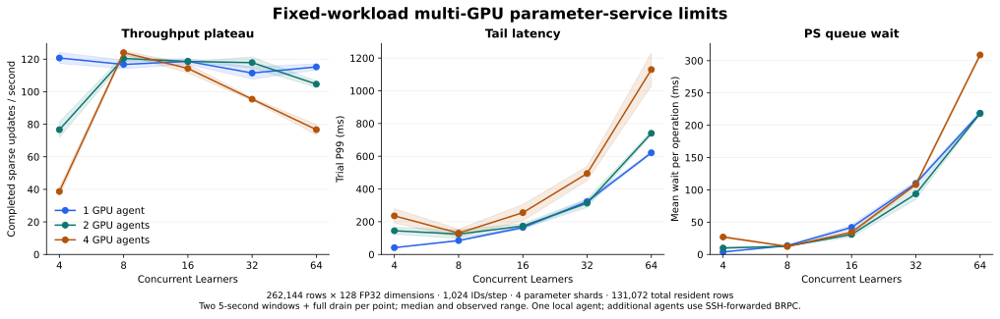
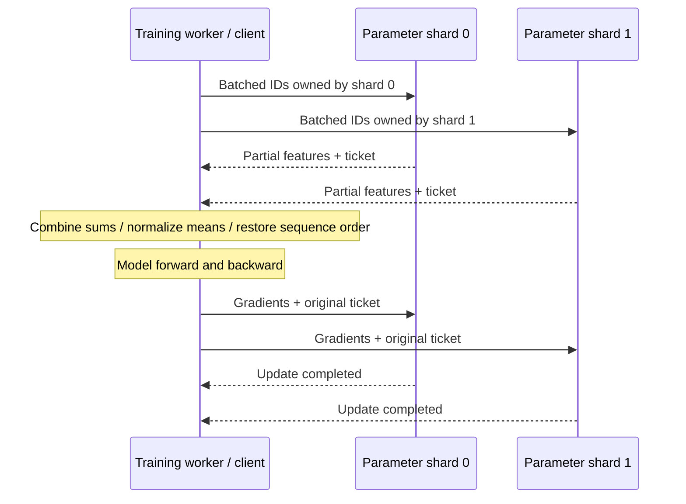
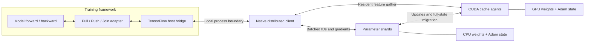

# Distributed Parameter Server

**Distributed storage, access and updates for machine-learning parameters.**

Training workers pull the parameters needed for a batch and push gradients back
for updates. Distributed Parameter Server partitions those parameters across
server shards and manages batched access and optimizer state. GPU workers cache
complete parameter rows and execute resident pooling and sparse updates.

The first implementation targets sparse access to embedding tables: each batch
touches only a small fraction of a large table. This pattern appears in
recommendation, advertising, knowledge graphs, graph learning and word-embedding
models.

A Pull/Push/Join adapter connects embedding operations to an existing training
framework. The supplied TensorFlow bridge uses stateful host callbacks and an
isolated native RPC client. Dataset readers, model computation and dense gradient
synchronization remain the training framework's responsibility.

[Named Entropy table and Runner hooks](docs/ENTROPY_TABLE_HOOKS.md) install that
boundary before the existing job entry point builds its graph. Source-level
Session checks execute the original methods against independent parameter shards,
including a mid-run original-controller checkpoint.



**Measured operating envelope (runtime `b6d97d3`):** four RTX A6000 agents sustain **119.62
acknowledged sparse updates/s** with **106.09 ms median trial P99** at eight
concurrent Learners, across three 20-second windows. The one-/two-agent sustained
rates are **117.71 / 127.75 updates/s** under the same total workload and
coordinator. At 64 Learners, four-agent short-sweep throughput falls to **76.67
updates/s** and P99 rises to **1.13 s**. All three topology sizes encounter the
Agent's default in-flight RPC limit during 128-Learner overload probes.

A million-row, 512-dimensional control covers **6 GiB of logical parameter/Adam
state**. Scheduling, hot-shard access, automatic admission and transport controls
locate coordination and communication costs. [Operating points, boundaries and
raw records](docs/CURRENT_MULTIGPU_LIMITS.md).

**Implemented:** independent BRPC parameter shards, cross-shard batching,
sparse LazyAdam with optional weight clipping, CUDA-resident weights and optimizer states, CPU/GPU migration,
generation fencing, bounded lookup tickets, and durable snapshots with optimizer
restore. Pooled gradients travel as feature vectors plus ordered ID references;
CUDA expands and reduces them at their parameter owner. Independent GPU owners
execute updates concurrently. CPU pooling and unique-vector transfer are executable access paths;
a pluggable cost planner selects between them. A TensorFlow graph check exercises
Pull → dense model/loss → sparse Push → Join against external server processes.

**Validation:** the current study retains **86 completed capacity trials /
52,173 updates**, with **2,752 sampled row-counter checks**, finite-state and
live-ticket checks. Three rejected load points retain separate failure records.
The native CPU/CUDA suite passes **22/22**, and each GPU worker passes its CUDA
state/device-result check at that capacity revision. Restore revision `ce17f18`
passes **39/39** native/CUDA/TensorFlow checks and **8/8** additional forced-CUDA
cases. Fresh services resume an original-method training graph from a committed
checkpoint, matching selected parameter/Adam state and dense weights exactly.
All artifacts are fetched and hash-verified before
rental deletion. The [validation record](docs/VALIDATION.md) also covers
optimizer-exact restart, TensorFlow integration, sanitizers, fencing, bounded
tickets and failure cleanup at their recorded source revisions.

[Build and run](docs/RUNNING.md) · [Validation](docs/VALIDATION.md) ·
[Implementation progress](docs/plans/2026-10-31-implementation.md)



## Runtime structure



## Service responsibilities

- **Parameter storage:** shard `(table, key)` rows and retain weights and optimizer state.
- **Batched access:** deduplicate requests while preserving bag and sequence positions;
  support sum, mean and ordered sequence features.
- **Sparse updates:** merge repeated-key contributions within the original update
  request and apply its configured sparse optimizer at the current parameter location.
- **Cache management:** coordinate CPU/GPU placement, acknowledged state transfer,
  generation checks and slot reclamation; automatically admit and replace rows
  within configured migration budgets.
- **Framework integration:** return the tensor layouts expected by the existing
  training graph; expose drain, bounded checkpoint export and matched resume for
  periodic saves. The controller commits sparse, dense and input state together.
  [Checkpoint lifecycle](docs/PERIODIC_CHECKPOINTS.md).

## Implemented optimizations

- **Resumable shard operations:** suspend pending cache calls and resume their
  continuations on the shard's single state-owning thread. Independent requests
  can progress; row, optimizer and agent-stream dependencies keep conflicting
  operations ordered. Automatic maintenance upgrades to a barrier at its decision
  window; save/restore retain ordered full barriers.
  [Execution, bounds and validation](docs/RESUMABLE_OPERATIONS.md).
- **Bounded asynchronous input preparation:** prepare future IDs, padding maps
  and shard layouts on one worker while current model/RPC work runs. Count and
  byte limits bound queued work; FIFO tokens are consumed explicitly. Parameter
  reads occur at Pull consumption, preserving the caller's update/read order.
  Eight service phase counters distinguish preparation, optimizer work, owner
  waits and migration. [Lifecycle and metrics](docs/ASYNCHRONOUS_PREPARATION.md).
- **Automatic reuse-aware placement:** track bounded, decayed per-row request
  reuse, admit rows whose predicted savings cover full-state migration, and
  replace lower-benefit residents after a minimum residence interval. Skip rows
  held by live tickets; enforce shared migration budgets and destination-side
  slot reserves. Manual and frequency-window baselines remain selectable.
  [Policy flow, costs and configuration](docs/CACHE_POLICY.md).
- **Destination-aware gathers:** send only the ID positions each destination
  reads and restore sequence positions on return. The default processes replies
  in shard order, starting each shard's cache work before waiting for the next
  reply. Optional cross-shard coalescing merges compatible work and reduces up
  to `shards × GPUs` calls to `GPUs` calls. This trades waiting for every shard
  against fewer calls. Original tickets and update boundaries remain independent.
  Both policies have native and TensorFlow correctness coverage; the plotted
  GPU measurements remain attached to their source revision.
- **Compact sparse-gradient transfer:** send each pooled feature gradient with
  ordered row references and mean scales. The destination GPU reduces those
  contributions into row gradients before Adam. Use expanded gradients when they
  are smaller. The measured numeric gradient payload is **4.3–9.7× smaller** than
  the expanded representation of the same updates at eight Learners.
- **Concurrent owner updates:** dispatch to independent GPU owners concurrently
  while retaining control-command ordering at each owner and the original
  request's optimizer context.
- **Bounded completion waiting:** reserve completion capacity before mutation;
  dedicated waiter threads notify BRPC callbacks when native futures finish.
  Requests no longer poll for completion on a timer.
- **Contiguous state and reusable staging:** preallocate CUDA parameter state and
  staging buffers, batch state transfers and return owning device results.


The payload comparison excludes protocol row identities and headers. CPU-side
validation still runs before the destination GPU reduces the compact payload.
See [benchmark definitions](docs/BENCHMARKS.md#gradient-payload).

## Access and cache policy design

| Optimization | What changes | Why it can accelerate training |
|---|---|---|
| Cost-based access planning | Compare CPU pooling with unique-vector transfer and GPU processing | Reduce traffic without moving the bottleneck into CPU pooling |
| Reuse-aware admission | Account for parameter-state loading and writeback when admitting a row | Avoid one-use insertions and repeated cache churn |
| Migration budgets and slot reserve | Bound in-flight transfer work and prepare reusable capacity early | Reduce bursts and waits for old rows to finish writing back |
| Batched preparation and transfer | Prepare ID routing ahead and coalesce compatible payloads | Reduce allocation, scheduling and small-message overhead |

The access planner, automatic admission/replacement controller and migration
budgets and asynchronous input preparation are implemented. Decisions currently
execute in coarse windows under a shard barrier. Agent waits suspend the actor;
independent work can proceed outside maintenance/save barriers. The [acceleration design](docs/ACCELERATION.md) explains the
choices and costs.

## Shard scheduling


At one parameter shard and 32 concurrent Learners, caching queued dependency
plans increases throughput from **67.69 to 94.50 updates/s** in a same-binary
cache-on/off comparison. Dependency preparation falls from **10.28 to 0.82 ms per
completed update**, while trial P99 falls from **708.21 to 396.30 ms**.

The latest single-A6000 deployment retains **70 capacity trials and 25,990
updates**, with zero training-update errors. Serialized/resumable controls retain
mixed results across shard counts and automatic policies: one-shard manual loads
improve by 5.3–10.6%, while some automatic-maintenance configurations regress.
The [scheduling report](docs/SCHEDULING_RESULTS.md) separates the cache ablation,
concurrency controls, numerical replay and earlier uncached implementation.

## Measured cache-policy behavior


In the 2,048-ID shifted-hot-set profile, reuse-cost placement completes **103.90
updates/s** with **14.80 ms median trial P99**, versus **71.16 updates/s** and
**42.62 ms** for frequency placement. Calibration selects a zero admission-savings
prior in this profile, avoiding new full-state migrations; static placement
reaches 106.28 updates/s. The report also includes CPU-only baselines and a larger
8,192-ID profile. [Two-profile results, costs and raw records](docs/CACHE_POLICY_RESULTS.md).

## Design and code map

- [Service architecture](docs/ARCHITECTURE.md)
- [API and integration](docs/API.md)
- [中文项目说明](docs/ARCHITECTURE.zh-CN.md)
- [Application families and sources](docs/APPLICATIONS.md)
- [Design decisions](docs/adr/README.md)
- [Implementation plan](docs/plans/2026-10-31-implementation.md)
- [Project scope and provenance](docs/PROVENANCE.md)

```text
include/eps/       C++20 service and cache-agent contracts
src/store/         Chunked row storage and durable binary snapshots
src/access/        Deduplicated lookup and feature-gradient reduction
src/update/        Sparse LazyAdam validation and updates
src/server/        Bounded shard executor and standalone server
src/transport/     BRPC services, client and attachment codec
src/client/        Cross-shard routing, pooling and sequence reconstruction
src/cache/         Agent control, host reference backend and cost planner
src/cuda/          Resident pooling, sparse Adam and batched state transfers
adapters/entropy/  C++ Pull/Push/Join adapter and portable TensorFlow bridge
proto/            Service protocol
configs/          Example service/integration configuration
tests/            Core, CUDA, TensorFlow, recovery and capacity probes
scripts/          GPU build and process/fleet capacity sweeps
docs/             Architecture, rationale and delivery plan
references/       Local reference collection guide
```

The implementation is designed around **C++20**, **BRPC/Protobuf** and contiguous
parameter-state storage. The C++ agent can run inside a compatible training worker
or as a standalone process. The supplied portable TensorFlow bridge isolates
BRPC's binary dependencies in a local client process; feature tensors cross a
host-memory boundary. The C++ CUDA API also returns owning device tensors for
native callers. Clients use the same table/key/gradient contract across tasks.

The [adapter guide](adapters/entropy/README.md) describes integration and gradient
conventions. The [implementation plan](docs/plans/2026-10-31-implementation.md)
tracks completed subsystems, original-framework native integration and integrated
workload evaluation.

## References

1. Li, M., et al. *Scaling Distributed Machine Learning with the Parameter Server.*
   OSDI, 2014. [Paper](https://www.usenix.org/conference/osdi14/technical-sessions/presentation/li_mu).
2. Zheng, D., et al. *DGL-KE: Training Knowledge Graph Embeddings at Scale.* SIGIR, 2020.
   [Paper](https://www.amazon.science/publications/dgl-ke-training-knowledge-graph-embeddings-at-scale).
3. PyTorch. *FBGEMM: Table Batched Embedding Training Module.*
   [Documentation](https://docs.pytorch.org/FBGEMM/fbgemm_gpu/python-api/tbe_ops_training.html).

Original project contributions use [PolyForm Noncommercial 1.0.0](LICENSE).
See [NOTICE](NOTICE) for attribution. Local upstream source and internal reference
material are excluded from version control.
