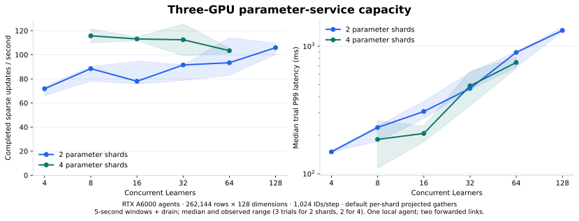
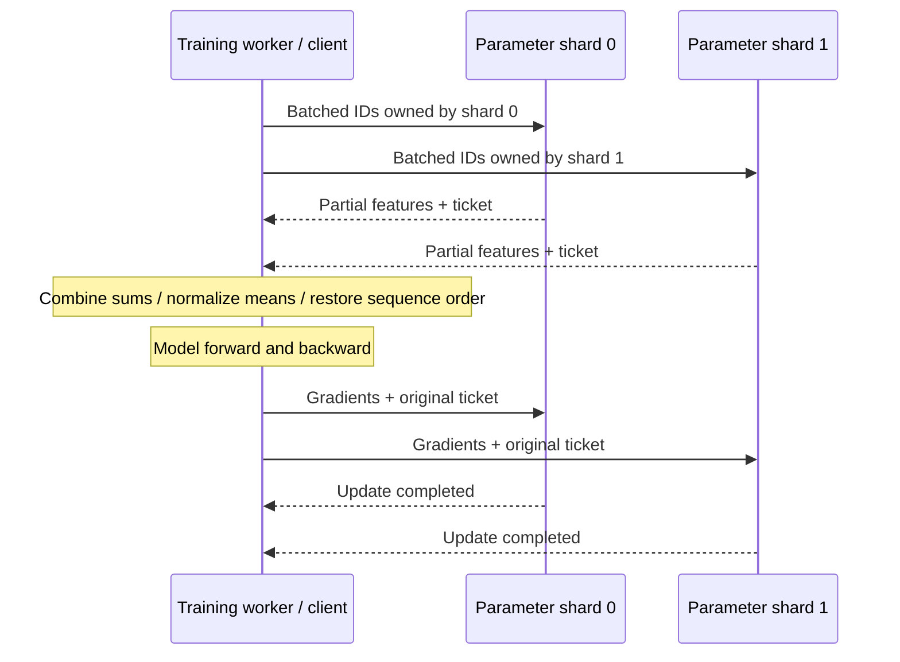
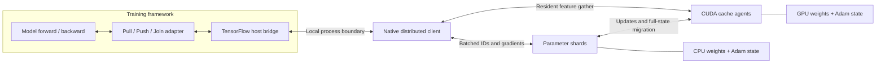

# Distributed Parameter Server

**Distributed storage, access and updates for machine-learning parameters.**

Training workers pull the parameters needed for a batch and push gradients back
for updates. Distributed Parameter Server partitions those parameters across
server shards and manages batched access and optimizer state. GPU workers cache
complete parameter rows and execute resident pooling and sparse updates.

The first implementation targets sparse access to embedding tables: each batch
touches only a small fraction of a large table. This pattern appears in
recommendation, advertising, knowledge graphs, graph learning and word-embedding
models.

A Pull/Push/Join adapter connects embedding operations to an existing training
framework. The supplied TensorFlow bridge uses stateful host callbacks and an
isolated native RPC client. Dataset readers, model computation and dense gradient
synchronization remain the training framework's responsibility.



**Measured capacity:** three RTX A6000 agents, four parameter shards and eight
concurrent Learners sustain **122.95 completed sparse updates/s** with **104.93 ms
median trial P99** across three 30-second trials: **10,841 updates, zero errors**.
Higher shard counts and concurrency expose the service's communication and
queueing limits. A million-row, 512-dimensional control exercises **6 GiB of
logical parameter/Adam state** and reaches approximately **109–111 thousand input
ID occurrences/s** including acknowledged updates. The measurements use synthetic
gradients over the sparse parameter path, with one local and two SSH-forwarded
GPU agents. [Capacity curves, paired comparisons and raw records](docs/BENCHMARKS.md).

**Implemented:** independent BRPC parameter shards, cross-shard batching,
sparse LazyAdam, CUDA-resident weights and optimizer states, CPU/GPU migration,
generation fencing, bounded lookup tickets, and durable snapshots with optimizer
restore. Pooled gradients travel as feature vectors plus ordered ID references;
CUDA expands and reduces them at their parameter owner. Independent GPU owners
execute updates concurrently. CPU pooling and unique-vector transfer are executable access paths;
a pluggable cost planner selects between them. A TensorFlow graph check exercises
Pull → dense model/loss → sparse Push → Join against external server processes.

**Validation:** the current macOS native/RPC/TensorFlow suite passes **19/19**,
and the core ASan/UBSan suite passes **9/9**. Automatic replacement, reserved
capacity, pins, failure fallback and optimizer-exact restart are covered by
native and external-process reference checks. CUDA state, migration and restore
were verified on L40/A6000 at the GPU benchmark revisions. See the
[validation record](docs/VALIDATION.md).

[Build and run](docs/RUNNING.md) · [Validation](docs/VALIDATION.md) ·
[Implementation progress](docs/plans/2026-10-31-implementation.md)



## Runtime structure



## Service responsibilities

- **Parameter storage:** shard `(table, key)` rows and retain weights and optimizer state.
- **Batched access:** deduplicate requests while preserving bag and sequence positions;
  support sum, mean and ordered sequence features.
- **Sparse updates:** merge repeated-key contributions within the original update
  request and apply its configured sparse optimizer at the current parameter location.
- **Cache management:** coordinate CPU/GPU placement, acknowledged state transfer,
  generation checks and slot reclamation; automatically admit and replace rows
  within configured migration budgets.
- **Framework integration:** return the tensor layouts expected by the existing
  training graph and expose a drain/flush operation for its save lifecycle.

## Implemented optimizations

- **Automatic reuse-aware placement:** track bounded, decayed per-row request
  reuse, admit rows whose predicted savings cover full-state migration, and
  replace lower-benefit residents after a minimum residence interval. Skip rows
  held by live tickets; enforce shared migration budgets and destination-side
  slot reserves. Manual and frequency-window baselines remain selectable.
  [Policy flow, costs and configuration](docs/CACHE_POLICY.md).
- **Destination-aware gathers:** send only the ID positions each destination
  reads and restore sequence positions on return. The default processes replies
  in shard order, starting each shard's cache work before waiting for the next
  reply. Optional cross-shard coalescing merges compatible work and reduces up
  to `shards × GPUs` calls to `GPUs` calls. This trades waiting for every shard
  against fewer calls. Original tickets and update boundaries remain independent.
  Both policies have native and TensorFlow correctness coverage; the plotted
  GPU measurements remain attached to their source revision.
- **Compact sparse-gradient transfer:** send each pooled feature gradient with
  ordered row references and mean scales. The destination GPU reduces those
  contributions into row gradients before Adam. Use expanded gradients when they
  are smaller. The measured numeric gradient payload is **4.3–9.7× smaller** than
  the expanded representation of the same updates at eight Learners.
- **Concurrent owner updates:** dispatch to independent GPU owners concurrently
  while retaining control-command ordering at each owner and the original
  request's optimizer context.
- **Bounded completion waiting:** reserve completion capacity before mutation;
  dedicated waiter threads notify BRPC callbacks when native futures finish.
  Requests no longer poll for completion on a timer.
- **Contiguous state and reusable staging:** preallocate CUDA parameter state and
  staging buffers, batch state transfers and return owning device results.


The payload comparison excludes protocol row identities and headers. CPU-side
validation still runs before the destination GPU reduces the compact payload.
See [benchmark definitions](docs/BENCHMARKS.md#gradient-payload).

## Access and cache policy design

| Optimization | What changes | Why it can accelerate training |
|---|---|---|
| Cost-based access planning | Compare CPU pooling with unique-vector transfer and GPU processing | Reduce traffic without moving the bottleneck into CPU pooling |
| Reuse-aware admission | Account for parameter-state loading and writeback when admitting a row | Avoid one-use insertions and repeated cache churn |
| Migration budgets and slot reserve | Bound in-flight transfer work and prepare reusable capacity early | Reduce bursts and waits for old rows to finish writing back |
| Batched preparation and transfer | Prepare ID routing ahead and coalesce compatible payloads | Reduce allocation, scheduling and small-message overhead |

The access planner, automatic admission/replacement controller and migration
budgets are implemented. Decisions currently execute in coarse windows on the
shard sequencer; asynchronous preparation and nonblocking agent waits remain
scheduling work. The [acceleration design](docs/ACCELERATION.md) explains the
choices and costs.

## Design and code map

- [Service architecture](docs/ARCHITECTURE.md)
- [API and integration](docs/API.md)
- [中文项目说明](docs/ARCHITECTURE.zh-CN.md)
- [Application families and sources](docs/APPLICATIONS.md)
- [Design decisions](docs/adr/README.md)
- [Implementation plan](docs/plans/2026-10-31-implementation.md)
- [Project scope and provenance](docs/PROVENANCE.md)

```text
include/eps/       C++20 service and cache-agent contracts
src/store/         Chunked row storage and durable binary snapshots
src/access/        Deduplicated lookup and feature-gradient reduction
src/update/        Sparse LazyAdam validation and updates
src/server/        Bounded shard executor and standalone server
src/transport/     BRPC services, client and attachment codec
src/client/        Cross-shard routing, pooling and sequence reconstruction
src/cache/         Agent control, host reference backend and cost planner
src/cuda/          Resident pooling, sparse Adam and batched state transfers
adapters/entropy/  C++ Pull/Push/Join adapter and portable TensorFlow bridge
proto/            Service protocol
configs/          Example service/integration configuration
tests/            Core, CUDA, TensorFlow, recovery and capacity probes
scripts/          GPU build and process/fleet capacity sweeps
docs/             Architecture, rationale and delivery plan
references/       Local reference collection guide
```

The implementation is designed around **C++20**, **BRPC/Protobuf** and contiguous
parameter-state storage. The C++ agent can run inside a compatible training worker
or as a standalone process. The supplied portable TensorFlow bridge isolates
BRPC's binary dependencies in a local client process; feature tensors cross a
host-memory boundary. The C++ CUDA API also returns owning device tensors for
native callers. Clients use the same table/key/gradient contract across tasks.

The [adapter guide](adapters/entropy/README.md) describes integration and gradient
conventions. The [implementation plan](docs/plans/2026-10-31-implementation.md)
tracks automatic-policy GPU validation, asynchronous preparation and integrated
workload evaluation.

## References

1. Li, M., et al. *Scaling Distributed Machine Learning with the Parameter Server.*
   OSDI, 2014. [Paper](https://www.usenix.org/conference/osdi14/technical-sessions/presentation/li_mu).
2. Zheng, D., et al. *DGL-KE: Training Knowledge Graph Embeddings at Scale.* SIGIR, 2020.
   [Paper](https://www.amazon.science/publications/dgl-ke-training-knowledge-graph-embeddings-at-scale).
3. PyTorch. *FBGEMM: Table Batched Embedding Training Module.*
   [Documentation](https://docs.pytorch.org/FBGEMM/fbgemm_gpu/python-api/tbe_ops_training.html).

Original project contributions use [PolyForm Noncommercial 1.0.0](LICENSE).
See [NOTICE](NOTICE) for attribution. Local upstream source and internal reference
material are excluded from version control.
