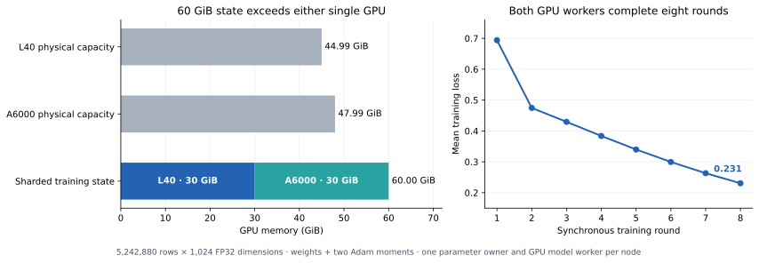
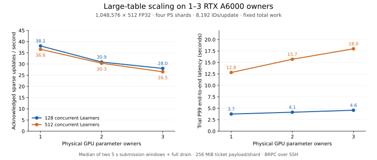
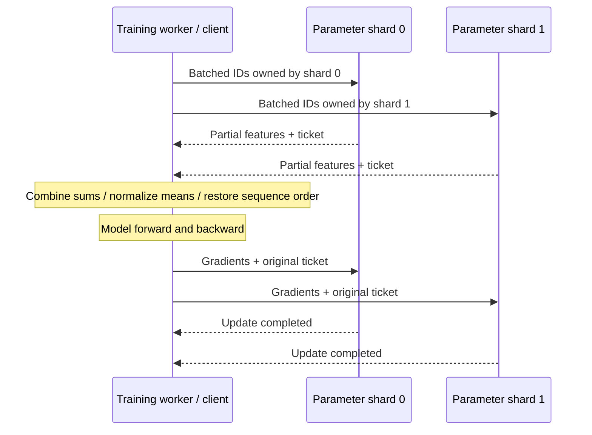
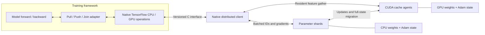
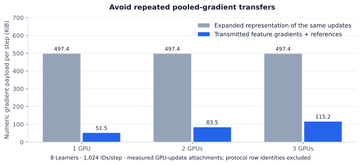
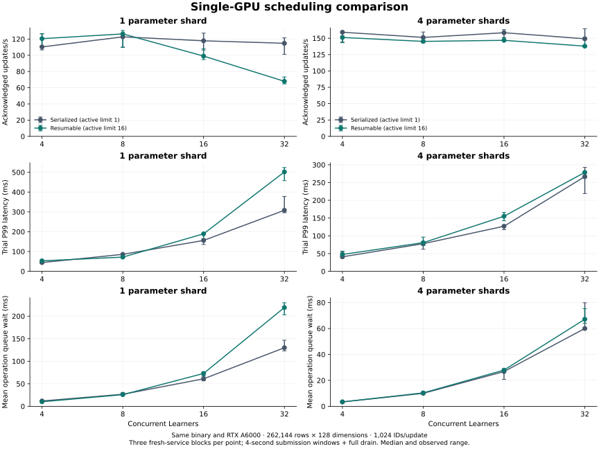
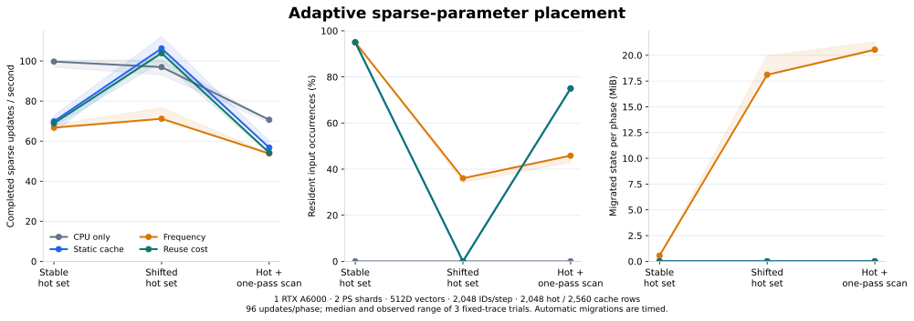

# Distributed Parameter Server

**Sharded parameter storage and optimizer updates for distributed training.**

Training workers pull the parameters needed for a batch and push gradients back
for updates. Distributed Parameter Server partitions those parameters across
server shards and manages batched access and optimizer state. GPU parameter
owners hold complete rows and execute resident pooling and sparse updates.

[Distributed training execution](docs/TRAINING_EXECUTION.md) is the central
implementation track: worker task dependencies, gradient/update semantics,
logical progress, replication and recovery, evaluated at a common quality
target. A standalone RPC coordinator now enforces sequential, eventual and
bounded-delay task admission across worker processes. Four independent workers
train a shared sparse model through two parameter-server processes, with task
completion following acknowledged parameter updates. Synchronous rounds now
support replica-backed primary recovery with retained-gradient retries. Complete
original Entropy execution and the remaining failure paths are tracked in the
implementation plan.

The first implementation targets sparse access to embedding tables: each batch
touches only a small fraction of a large table. This pattern appears in
recommendation, advertising, knowledge graphs, graph learning and word-embedding
models.

The principal multi-GPU scenario is training when parameter and optimizer state
exceeds one GPU's memory. The service partitions embedding rows across GPU
owners; workers pull required vectors, run GPU forward/backward and return
sparse gradients to the corresponding owners.



**Executed capacity:** two physical GPU nodes—L40 and RTX A6000—hold **60 GiB
of initialized, resident parameter/Adam state**, with **30 GiB per owner**.
The larger single GPU exposes 47.99 GiB. Both workers finish eight synchronous
rounds and mean training loss decreases from **0.694 to 0.231**. The workload
uses 5.24 million rows × 1,024 FP32 dimensions and a two-layer MLP. A preceding
small cross-node run matches reference parameters/Adam state within `8.94e-7`.
[Workload, memory placement and validation](docs/MULTIGPU_TRAINING_CAPACITY.md).

[Synchronous gradient rounds](docs/SYNCHRONOUS_GRADIENTS.md) collect one sparse
contribution per worker at each parameter shard, combine matching Keys and apply
one optimizer update per round. Worker and sample-weighted averaging support
different training batch sizes, including empty shard contributions.

[TensorFlow model workers](docs/TENSORFLOW_SHARDED_TRAINING.md) train both
Embedding vectors and two-layer MLP weights/biases through this shared parameter
path. CPU and A6000 GPU runs compare aggregated gradients, complete touched
weights/Adam state, task progress and loss against a single-worker reference.
The GPU execution currently uses host staging at the RPC boundary.

[Reusable Lookup layouts](docs/REUSABLE_LOOKUP_LAYOUTS.md) register repeated ID
lists and CSR layouts once per shard, then send scoped tokens for fresh reads.
Bounded LRU/TTL registries and same-request fallback preserve parameter and
ticket semantics through metadata eviction or registry restart.

[Joint training checkpoints](docs/JOINT_TRAINING_CHECKPOINT.md) restore parameters,
Adam state, gradient rounds, completed worker clocks and the next input batch
together. New processes start paused, rehydrate existing rows on their owners
and reopen training after all shard identities and clocks match.

[Replicated training updates](docs/REPLICATED_TRAINING.md) persist exact updated
parameters, Adam state and request progress on an independent disk-backed replica
before acknowledging a synchronous round. A replacement primary restores that
state under a new durable term; workers retain and retry their original gradients.
Two CPU model-training fault cases cover a lost commit acknowledgement and an
unpublished update, with zero final state/loss difference from uninterrupted
training. [Read-lifecycle recovery](docs/READ_LIFECYCLE_RECOVERY.md) closes uncertain
cross-shard Pulls by request identity, fences late reads and retries partial
Release acknowledgements before admitting another model read. Failed cleanup
requires job recovery; partially applied gradient updates keep their existing
failure contract.

[Worker/coordinator recovery](docs/WORKER_RECOVERY.md) journals original gradients
before submission, rolls a partially committed round forward and reconstructs
task clocks and input positions. CPU model checks restart actual process groups
after an abandoned read, a partial commit and a lost task completion, preserving
all parameters, Adam state and per-round loss.

[Worker journal handoff](docs/WORKER_JOURNAL_HANDOFF.md) seals stopped workers'
original gradients, transfers bounded chunks over persistent node connections
and publishes complete journals on replacement nodes. Model recovery checks
fetch to manager storage, reconcile partial rounds and stage independent worker
copies before continuing the same training input.

[Worker gradient replicas](docs/WORKER_GRADIENT_REPLICAS.md) durably copy each
original gradient to another node before parameter submission. Across two
A6000 GPU instances, three fault cases delete both worker-local journals,
recover from opposite-node replicas and complete eight rounds. All 64 rows'
weights/Adam state and per-round losses match uninterrupted GPU training exactly.

[Managed training recovery](docs/MANAGED_TRAINING_RECOVERY.md) starts and observes
named role generations, detects process failure and drives replica promotion,
owner rehydration, journal handoff and worker continuation. Durable manager phases
support reentry after journal staging; distinct TCP aliases verify translation
between worker-visible and manager-visible parameter endpoints.

[Owner incarnations](docs/OWNER_INCARNATIONS.md) separate the stable training run
from a replacement parameter owner's identity. Old reads and control commands
reject at the replacement endpoint while optimizer updates retain their original
model identity. [Replica-backed owner recovery](docs/REPLICA_OWNER_RECOVERY.md)
reloads complete row/Adam state into replacement owners before rolling partial
rounds forward. Host and L40 CUDA training checks replace all roles and match uninterrupted
parameters and loss exactly. The CUDA recovery check uses two owner processes
on one physical GPU; cross-node capacity is recorded separately.

[Node orchestration](docs/DISTRIBUTED_MODEL_TRAINING.md) places a parameter shard,
owner and model worker on each node, initializes local backing/resident rows,
samples resources and verifies round completion and process cleanup. Its Host-backed workflow and two-node CUDA capacity execution pass, including
complete residency counts, GPU model placement and verified process cleanup.

A [native worker owner](docs/WORKER_AGENT.md) embeds the Agent in the training
process. [Device Pull](docs/DEVICE_PULL.md) combines CPU, native CUDA and remote
Agent contributions into complete model features on GPU, including global mean
normalization and padded sequences. It retains the existing Pull/Push/Join
handles; the standalone Agent uses the same worker ownership and admission path.

A Pull/Push/Join adapter connects embedding operations to an existing training
framework. [Native TensorFlow CPU/CUDA operations](docs/NATIVE_TENSORFLOW.md)
return complete feature tensors directly to the model and submit its automatic
gradients to the service. A versioned C interface isolates private transport
dependencies from TensorFlow's ABI. A portable callback bridge is also available.
Dataset readers, model computation and dense gradient synchronization remain the
training framework's responsibility.

[Named Entropy table and Runner hooks](docs/ENTROPY_TABLE_HOOKS.md) install that
boundary before the existing job entry point builds its graph. Source-level
Session checks execute the original methods against independent parameter shards,
including a mid-run original-controller checkpoint.
[Native table installation](docs/NATIVE_TABLE_INSTALLATION.md) selects Eps
operations through the same job configuration, with one shared context per
learner and an early-started GPU owner per worker.
[Public Redis SDK integration](docs/PUBLIC_REDIS_SDK.md) supplies the original
shared wrapper's missing client interfaces using real Redis commands. Binary
batch results, TTL, timeouts and lost-reply behavior are process-tested; the
original native dependency graph resolves. [Original framework integration](docs/ORIGINAL_NATIVE_BUILD.md)
is progressing through Linux C++/CUDA compilation and a matching Python-runtime
build; complete framework execution remains a separate acceptance check.
[Peer-coordinated checkpoints](docs/PEER_CHECKPOINTS.md) also support a chief
without an external learner table; two-process/four-thread checks cover repeated
commit, admission control and a failed model save.



**Measured operating envelope:** a fixed million-row, 512-dimensional table
represents **6 GiB of logical parameter/Adam state**. With 8,192 IDs/update and
512 concurrent Learners, one/two/three RTX A6000 owners complete
**36.56 / 30.33 / 26.52 acknowledged sparse updates/s**, with median trial P99
**12.82 / 15.70 / 17.99 seconds**. These are medians of two five-second submission
windows followed by full drain, using four parameter shards and SSH-forwarded
BRPC between cloud instances. More owners add communication and coordination
cost in this deployment. [Scaling, overload and raw measurements](docs/OVERLOAD_SCHEDULING.md).

**Observable overload:** bounded dependency-plan retention and an independent
statistics path keep parameter shards inspectable while data operations wait.
The 256 MiB/shard lookup-ticket budget produces an explicit capacity rejection
at 1,022 large-input Learners; the failed cohort's tickets and Agent queues drain.
With 512 MiB/shard, single-owner and three-owner controls complete
1,022-Learner windows; the three-owner trial records **23.61 updates/s** and
**35.47 s P99**.
[Earlier 1/2/4-owner measurements](docs/NATIVE_MULTIGPU_RESULTS.md) retain their
runtime, longer-duration small-input results and original overload failures.

**Implemented:** independent BRPC parameter shards, cross-shard batching,
sparse LazyAdam with optional weight clipping, CUDA-resident weights and optimizer states, CPU/GPU migration,
generation fencing, bounded lookup tickets, Agent-wide RPC admission, and durable snapshots with optimizer
restore. Pooled gradients travel as feature vectors plus ordered ID references;
CUDA expands and reduces them at their parameter owner. Independent GPU owners
execute updates concurrently. CPU pooling and unique-vector transfer are executable access paths;
a pluggable cost planner selects between them. A TensorFlow graph check exercises
Pull → dense model/loss → sparse Push → Join against external server processes.

**Validation:** completed pressure-test windows inspect finite sampled weights,
exact sampled row-update counters and drained lookup/Agent queues. Native model
checks separately compare complete touched optimizer state. The Ubuntu
TensorFlow/CUDA integration suite passes **56/56** with the recorded original-method
source fixture. Five follow-up checks verify CPU-only controller Sessions,
shared contexts, original native CPU/GPU table graphs and checkpoint continuation.
Native table graphs contain no Python callback operations. Native restore compares
all selected weights, Adam moments, counters and beta powers with zero difference.
[Native table checks and scope](docs/validation/2026-11-01-native-table-installation.json).
Pinned multi-owner model traces separately cover **1/2/3 physical GPU parameter
owners**, with an earlier four-owner trajectory.
[Native integration checks](docs/NATIVE_TENSORFLOW.md#executed-verification).
Device Pull follows
five training steps across two shards and mixed native/remote cache paths,
comparing complete features and all touched optimizer rows with CPU replay.
The core ASan/UBSan suite passes **18/18**.
[Device Pull verification](docs/validation/2026-11-01-device-pull.json).
The admission component passes ASan/UBSan and
ThreadSanitizer checks. [Validation index](docs/validation/2026-11-01-agent-admission.json).
The [validation record](docs/VALIDATION.md) retains the scope and provenance of
checkpoint continuation, optimizer-state comparisons, migration and fencing.

[Build and run](docs/RUNNING.md) · [Validation](docs/VALIDATION.md) ·
[Implementation progress](docs/plans/2026-10-31-implementation.md)



## Runtime structure



## Service responsibilities

- **Parameter storage:** shard `(table, key)` rows and retain weights and optimizer state.
- **Batched access:** deduplicate requests while preserving bag and sequence positions;
  support sum, mean and ordered sequence features.
- **Sparse updates:** merge repeated-key contributions within the original update
  request and apply its configured sparse optimizer at the current parameter location.
- **Cache management:** coordinate CPU/GPU placement, acknowledged state transfer,
  generation checks and slot reclamation; automatically admit and replace rows
  within configured migration budgets.
- **Framework integration:** return the tensor layouts expected by the existing
  training graph; expose drain, bounded checkpoint export and matched resume for
  periodic saves. The controller commits sparse, dense and input state together.
  [Checkpoint lifecycle](docs/PERIODIC_CHECKPOINTS.md).

## Implemented optimizations

- **Resumable shard operations:** suspend pending cache calls and resume their
  continuations on the shard's single state-owning thread. Independent requests
  can progress; row, optimizer and agent-stream dependencies keep conflicting
  operations ordered. Automatic maintenance upgrades to a barrier at its decision
  window; save/restore retain ordered full barriers.
  [Execution, bounds and validation](docs/RESUMABLE_OPERATIONS.md).
- **Bounded asynchronous input preparation:** prepare future IDs, padding maps
  and shard layouts on one worker while current model/RPC work runs. Count and
  byte limits bound queued work; FIFO tokens are consumed explicitly. Parameter
  reads occur at Pull consumption, preserving the caller's update/read order.
  Eight service phase counters distinguish preparation, optimizer work, owner
  waits and migration. [Lifecycle and metrics](docs/ASYNCHRONOUS_PREPARATION.md).
- **Automatic reuse-aware placement:** track bounded, decayed per-row request
  reuse, admit rows whose predicted savings cover full-state migration, and
  replace lower-benefit residents after a minimum residence interval. Skip rows
  held by live tickets; enforce shared migration budgets and destination-side
  slot reserves. Manual and frequency-window baselines remain selectable.
  [Policy flow, costs and configuration](docs/CACHE_POLICY.md).
- **Destination-aware gathers:** send only the ID positions each destination
  reads and restore sequence positions on return. The default processes replies
  in shard order, starting each shard's cache work before waiting for the next
  reply. Optional cross-shard coalescing merges compatible work and reduces up
  to `shards × GPUs` calls to `GPUs` calls. This trades waiting for every shard
  against fewer calls. Original tickets and update boundaries remain independent.
  Both policies have native and TensorFlow correctness coverage; the plotted
  GPU measurements remain attached to their source revision.
- **Compact sparse-gradient transfer:** send each pooled feature gradient with
  ordered row references and mean scales. The destination GPU reduces those
  contributions into row gradients before Adam. Use expanded gradients when they
  are smaller. The measured numeric gradient payload is **4.3–9.7× smaller** than
  the expanded representation of the same updates at eight Learners.
- **Concurrent owner updates:** dispatch to independent GPU owners concurrently
  while retaining control-command ordering at each owner and the original
  request's optimizer context.
- **Bounded completion waiting:** reserve completion capacity before mutation;
  dedicated waiter threads notify BRPC callbacks when native futures finish.
  Requests no longer poll for completion on a timer.
- **Agent-wide RPC admission:** dispatch at most 32 unfinished operations per
  owner and retain waiting work within count/byte budgets. Permits cover backend
  completion and response encoding. [Admission design](docs/AGENT_ADMISSION.md).
- **Contiguous state and reusable staging:** preallocate CUDA parameter state and
  staging buffers, batch state transfers and return owning device results.



The payload comparison excludes protocol row identities and headers. CPU-side
validation still runs before the destination GPU reduces the compact payload.
See [benchmark definitions](docs/BENCHMARKS.md#gradient-payload).

## Access and cache policy design

| Optimization | What changes | Why it can accelerate training |
|---|---|---|
| Cost-based access planning | Compare CPU pooling with unique-vector transfer and GPU processing | Reduce traffic without moving the bottleneck into CPU pooling |
| Reuse-aware admission | Account for parameter-state loading and writeback when admitting a row | Avoid one-use insertions and repeated cache churn |
| Migration budgets and slot reserve | Bound in-flight transfer work and prepare reusable capacity early | Reduce bursts and waits for old rows to finish writing back |
| Batched preparation and transfer | Prepare ID routing ahead and coalesce compatible payloads | Reduce allocation, scheduling and small-message overhead |

The access planner, automatic admission/replacement controller and migration
budgets and asynchronous input preparation are implemented. Decisions currently
execute in coarse windows under a shard barrier. Agent waits suspend the actor;
independent work can proceed outside maintenance/save barriers. The [acceleration design](docs/ACCELERATION.md) explains the
choices and costs.

## Shard scheduling



At one parameter shard and 32 concurrent Learners, caching queued dependency
plans increases throughput from **67.69 to 94.50 updates/s** in a same-binary
cache-on/off comparison. Dependency preparation falls from **10.28 to 0.82 ms per
completed update**, while trial P99 falls from **708.21 to 396.30 ms**.

The latest single-A6000 deployment retains **70 capacity trials and 25,990
updates**, with zero training-update errors. Serialized/resumable controls retain
mixed results across shard counts and automatic policies: one-shard manual loads
improve by 5.3–10.6%, while some automatic-maintenance configurations regress.
The [scheduling report](docs/SCHEDULING_RESULTS.md) separates the cache ablation,
concurrency controls, numerical replay and earlier uncached implementation.

## Measured cache-policy behavior



In the 2,048-ID shifted-hot-set profile, reuse-cost placement completes **103.90
updates/s** with **14.80 ms median trial P99**, versus **71.16 updates/s** and
**42.62 ms** for frequency placement. Calibration selects a zero admission-savings
prior in this profile, avoiding new full-state migrations; static placement
reaches 106.28 updates/s. The report also includes CPU-only baselines and a larger
8,192-ID profile. [Two-profile results, costs and raw records](docs/CACHE_POLICY_RESULTS.md).

## Design and code map

- [Service architecture](docs/ARCHITECTURE.md)
- [API and integration](docs/API.md)
- [中文项目说明](docs/ARCHITECTURE.zh-CN.md)
- [Application families and sources](docs/APPLICATIONS.md)
- [Design decisions](docs/adr/README.md)
- [Implementation plan](docs/plans/2026-10-31-implementation.md)
- [Project scope and provenance](docs/PROVENANCE.md)

```text
include/eps/       C++20 service and cache-agent contracts
src/store/         Chunked row storage and durable binary snapshots
src/access/        Deduplicated lookup and feature-gradient reduction
src/update/        Sparse LazyAdam validation and updates
src/server/        Bounded shard executor and standalone server
src/transport/     BRPC services, client and attachment codec
src/client/        Cross-shard routing, pooling and sequence reconstruction
src/cache/         Agent control, host reference backend and cost planner
src/cuda/          Resident pooling, sparse Adam and batched state transfers
adapters/entropy/  C++ Pull/Push/Join adapter and portable TensorFlow bridge
proto/            Service protocol
configs/          Example service/integration configuration
tests/            Core, CUDA, TensorFlow, recovery and capacity probes
scripts/          GPU build and process/fleet capacity sweeps
docs/             Architecture, rationale and delivery plan
references/       Local reference collection guide
```

The implementation is designed around **C++20**, **BRPC/Protobuf** and contiguous
parameter-state storage. The C++ agent can run inside a compatible training worker
or as a standalone process. The supplied portable TensorFlow bridge isolates
BRPC's binary dependencies in a local client process; feature tensors cross a
host-memory boundary. The C++ CUDA API also returns owning device tensors for
native callers. Clients use the same table/key/gradient contract across tasks.

The [adapter guide](adapters/entropy/README.md) describes integration and gradient
conventions. The [implementation plan](docs/plans/2026-10-31-implementation.md)
tracks completed subsystems, original-framework native integration and integrated
workload evaluation.

## References

1. Li, M., et al. *Scaling Distributed Machine Learning with the Parameter Server.*
   OSDI, 2014. [Paper](https://www.usenix.org/conference/osdi14/technical-sessions/presentation/li_mu).
2. Zheng, D., et al. *DGL-KE: Training Knowledge Graph Embeddings at Scale.* SIGIR, 2020.
   [Paper](https://www.amazon.science/publications/dgl-ke-training-knowledge-graph-embeddings-at-scale).
3. PyTorch. *FBGEMM: Table Batched Embedding Training Module.*
   [Documentation](https://docs.pytorch.org/FBGEMM/fbgemm_gpu/python-api/tbe_ops_training.html).

Original project contributions use [PolyForm Noncommercial 1.0.0](LICENSE).
See [NOTICE](NOTICE) for attribution. Local upstream source and internal reference
material are excluded from version control.
