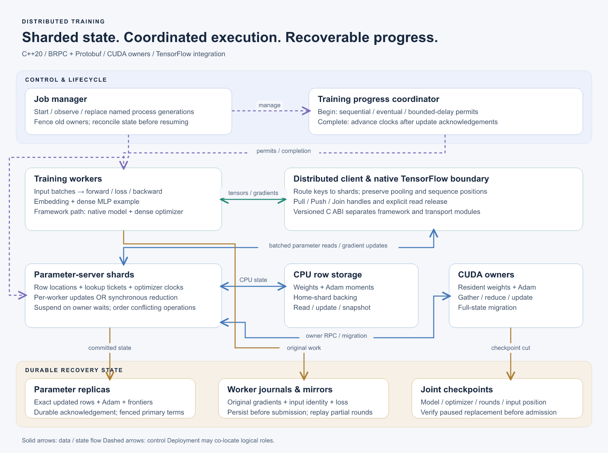

# Distributed Training with a Sharded Parameter Server

A **C++20 distributed training system** with sharded parameter and optimizer state,
CPU/CUDA parameter owners, training-task coordination, and checkpoint/replay recovery.
Workers execute model forward/backward computation; parameter shards own shared
state and apply updates. The runtime connects these roles through BRPC/Protobuf
and native TensorFlow operations.

The executable model trains **embeddings and a dense two-layer MLP** together.
A separate integration runs an existing training framework through its original
application entry point, preserving its reader, model, and dense optimizer while
replacing the embedding parameter backend.

The implementation covers three connected responsibilities:

- **Parameter execution:** route batched reads and gradients, aggregate updates,
  and manage complete parameter/Adam state on CPU and GPU.
- **Training coordination:** enforce iteration dependencies, acknowledge completed
  updates, and manage worker/server process generations.
- **Recovery:** preserve committed state and original gradients, reconcile partial
  rounds, and restore the matching model, optimizer, progress, and input position.

[Build and run](docs/RUNNING.md) · [Training execution](docs/TRAINING_EXECUTION.md) ·
[Validation records](docs/VALIDATION.md) · [中文架构说明](docs/ARCHITECTURE.zh-CN.md)

## System architecture



[Open the scalable SVG](docs/assets/distributed-training-architecture.svg). Solid
arrows show data/state paths; dashed arrows show control. Logical roles can share
one physical host. [Regenerate the diagram](scripts/render_architecture.py).

| Component | Responsibility |
| --- | --- |
| Training worker | Read its input, run forward/backward, submit gradients, and report completion |
| Distributed client | Route `(table, key)` rows to home shards and reconstruct ordered or pooled features |
| Parameter shard | Own row locations, lookup tickets, gradient/update execution, and optimizer clocks |
| CPU/CUDA owner | Store weights and Adam state; execute access and updates at the current location |
| Progress coordinator | Admit iterations according to completed worker clocks |
| Manager | Observe named processes, replace failed generations, and drive recovery |
| Replicas, journals, checkpoints | Retain the state and original work needed to continue training |

These components have separate identities and completion boundaries. A training
permit does not imply a parameter update; a successful update does not itself
advance a worker's task clock. The worker reports completion after all required
parameter acknowledgements.

## One training iteration

1. **Obtain a permit.** The worker asks the coordinator to begin its next iteration.
2. **Pull parameters.** The client partitions keys by home shard. Shards deduplicate
   repeated IDs, resolve CPU/GPU locations, and retain read-lifecycle tickets.
3. **Construct model inputs.** Partial sums are combined, means use the original
   bag denominator, and sequence outputs return to their original positions.
4. **Compute gradients.** TensorFlow executes the model and automatic differentiation.
5. **Submit updates.** Repeated-key gradients are reduced and sent to owning shards.
   Journal-enabled synchronous workers persist and mirror original gradients first.
6. **Finish the round.** Shards apply the configured update, complete any required
   durable replication, and acknowledge. The worker then completes its task.

The ordinary adapter uses a Pull/Push/Join handle lifecycle; read-only work closes
with Release. The synchronous model worker closes read tickets before submitting
its retained row-gradient contributions. Both paths preserve the original input
positions and distinguish read completion from optimizer completion.

[Parameter lifecycle](docs/ARCHITECTURE.md) ·
[Synchronous gradients](docs/SYNCHRONOUS_GRADIENTS.md) ·
[Model worker](docs/TENSORFLOW_SHARDED_TRAINING.md)

## Execution and state management

### Sharded parameters and CPU/GPU ownership

Rows have fixed logical home shards. Their current weights and Adam first/second
moments can reside in CPU storage or a CUDA owner. Migration transfers complete
row state, waits for live references, and publishes a new location/generation
only after acknowledgement. CPU backing for resident rows is refreshed during
writeback and checkpointing.

GPU owners support resident pooling, gradient reduction, optimizer updates, and
batched state transfer. Reuse-aware admission compares expected access savings
with loading and writeback costs; frequency and manual placement remain controls.
Unadmitted rows remain accessible through CPU paths.

[Architecture](docs/ARCHITECTURE.md) · [Placement policy](docs/CACHE_POLICY.md) ·
[Device feature assembly](docs/DEVICE_PULL.md)

### Why access and migration are separate decisions

A CPU-backed bag can be pooled near storage before transfer, or its unique
vectors can be transferred for GPU processing. A long sum/mean bag may shrink
to one feature vector; a sequence must preserve its positions. The access
planner compares these routes while resident rows always use their current
owner. Cache hit rate alone does not capture CPU work, transferred bytes, queue
waits, or migration cost.

Admission changes a row's location, not whether it participates in training.
Loading a row transfers weights and optimizer history; eviction must wait for
live references and acknowledged writeback before reusing its slot. Compact
pooled-gradient transport reduces repeated vectors while preserving occurrence
maps, normalization, and each original update's optimizer context.

[Access and migration rationale](docs/ACCELERATION.md) ·
[Gradient transfer contract](include/eps/compact_gradients.hpp)

### Dependency-aware parameter execution

Each shard has one state-owning thread. Operations suspend while awaiting owner
work and resume on that thread; independent requests can progress during the wait.
Row, optimizer, and owner-stream dependencies preserve conflicting-operation order.
Save/restore and selected maintenance operations use full barriers.

Queued dependency plans are retained within bounded metadata budgets. Lookup
layouts and gradient-key lists can be registered once and reused with scoped
tokens; parameter values and gradient values remain fresh. Independent statistics
completion keeps waiting data operations observable.

[Resumable operations](docs/RESUMABLE_OPERATIONS.md) ·
[Lookup layout reuse](docs/REUSABLE_LOOKUP_LAYOUTS.md) ·
[Gradient layout reuse](docs/REUSABLE_GRADIENT_LAYOUTS.md) ·
[Overload behavior](docs/OVERLOAD_SCHEDULING.md)

### Task dependencies and optimizer semantics

The coordinator supports **sequential, eventual, and bounded-delay admission**
using contiguous completed-worker counts. These policies control iteration
eligibility; they do not define gradient averaging or an atomic cross-shard model
snapshot.

Two update paths are implemented:

| Update path | Optimizer behavior |
| --- | --- |
| Per-worker | Each worker contribution applies its own LazyAdam update; used to compare the three admission policies |
| Synchronous round | Each shard collects the full worker group, reduces matching rows, and applies one update per round; supports sum, worker mean, and sample-weighted mean |

The retained-gradient recovery protocol operates on synchronous group rounds.
Per-worker admission-policy experiments have a separate update contract.

[Progress controller](include/eps/training_progress.hpp) ·
[Policy model experiments](docs/MODEL_CONSISTENCY_POLICIES.md)

## Recovery and continuation

**Parameter replicas preserve the actual update result.** Before acknowledging a
replicated synchronous round, the primary persists exact updated weights, Adam
moments, optimizer clocks, and request progress on an independent disk-backed
replica. Replacement primaries restore these after-images. Durable terms and owner
incarnations reject obsolete primary and owner identities.

**Worker journals preserve the original work.** Workers retain exact gradients,
input identity, read progress, and loss before submission. Cross-node gradient
mirrors allow recovery when worker-local storage is lost. If one shard committed
a round and another did not, replay submits the original gradients: completed
shards acknowledge the existing result and lagging shards finish the update.

**Joint checkpoints preserve the training cut.** Checkpoints bind parameters,
optimizer state, gradient rounds, worker clocks, and input positions. In the
original framework integration, capture also includes prepared batches, pipeline
buffers, ORC reader positions, and original dense/model state. Replacement roles
start paused and reopen training after state and progress checks.

The manager records durable recovery phases, observes process birth identities,
and can adopt existing roles after interruption. Terminal node loss requires
explicit deployment evidence; a connection timeout leaves a node unresolved.
Checkpoint rollover establishes new recovery baselines, and distributed retirement
removes certified old logs only after all participants seal their state and the
manager publishes a durable decision.

[Replicated updates](docs/REPLICATED_TRAINING.md) ·
[Worker recovery](docs/WORKER_RECOVERY.md) ·
[Joint checkpoints](docs/JOINT_TRAINING_CHECKPOINT.md) ·
[Managed recovery](docs/MANAGED_TRAINING_RECOVERY.md) ·
[Physical-node recovery](docs/PHYSICAL_NODE_RECOVERY.md) ·
[Generation retirement](docs/DISTRIBUTED_GENERATION_RETIREMENT.md)

## Framework integration

The native TensorFlow path uses resource and asynchronous CPU/GPU operations for
Pull, Push, preparation, and lifecycle commands. A **versioned C ABI** separates
TensorFlow's operation library from BRPC/Protobuf C++ dependencies. GPU Pull wraps
owned device results in TensorFlow buffers; the RPC gradient path currently uses
host payloads. A portable callback/isolated-client path is also available.

Two model integrations establish different boundaries:

- **Standalone TensorFlow worker:** embedding vectors and packed dense MLP
  weights/biases all live in the parameter service and share its optimizer path.
- **Original framework application:** the original main/Executor, reader, native
  peers, model, and DenseAdam remain active; this project replaces the embedding
  backend and coordinates parameter/progress/input checkpoint continuation.

The model examples exercise dense parameters as well as embeddings. Large dense
collectives and arbitrary-model parallelism are outside the demonstrated service
path. Initial experiments use sparse row access; the model and transport APIs
make that access pattern explicit.

[Native TensorFlow operations](docs/NATIVE_TENSORFLOW.md) ·
[Original application integration](docs/ORIGINAL_NATIVE_BUILD.md) ·
[Original input recovery](docs/ORIGINAL_INPUT_CHECKPOINT.md)

## Verified experiments

[RTX 5090 experiment plan](docs/plans/2026-11-07-5090-sync-async-design.md)
contains setup and baseline commands for comparing synchronous and asynchronous
training on one GPU.

The following are **separate experiments**, each with its own workload and source
record. GPU count, training-state capacity, model correctness, and throughput
measure different properties.

| Experiment | Executed result | Scope |
| --- | --- | --- |
| Cross-node training capacity | L40 + RTX A6000 hold **60 GiB** of initialized GPU-resident parameters/Adam state; two workers complete eight rounds, loss **0.694 → 0.231** | 5,242,880 rows × 1,024 FP32 dimensions; 521 rows touched; 64 touched rows inspected. Establishes capacity beyond either single GPU, not a speedup |
| Numerical reference | Small cross-node training matches sampled complete weights/Adam vectors within **8.94e-7** | Separate deterministic small-model reference; no full 60 GiB reference replay |
| Physical node loss | Delete the L40 at shard frontiers **[4, 3]**; restore on A6000 and finish eight rounds with **zero state/loss difference** from uninterrupted training | All 64 model rows inspected; surviving parameter/gradient replicas retained. This recovery workload fits on the survivor |
| Full original application | Two native peers complete **128 records / 32 batches**; fresh-process recovery replays eight uncommitted sample attempts with no missing/duplicate committed sample marks | One physical A6000; original reader, dense optimizer, and external parameter shards |
| Consistency policies | **36 fresh GPU-model trials** verify three admission policies and reach the common target loss | Two workers on one A6000, CPU parameter shards; target-time ranges overlap, so no repeatable speedup is established |

Reports and machine-readable records:

- [Capacity](docs/MULTIGPU_TRAINING_CAPACITY.md) · [capacity manifest](docs/validation/2026-11-04-multi-gpu-training-capacity.json)
- [Node loss](docs/PHYSICAL_NODE_RECOVERY.md) · [node-loss manifest](docs/validation/2026-11-05-provider-node-loss-recovery.json)
- [Original application replay](docs/ORIGINAL_INPUT_CHECKPOINT.md) · [replay manifest](docs/validation/2026-11-05-original-executor-uncommitted-replay.json)
- [Policy comparison](docs/MODEL_CONSISTENCY_POLICIES.md) · [GPU-policy manifest](docs/validation/2026-11-05-gpu-model-consistency-policies.json)
- [DeepLOB / FI-2010 workload](docs/plans/2026-11-08-order-book-strategy-design.md) · [runnable benchmark](tests/order_book_strategy_workloads.py)

### Parameter-runtime performance

Matched subsystem measurements identify specific costs; their rates are not
end-to-end model-training throughput:

- **Dependency-plan caching:** at one shard and 32 concurrent Learners, a
  same-binary cache-on/off comparison improves **67.69 → 94.50 updates/s** and
  reduces dependency preparation **10.28 → 0.82 ms/update**.
  [Scheduling experiments](docs/SCHEDULING_RESULTS.md).
- **Compact gradient transfer:** numeric gradient payload is **4.3–9.7× smaller**
  than the expanded representation for the recorded eight-Learner workloads;
  row identities and protocol headers are excluded.
  [Payload definitions](docs/BENCHMARKS.md#gradient-payload).
- **Multi-owner scaling:** a fixed large-table deployment records **36.56 / 30.33 /
  26.52 updates/s** with one/two/three A6000 owners. Added communication and
  coordination dominate in that SSH-forwarded deployment.
  [Scaling and overload records](docs/OVERLOAD_SCHEDULING.md).

A separate [fixed-workload model protocol](docs/MODEL_SCALING.md) holds logical
workers, shards, model, and data constant while varying physical placement. Its
[local protocol validation](docs/validation/2026-11-05-fixed-workload-measurement-protocol.json)
uses CPU processes and establishes timing/reentry checks, not physical GPU scaling.

## Build and explore

A dependency-light core build requires C++20, CMake 3.20+, and POSIX file APIs:

```sh
cmake -S . -B build/core -DCMAKE_BUILD_TYPE=Release -DEPS_BUILD_BRPC=OFF
cmake --build build/core -j 4
ctest --test-dir build/core --output-on-failure
```

Network services additionally require BRPC, Protobuf, and nlohmann/json. CUDA
owners require a matching CUDA toolkit; framework workers require the documented
TensorFlow/Python environment. See [build and run](docs/RUNNING.md) for installation,
service configuration, and native integration commands.

To run the distributed model on prepared nodes:

```sh
python scripts/distributed_model_training.py \
  --fleet /private/connected-fleet.json \
  --rows 5242880 --dimension 1024 --hidden 8 \
  --samples 16 --bag 16 --iterations 8 --require-capacity \
  --out results/capacity
```

This capacity command needs two distinct compatible GPU nodes and the memory
checks described in the [deployment guide](docs/DISTRIBUTED_MODEL_TRAINING.md).
Fleet connection details stay outside version control. The repository contains
executable examples and tests; the original framework's private source/runtime
bundle is a separate integration prerequisite.

## Code and documentation map

| Area | Entry points |
| --- | --- |
| Public contracts | [`include/eps/`](include/eps/) |
| Row storage and snapshots | [`src/store/`](src/store/) |
| Batch access and reusable layouts | [`src/access/`](src/access/) |
| CPU/CUDA optimizers and owners | [`src/update/`](src/update/), [`src/cuda/`](src/cuda/), [`src/cache/`](src/cache/) |
| Task progress and synchronous reduction | [`src/training/`](src/training/) |
| Durable replica protocol | [`src/replication/`](src/replication/) |
| Servers and distributed transport | [`src/server/`](src/server/), [`src/transport/`](src/transport/), [`src/client/`](src/client/) |
| Framework integration | [`adapters/entropy/`](adapters/entropy/) |
| Model example | [`examples/tensorflow_training_worker.py`](examples/tensorflow_training_worker.py) |
| Process orchestration and recovery | [`scripts/managed_training_recovery.py`](scripts/managed_training_recovery.py), [`scripts/recover_training.py`](scripts/recover_training.py) |

[API](docs/API.md) · [Architecture](docs/ARCHITECTURE.md) ·
[Design decisions](docs/adr/README.md) · [Implementation history](docs/plans/2026-10-31-implementation.md)

## Scope and design references

The implemented manager uses explicit deployment routes and role generations.
A multi-job controller adds priority/FIFO queues, cooperative node reservations,
and bounded resource-aware placement for 2–8 logical groups. Local checks cover
2/4/8-group model training, concurrent jobs, restart adoption, cancellation, and
node-scope recovery; physical multi-job GPU validation remains a separate gate.
[Controller scope and checks](docs/TRAINING_JOB_CONTROLLER.md). Existing validation
covers the stated failure cases with surviving state authorities. Each shard's
current replica protocol uses one standby authority rather than quorum election;
loss of every authoritative state copy is outside its recovery contract.

The system follows the Parameter Server separation of workers, parameter owners,
and logical training progress. Task/state dependencies and process lifecycle
management are complementary runtime layers. This is a project-specific
implementation; its manager and executor do not require Ray or Borg.

1. Li et al., [Scaling Distributed Machine Learning with the Parameter Server](https://www.usenix.org/conference/osdi14/technical-sessions/presentation/li_mu), OSDI 2014.
2. Moritz et al., [Ray: A Distributed Framework for Emerging AI Applications](https://www.usenix.org/conference/osdi18/presentation/moritz), OSDI 2018.
3. Verma et al., [Large-scale cluster management at Google with Borg](https://research.google/pubs/large-scale-cluster-management-at-google-with-borg/), EuroSys 2015.

The parameter subsystem was extracted and developed against an existing training
framework. Its prior capabilities and this project's contribution boundaries are
recorded in [PROVENANCE](docs/PROVENANCE.md). Historical framework measurements
remain separate from project experiments. Original project contributions use
[PolyForm Noncommercial 1.0.0](LICENSE); inherited rights and attribution are in
[NOTICE](NOTICE).
