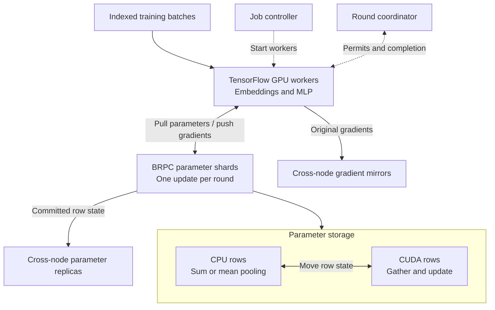

# Distributed Recommendation Model Training System

A **C++20 distributed training system** with sharded parameter and optimizer state,
CPU/CUDA parameter owners, training-task coordination, and checkpoint/replay recovery.
Workers execute model forward/backward computation; parameter shards own shared
state and apply updates. The runtime connects these roles through BRPC/Protobuf
and native TensorFlow operations.

The executable model trains **embeddings and a dense two-layer MLP** together.
A separate integration runs an existing training framework through its original
application entry point, preserving its reader, model, and dense optimizer while
replacing the embedding parameter backend.

The implementation covers three connected responsibilities:

- **Parameter execution:** route batched reads and gradients, aggregate updates,
  and manage complete parameter/Adam state on CPU and GPU.
- **Training coordination:** enforce iteration dependencies, acknowledge completed
  updates, and manage worker/server process generations.
- **Recovery:** preserve committed state and original gradients, reconcile partial
  rounds, and restore the matching model, optimizer, progress, and input position.

## Train on MovieLens

Start with the [GPU cluster runbook](docs/RECOMMENDATION_GPU.md). It covers the
Linux install, NVIDIA driver requirements, SSH inventory, and storage paths. Use
two GPU training hosts on a private network. Add a spare GPU host to try node
replacement. The standalone job uses the TensorFlow model in this repository.

Once the runtime is installed, prepare [MovieLens 100K](https://grouplens.org/datasets/movielens/100k/)
from the repository root. Mount the prepared data read-only at the same path on
every host.

```sh
py=/srv/drmts/environment/bin/python
"$py" scripts/prepare_recommendation_data.py ml-100k/u.data /shared/movielens \
  --movielens --workers 2 --batch-size 128
```

Copy the [inventory example](configs/recommendation-inventory.example.json) to
`inventory.json` and fill in your node addresses and runtime paths. Copy the
[job example](configs/recommendation-job.example.json) to `job.json` and set
`data.version` to the `version` in `/shared/movielens/manifest.json`. The job's
`groups` and `training.batch_size` must match the preparation command.

```sh
cli=scripts/training_job_controller.py
state=/srv/drmts/controller
"$py" "$cli" --state "$state" --inventory inventory.json node probe
"$py" "$cli" --state "$state" --inventory inventory.json job plan job.json
"$py" "$cli" --state "$state" job submit job.json
"$py" "$cli" --state "$state" --inventory inventory.json controller serve
```

From another terminal, run
`/srv/drmts/environment/bin/python scripts/training_job_controller.py --state /srv/drmts/controller job status movielens`
to see training progress, validation metrics, and the checkpoint path. The job
writes its checkpoint manifest to `/shared/checkpoints/movielens/manifest.json`.
To train on your own data, leave off `--movielens` and pass a CSV with
`user_id,item_id,label,timestamp`. Data preparation holds out the latest time range
for validation.

## How training works

The standalone system follows Entropy's learner and parameter-server split.
Each worker reads its indexed batches and runs the TensorFlow model on a GPU.
The parameter shards serve rows from CPU storage or CUDA memory.



Workers pull parameters and push gradients through custom TensorFlow ops. In
synchronous mode, each shard waits for every worker's gradients before updating.
Workers report completion after all shards acknowledge their updates. The
coordinator then permits the next round. The job controller queues jobs by
priority and reserves resources for the whole job before launching its processes.
[Training execution](docs/TRAINING_EXECUTION.md) ·
[Synchronous updates](docs/SYNCHRONOUS_GRADIENTS.md) ·
[Job controller](docs/TRAINING_JOB_CONTROLLER.md)

For sum or mean features backed by CPU storage, the service can pool the
embeddings on the CPU and send the pooled result to the GPU. The reuse-based cache
policy admits a row only when the expected access time savings exceed the cost of
loading and writing it back. The optimizer state moves with the weights.
[Cache policy](docs/CACHE_POLICY.md)

## Recover a job

Use `job resume` to start another training segment from a completed checkpoint.
The controller checks that the checkpoint and prepared input belong to the job
before training resumes. [Checkpoint and resume commands](docs/RECOMMENDATION_GPU.md)

After confirmed node loss, the controller starts the failed roles on replacement
capacity. Parameter replicas supply committed updates, and mirrored worker
journals supply the original gradients for a partial round. Shards that already
applied the round keep their committed result. The other shards replay the missing
update before training resumes. This requires surviving parameter and gradient
copies and enough spare GPU capacity. The current setup uses one controller and
one standby per shard. [Node replacement procedure](docs/PHYSICAL_NODE_RECOVERY.md)

## GPU results

The standalone run used three physical RTX A6000 hosts, two for training and
one spare. The MovieLens run recorded GPU placements for both workers' forward
and backward passes, and its parameter shards used CUDA owners. The record also
includes a run on a second CSV.

After one training host was removed mid-round, the spare took over. The
eight-round recovery run matched the uninterrupted run's final state and loss.
The checkpoint continuation run matched as well. The record covers small
synchronous jobs and includes the exact workload and comparison tolerance.
[Three-host acceptance record](docs/validation/2026-11-08-vast-a6000-recommendation.json)

Separate experiments cover [GPU parameter capacity](docs/MULTIGPU_TRAINING_CAPACITY.md),
[training admission policies](docs/MODEL_CONSISTENCY_POLICIES.md),
[DeepLOB on FI-2010](docs/DEEPLOB_FI2010_RESULTS.md), and
[parameter scheduling](docs/SCHEDULING_RESULTS.md). See the
[validation index](docs/VALIDATION.md) for the individual workloads and results.

## Build the CPU core

Run this on a POSIX system with a C++20 compiler and CMake 3.20 or newer.

```sh
cmake -S . -B build/core -DCMAKE_BUILD_TYPE=Release -DEPS_BUILD_BRPC=OFF
cmake --build build/core -j 4
ctest --test-dir build/core --output-on-failure
```

See [build and run](docs/RUNNING.md) for the network service and CUDA builds.

## Documentation

- [Architecture](docs/ARCHITECTURE.md) · [中文架构说明](docs/ARCHITECTURE.zh-CN.md) · [Architecture diagram (SVG)](docs/assets/distributed-training-architecture.svg)
- [TensorFlow worker](docs/TENSORFLOW_SHARDED_TRAINING.md) · [Native TensorFlow ops](docs/NATIVE_TENSORFLOW.md) · [Parameter service API](docs/API.md)
- [Replica protocol](docs/REPLICATED_TRAINING.md) · [Worker journals](docs/WORKER_RECOVERY.md) · [Joint checkpoints](docs/JOINT_TRAINING_CHECKPOINT.md)
- [Automatic training policy selection](docs/AUTO_TRAINING_POLICY.md) · [Design decisions](docs/adr/README.md)
