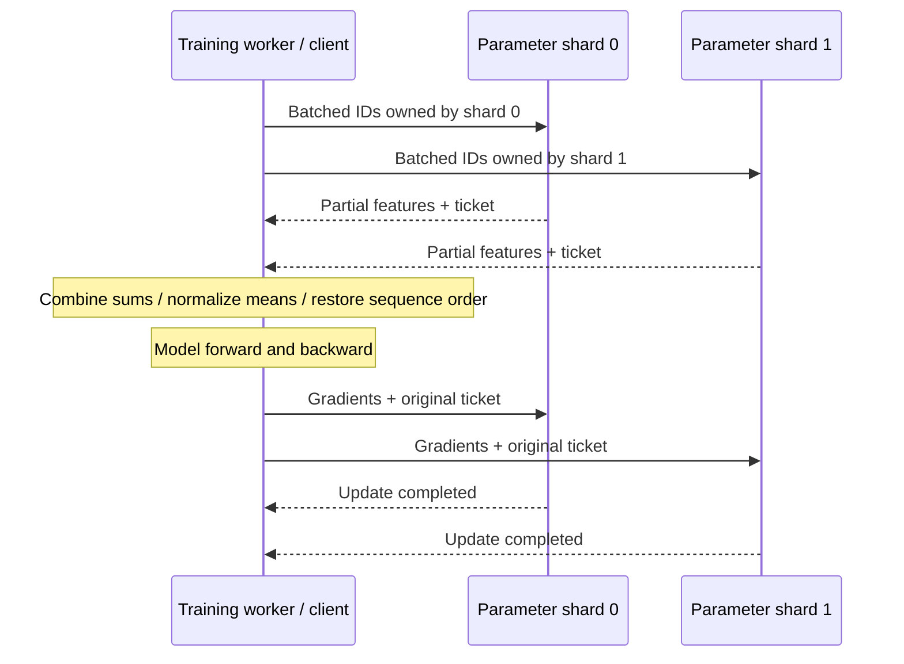
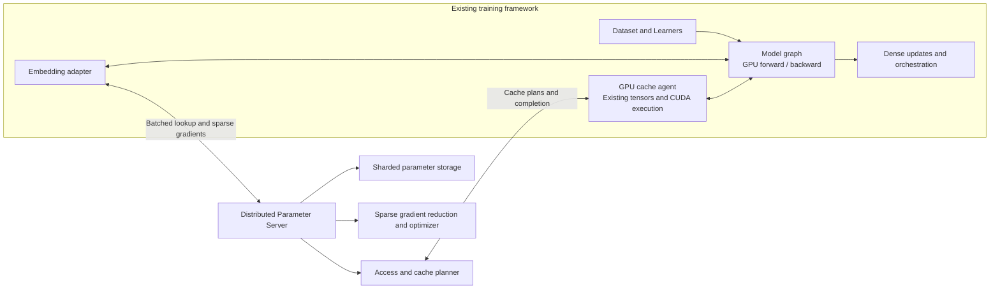

# Distributed Parameter Server

**Distributed storage, access and updates for machine-learning parameters.**

Training workers pull the parameters needed for a batch and push gradients back
for updates. Distributed Parameter Server partitions those parameters across
server shards and manages batched access and optimizer state. GPU workers cache
complete parameter rows and execute resident pooling and sparse updates.

The first implementation targets sparse access to embedding tables: each batch
touches only a small fraction of a large table. This pattern appears in
recommendation, advertising, knowledge graphs, graph learning and word-embedding
models.

The first integration retains **Entropy's training framework**: dataset readers,
model graphs, GPU forward/backward, dense gradient synchronization and training
orchestration continue to run there. A Pull/Push/Join adapter connects embedding
operations to the service; its portable TensorFlow bridge uses stateful host
callbacks and an isolated native RPC client.

**Implemented:** independent BRPC parameter shards, cross-shard batching,
sparse LazyAdam, CUDA-resident weights and optimizer states, CPU/GPU migration,
generation fencing, bounded lookup tickets, and durable snapshots with optimizer
restore. Pooled gradients travel as feature vectors plus ordered ID references;
CUDA expands and reduces them at their parameter owner. Independent GPU owners
execute updates concurrently. CPU pooling and unique-vector transfer are executable access paths;
a pluggable cost planner selects between them. A TensorFlow graph check exercises
Pull → dense model/loss → sparse Push → Join against external server processes.

**GPU validation:** real L40 checks cover mixed CPU/GPU updates, migration and
restart. A checked-read stress run used 1,048,576 rows of dimension 128 and
8,388,608 ID occurrences across 16 callers, with zero maximum absolute error
against its CPU reference and no additional backend output allocations during
reads. This measures parameter-access correctness under load, rather than model
training speedup. See the [validation record](docs/VALIDATION.md).

[Build and run](docs/RUNNING.md) · [Validation](docs/VALIDATION.md) ·
[Implementation progress](docs/plans/2026-10-31-implementation.md)



## Target integration



## Service responsibilities

- **Parameter storage:** shard `(table, key)` rows and retain weights and optimizer state.
- **Batched access:** deduplicate requests while preserving bag and sequence positions;
  support sum, mean and ordered sequence features.
- **Sparse updates:** merge repeated-key contributions within the original update
  request and apply its configured sparse optimizer at the current parameter location.
- **Cache management:** choose reusable rows, coordinate CPU/GPU placement and batch
  transfers within memory and bandwidth budgets.
- **Framework integration:** return the tensor layouts expected by the existing
  training graph and expose a drain/flush operation for its save lifecycle.

## Independent optimization focus

| Optimization | What changes | Why it can accelerate training |
|---|---|---|
| Cost-based access planning | Compare CPU pooling with unique-vector transfer and GPU processing | Reduce traffic without moving the bottleneck into CPU pooling |
| Reuse-aware admission | Account for parameter-state loading and writeback when admitting a row | Avoid one-use insertions and repeated cache churn |
| Migration budgets and slot reserve | Bound in-flight transfer work and prepare reusable capacity early | Reduce bursts and waits for old rows to finish writing back |
| Batched preparation and transfer | Prepare ID routing ahead and coalesce compatible payloads | Reduce allocation, scheduling and small-message overhead |

These extend a baseline that already has partitioning, pooling, sparse updates,
cache management and asynchronous transfers. The [acceleration design](docs/ACCELERATION.md)
explains the decision model and expected workload benefits.

## Design and code map

- [Service architecture](docs/ARCHITECTURE.md)
- [API and integration](docs/API.md)
- [中文项目说明](docs/ARCHITECTURE.zh-CN.md)
- [Application families and sources](docs/APPLICATIONS.md)
- [Design decisions](docs/adr/README.md)
- [Implementation plan](docs/plans/2026-10-31-implementation.md)
- [Project scope and provenance](docs/PROVENANCE.md)

```text
include/eps/       C++20 service and cache-agent contracts
src/store/         Chunked row storage and durable binary snapshots
src/access/        Deduplicated lookup and feature-gradient reduction
src/update/        Sparse LazyAdam validation and updates
src/server/        Bounded shard executor and standalone server
src/transport/     BRPC services, client and attachment codec
src/client/        Cross-shard routing, pooling and sequence reconstruction
src/cache/         Agent control, host reference backend and cost planner
src/cuda/          Resident pooling, sparse Adam and batched state transfers
adapters/entropy/  C++ Pull/Push/Join adapter and portable TensorFlow bridge
proto/            Service protocol
configs/          Example service/integration configuration
tests/            Core, CUDA, TensorFlow, recovery and capacity probes
scripts/          GPU build and process/fleet capacity sweeps
docs/             Architecture, rationale and delivery plan
references/       Local reference collection guide
```

The implementation is designed around **C++20**, **BRPC/Protobuf** and contiguous
parameter-state storage. The C++ agent can run inside a compatible training worker
or as a standalone process. The supplied portable TensorFlow bridge isolates
BRPC's binary dependencies in a local client process; feature tensors cross a
host-memory boundary. The C++ CUDA API also returns owning device tensors for
native callers. Clients use the same table/key/gradient contract across tasks.

The [adapter guide](adapters/entropy/README.md) describes integration and gradient
conventions. The [implementation plan](docs/plans/2026-10-31-implementation.md)
tracks automatic admission, asynchronous preparation and integrated workload
evaluation.

## References

1. Li, M., et al. *Scaling Distributed Machine Learning with the Parameter Server.*
   OSDI, 2014. [Paper](https://www.usenix.org/conference/osdi14/technical-sessions/presentation/li_mu).
2. Zheng, D., et al. *DGL-KE: Training Knowledge Graph Embeddings at Scale.* SIGIR, 2020.
   [Paper](https://www.amazon.science/publications/dgl-ke-training-knowledge-graph-embeddings-at-scale).
3. PyTorch. *FBGEMM: Table Batched Embedding Training Module.*
   [Documentation](https://docs.pytorch.org/FBGEMM/fbgemm_gpu/python-api/tbe_ops_training.html).

Original project contributions use [PolyForm Noncommercial 1.0.0](LICENSE).
See [NOTICE](NOTICE) for attribution. Local upstream source and internal reference
material are excluded from version control.
