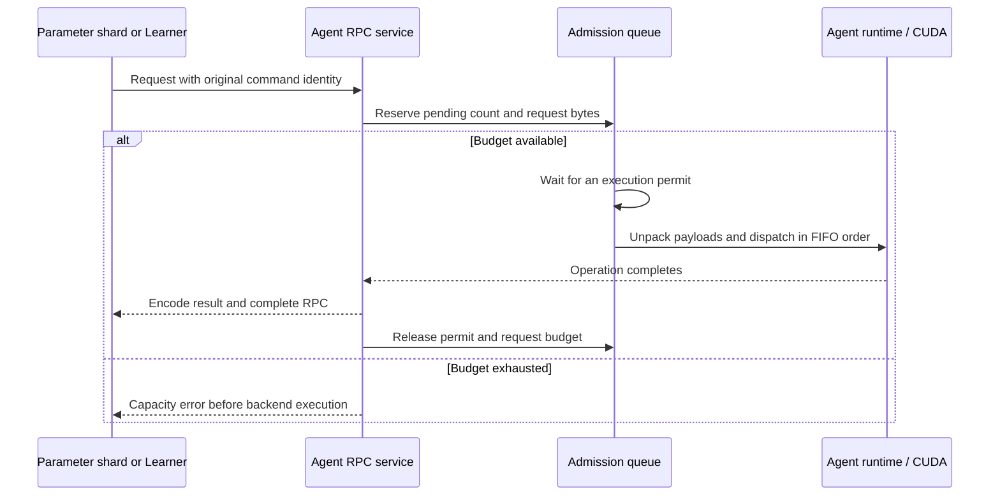

# Agent RPC admission and backpressure

Each Agent owns one admission queue shared by every parameter shard and training
client connected to it. Requests wait within explicit count and input-byte
budgets before entering the Agent runtime. The execution permit remains attached
to the asynchronous completion until the response is encoded and its completion
closure runs.



## Budgets and lifecycle

| Setting | Default | Scope |
| --- | --- | --- |
| `--max-active-rpcs` | 32 | Requests dispatched but not fully completed |
| `--max-pending-rpcs` | 4096 | Active plus waiting requests |
| `--request-bytes` | 268435456 | Retained serialized request and attachment bytes |

The active limit is configurable from 1 to 128. It keeps the existing ordered
runtime and completion executor below their own queue limits. The pending limit
is configurable up to 65,536; the byte budget accounts for variable-sized
requests that a request-count limit alone would miss. Codec message/attachment
limits still apply. These are logical serialized-input counters; BRPC parses the
protobuf envelope before application admission. Attachment unpacking and runtime
execution begin after admission. Response storage is bounded by the active count and output
codec limits; it is outside the input-byte counter.

A dispatcher starts admitted work without occupying a BRPC worker while a
request waits. FIFO order prevents newly arriving work from bypassing earlier
queued requests. The runtime retains its original command sequencing, replay
identities, generation checks and optimizer ownership. Server-side shutdown
closes new admission and drains accepted completions before destroying the
queue and runtime.

BRPC's separate transport concurrency limit is disabled for this Agent service.
It previously rejected requests at 128 in-flight RPCs before the service could
queue them. The application queue supplies the finite count/byte budgets.
Limits are global to an Agent process, covering producers in separate processes.

Waiting preserves work within those budgets and adds latency under saturation.
Exhausting an application budget still produces a capacity error; cross-shard
partial updates then follow the existing failed-run and checkpoint-recovery
contract. An observed cancellation before dispatch returns without executing the
backend. Once dispatched, a permit stays live through operation completion;
transport timeout alone does not establish whether a mutation committed.

## Observe admission

```sh
./build-cuda/eps_cache_agent --run training-run --backend cuda --device 0 \
  --listen 127.0.0.1:9200 --max-active-rpcs 32 \
  --max-pending-rpcs 4096 --request-bytes 268435456

curl -sS http://127.0.0.1:9200/eps.v1.CacheAgentService/AdmissionStats \
  -H 'Content-Type: application/json' -d '{}'
```

The statistics RPC bypasses the execution queue so waiting work does not hide
its state. It reports active/queued requests, retained input bytes, their high
water marks, accepted/completed/rejected requests, cumulative queue-wait
nanoseconds, unexpected dispatcher failures and configured limits. Completion
counts describe RPC lifetimes; successful optimizer updates remain a separate
parameter-service metric.

Capacity records include each Agent's admission snapshot after every verified
trial. Their counters include setup, preflight, warmup and earlier trials in the
same probe. Failure records retain an immediate snapshot alongside parameter
service health and ticket observations.

## Verification

The core tests hold asynchronous permits while new work arrives and exercise
FIFO dispatch, count/byte limits, concurrent producers, exception cleanup and
shutdown drain. The same component runs under ASan/UBSan and ThreadSanitizer.

A real BRPC test pauses the first backend operation, then submits 256 requests
through eight independent clients. It observes four active operations and 252
waiting requests, then checks every returned value and the unchanged full row
state. Separate count and byte rejection cases verify that rejected requests
never enter the backend and that subsequent requests still complete.

An additional mutating RPC case queues eight independent home-shard streams
behind a paused operation. It executes 128 expanded and 128 compact updates,
compares all eight rows' weights, both Adam moments and update counters with a
separate Host-backend replay, then evicts all rows and checks returned capacity.

The complete native and TensorFlow suites cover sparse updates, migration,
periodic save, committed restore and continued training with this admission path.
GPU load results are published with their source and binary provenance.

[CUDA results and provenance](AGENT_ADMISSION_RESULTS.md) ·
[Original overload observations](MULTIGPU_BOUNDARIES.md) ·
[Implementation plan](plans/2026-11-01-agent-admission.md)
