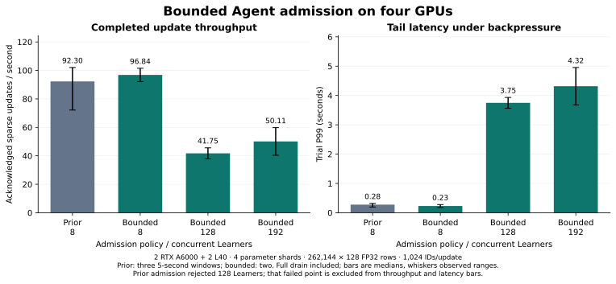

# Bounded Agent admission: CUDA verification

November 1, 2026 · runtime `426c27b` · same-fleet comparison with `b7b87cf`

The previous Agent rejects 128 concurrent Learners with BRPC `E2004` in this
fleet, leaving 254 training tickets and a failed fresh read. Bounded admission
completes the 128- and 192-Learner cases on one, two and four active GPU agents.
The four-agent, 192-Learner sustained test completes three 20-second windows
with zero reported update errors and zero remaining training tickets.



## Completed workload matrix

| Active GPU agents | Learners | Submission windows | Completed trials | Update errors |
| --- | --- | --- | --- | --- |
| 1 RTX A6000 | 8 / 128 / 192 | Two 5-second windows per level | 6 | 0 |
| 2 RTX A6000 | 8 / 128 / 192 | Two 5-second windows per level | 6 | 0 |
| 2 RTX A6000 + 2 L40 | 8 / 128 / 192 | Two 5-second windows per level | 6 | 0 |
| 2 RTX A6000 + 2 L40 | 192 | Three 20-second windows | 3 | 0 |
| 2 RTX A6000 + 2 L40, large table | 32 | Two 5-second windows | 2 | 0 |

The candidate completes **23 verified CUDA capacity trials / 12,950 acknowledged
sparse updates / 736 sampled row-counter checks**. Numerical preflight includes
sum, mean, sequence, repeated IDs and empty bags; maximum absolute feature error
is **3.91e-8**. Every completed trial checks finite sampled parameters, exact
sampled update counts and zero live tickets after drain. The large-table case
uses 1,048,576 rows × 512 FP32 dimensions and 8,192 ID occurrences per update,
covering 6 GiB of logical weights and two Adam moments.

## Same-fleet control

The common workload uses four parameter shards, 262,144 rows × 128 FP32
dimensions, 1,024 ID occurrences per update, pooling bags of 32 and 131,072
live resident rows. Each case starts fresh parameter-service and Agent processes.

| Admission | Learners | Trials | Updates/s, median | Observed rate range | Trial P99, median |
| --- | --- | --- | --- | --- | --- |
| Previous transport limit | 8 | 3 | 92.30 | 72.17–102.05 | 277.50 ms |
| Bounded application queue | 8 | 2 | 96.84 | 92.17–101.52 | 229.08 ms |
| Previous transport limit | 128 | Failed first window | — | — | — |
| Bounded application queue | 128 | 2 | 41.75 | 37.88–45.61 | 3749.58 ms |
| Bounded application queue | 192 | 2 | 50.11 | 40.42–59.81 | 4317.25 ms |

The old and new low-load rate ranges overlap. The high-load result establishes
completion within the application budgets; tail latency still grows with queue
wait. A failed point has no assigned throughput or latency percentile.

In the longer four-agent test, 192 Learners sustain **59.17 updates/s** median
(51.86–59.95 observed range) with **4.95 s median trial P99**. Its three windows
complete **3,857 updates**. Queueing at this stress point produces seconds of
request latency.

## Admission bounds observed on CUDA

| Metric | Observed | Configured budget |
| --- | --- | --- |
| Maximum dispatched, unfinished RPCs at an Agent | 32 | 32 |
| Maximum total pending RPCs, including waiting | 195 | 4096 |
| Maximum retained serialized input | 6,367,286 bytes / 6.07 MiB | 256 MiB |
| Admission rejections in candidate trials | 0 | — |
| Unexpected dispatcher failures | 0 | — |
| Active/waiting RPCs and retained input after drain | 0 | — |

Dispatched RPCs can wait inside the ordered Agent runtime; this counter does not
represent concurrent CUDA kernels. Permits remain live through asynchronous
operation completion and response encoding. All candidate Agent snapshots report
equal accepted/completed counts after drain. High-water marks and counters include
setup, numerical preflight, warmup and previous windows in the same probe.

## Verification and deployment provenance

| Environment / scope | Result |
| --- | --- |
| macOS native CPU/RPC suite | 26/26 |
| macOS native/TensorFlow suite, including checkpoint continuation | 40/40 |
| Admission component, ASan/UBSan | 1/1 |
| Admission component, ThreadSanitizer | 1/1 |
| Ubuntu native CPU/CUDA build suite | 28/28 |
| Reused candidate binary, CUDA state/device check on each final worker | 4/4 |

The deterministic BRPC test pauses the first backend operation and submits 256
requests through eight client channels. It observes four dispatched requests
and 252 waiting requests, then checks every returned value and unchanged full
row state. Count and byte rejection cases prove rejection before backend
execution. A separate four-shard Host smoke completes 128/192-Learner updates;
its two records retain their explicit Host-reference label.

The expanded native RPC test queues eight home-shard streams behind a paused
operation, executes **256 updates** split equally between expanded and compact
payloads, and compares complete weights, both moments and counters for all eight
rows with a separate Host-backend replay. All values match exactly. It then
evicts all eight rows and checks returned capacity. This extends the local
protocol test; the reused CUDA build's 28-test log retains its original scope.
[Structured RPC checks](benchmarks/2026-11-01-agent-admission/rpc-admission-checks.jsonl).

The final fleet has two A6000 and two L40 devices with distinct CUDA UUIDs. One
and two-agent cases use the A6000 devices. A six-CPU coordinator with a 5.94-core
cgroup quota runs on an Intel Xeon E5-2683 v4 at 2.10 GHz. It hosts the four PS
processes, load generator and one Agent. Remaining Agents use verified direct
SSH-forwarded BRPC links. The prior Agent and the candidate run on the same
fleet in separate blocks; the prior block runs first. Baseline low-load trials
have three repetitions and the candidate short sweep has two.

Both binary builds use Ubuntu 22.04, GNU C++ 11.4, BRPC 1.18.0 and CUDA 13.0.88,
architecture 86 with `--fmad=false`. The provider preload remains installed.
The candidate binaries first pass the 28-test suite on an A6000 build instance;
the identical binaries are reused for the final fleet, whose workers separately
pass the CUDA check. Build provenance and runtime hardware have distinct records.
Every deployed Agent hash is checked against its selected baseline/candidate
binary. Critical runtime source hashes match the validated build.

Following the CUDA measurement, local tests add the eight-stream mutation check
and the documented CLI/HTTP statistics path. The HTTP path accepts BRPC's retained
JSON body within a 1 KiB limit and rejects oversized statistics input; data/control
admission is unchanged. CUDA measurements remain pinned to runtime `426c27b`.

Two earlier deployment attempts retain transport-failure records. Their
incomplete multi-GPU cases are excluded from these capacity counts. The final
coordinator is selected from observed SSH reachability and every workload runs
only after its forwarded Agent health checks succeed. The orchestration revision
retains its final health snapshot per experiment; the subsequent harness fix
retains a separate snapshot per topology. All rented instances, including the
deployment attempts, are deleted after hash-verified artifact retrieval.

Throughput includes input generation, lookup, feature reconstruction, synthetic
gradient preparation, acknowledged sparse updates and full drain. Model compute
and dense collectives belong to the training framework. ID preparation precedes
the step latency timer. 95% of sampled IDs come from the resident half and 5%
from the full table, producing an expected 97.5% resident occurrence share.
Capacity-client RPC timeouts are 30 seconds. Initialization, admission, preflight,
warmup and post-trial checks are outside timing. P99 entries are medians of trial
P99s. Queuing and network latency remain part of the measured deployment.

[Source/binary hashes, raw records and hardware](benchmarks/2026-11-01-agent-admission/manifest.json)
· [Baseline failed point](benchmarks/2026-11-01-agent-admission/failed-points.json)
· [Deployment checks](benchmarks/2026-11-01-agent-admission/deployment-checks.json)
· [Excluded deployment incidents and cleanup](benchmarks/2026-11-01-agent-admission/deployment-incidents.json)
· [Validation index](validation/2026-11-01-agent-admission.json)

## Reproduce

```sh
python3 scripts/fleet_capacity_sweep.py --fleet /path/to/private-fleet.json \
  --out-name bounded --gpu-counts 1,2,4 --ps-shards 4 \
  --learners 8,128,192 --seconds 5 --repeats 2

python3 scripts/fleet_capacity_sweep.py --fleet /path/to/private-fleet.json \
  --out-name sustained --gpu-counts 4 --ps-shards 4 \
  --learners 192 --seconds 20 --repeats 3

python3 scripts/render_agent_admission.py \
  --data docs/benchmarks/2026-11-01-agent-admission --out docs/assets
```

[Admission design and CLI](AGENT_ADMISSION.md) ·
[Earlier capacity limits](MULTIGPU_BOUNDARIES.md)
