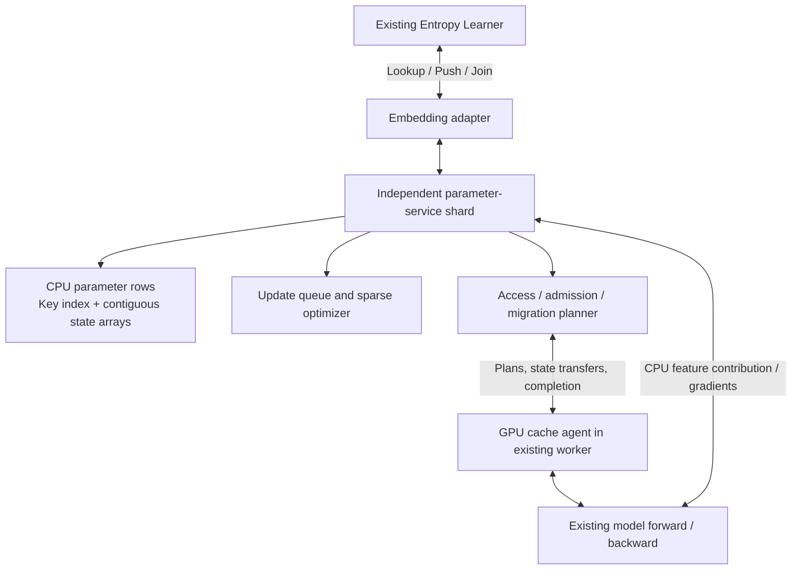

# Distributed parameter server architecture

## Keep the training framework; extract its parameter subsystem

Entropy continues to own dataset iteration, feature extraction, model graph
construction, loss/backward, dense optimization, GPU collectives and training-job
orchestration. The extracted service owns sparse parameter storage, access,
update execution and cache decisions.

The first adapter replaces the embedding backend at the existing Pull/Push/Join
boundary. Tensor shapes, pooling semantics and caller-visible completion remain
compatible with the graph. No new PyTorch trainer or global DDP step protocol is
required by this service.

## Roles

| Role | Responsibilities |
|---|---|
| Entropy Learner | Prepare samples and issue the original lookup/update lifecycle |
| Embedding adapter | Translate feature batches and gradients to the service contract |
| Parameter-service shard | Store CPU rows, resolve locations, execute lookup/pooling and sparse updates |
| Cache coordinator | Select admission/eviction, allocate slots and schedule state transfers |
| GPU cache agent | Execute resident lookup, gradient reduction/update and state copy using the existing GPU process |

The parameter service is a separate C++ process with its own endpoints and CPU
memory allocation. It can be started, configured and scaled separately from the
training application. The GPU backend can be linked into a compatible worker;
the supplied `eps_cache_agent` executable hosts it as a standalone process.
The portable TensorFlow adapter consumes host-returning RPC contributions.
The native TensorFlow path exchanges device tensors with the worker's GPU owner.
The [original framework integration](ORIGINAL_NATIVE_BUILD.md) also runs the
complete original application and joint input/model/optimizer recovery.

## Parameter identity and ownership

A row is identified by `(table_id, key)`. Keys are routed to a fixed home shard
using the configured partition map. The service tracks whether the current row
state is on CPU or delegated to a GPU cache agent. Different features can share
the same row; its placement is shared across those features.

A CPU row stores weights and optimizer state. A GPU-resident row's latest state
lives in the agent; its CPU backing copy is refreshed during writeback. All access
to that row is directed to its current location.

## One request through the system

1. The existing Learner reaches its embedding lookup. The adapter sends table,
   keys, sample offsets and pooling/sequence metadata to the service.
2. The service deduplicates keys and retains an occurrence map. It resolves
   CPU-backed and GPU-resident rows and returns a lookup ticket for this request.
3. CPU-backed contributions use the selected access route. Sum/mean features can
   be pooled near CPU storage; sequences retain their order. The GPU agent reads
   resident rows and combines the contributions into the graph's expected tensors.
4. The existing model runs forward and backward. Its existing gradient scaling
   and multi-GPU communication remain in effect.
5. The adapter/agent returns gradients with the lookup ticket. The service and
   agent reduce repeated-key contributions within this update request and apply
   the sparse optimizer at the current row location.
6. The completion notification satisfies the existing Push/Join dependency and
   releases this request's parameter references.

The service preserves the framework's asynchronous Learner model. It does not
merge several Learners' Adam updates into one update. Within a shard, an update
sequencer gives each original request an optimizer context shared by its CPU and
GPU portions, including learning rate and optimizer-counter state.

## Pooling and sequence behavior

For sum pooling, add CPU and GPU partial sums. For mean pooling, divide once by
the original valid bag length, including contributions across shards. Backward
uses that same denominator. Sequence access reconstructs original positions from
the inverse map; repeated IDs remain repeated positions.

Feature creation/retirement remains a model/table policy. Cache admission changes
where a parameter is stored, not whether it receives training updates.

## Cache migration

The service manages four row states:

```mermaid
stateDiagram-v2
    CPU --> Loading: Admit row
    Loading --> GPU: Full state transferred; publish location
    Loading --> CPU: Abandon admission
    GPU --> Draining: Select eviction; stop new row references
    Draining --> CPU: Finish referenced updates; write back; publish location
```

A location change requires existing lookup tickets that reference the row to
finish. The current `MoveRows` rejects pinned rows so its caller can retry later;
once accepted, row and agent-stream dependencies remain held through transfer.
The operation suspends on external futures and publishes the destination after
acknowledgement. Unrelated rows can progress on the same shard actor during the
wait. [Resumable operations](RESUMABLE_OPERATIONS.md) describe dependencies,
maintenance barriers and the completion pool. Full state moves together; for the
initial sparse LazyAdam policy this includes weights, first/second moments and
row update metadata. Table/shard optimizer globals are managed by the update
sequencer rather than independently advanced in CPU and GPU code.

Migration plans carry a generation, and slots become reusable after the move
completes. This protocol fits the existing asynchronous training lifecycle;
there is no new global training barrier.

Waiting work is bounded by live-ticket and queue limits. Pressure at these
limits produces backpressure rather than unbounded host-memory growth. Table
storage, staging buffers, device slots and policy statistics have separate memory
budgets; existing RPC completion threads do not wait on row or device completion.

## Core modules

| Module | Main interface | Implementation destination |
|---|---|---|
| ShardStore | Read rows, read/write complete state, snapshot | `src/store/` |
| BatchAccess | Resolve keys, deduplicate, pool, reconstruct | `src/access/` |
| UpdateEngine | Accept gradient batch, merge keys, apply optimizer | `src/update/` |
| CacheCoordinator | Observe accesses, plan placement/migration | `src/cache/` |
| ServiceTransport | Batched requests and contiguous payloads | `src/server/` |
| EntropyAdapter | Pull/Push/Join integration | `adapters/entropy/` |
| GpuCacheAgent | CUDA pooling, updates and full-state copy | `src/cuda/` |

The first implementation provides a complete CPU parameter-service path before
connecting GPU-resident execution. Both use the same lookup/update contracts.

## Deployment and saving

BRPC/Protobuf keeps the transport close to the existing integration. Bulk key,
vector and state arrays use contiguous attachments. CPU backing services can run
on separate nodes; cache coordination and the agent can be placed near the GPU.

The existing save controller pauses the relevant training lifecycle and invokes
`DrainAndFlush`. The service finishes accepted updates, drains migrations and
returns dirty rows to backing storage. It then supplies shard snapshot metadata
to the existing checkpoint/export flow. Dataset position, RNG and dense state
remain the framework's responsibility.

An owner or agent failure ends the affected training run and uses the existing
restart/save lifecycle. Initial extraction focuses on parameter access and update
performance, with static shard membership during a run.

## Windowed placement controller

The implemented controller observes distinct-row reuse on fresh lookups and
runs at completed Push/Release windows. It combines bounded decayed history,
cost/frequency admission, minimum residence, live-ticket exclusion, shared
migration budgets and atomic destination slot reserves. A rejected admission
keeps CPU fallback; save drains placement and restore rebuilds history.
[Automatic cache policy](CACHE_POLICY.md) documents decisions, configuration,
metrics and execution cost on the existing sequencer.
