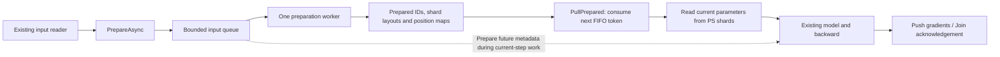

# Bounded asynchronous input preparation

Prepare the next batch's IDs and layouts while the current batch performs model
or RPC work. Parameter values are read when the training graph executes
`PullPrepared`, so the caller's update and read boundaries remain explicit.



## Prepared data and read ordering

Preparation removes padding IDs, retains valid mean-pooling denominators,
records original sequence positions and partitions IDs by `key % shard_count`.
It builds shard-local row splits and the maps used to reconstruct the output and
route sequence gradients. Routing uses a key-count pass followed by one dispatch
pass, rather than scanning every key separately for each shard. Bag metadata is
replicated across shards.

A prepared lookup owns its buffers and is move-only. It contains no parameter
values, GPU ownership tickets or optimizer state. The client checks registered
tables and reads parameters at consumption time. Training request sequence IDs
are assigned then; cancelled preparation tokens leave no holes in that stream.
Synchronous Pull uses the same preparation builder.

A caller can prepare batch B before updating batch A, complete A's Push, then
consume B and read the updated weights. The native check holds the first RPC
behind a promise while the second input finishes preparation, and verifies that
future metadata does not issue an additional parameter lookup.

## Queue and checkpoint lifecycle

| Operation | Queue behavior | Parameter-service behavior |
| --- | --- | --- |
| `PrepareAsync` / Python `prepare` | Validate and reserve a token; worker builds metadata | No calls |
| `PullPrepared` / `pull_prepared` | Claim the oldest pending token; wait if necessary; transfer its buffers to the active batch | Read current parameters and create normal lookup tickets |
| `CancelPrepared` / `cancel_prepared` | Cancel an unclaimed token | No calls |
| `Push` or `Release` | Future metadata can continue preparing | Close the current batch's ordinary lifecycle |
| `Join` | Future metadata may remain queued | Require all live Pull handles to be closed |
| `Save` | Require every token to be consumed or cancelled; atomically close admission | Drain and save after live handles are closed |

Queued and ready cancellation release buffers immediately. Cancellation of a
running job retains its count/byte reservation until that worker releases its
input and output buffers. Once Pull has claimed a token, cancellation returns
`unavailable`. Consumed or cancelled tokens return `retired_request` when reused.
Out-of-order consumption returns `unavailable` and leaves the inputs queued.
Synchronous Pull also requires the caller to consume/cancel pending tokens.

The preparation worker uses its own mutex and condition variable. It does not
need the adapter's model/RPC mutex. Its single worker preserves FIFO scheduling
and avoids a new thread for each input. Destruction cancels pending metadata and
joins the worker, and attempts to release known live lookup tickets. Run-level
recovery still handles unreachable services or ambiguous transport completion.
Output reconstruction, NumPy conversion and unpublished IPC-response failures
release known successful lookups before discarding their handles.

## Bounds and configuration

| Setting | Default | Scope |
| --- | ---: | --- |
| `max_pending_batches` | 8 | Queued, running and ready physical jobs, including cancelled work still running |
| `payload_bytes` | 64 MiB | Conservative retained-input, derived-buffer and scratch reservations |
| `max_input_bytes` | 16 MiB | Original input buffer capacities and container storage per input |
| `max_prepared_bytes` | 64 MiB | Owned lookup metadata per input |
| `max_features` | 1,024 | Feature descriptors per input |

The reservation counts original vector capacities, routed IDs, position maps,
replicated bag metadata and conversion scratch. Accepted reservations cannot
exceed the queue budget. Allocation headers, allocator fragmentation, the one
worker's stack, caller-owned inputs and active model/output buffers have separate
lifetimes. The existing live-batch and server-ticket limits remain in force.
A cancelled running job cannot be used to admit an unbounded sequence of new
inputs. Pure preparation failures reclaim their token/reservation without
advancing a parameter request sequence.

C++ configures `AdapterOptions::preparation`. Python accepts the same fields:

```python
ps = ParameterServer(
    endpoints, run_id,
    preparation=dict(max_pending_batches=2, payload_bytes=32 << 20),
)
```

`preparation_stats()` reports accepted, completed, failed, consumed, cancelled and
rejected jobs, pending/claimed counts, retained reservations, peak reserved bytes
and preparation callback wall time. The queue reservation ends when a prepared
input becomes an active Pull; normal batch/ticket ownership then applies.

## Existing TensorFlow training graph

Use eager input code to enqueue metadata and pass a scalar token into the
existing train function. Dimensions describe the prepared feature outputs in
original feature order. Runtime schema mismatches release the unpublished Pull.

```python
@tf.function(input_signature=[tf.TensorSpec([], tf.uint64)])
def train(token):
    handle, embeddings = ps.pull_prepared(token, (embedding_dimension,))
    # Existing model, loss, GradientTape and dense update stay here.
    sparse_ack = ps.push(handle, feature_ids, feature_gradients)
    return ps.join([sparse_ack, dense_train_op])

# Prefill from the existing reader. For a longer input iterator, keep at most
# two accepted tokens and refill after each completed train call.
a = ps.prepare(batch_a_features)
b = ps.prepare(batch_b_features)
train(tf.constant(a, tf.uint64))
train(tf.constant(b, tf.uint64))
ps.save("checkpoint")
```

The isolated Python transport serializes IPC commands. Enqueue the future input
before invoking the current train step; the native worker continues independently
while that step runs. Native C++ callers can also submit while another Pull is
waiting on RPC. Graph execution consumes tokens in FIFO order without retracing
for new token values. Before early checkpointing, cancel any unused tokens after
finishing the existing model/update barrier.

The graph checks train five dense/sparse steps, require decreasing loss and one
trace, verify zero parameter lookups before token consumption, exercise save
rejection with pending tokens, cancel future inputs, validate output-schema error
cleanup and save through two external shards. The same path runs with automatic
cache placement and coalesced gathers.

## Service phase metrics

Stats and both benchmark probes expose cumulative sequencer wall time in
nanoseconds. Benchmark JSON records per-trial/per-phase deltas under
`phase_nanoseconds`.

| Counter | Measured scope |
| --- | --- |
| `lookup_prepare_nanoseconds` | Fresh Lookup validation, row access, CPU pooling, routing and access observation |
| `gradient_prepare_nanoseconds` | Gradient validation, reduction, CPU/GPU partitioning and CPU optimizer validation |
| `gpu_packet_prepare_nanoseconds` | Building compact/expanded update packets for GPU owners |
| `update_dispatch_nanoseconds` | Submitting owner updates, including synchronous transport encoding |
| `cpu_optimizer_nanoseconds` | CPU-owned row updates and table optimizer-clock advancement |
| `agent_wait_nanoseconds` | Waiting on owner-operation futures inside the PS, including define, state reads, migration and updates |
| `migration_nanoseconds` | Whole migration attempts, including validation and owner waits |
| `cache_maintenance_nanoseconds` | Whole decision windows, including bookkeeping, migration and owner waits |

Duplicate Lookup/Push replays do not repeat or add the skipped preparation/update
work. Failed attempts contribute time to scopes they entered. Initialization is
included in cumulative Stats; benchmark deltas exclude setup and warmup.

These are inclusive wall-time scopes. Maintenance includes migrations and owner
waits; migration includes owner waits. They must not be added as disjoint CPU
percentages. Client-side gathers, framework computation and input-reader time
are outside PS phase counters. Queue preparation time is exposed separately by
`preparation_stats()`.
