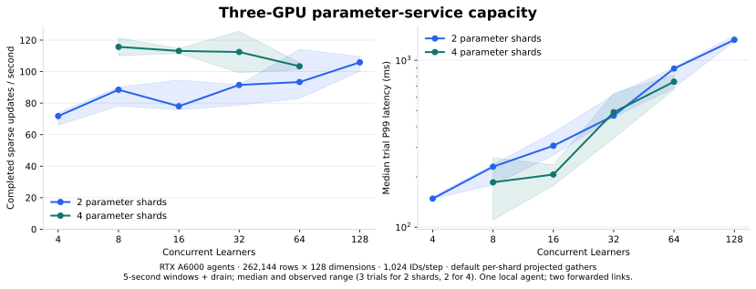
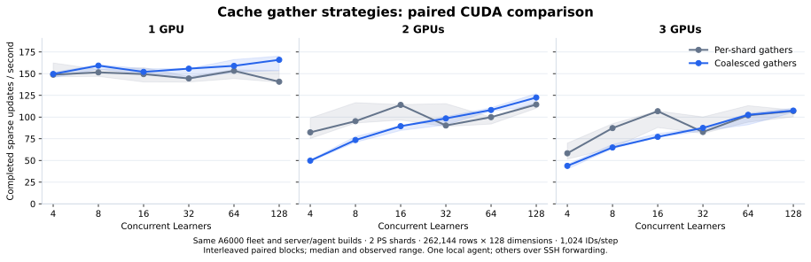
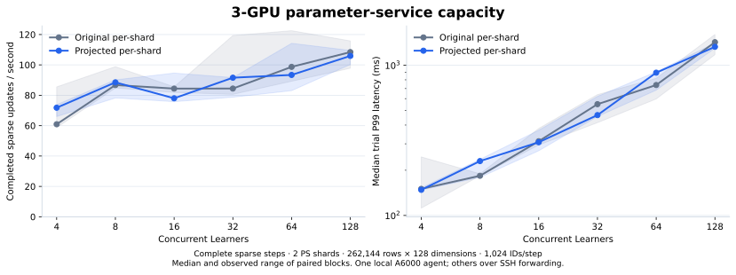
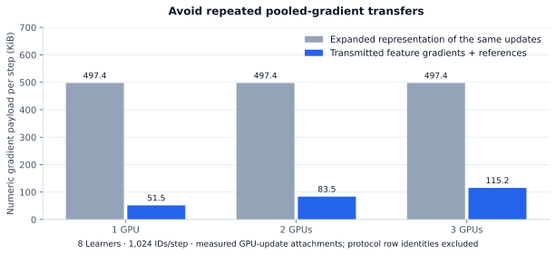

# Multi-GPU capacity evaluation

October 31, 2026 · C++20 / BRPC / CUDA · 1–3 RTX A6000 agents

The best sustained three-GPU operating point tested is **122.95 completed sparse
update steps/s**, with **104.93 ms median trial P99**, using four parameter shards
and eight concurrent Learners. Three 30-second trials completed **10,841 updates
with zero errors**. Raising the shard count to eight or sixteen reduces throughput;
raising concurrency increases queueing and tail latency.



This round contains **253 capacity trials and 153,703 completed updates**, all
without reported errors. It includes paired client comparisons, shard controls,
a larger embedding table and longer-window checks. The [initial 207-trial report](BENCHMARKS.initial-2026-10-31.md)
is retained separately with its original source revisions and deployment.

## What a measured step does

Each step performs distributed lookup, CPU/GPU feature reconstruction, gradient
preparation and an acknowledged sparse LazyAdam update. The generator supplies
synthetic feature gradients; dense-model forward/backward is outside this
parameter-service benchmark. Input ID occurrences include repeats, rather than
counting only unique updated rows.

| Setting | Main workload | Larger-table control |
|---|---:|---:|
| Parameter rows | 262,144 | 1,048,576 |
| FP32 vector dimensions | 128 | 512 |
| Cached rows, total across agents | 131,072 | 524,288 |
| Input ID occurrences/step | 1,024 | 8,192 |
| IDs per mean-pooling bag | 32 | 128 |
| Logical weights + two Adam moments | 384 MiB | 6 GiB |
| Learner concurrency | 4–128 | 4, 8, 16 |

The workload chooses 95% of IDs from the cached half and 5% from the complete
table, giving an expected 97.5% resident-ID share. Parameters use `key %
shard_count` placement; cache ownership uses `(key / shard_count) % gpu_count`.
Total table and cached-row counts stay fixed when GPU count changes. Adam row
counters and service metadata are additional to the logical state sizes above.
The fleet driver reserves extra CUDA slots per agent, so logical state size is
not a measurement of allocated VRAM or a device-memory limit.

Initialization, cache admission, numerical preflight, three warmup updates and
post-trial checks are outside timing. A submission window is followed by a full
drain; throughput divides completed steps by elapsed time **including that
drain**, ID generation and client bookkeeping. Step latency starts after the
input IDs are prepared and ends after the sparse update acknowledgement. P99
values in this report are medians of trial-level P99s, rather than a percentile
pooled across trials.

## Sustained operating points

All three configurations below use three A6000 agents and the current default
client (`9f36ca3`): destination-projected, per-shard gathers. Each has three
30-second submission windows plus drain.

| Parameter shards | Learners | Steps/s, median | Trial rate range | Median trial P99 | Total completed updates |
|---:|---:|---:|---:|---:|---:|
| 2 | 8 | 79.56 | 78.31–81.09 | 216.59 ms | 7,196 |
| **4** | **8** | **122.95** | **108.26–128.90** | **104.93 ms** | **10,841** |
| 2 | 128 | 93.37 | 90.52–99.45 | 1,777.78 ms | 8,874 |

At the same eight-Learner concurrency, four shards provide **54.5% higher median
throughput** and **51.6% lower median trial P99** than two shards in these runs.
The configurations ran in separate blocks on the same instances and binaries.
At 128 Learners, two shards deliver less throughput than the four-shard operating
point while accumulating much longer waits.

These longer-window checks establish a useful tested operating point. The short
sweeps below show how the system approaches and passes it.

## Shard and concurrency limits

The default three-GPU client was tested with two, four, eight and sixteen
parameter shards. The two-shard sweep has three five-second trials per load
level; the other shard controls have two. The figure at the top plots the two-
and four-shard curves, with observed trial ranges.

| Parameter shards | Learners | Steps/s, median | Median trial P99 | Median sequencer queue wait |
|---:|---:|---:|---:|---:|
| 4 | 8 | 115.73 | 185.67 ms | 12.94 ms |
| 4 | 16 | 113.14 | 206.77 ms | 33.05 ms |
| 4 | 32 | 112.46 | 488.17 ms | 90.62 ms |
| 4 | 64 | 103.40 | 744.42 ms | 236.99 ms |
| 8 | 8 | 56.51 | 263.06 ms | 32.71 ms |
| 8 | 16 | 66.12 | 290.52 ms | 66.20 ms |
| 16 | 8 | 30.93 | 361.21 ms | 59.40 ms |
| 16 | 16 | 31.55 | 737.82 ms | 144.20 ms |

Four shards are the best tested shard count for this small-vector workload.
Additional shards introduce more per-shard gathers, feature outputs, update
contexts and messages. The PS sequencer also waits for remote-agent update
acknowledgements. The falling throughput and rising queue waits identify service
coordination and communication as scaling targets. They do not establish that
A6000 arithmetic throughput is exhausted.

## Gather policy: fewer calls versus earlier work

The original client submits shard lookups concurrently, then starts each shard's
cache gathers before waiting for the next shard reply. The implementation now
projects each gather onto **only the ID positions that its destination reads**,
then restores sequence positions in the combined result. Original valid mean
lengths, update tickets and optimizer boundaries are preserved.

An explicit coalescing policy first collects all shard replies and combines
compatible work by destination, feature and access route. This reduces as many
as `shards × GPUs` gathers to `GPUs` gathers, while adding a wait for all shard
replies. Both policies use destination projection. Per-shard overlap remains the
default; `SetCacheResolver(resolver, true)` and the adapters' `coalesce=True`
select cross-shard coalescing.

Three paired suites retain the intermediate implementation and its regressions:

| Suite | Baseline → candidate client | GPU counts | Learners | Trials |
|---|---|---|---|---:|
| Full-layout coalescing | `db74e47` → `5a4cdcb` | 1, 2, 3 | 4, 8, 16, 32 | 72 |
| Projected coalescing | `db74e47` → `513640e` | 1, 2, 3 | 4, 8, 16, 32, 64, 128 | 108 |
| Projected per-shard default | `db74e47` → `9f36ca3` | 3 | 4, 8, 16, 32, 64, 128 | 36 |

Each suite uses three paired blocks, alternating baseline/candidate order by
block and topology, fresh PS/agent state for each run, identical server/agent
binaries and five-second submission windows. The full-layout candidate sends
redundant ID layouts; the projected candidate removes that redundancy. The
coalesced policy is built into `513640e`; it is explicitly selectable in
`9f36ca3`.



The projected-coalescing sweep's highest median rates are:

| GPU agents | Learners | Baseline steps/s at that concurrency | Projected coalescing steps/s | Candidate median trial P99 |
|---:|---:|---:|---:|---:|
| 1 | 128 | 140.72 | 165.97 | 799.45 ms |
| 2 | 128 | 114.42 | 122.50 | 1,159.96 ms |
| 3 | 128 | 106.98 | 107.45 | 1,329.69 ms |

One agent is local to the coordinator; the additional agents use forwarded
network links. These GPU counts therefore change both distributed communication
and placement. Their rates show the capacity of the tested deployment, rather
than a compute-only GPU scaling ratio.



The current default's three-GPU paired comparison remains mixed:

| Learners | Original steps/s | Projected per-shard steps/s | Candidate median trial P99 |
|---:|---:|---:|---:|
| 4 | 60.94 | 71.80 | 148.2 ms |
| 8 | 86.74 | 88.51 | 230.2 ms |
| 16 | 84.40 | 78.01 | 307.4 ms |
| 32 | 84.42 | 91.57 | 465.9 ms |
| 64 | 98.70 | 93.39 | 892.9 ms |
| 128 | 108.42 | 105.92 | 1,327.3 ms |

Destination projection eliminates redundant layout entries, while the default
retains per-shard overlap. The paired trials do not establish a uniform
throughput improvement for either projection or cross-shard coalescing. The raw
records retain all load levels, baseline results and observed ranges.

## Larger embedding table

The larger-table control uses 1,048,576 rows × 512 dimensions, 8,192 IDs/step,
three GPU agents and two PS shards. Logical weights and Adam moments occupy
6 GiB; half the rows are resident across the agents. Each policy/concurrency
combination has two five-second trials.

| Policy | Learners | Steps/s, median | Input ID occurrences/s | Median trial P99 |
|---|---:|---:|---:|---:|
| Per-shard, projected | 4 | 11.34 | 92,891 | 450.5 ms |
| Per-shard, projected | 8 | 13.34 | 109,261 | 663.8 ms |
| Per-shard, projected | 16 | 12.76 | 104,552 | 1,353.2 ms |
| Coalesced, projected | 4 | 11.93 | 97,750 | 410.9 ms |
| Coalesced, projected | 8 | 12.56 | 102,925 | 732.6 ms |
| Coalesced, projected | 16 | 13.60 | 111,385 | 1,222.2 ms |

This extends the checked operating range to million-row, 512-dimensional state
and roughly 109–111 thousand ID occurrences/s including acknowledged updates.
The policies ran in separate short blocks; the differences do not establish a
consistent policy speedup.

## Gradient payload



Pooled feature gradients are transferred once per destination command with
ordered row references, offsets and mean scales. The destination CUDA kernel
reduces those references into row gradients before Adam. Expanded gradients are
used when they occupy fewer bytes.

The initial dataset records the expanded and selected representations of the
**same completed updates** at eight Learners. Numeric gradient attachments fall
from approximately 497.4 KiB/step to 51.5, 83.5 and 115.2 KiB/step for one, two
and three agents: **9.7×, 6.0× and 4.3× smaller**, respectively. These counters
include compact numeric references/scales and exclude Protobuf identities,
headers and SSH framing. The [initial report](BENCHMARKS.initial-2026-10-31.md#gradient-payload)
retains the source variants and raw records for that comparison.

## CPU-only transport control

A framed send/acknowledgement probe ran on a forwarded link with no GPU work,
`TCP_NODELAY` at both ends, three warmup frames and 20 measured frames per size.

| Payload | Median transfer latency | Maximum observed latency |
|---:|---:|---:|
| 8 KiB | 0.70 ms | 41.77 ms |
| 16 KiB | 0.72 ms | 42.69 ms |
| 32 KiB | 1.01 ms | 43.03 ms |
| 64 KiB | 1.19 ms | 42.99 ms |
| 128 KiB | 21.91 ms | 42.95 ms |
| 256 KiB | 43.04 ms | 44.04 ms |
| 1 MiB | 10.23 ms | 49.65 ms |

Long, variable delays occur without GPU execution, supporting communication as
a contributor to the service's tail latency. The non-monotonic results do not
isolate the transport mechanism. This is a fresh control on the current fleet;
the initial deployment's transport results remain in its archived report.

## Correctness and overload

- Current macOS native/RPC/TensorFlow checks: **14/14 passed**.
- Core ASan/UBSan checks: **8/8 passed**.
- Initial Ubuntu A6000 CPU/CUDA suite at `5a4cdcb`: **13/13 passed**.
- Current Ubuntu CPU suite at `9f36ca3`: **11/11 passed**.
- Current CUDA process lifecycle passes with both gather policies, including
  two-shard mixed-placement updates, migration, save and optimizer-exact restore.
- Three distinct CUDA-visible A6000 devices passed state/device-result checks.
- The projected candidate performs an untimed read preflight per fresh topology:
  96 CPU-owned reference rows, then sum/mean/sequence reconstruction after cache
  migration, including repeats and empty bags. It checks 17,024 values at
  dimension 128 and 68,096 at dimension 512. Maximum absolute error across the
  candidate records is **4.47 × 10⁻⁸**.
- All **253 new capacity trials** pass 32-key update-counter checks, finite-state
  checks and live-ticket cleanup, with zero reported errors or admission
  rejections. The separate configured-overload test admits 32 of 64 concurrent
  requests, rejects the rest with `capacity_exceeded` and verifies successful
  retry after release.

Suite counts and log hashes are recorded in the [validation artifact](benchmarks/2026-10-31-capacity-controls/validation.json).
[VALIDATION.md](VALIDATION.md) describes numerical, failure, replay and recovery
coverage. The overload test and unit checks are separate from capacity trials.

## Environment and source provenance

The fleet comprises three single-A6000 48 GB instances. The coordinator also runs
one GPU agent, the load generator and all PS processes. It has **six allocated
vCPUs**, an **Intel Xeon E5-2699 v4 @ 2.20 GHz** host and **48 GiB RAM**. The
other two agents use direct host-to-host SSH-forwarded BRPC links; the local
agent uses loopback. Distinct CUDA device UUIDs are checked before each topology.

Software: Ubuntu 22.04.5, GNU C++ 11.4.0, BRPC 1.18.0, Protobuf 3.12.4, CUDA
compiler 13.0.88, driver 610.43.02, architecture 86 and `--fmad=false`. The
provider driver/preload remains installed; BRPC's optional pthread profiler hook
is disabled as described in the validation record.

Every paired run uses the same server and CUDA-agent builds from `5a4cdcb`;
only the client/probe build changes. The manifest verifies identical server
hashes and distinct probe hashes. The server/cache-agent sources do not change
across these client revisions.

```text
Shared eps_server SHA-256:
  b6487b37846968dcfabfdb105cdfebdd21b276086fb48688061c482bd99bdab1
Shared eps_cache_agent SHA-256:
  2aafec0e47854f03b975c757448452363db90170c8a529e06cb81cec89e42bcd
```

The initial report used an EPYC coordinator with all A6000 agents remote.
Absolute rates across the two deployments are kept separate; within-fleet
paired trials are the comparison for the client policies.

## Raw records and reproduction

| Dataset | Trials | Manifest | Derived summary |
|---|---:|---|---|
| Full-layout coalescing | 72 | [Sources, workload and raw hashes](benchmarks/2026-10-31-gather-full-layout/manifest.json) | [Paired levels](benchmarks/2026-10-31-gather-full-layout/summary.json) |
| Projected coalescing | 108 | [Sources, workload and raw hashes](benchmarks/2026-10-31-gather-projected/manifest.json) | [Paired levels](benchmarks/2026-10-31-gather-projected/summary.json) |
| Current per-shard default | 36 | [Sources, workload and raw hashes](benchmarks/2026-10-31-gather-streamed/manifest.json) | [Paired levels](benchmarks/2026-10-31-gather-streamed/summary.json) |
| Shards, larger table, sustained | 37 | [Sources, workload and raw hashes](benchmarks/2026-10-31-capacity-controls/manifest.json) | [Control levels](benchmarks/2026-10-31-capacity-controls/summary.json) |
| Initial deployment | 207 | [Historical sources and raw hashes](benchmarks/2026-10-31/manifest.json) | [Historical levels](benchmarks/2026-10-31/summary.json) |

All 460 capacity trials retain their original records. Resource summaries contain
PS/load-generator CPU time in equivalent occupied cores and sampled per-process
RSS maxima. Only timing windows bracketed by telemetry samples receive a CPU
estimate; missing windows remain missing. These summaries do not represent
whole-instance or whole-fleet CPU use. Connection details and credentials are
excluded from published artifacts.

Build instructions are in [RUNNING.md](RUNNING.md). For prepared immutable
baseline/current client builds, a common server/agent build and a private fleet
configuration:

```sh
python3 scripts/paired_fleet_capacity.py \
  --fleet build/fleet.json --out build/streamed-pairs \
  --baseline-build paired-baseline --candidate-build paired-streamed \
  --baseline-commit db74e47 --candidate-commit 9f36ca3 \
  --candidate-coalescing 0 --require-candidate-preflight \
  --baseline-label 'Original per-shard' --candidate-label 'Projected per-shard' \
  --gpu-counts 3 --learners 4,8,16,32,64,128 --blocks 3 --seconds 5

python3 scripts/fleet_capacity_sweep.py \
  --fleet build/fleet.json --build-name paired-streamed \
  --out-name four-shards-sustained --coalesce-gathers 0 \
  --gpu-counts 3 --ps-shards 4 --rows 262144 --dimension 128 \
  --keys 1024 --bag 32 --learners 8 --seconds 30 --repeats 3
```

Use `--ps-shards 8` or `16` for the higher-shard controls. For the larger table,
use `--rows 1048576 --dimension 512 --keys 8192 --bag 128 --ps-shards 2` and
`--coalesce-gathers 0` / `1`. The fleet harness starts and stops its processes;
instance rental/deletion and SSH forwarding are managed separately.

Regenerate the front-page capacity figure from published records:

```sh
python3 -m pip install matplotlib
python3 scripts/render_service_capacity.py \
  --paired docs/benchmarks/2026-10-31-gather-streamed \
  --controls docs/benchmarks/2026-10-31-capacity-controls --out docs/assets
```

The paired collector and plotting entry point is
`scripts/summarize_gather_pairs.py`; it accepts the execution manifest, fetched
run directories and a public environment description, verifies each raw record
and produces the paired summaries and figures.
