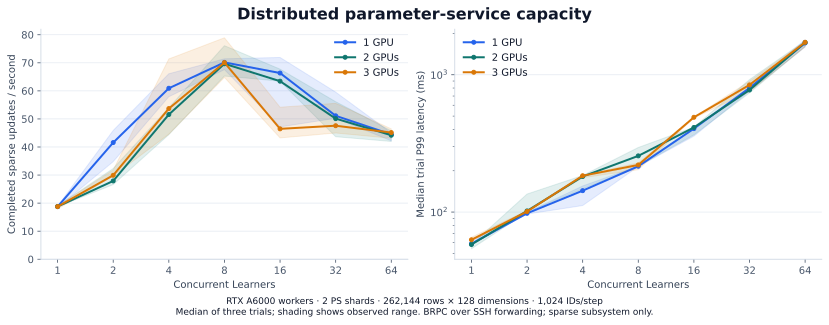
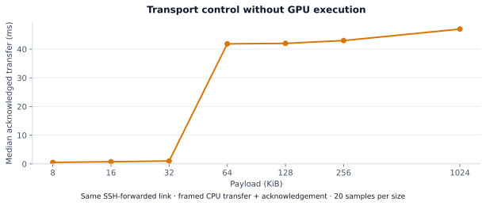

# Multi-GPU capacity evaluation

October 31, 2026 · C++20 / BRPC / CUDA · 1–3 RTX A6000 workers

The measured operating point is **61.8 completed sparse update steps/s** across
three 30-second trials with three GPU workers, two parameter shards and eight
concurrent Learners. The trials completed **5,754 steps with zero errors**.
Short-window sweeps reach approximately 70 steps/s on one, two and three GPUs.
Increasing concurrency beyond that point raises latency without increasing
throughput. The measured revision's scaling limit lies in the service/transport path.



## Workload and measurement

A measured step performs batched lookup, CPU/GPU feature reconstruction, feature
gradient preparation and an acknowledged sparse LazyAdam update. Gradients are
synthetic; dense-model forward/backward computation is outside this benchmark.

| Setting | Value |
|---|---|
| Parameter table | 262,144 rows × 128 FP32 dimensions |
| Cached rows | 131,072 total, distributed over the selected GPU workers |
| Default input | 1,024 ID occurrences/step, mean pooling, 32 IDs/bag |
| Distribution | 95% of IDs from the cached half, 5% from the full table |
| Key placement | Parameter shard: `key % shard_count`; cache worker: `(key / shard_count) % gpu_count` |
| Optimizer state | FP32 weights, first/second moments and per-row counters |
| Main sweep | 1, 2, 3 GPU workers; 1–64 concurrent Learners; 2 parameter shards |
| Main repeat policy | Three trials per load level, five-second submission windows |
| Shard/batch controls | Two trials per load level, three-second submission windows |
| Sustained control | Three trials, 30-second submission windows, 3 GPUs / 2 shards / 8 Learners |

Initialization, cache admission, three warmup updates and post-run checks are
outside the measured interval. Throughput divides completed steps by elapsed
time **including the final drain**. Step latency starts when a Learner dispatches
its prepared IDs and ends after the sparse update acknowledgement. It includes
feature-gradient preparation and service queueing. Input generation also
contributes to throughput time. P99 values below are medians of trial-level P99s,
not a pooled percentile across trials.

Each load level checks finite state, sampled parameter update counts and the
absence of live tickets. Current probes sample 32 keys spanning the shard
partitions. Earlier published variants also sample 32 keys; their old stride
covered only one modulo partition in the two-shard configuration. The corrected
probe is included in commit `db74e47`.

## GPU-count sweep

The final implementation uses compact gradient payloads, concurrent independent
owner updates and notification-based completion waiting. The total table and
cache size remain fixed as GPU count changes.

| GPU workers | Learners | Completed steps/s | Median trial P99 | Trial rate range |
|---:|---:|---:|---:|---:|
| 1 | 8 | 70.14 | 215.6 ms | 67.57–71.42 |
| 2 | 8 | 69.65 | 256.6 ms | 65.27–76.09 |
| 3 | 8 | 70.08 | 220.4 ms | 64.78–78.92 |
| 3 | 64 | 45.14 | 1,723.8 ms | 43.09–46.45 |

Eight Learners give the highest median throughput in each final GPU-count
sweep. At 64 Learners, three-worker throughput falls by about 36% while P99
grows to 1.72 seconds. Adding GPUs alone does not remove the current bottleneck.

## Shard, batch and sustained controls

| Control | GPUs / shards / Learners | IDs / bag length | Steps/s | ID occurrences/s | Median trial P99 |
|---|---|---|---:|---:|---:|
| One-shard peak | 3 / 1 / 16 | 1,024 / 32 | 40.35 | 41,316 | 415.0 ms |
| Four-shard peak | 3 / 4 / 8 | 1,024 / 32 | 73.93 | 75,703 | 321.8 ms |
| Large-batch peak | 3 / 4 / 16 | 8,192 / 128 | 69.95 | 573,010 | 304.9 ms |
| 30-second control | 3 / 2 / 8 | 1,024 / 32 | 61.80 | 63,287 | 246.7 ms |

The three longer trials range from **61.27 to 67.48 steps/s**. Their combined
5,754 completed updates have no errors. This is the longer-window operating
point established by this experiment; it does not establish hours-long stability.

Increasing shards from one to two helps substantially; four shards provide
little additional throughput over the two-shard main sweep. Larger batches
amortize request overhead and increase useful ID work per step. ID occurrences
count repeated IDs as separate input positions, rather than unique row updates.
The controls use shorter submission windows than the sustained trial, so their
peak rates should be interpreted with their repeat ranges in the raw summary.

## Gradient payload


For pooled features, the same feature-gradient vector contributes to many
parameter rows. The compact representation sends the feature vectors once per
destination command, plus ordered row references, offsets and mean scales. A
CUDA kernel reduces those references into the destination row gradients before
Adam. Expanded gradients remain the fallback when they occupy fewer bytes.

At eight Learners, the numeric gradient attachments per step are approximately:

| Workers | Expanded representation of the same updates | Actual transmitted representation | Reduction factor |
|---:|---:|---:|---:|
| 1 | 497.4 KiB | 51.5 KiB | 9.7× |
| 2 | 497.4 KiB | 83.5 KiB | 6.0× |
| 3 | 497.4 KiB | 115.2 KiB | 4.3× |

Both counters are recorded for the **same completed updates** in each final
trial. They cover numeric gradient attachments, including compact references,
offsets and scales, and exclude Protobuf row identities, message headers and SSH
framing. CPU validation and original-request gradient reduction remain in the
update path. This result quantifies transferred payload, without assigning a
model-training speedup to it.

The published history contains three source variants:

| Variant | Source commit | Behavior |
|---|---|---|
| `concurrent_expanded_polling` | `5ef8cd8` | Concurrent owner updates, expanded gradients, completion polling |
| `compact_polling` | `3a59ebc` | Compact-gradient selection, completion polling |
| `concurrent_compact` | `db74e47` | Compact gradients and bounded notification waiters; final probe |

These runs retain repeat ranges and their original raw records. In particular,
the earlier one-GPU compact variant reached 82.60 steps/s, above the final
one-GPU result. The experiment does not establish an independent throughput
benefit for replacing completion polling. The final curves use one implementation
consistently for all GPU counts.

## Locating the scaling limit

A CPU-only framed send/acknowledgement probe used the same SSH-forwarded link,
with `TCP_NODELAY` enabled at both endpoints and 20 samples per payload size.
Median transfer latency was **1.01 ms at 32 KiB**, **41.85 ms at 64 KiB** and
**47.00 ms at 1 MiB**. This exposes substantial transport delay without any GPU
execution. The exact transport mechanism behind that size-dependent delay was
not isolated.



The client submits parameter-shard lookups concurrently, then resolves cached
feature work one shard at a time. A request can therefore make several separate
GPU-agent calls for the same destination. Increasing GPU/shard counts adds
coordination and messages while the small vector workload provides limited GPU
work to amortize them. Throughput, shard controls and the CPU-only transport
probe together point to this service/communication path as the next target.

Following these measurements, the client now **coalesces cached feature work
across parameter shards by destination GPU** and issues destination gathers
concurrently. Native, real-BRPC and TensorFlow checks cover the new path; the
two-shard/three-agent test asserts one gather per destination and checks
numerical state against a CPU reference. The figures above remain measurements
of `db74e47`; a paired GPU rerun is needed to quantify this subsequent change.

Re-running on a directly reachable private network would separate application
coordination from the forwarded transport. The measurements here establish the
limit of this deployment and workload; raw GPU compute capacity and complete
model-training scaling require their own workloads.

## Correctness and overload

At the measured revision:

- L40 native CPU/CUDA suite: **12/12 passed**.
- macOS native/RPC/TensorFlow suite: **11/11 passed**.
- Core-only ASan/UBSan suite: **7/7 passed**.
- Each of three distinct A6000 devices passed CUDA state and device-result checks.
- A configured 32-live-ticket limit accepted 32 of 64 concurrent Learners and
  rejected the rest with `capacity_exceeded`; rejected work retried successfully
  after release, with cached data and row pins intact.
- All **207 published capacity trials** completed with zero reported errors.

Numerical, migration, replay and recovery coverage is detailed in
[VALIDATION.md](VALIDATION.md). The separate checked-read stress test covers
1,048,576 rows and 8,388,608 ID occurrences with zero maximum absolute error.

## Environment and reproducibility

Three separate Thunder Compute workers each exposed one distinct RTX A6000
48 GB device, compute capability 8.6. The coordinator had six allocated vCPUs
on an AMD EPYC 7773X host and 48 GiB host RAM; its L40 was used for correctness
validation, while the scaling workload used the A6000 agents. Parameter shards
and the load generator shared the coordinator's CPU allocation. Agents lived on
separate instances. BRPC used direct host-to-host SSH port forwarding because
the tested private endpoints were unreachable.

Software: Ubuntu 22.04, GNU C++ 11.4.0, BRPC 1.18.0, Protobuf 3.12.4, CUDA
compiler 13.0.88, driver 610.43.02, compiled architectures 86/89. CUDA arithmetic
uses `--fmad=false`. The image's provider driver/preload was retained; the BRPC
optional pthread profiler hook was disabled as described in the validation log.

The [manifest](benchmarks/2026-10-31/manifest.json) records source commits,
workloads, trial counts, SHA-256 hashes and raw-record filenames. The
[summary](benchmarks/2026-10-31/summary.json) contains 73 measured load levels
across 13 experiments and 207 trials. Associated resource summaries contain
sampled parameter-server/load-generator CPU and RSS. CPU use is expressed in
equivalent occupied cores, with CPU time interpolated over each native timed
window. RSS is the sum of sampled per-process maxima. Connection details and
credentials are excluded.

Build instructions and single-host runs are in [RUNNING.md](RUNNING.md).
For a prepared three-worker fleet and local private connection configuration:

```sh
python3 scripts/fleet_capacity_sweep.py --fleet build/fleet.json \
  --out-name scaling --gpu-counts 1,2,3 --ps-shards 2 \
  --rows 262144 --dimension 128 --keys 1024 --bag 32 \
  --learners 1,2,4,8,16,32,64 --seconds 5 --repeats 3
```

The fleet script starts agents on prepared hosts, verifies distinct GPU UUIDs,
invokes the native probe and stops its processes. Instance rental/deletion and
SSH forwarding are managed separately. Use `--ps-shards 1` / `4` for shard
controls; `--keys 8192 --bag 128` for the large-batch control; and
`--gpu-counts 3 --learners 8 --seconds 30 --repeats 3` for the longer control.

Regenerate the figures from the published records:

```sh
python3 -m pip install matplotlib
python3 scripts/render_capacity.py \
  --data docs/benchmarks/2026-10-31 --out docs/assets
```
