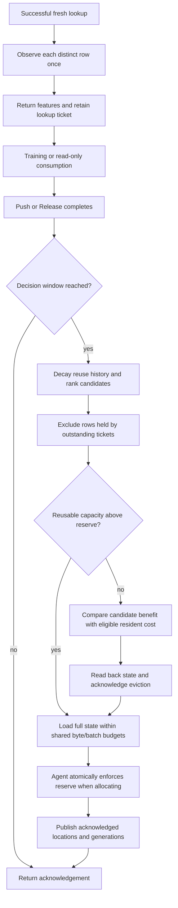

# Automatic cache admission and replacement

The parameter service can move repeatedly used rows into its GPU cache and
replace older residents when the hot set changes. A migrated row includes its
weights, both Adam moments and update counter. Unadmitted or evicted rows remain
trainable through the CPU path.

## Request and ownership flow



Each home shard owns its decisions and uses its existing sequencer. A fresh
lookup contributes one observation per distinct `(table, key)`, even when that
ID occurs repeatedly or in several features. Retried lookups and completed
Push/Release retries do not advance the observation or completion windows.
Read-only requests participate when released.

At a decision boundary, every row referenced by another live ticket is excluded
from admission and replacement. Lookup tickets preserve the ownership used by
backward. Migration reuses the existing acknowledged Load / ReadBack /
CommitEviction lifecycle; placement generations advance after acknowledged
publication. New lookups wait behind that sequenced decision.

## Reuse and cost model

The access-history map retains at most `max_tracked_rows`. Within that bound,
observations are maintained in request-level LRU order. Old counts decay lazily
by `window_decay` for every decision window that passes. A row's score is an
exponentially weighted request count; it estimates repeated access rather than
counting repeated positions inside one batch as separate future requests.
Large working sets can displace history entries, trading prediction fidelity
for bounded metadata. Resident generation/age metadata is proportional to the
current cached rows and is reconciled at each decision window.

`frequency` selects rows above `minimum_accesses` using that count. `reuse_cost`
uses the following prediction, in microseconds:

```text
candidate benefit = expected accesses × saved time per access
                  − full-state bytes × (load cost/byte + future writeback cost/byte)
resident value    = expected accesses × saved time per access
replacement cost = retained resident value + immediate writeback cost
```

Only positive-benefit candidates are admitted. A replacement must exceed the
combined eligible residents' replacement cost by `replacement_margin`; a
resident must also have reached `minimum_residence_windows`. Candidates and
victims are compared within the same table and destination agent, so they share
a row layout. A replacement may also free enough additional slots to restore
the configured reserve before admitting the new rows.

`saved_microseconds_per_access`, `load_microseconds_per_byte` and
`writeback_microseconds_per_byte` are configurable priors. With
`learn_migration_costs=true`, acknowledged migration elapsed time per logical
state byte updates the latter two estimates using `cost_average_alpha`. That
elapsed time includes the service/backend/transport path. Saved-access time is
an explicit workload estimate; the controller does not invent paired CPU/GPU
measurements. Access-route selection remains a separate cost-planner decision.

## Placement, budgets and contention

Candidate placement uses the configured agent order:

```text
agent = policy_agents[(key / shard_count) % policy_agents.size()]
```

One window shares `network_bytes_per_window`, `staging_bytes_limit` and
`max_inflight_batches` across all its tables and agents. Logical migration bytes
are `rows × (12 × dimension + 8)` for FP32 weights, moments and row counters;
wire identities and protocol headers are additional. Every eviction and
admission consumes its own budget. The controller issues batches sequentially;
`max_inflight_batches` also caps their **total count per window**. This bounds
work more strictly than an in-flight-only limit. A replacement needs at least
two available batches and budgets for both directions. Each batch also obeys
`max_rows_per_batch` and the service request-byte limit.

The service checks capacity before migrating. The destination backend repeats
the reserve check **inside its ordered allocation operation**, using
`MigrationPlan.reserve_slots`. Two home shards can therefore observe the same
free capacity without subsequently consuming the reserved slots. Capacity
contention can still reject an admission; the row stays CPU-owned and may be
reconsidered in a later window. Existing agents must be upgraded with the PS to
enforce the new reserve field.

For CUDA, the reserve applies to each preallocated table's free slots. The host
reference backend uses a shared byte pool and checks that the complete batch
leaves the equivalent reserve for every table it loads. Its memory layout is a
protocol reference, while actual GPU allocation uses the CUDA backend.

A rejected admission is policy work, so it does not undo a completed training
update. If eviction succeeds but replacement admission loses a capacity race,
both rows remain available through CPU ownership. Uncertain agent failures keep
the service's existing failed-run boundary. Migration is never retried by
blindly applying a second optimizer update.

## Save, restart and execution cost

Drain stops new lookups and requires outstanding tickets to complete. Automatic
maintenance is skipped during draining and on failed services. The existing
snapshot path writes back all cached rows before saving weights, moments,
row counters and table optimizer context. A restored process starts with cold
cache/history and rebuilds placement from new observations; history is a
performance hint and is not needed to reproduce the optimizer trajectory.

Decisions and migrations currently execute on the shard sequencer and contribute
to the completing request's latency. Coarse windows reduce how often that work
runs. Moving preparation/agent waits off the sequencer requires a separate
ownership-aware scheduling change; this controller does not claim to remove
the communication limit measured in the capacity report.

## Configuration and metrics

[The cache deployment example](../configs/service.cache.example.json) enables
`reuse_cost`; [the CPU example](../configs/service.example.json) retains manual
placement. Set `cache.admission` to `manual`, `frequency` or `reuse_cost`.
`policy_agents` defaults to the configured agent list. Automatic modes require
attached agents; transfer/CPU fallback for uncached contributions is configured
separately under `access`. Clients must register their cache endpoints to resolve
resident features.

| RPC Stats field | Meaning |
|---|---|
| `policy_windows` | Decision windows triggered by fresh completions |
| `policy_tracked_rows` | Current bounded access-history entries |
| `policy_admitted_rows`, `policy_evicted_rows` | Successfully migrated rows |
| `policy_pinned_skips` | Row-window decisions deferred by live tickets |
| `policy_budget_skips` | Candidate decisions deferred by byte/batch bounds |
| `policy_migration_batches`, `policy_migration_bytes` | Acknowledged policy migration work |
| `policy_failures` | Policy allocation/migration attempts that failed |

Counters are cumulative for the process; reconfiguring a policy resets its
history/residence estimates and keeps cumulative counters. Current tracked rows
become zero in manual mode. Pin/budget skips are decision events, not unique rows.

## Verification

`automatic_cache_policy_lifecycle` compares weights, moments and row counters
with an independent CPU service through hot-set replacement, pins, reserved
capacity, read-only completions, duplicates, bounded history, byte/batch limits,
multiple agents, admission failure before/after eviction, and save/restore.
`automatic_cache_external_shards` and its coalesced variant execute two external
BRPC parameter shards with a separately running agent, exercise JSON settings
and RPC metrics, and continue the exact optimizer trajectory after restart.

The process driver accepts `EPS_CACHE_BACKEND=cuda` for real-device verification;
its default is the host protocol backend. GPU performance results in
[BENCHMARKS.md](BENCHMARKS.md) retain their measured source revisions and manual
placement. Automatic-policy performance needs a separate changing-hot-set
comparison, including the migration work in end-to-end latency.


`tensorflow_graph_automatic_cache` and its coalesced variant execute five
TensorFlow dense/sparse train steps with automatic admission, decreasing loss
and no retracing. They assert that the two accessed rows become resident,
inspect per-shard policy metrics through the isolated Python bridge, and verify
cache drain at save. `ParameterServer.stats()` returns runtime dictionaries in
configured shard order for monitoring outside the graph.
