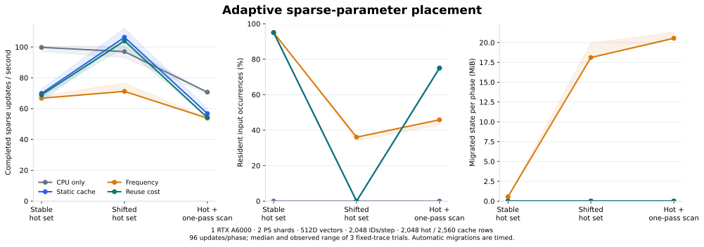
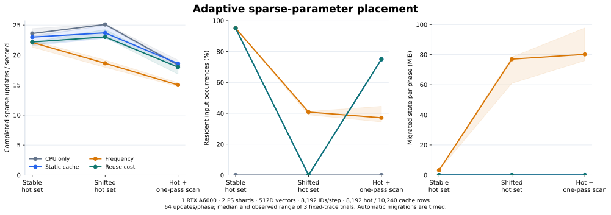
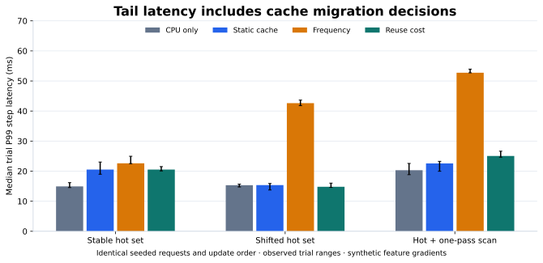

# Cache policy evaluation on RTX A6000

The later [multi-GPU study](MULTIGPU_LIMITS.md#cache-policy-replay-and-numerical-checks) retains 35 completed first-fleet fixed-trace runs across 1, 2 and 4 agents, plus a separate four-agent positive-cost correctness check.

October 31, 2026 · source `3a2cd7e` · two BRPC parameter shards / one CUDA agent

Cache-hit rate did not predict completed-update throughput in these traces.
During the moderate profile's hot-set shift, reuse-cost admission completed
**103.90 updates/s**, compared with **71.16 updates/s** for
frequency placement, and moved **0.00 versus 18.11 MiB** of parameter state.
Median trial P99 was **14.80 versus 42.62 ms**. Static placement completed
106.28 updates/s in that phase. The cost rule retained the initial placement
and avoided new admissions after calibration found GPU caching slower.



The experiment contains **36 independent runs**, including calibration,
**84 phase records** and **6,528 completed sparse updates** across two profiles.
All runs passed complete feature/state replay checks. Phase records within a run
are successive portions of one trace and are not independent repetitions.

## Workload and controls

A measured step performs lookup, reconstruction of mean-pooled features, a copy
of those features for later correctness checking, and an acknowledged sparse
LazyAdam update with constant 0.01 feature gradients. Dense-model forward/backward
is outside this parameter-service benchmark. Input generation, initialization,
CUDA warmup, initial static loading, CPU-reference replay and final save/state
checks are outside timing. Automatic migration decisions and their transfers
are included in the completing step's latency.

| Setting | Moderate profile | Larger-batch profile |
|---|---:|---:|
| ID universe | 131,072 | 262,144 |
| FP32 dimensions | 512 | 512 |
| IDs per step | 2,048 | 8,192 |
| IDs per bag | 64 | 128 |
| Rows per hot set | 2,048 | 8,192 |
| Cache slots | 2,560 | 10,240 |
| Reserved slots | 64 | 128 |
| Steps per phase | 96 | 64 |
| Steps per calibration | 64 | 64 |
| Completions per decision window | 16 | 16 |
| Maximum rows per migration batch | 256 | 1,024 |
| State-byte budget per home/window | 2,097,152 | 16,777,216 |

Both profiles use one Learner to preserve update order, two independent PS
processes, one local standalone agent and loopback BRPC. Each mode has three
fresh-process runs. The four mode orders rotate across blocks; each CPU/static
calibration pair alternates order. The larger profile increases work per request
and migration batch/budget together; it is a separate workload profile, rather
than an ablation of one variable.

Three successive phases use the same seeded ID order in every mode:

1. **Stable:** 95% of positions use the first hot set; 5% use a separate cold region.
2. **Shift:** the same distribution moves to a disjoint, equally sized hot set.
3. **Mixed scan:** 75% use the first hot set; 25% visit unique scan IDs once.
   Scan IDs are excluded from the earlier cold region.

CPU-only starts without resident rows. Static, frequency and reuse-cost modes
start with the same first hot set already resident. All runs warm CUDA using a
separate table whose sole row is evicted before timing; that temporary table's
preallocated slot array remains allocated. Cache-slot counts refer to the
benchmark table, rather than device-wide VRAM use. Rows outside the initial hot
set are created lazily; the ID universe is not a claim that every ID is allocated.

Frequency uses decayed distinct-row request counts, a minimum of two observed
accesses, minimum residence of two windows and a 25% replacement margin.
Reuse-cost uses the same bounds and subtracts full-state loading/writeback costs.
History holds at most 16,384 rows/home in the moderate profile and 65,536 in the
larger profile. Each home may issue at most eight migration batches per window.
State bytes count FP32 weights, two moments and the row counter; protocol
identities and headers are additional.

## Calibrated costs

Saved time per access is estimated from the median complete-step difference
between CPU-only and static-cache calibration, divided by the mean number of
distinct initially hot rows per step. Negative differences are clamped to zero.
The calibration is a point estimate from three runs per mode. Migration costs
start at 0.001 microseconds/state byte in each direction and update from
acknowledged automatic migrations with an EWMA coefficient of 0.2.

| Profile | CPU step mean, median | Static-cache step mean, median | Savings prior per distinct hot-row access |
|---|---:|---:|---:|
| moderate | 10.785 ms | 14.834 ms | 0.000000 µs |
| bulk | 43.669 ms | 42.470 ms | 0.238495 µs |

The moderate calibration favors CPU access. In the larger profile the complete
step-time difference is small; the raw calibration records retain its repeat
variation. A positive access-savings prior still has to pay the predicted
full-state migration cost before admission. Initial residents are replaced only
when making room for a more valuable candidate; a low/zero savings prior does
not proactively evict them. The reuse-cost mode admits no additional rows in either profile:
the moderate prior is zero, and the larger profile's small positive prior still
does not cover the model's loading/writeback estimate over its decayed reuse
horizon. Both retain the same initial residents while frequency placement moves
rows more actively.

## Per-phase results

Values are medians of three runs. P99 is the median of each run's phase P99,
rather than a percentile pooled across runs. Each phase contains 64 or 96
updates; longer-window concurrency checks are in the capacity report.
Input-hit fraction counts resident input
positions, including repeated IDs. It is measured from actual agent work, not
inferred from final occupancy. Migration columns cover timed automatic work and
exclude initial loading and final checkpoint drain.

### Moderate requests

| Phase | Mode | Updates/s | Median trial P99 | Resident positions | Migrated state |
|---|---|---:|---:|---:|---:|
| stable | CPU only | 99.70 | 14.93 ms | 0.0% | 0.00 MiB |
| stable | Static cache | 69.85 | 20.53 ms | 95.0% | 0.00 MiB |
| stable | Frequency | 66.74 | 22.62 ms | 95.0% | 0.56 MiB |
| stable | Reuse cost | 68.87 | 20.53 ms | 95.0% | 0.00 MiB |
| shift | CPU only | 96.96 | 15.32 ms | 0.0% | 0.00 MiB |
| shift | Static cache | 106.28 | 15.37 ms | 0.0% | 0.00 MiB |
| shift | Frequency | 71.16 | 42.62 ms | 36.0% | 18.11 MiB |
| shift | Reuse cost | 103.90 | 14.80 ms | 0.0% | 0.00 MiB |
| scan_mixed | CPU only | 70.66 | 20.33 ms | 0.0% | 0.00 MiB |
| scan_mixed | Static cache | 56.76 | 22.57 ms | 75.0% | 0.00 MiB |
| scan_mixed | Frequency | 53.78 | 52.74 ms | 45.8% | 20.55 MiB |
| scan_mixed | Reuse cost | 54.17 | 25.05 ms | 75.0% | 0.00 MiB |

### Larger requests



| Phase | Mode | Updates/s | Median trial P99 | Resident positions | Migrated state |
|---|---|---:|---:|---:|---:|
| stable | CPU only | 23.59 | 52.75 ms | 0.0% | 0.00 MiB |
| stable | Static cache | 23.00 | 54.77 ms | 95.0% | 0.00 MiB |
| stable | Frequency | 22.09 | 58.87 ms | 95.0% | 3.19 MiB |
| stable | Reuse cost | 22.18 | 53.58 ms | 95.0% | 0.00 MiB |
| shift | CPU only | 25.10 | 49.39 ms | 0.0% | 0.00 MiB |
| shift | Static cache | 23.69 | 51.78 ms | 0.0% | 0.00 MiB |
| shift | Frequency | 18.63 | 190.12 ms | 40.8% | 77.01 MiB |
| shift | Reuse cost | 23.02 | 60.11 ms | 0.0% | 0.00 MiB |
| scan_mixed | CPU only | 18.33 | 64.26 ms | 0.0% | 0.00 MiB |
| scan_mixed | Static cache | 18.59 | 64.01 ms | 75.0% | 0.00 MiB |
| scan_mixed | Frequency | 15.01 | 220.32 ms | 37.1% | 80.19 MiB |
| scan_mixed | Reuse cost | 17.98 | 72.25 ms | 75.0% | 0.00 MiB |

In the moderate shifted phase, reuse-cost placement has **46.0% higher median
throughput** and **65.3% lower median trial P99** than frequency placement.
The static baseline remains slightly faster than reuse-cost placement there.
Frequency raises residency while paying movement and coordination costs; these
results support deciding from completed work and transfer cost alongside hit rate.



## Correctness and lifecycle evidence

Every recorded feature value is compared with an untimed single-shard CPU replay
using the identical IDs, gradient tensors and update order. After all phases,
cache drain writes back full state, then every touched row's weights, moments
and update count is compared with that reference. Independent per-ID expected
counts also check one update per unique row in each original request.

| Profile | Touched rows checked per main run | Maximum feature absolute error | Maximum final-state absolute error | Nonfatal policy events in main runs |
|---|---:|---:|---:|---:|
| moderate | 70,638 | 6.71e-08 | 0 | 7 |
| bulk | 189,261 | 5.22e-08 | 0 | 18 |

Nonfatal policy events are the service's `policy_failures` counter and are
separate from completed-update errors. Refused admission work can retain CPU
fallback. The counter is aggregate, so the report does not assign an individual
error cause from it. All completed runs have no remaining lookup tickets and
restore the benchmark table's full free-slot count after drain.

Executed suites at this source:

- macOS native/RPC/TensorFlow: **20/20 passed**.
- Core ASan/UBSan at the unchanged core sources: **9/9 passed**.
- Ubuntu A6000 native CPU/CUDA: **17/17 passed**, including atomic slot reserves
  and checked device reads.
- Additional explicitly CUDA-backed process checks: **3/3 passed**, covering
  automatic replacement in both gather modes and mixed-placement save/restore.

[The source-hashed validation artifact](validation/2026-10-31-cache-policy-cuda.json)
records commands, revisions and source-log hashes. The TensorFlow graph checks
run through the Host reference agent locally; the Ubuntu process checks run the
real CUDA agent.

## Environment and reproduction

One Thunder RTX A6000 48 GB instance, six requested vCPUs, six visible CPU-affinity
slots and a 5.94-core cgroup quota; Intel Xeon E5-2683 v4 @ 2.10 GHz; 48 GiB
cgroup memory limit. Software: Ubuntu 22.04.5, GNU C++ 11.4.0, BRPC 1.18.0,
Protobuf 3.12.4, CUDA compiler 13.0.88, compute architecture 86 and
`--fmad=false`. The original provider driver/preload is retained; the optional
BRPC pthread-profiler hook is disabled by the build script.

Both profiles use identical server, agent and probe binaries from `3a2cd7e`.
The deployment differs from the earlier multi-GPU SSH-forwarded capacity study;
its absolute rates are kept separate. One-Learner trace results complement the
[concurrent capacity evaluation](BENCHMARKS.md).

| Dataset | Runs | Phase records | Sources and raw hashes | Derived results |
|---|---:|---:|---|---|
| moderate | 18 | 42 | [Manifest](benchmarks/2026-10-31-cache-policy-moderate/manifest.json) | [Summary](benchmarks/2026-10-31-cache-policy-moderate/summary.json), [calibration](benchmarks/2026-10-31-cache-policy-moderate/calibration.json) |
| bulk | 18 | 42 | [Manifest](benchmarks/2026-10-31-cache-policy-bulk/manifest.json) | [Summary](benchmarks/2026-10-31-cache-policy-bulk/summary.json), [calibration](benchmarks/2026-10-31-cache-policy-bulk/calibration.json) |

To reproduce this measured revision, build source `3a2cd7e` with
`scripts/gpu_validate.sh`, then run the prepared CUDA executables:

```sh
python3 scripts/cache_policy_sweep.py --build build/cuda \
  --out build/policy-moderate --backend cuda --source-commit 3a2cd7e

python3 scripts/cache_policy_sweep.py --build build/cuda \
  --out build/policy-bulk --backend cuda --source-commit 3a2cd7e \
  --rows 262144 --keys 8192 --bag 128 --hot-rows 8192 --cache-rows 10240 \
  --reserve-slots 128 --phase-steps 64 --calibration-steps 64 \
  --migration-rows 1024 --window-bytes 16777216 --max-tracked-rows 65536
```

The driver starts fresh processes, alternates calibration pairs, rotates main
mode order, checks fixed trace identities, performs complete replay checks and
removes generated snapshots after verification. The native smoke check uses a
small Host reference configuration and is excluded from GPU measurements.

`scripts/summarize_cache_policy.py` verifies raw hashes, topology, input accounting,
calibration, numerical coverage and window bounds, then publishes curated
records and renders the figures. Private absolute paths and connection metadata
are excluded from published data.
