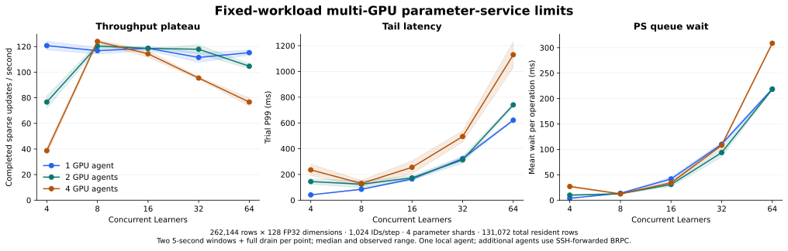

# Current-runtime multi-GPU operating envelope

October 31, 2026 · runtime `b6d97d3` · four physical RTX A6000 agents

Four GPU agents sustain **119.62 acknowledged sparse
updates/s** with **106.09 ms median trial P99** at
**8 concurrent Learners**. The one-agent sustained rate is
**117.71 updates/s**. The four-/one-agent
rate ratio is **1.02×**
under a fixed total workload and coordinator.



The study retains **86 verified capacity trials / 52,173
completed updates**, with zero update errors in those completed records.
**3 rejected load points** are recorded separately. Their
incomplete work is excluded from throughput and verified-update totals. A
separate initial single-GPU deployment retains ten completed trials / 4,028
updates and its 128-Learner rejection in the [pilot manifest](benchmarks/2026-10-31-current-multigpu/pilot/manifest.json).

## Sustained operating points

The short sweep uses 4/8/16/32/64 Learners, two five-second submission windows per
point and full drain. For each GPU count, the lowest concurrency within 95% of
its observed short-sweep peak is selected, then measured with three
20-second windows after a fresh service start. Repetitions within that probe
continue parameter and optimizer state. Entries are medians of trial metrics;
ranges are observed trial rates.

| GPU agents | Learners | Updates/s | Rate range | Trial P99 (ms) | Queue wait/operation (ms) |
| --- | --- | --- | --- | --- | --- |
| 1 | 4 | 117.71 | 115.95–117.82 | 44.07 | 3.42 |
| 2 | 8 | 127.75 | 121.65–129.04 | 107.08 | 11.67 |
| 4 | 8 | 119.62 | 114.66–125.25 | 106.09 | 11.67 |


These operating points use four parameter shards. Increasing the GPU count
partitions the same 131,072 resident rows across more agents. It also increases
the number of destinations touched by each shard. The coordinator, global table
size and per-step input count remain fixed.

## Admission boundary under overload

The standalone GPU Agent configures BRPC `max_concurrency=128`
([agent entry point](../src/server/agent_main.cpp)). This is an in-flight RPC
limit at each Agent. A Learner's batch can produce gathers from several parameter
shards and a separate update from each shard, so the Learner count and Agent RPC
count differ. The resumable shard scheduler permits independent requests to
reach the Agent while earlier owner operations are pending.

| Experiment | GPU agents | Learners at failure | Observed error |
| --- | --- | --- | --- |
| limits-overload-g1 | 1 | 128 | E2004: Agent RPC admission limit |
| limits-overload-g2 | 2 | 128 | E2004: Agent RPC admission limit |
| limits-overload-g4 | 4 | 128 | E2004: Agent RPC admission limit |


Each rejected topology is stopped independently, preserving its logs and any
previously completed, verified trial records. Later topologies are still
attempted. The report does not assign a latency percentile or completed-update
count to an incomplete rejected point. Post-failure optimizer state was not
validated for those failed probes. Successful completed probes check finite
parameters, sampled row-update counters and zero live tickets after drain.

## Parameter-shard control

Four agents are held fixed. Each one-/eight-shard point has two four-second
windows. The table selects the highest median among the common 4/8/16/32-Learner
levels; the four-shard entries come from the main matrix.

| PS shards | Learners | Updates/s | Trial P99 (ms) |
| --- | --- | --- | --- |
| 1 | 32 | 37.90 | 873.48 |
| 4 | 8 | 123.99 | 130.38 |
| 8 | 8 | 54.32 | 381.55 |


More shards divide CPU-owned work while adding partial outputs, tickets and
owner RPC destinations. A table's optimizer context remains ordered inside its
home shard; resumable waiting does not remove that dependency. Agent requests
also enter an ordered runtime before cache execution
([Agent runtime](../src/cache/agent_runtime.cpp)). These serialized boundaries
and fan-out explain which paths need profiling when extra GPU agents stop
improving throughput.

## Scheduling, skew and automatic-placement controls

All rows use four GPU agents and four shards. The default active limit is 16;
the serialized control sets it to 1. Hot-shard IDs all satisfy `key % 4 == 0`,
while retaining the same resident-mixture probability and vector width. They
still distribute resident rows across the four GPU owners. Frequency admission
uses the same bounded policy settings as the earlier study.

| Control | Learners | Trials | Updates/s | Trial P99 (ms) |
| --- | --- | --- | --- | --- |
| Uniform resident mixture | 8 | 2 | 123.99 | 130.38 |
| Uniform resident mixture | 32 | 2 | 95.40 | 494.63 |
| Serialized shard scheduling | 8 | 3 | 108.90 | 141.70 |
| Serialized shard scheduling | 32 | 3 | 88.96 | 525.97 |
| Serialized shard scheduling | 128 | 3 | 76.88 | 2102.88 |
| All timed IDs home to shard 0 | 8 | 3 | 50.24 | 213.12 |
| All timed IDs home to shard 0 | 32 | 3 | 38.91 | 861.58 |
| All timed IDs home to shard 0 | 128 | 3 | 55.43 | 2368.39 |
| Automatic frequency admission | 8 | 2 | 27.01 | 1340.03 |
| Automatic frequency admission | 32 | 2 | 48.54 | 1606.89 |


These are same-binary controls on the same fleet in separate blocks. Learner
lists and repetition counts differ; the rows characterize behavior without
claiming a paired identical-trace speedup. The main sweep uses two repetitions;
scheduling and skew controls use three five-second windows, and automatic
admission uses two.

At 128 Learners, both serialized scheduling and the hot-shard control complete
all three windows, with P99 above two seconds. The default four-shard
distribution reaches Agent admission rejection at that load. Scheduling and
request distribution therefore affect the observed boundary. Successful
completion at high concurrency comes with substantial queueing latency.

| Policy windows | Admitted rows | Evicted rows | Migration bytes | Maintenance failures | Live tickets after drain |
| --- | --- | --- | --- | --- | --- |
| 268 | 5 | 0 | 7720 | 0 | 0 |


Policy counters cover setup, warmup and the whole automatic-placement probe.
Frequency admission is slower than manual placement at both common load levels.
Its inclusive maintenance timer totals 11.78 and 12.61 ms per acknowledged update
at eight and 32 Learners, respectively, summed across parameter shards. These
stage times can overlap with other work and are not percentages of elapsed time.
This control measures maintenance overhead with five admissions and no evictions.

## Larger embeddings

The larger control uses 1,048,576 rows × 512 FP32 dimensions, 8,192 ID occurrences
per step, mean-pooling bags of 128 and 524,288 total resident rows. Weights plus
two Adam moments occupy **6 GiB of logical state**. Both GPU counts test 8 and 32
Learners with two five-second windows. The table selects each count's highest
median observed rate.

| GPU agents | Learners | Updates/s | Trial P99 (ms) |
| --- | --- | --- | --- |
| 1 | 8 | 43.78 | 201.75 |
| 4 | 32 | 24.56 | 1453.67 |


The allocated cache pools retain spare slots at this working-set size.

## Transport and measured scope

One Agent is local to the coordinator; additional Agents use SSH-forwarded
BRPC. A framed upload plus acknowledgement control measures those same paths
with three warmups and 20 repetitions per payload size.

| Path | 8 KiB (ms) | 64 KiB (ms) | 1 MiB (ms) | 1 MiB framed rate (MiB/s) |
| --- | --- | --- | --- | --- |
| loopback | 0.05 | 0.08 | 2.09 | 478.60 |
| forward-1 | 0.65 | 41.92 | 47.95 | 20.85 |
| forward-2 | 0.64 | 41.20 | 48.00 | 20.83 |
| forward-3 | 0.65 | 41.83 | 48.03 | 20.82 |

The forwarded paths add substantial latency in a CPU-only transfer control.
Together with increasing request fan-out, rising queue waits and the ordered
Agent execution path, this points to communication and request coordination as
scaling targets for this deployment. These measurements describe parameter-service
operating points under the recorded transport configuration.

The coordinator is **Intel(R) Xeon(R) CPU E5-2699 v4 @ 2.20GHz**, with six affinity-visible
CPUs, cgroup CPU quota `594000 100000` and 48 GiB allocated RAM.
All devices are A6000 48 GB, compute capability 8.6. GNU C++ 11.4, BRPC 1.18.0 and
CUDA 13.0.88 use architecture 86 and `--fmad=false`. Four distinct CUDA UUIDs and
matching agent binaries are checked during deployment.

Each timed step includes distributed lookup, feature reconstruction, synthetic
feature-gradient preparation and acknowledged sparse LazyAdam updates. The main
workload has 262,144 rows, 128 FP32 dimensions, 1,024 ID occurrences/step and
mean-pooling bags of 32. IDs can repeat. 95% of generated IDs come from the
resident half and 5% from the full table, giving an expected 97.5% resident
occurrence share. Model forward/backward and dense-gradient collectives belong
to the training framework and are outside this parameter-service workload.

Initialization, migration, numerical preflight and warmup are outside timing.
Throughput includes input generation and full drain; latency begins after ID
preparation and ends at update acknowledgement. P99 entries are medians of trial
P99s. Phase timers are inclusive stage wall times; actor occupancy excludes
suspended external waits. Process CPU/RSS summaries retain only fully sampled
windows. The earlier four-agent revision and its hardware deployment remain in
[the historical report](MULTIGPU_LIMITS.md); absolute rates across deployments
are not a paired optimization comparison.

## Validation and artifacts

The current Ubuntu CPU/CUDA suite passes **22/22**. Every worker also passes
its CUDA state/device-result check. Capacity preflight covers mean, sum and
sequence outputs, duplicate IDs and empty bags; maximum feature error is
**3.91e-08**. Completed trials verify
**2,752 row-update counters** in total, plus finite
weights and ticket cleanup. Full optimizer replay is covered by the separate
[existing correctness records](VALIDATION.md); the capacity sample checks are
reported with their own scope.

- [Manifest, source/binary hashes, failed points and cleanup](benchmarks/2026-10-31-current-multigpu/manifest.json)
- [All successful load levels](benchmarks/2026-10-31-current-multigpu/summary.json)
- [Source-hashed validation](validation/2026-10-31-current-multigpu.json)
- [Native/CUDA test log](benchmarks/2026-10-31-current-multigpu/native-cuda-tests.log)

All worker archives are fetched and SHA-256 verified before instance deletion.
All four rental instances are verified absent after cleanup.

## Reproduce

```sh
python3 scripts/fleet_capacity_sweep.py --fleet /path/to/private-fleet.json \
  --out-name current-fixed --gpu-counts 1,2,4 --ps-shards 4 \
  --learners 4,8,16,32,64 --seconds 5 --repeats 2
python3 scripts/fleet_capacity_sweep.py --fleet /path/to/private-fleet.json \
  --out-name current-overload --gpu-counts 1,2,4 --ps-shards 4 \
  --learners 128 --seconds 10 --repeats 2
python3 scripts/fleet_capacity_sweep.py --fleet /path/to/private-fleet.json \
  --out-name current-hot-shard --gpu-counts 4 --ps-shards 4 \
  --access-pattern hot_shard --learners 8,32,128 --seconds 5 --repeats 3
```

[Private fleet format and build instructions](RUNNING.md)
