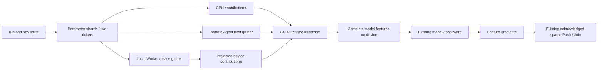

# Complete distributed features on CUDA

`TableAdapter::PullDevice` returns model-ready device features under the existing
Pull/Push/Join handle. It combines CPU-owned parameters, local native cache
results and remote Agent contributions, then restores pooling and sequence layout
on the model GPU. `PullPreparedDevice` consumes the existing FIFO preparation
tokens through the same path.



## Distributed lookup and reconstruction

The client still partitions IDs by home shard and retains each shard's ticket.
Device lookup collects shard replies and coalesces work by destination, feature
and access route. Native destinations call `WorkerCacheAgent::GatherDevice`;
other destinations use the existing host-returning Agent RPC. All destination
reads are submitted before their completions are collected. An error waits for
every submitted read before the client releases known row pins.

Destination projection sends only referenced occurrence positions. A native
sequence contribution carries its compact device matrix and the corresponding
global occurrence positions. The assembler composes those positions with the
adapter's original sequence positions, so it can scatter directly into padded
model output. Remote sequence contributions use the existing host reconstruction.

The CUDA backend assembles the complete features on its ordered stream:

1. Initialize output and upload the combined CPU/remote-host contributions.
2. Wait on each native contribution's producer event and add its values directly
   from device memory; scatter sequence contributions to their original rows.
3. Divide mean outputs once by the complete, nonpadding bag lengths. Empty bags
   and padding positions retain zero.
4. Record output readiness and return independently owned device blocks.

The output uses the same owned allocation and output-byte budget as native
gather. Input device blocks and host vectors stay alive until their submitted
reads finish; CUDA failures drain the stream before ownership is released. The
combined compact host staging is limited to 64 MiB at the client. The assembler
also enforces the backend's configured transfer/output budgets, including final
padded shape and position buffers. Inputs and the final output coexist during
assembly and count against the output ownership budget.

Collecting replies before a coalesced gather avoids multiple calls for the same
destination and provides a single global layout. It gives up the host path's
early gather from a ready shard. Device assembly adds output initialization and
merge kernels while keeping native contributions on device. The measurement
contract therefore separates correctness from any future throughput comparison.

## Configure a native training worker

After creating the worker and registering its reachable endpoint with the
parameter shards, configure the existing C++ adapter:

```cpp
adapter.SetDevicePath(
    eps::MakeDeviceCacheResolver(
        {{0, [worker](auto work, auto layouts) {
            return worker->GatherDevice(std::move(work), std::move(layouts));
        }}},
        {{1, remote_agent_backend}}),
    [cuda_backend](eps::DeviceAssemblyRequest request) {
        return cuda_backend->AssembleFeatures(std::move(request)).get();
    });

auto result = adapter.PullDevice(features);
// Check Result, then consume each DevicePullResult::features block on the
// model device, retaining its owner until model operations complete.
// Submit dL/d(feature) through adapter.Push(result.handle, gradients).
```

`MakeDeviceCacheResolver` maps Agent IDs to native gather functions or remote
backends. Native tensors must reside on the assembler's CUDA device; another
device/node uses a host-returning endpoint unless the caller supplies a compatible
device-transfer resolver. Native callbacks keep the Worker admission boundary.

Device batches retain compact host shape metadata and per-shard tickets.
`TableAdapter` retains the model output shapes, strips padded sequence gradient
positions and forwards compact gradients to the unchanged acknowledged Push
path. Duplicate Push, explicit Release, Join, save/resume and prepared-input
ordering keep their existing behavior. The caller completes model-side reads
before abandoning a lookup or closing the worker.

The portable Python/TensorFlow bridge remains host based. This native device
Pull boundary provides complete features for a matching framework device
operator; it does not install that operator or change dense collectives.

## Validation

`distributed_device_pull_protocol` exercises the lifecycle with explicitly
labeled CPU reference tensors. `distributed_device_pull_cuda` uses two native
Worker Agents on one CUDA device, real BRPC Agent control/gather and two CPU
parameter-shard objects. The native path and a host-returning remote Agent both
contribute to the same output. The scenario includes CPU-pool and unique-vector
transfer routes, repeated IDs, seven feature layouts, empty bags, all-padding
and empty sequences, two prepared inputs, five training steps and a mid-run
save/resume with cache writeback and reload.

Every step compares complete features and all eight touched rows' weights, both
Adam moments and counters with CPU replay. A CUDA model kernel consumes each
assembled output on a nondefault stream to generate the feature gradients;
gradients return through the existing host/RPC Push. The test retains initial
outputs across later updates and save/reload. A real output-budget failure must
release all lookup tickets; a held-read test proves resolver errors wait for
other native reads to complete. These are subsystem/trajectory checks, separate
from original framework application or cross-node model execution.

```sh
ctest --test-dir build/native -R distributed_device_pull_protocol --output-on-failure
ctest --test-dir build/cuda -R distributed_device_pull_cuda --output-on-failure
```
