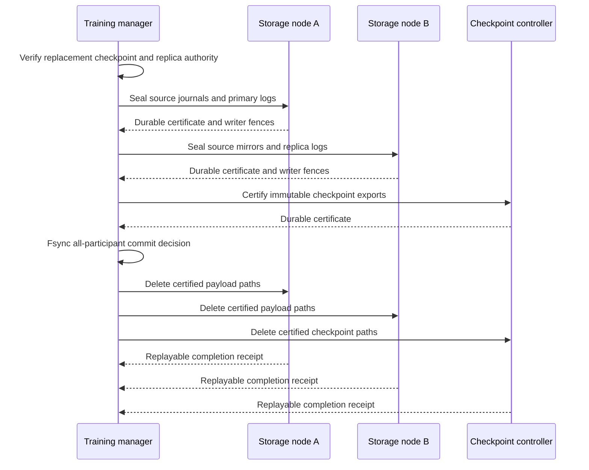

# Distributed training-generation retirement

Long-running training accumulates parameter-replica logs, original-gradient
journals and checkpoint exports. After a replacement generation owns an
independent durable baseline, the manager retires those obsolete payloads on
their storage hosts. Workers retain the current input position, model state and
optimizer progress while older recovery data leaves the active storage window.

## Roles and ordering



The manager owns the immutable source-resource assignment and group decision.
Each participant opens only its local files. Persistent SSH streams carry the
control messages; checkpoint and journal payloads remain on their hosts.

Worker and gradient-mirror inspection uses the production journal codec,
input/model identity and exact retained round interval. Native replica
inspection verifies the checkpoint frontier and checksums. Primary-parent and
storage locks exclude concurrent writers. A local certificate records the
inspected file identities before retirement markers fence the old roots.

A controller holding only published immutable checkpoint exports needs no
stopped training-process handle. Mutable worker, mirror and replica storage
requires terminal local writer handles, including the host and process birth
recorded by the role supervisor, plus exclusive storage locks.

## Interrupted operation

Sealing publishes no deletion. If a participant is unavailable, previously
sealed payloads remain present and the group has no commit decision. Once all
sealing receipts are durable, the manager publishes the commit decision before
sending any delete request.

Deletion completes per participant. Each node checks its certificate, marker
and remaining file identities, removes the certified names, fsyncs their parent
directories and publishes a completion receipt. Notes and other unregistered
files remain. A changed payload rejects the operation before the first unlink.

Restarting the same manager command reuses the immutable intent. Lost successful
replies return the existing node receipt. After the group decision is durable,
reentry uses those certificates without reopening replacement-authority RPCs;
completed retirement remains replayable after later generation cleanup. A
transport timeout leaves that participant unresolved.

## Deployment

An uninterrupted two-node managed training run can export the source generation
directly:

```sh
python scripts/managed_training_recovery.py \
  --fleet /private/training-fleet.json --run training-prefix \
  --out /controller/training-prefix --export-checkpoint
```

After both Workers finish, the native controller pauses admission and streams
the joint parameter/optimizer checkpoint to the controller. The manager then
stops its owned processes and publishes
`/controller/training-prefix/source-generation/source.json`. This descriptor
contains the source job's worker, primary, replica and mirror configurations,
exact resource ownership, and per-host terminal process handles. Remote journal
payloads remain on their original hosts. The controller checkpoint is a separate
immutable participant.

Reentry adopts the recorded training phases. A checkpoint published before the
manager recorded its phase is validated through the native snapshot reader and
matched against the input progress before adoption. The export descriptor omits
SSH authentication and connection fields. Join its deployment node IDs with the
original private fleet transport configuration, and provide local Python/source
paths for the checkpoint-controller participant. Nonlocal training nodes must
have explicit stable `node_id` values. This export entry currently covers a
fixed-placement, uninterrupted generation; fault recovery uses the existing
managed recovery entry.

First use the existing checkpoint-rollover planner and readiness verifier to
publish the replacement `plan.json` and `ready.json`. Supply a private deployment
file containing:

| Field | Meaning |
| --- | --- |
| `nodes` | Stable node IDs, Python/source/bin paths, retirement-state directories and SSH connection options |
| `resource_nodes` | Exactly one owner for every source resource key |
| `handles` | Per-node terminal source writer handles from the role supervisor |

The standard source keys are `worker-N`, `mirror-N`, `primary-N`, `replica-N`
and `checkpoint`. Repeated rotations also register `staged-checkpoint` for the
former generation's initial baseline. Map each key to its actual storage host.
Checkpoint-only controllers can provide an empty handle list.

Node descriptors use the existing `NodeSessions` transport fields: `source`,
`python`, `host`, `port`, `user`, `identity_file` and `known_hosts`; local
participants use `local: true`. Add `node_id`, `bin_dir` and
`retirement_directory`. Every participant needs the project modules, NumPy and
the native inspection binaries. Generation-specific state directories and
small receipts remain available for retries. The persisted group intent
excludes SSH identity and connection fields.

```sh
python scripts/distributed_retirement.py \
  --plan /controller/new-generation/plan.json \
  --deployment /private/retirement-deployment.json \
  --build /controller/eps-build
```

The host-local `rotate_training_checkpoint.py --action retire` entry remains
available and shares the same storage inspector.

## Executed verification

The full CPU TensorFlow model regression uses two parameter shards, two Workers,
replicated optimizer updates and three separate retirement participants: two
training-storage processes and the immutable-checkpoint controller. Replacement
readiness is verified by real native checkpoint and replica RPCs. The test
interrupts sealing, loses successful commit replies, reenters the manager and
then continues the model.

Two rotations at rounds 4 and 8 remove the old payloads. At committed round 10,
SIGKILL removes Workers, primaries, owners and coordinator before all task
completions arrive. Surviving replicas rebuild the state and training finishes
at clocks `[12, 12]`. All 32 model rows' weights, Adam moments, counters and
continued losses match uninterrupted training with maximum measured error zero.
The older completed receipt is replayed after the next generation's cleanup.

The protocol checks additionally cover a live local process or journal lock,
future gradient, omitted resource, interrupted node seal/unlink, changed payload,
changed completion receipt, and preservation of unrelated files.

The managed source-export check runs two real TensorFlow Workers, two parameter
shards and opposite-node gradient/parameter replicas for four rounds. It
interrupts the manager after checkpoint publication, reenters, validates the
checkpoint and every participant's retained storage, and checks terminal process
handles. A changed input cursor cannot adopt the checkpoint. This local check
retains 20 certified payload paths on each training participant and three on the
checkpoint controller; it performs no retirement or GPU execution.

```sh
ctest --test-dir build/tensorflow --output-on-failure \
  -R '^(distributed_retirement_protocol|tensorflow_distributed_retirement|tensorflow_distributed_retirement_recovery)$'
```

These executions use independent participant processes on one physical host.
Actual SSH-host execution and the same-workload physical multi-GPU scaling
comparison remain separate project acceptance gates.

[Commands, source hashes and measured results](validation/2026-11-05-distributed-training-retirement.json).

[Managed source-export validation](validation/2026-11-05-managed-training-source-export.json).
