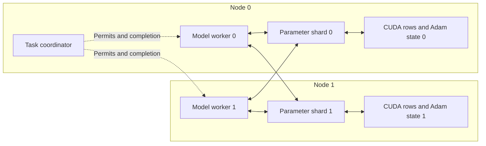

# Distributed model training and capacity execution

Each node owns one parameter shard, one parameter owner and one model worker.
The coordinator admits training tasks on node 0. Workers train the shared
Embedding/MLP model and send row gradients to the owning shards; each shard
reduces the complete worker group's gradients and applies one optimizer update.



The CPU backing storage is distributed with its parameter shard, rather than
centralized on the coordinator. CPU row storage remains allocated while rows
reside on GPU; current resident state is read back from its GPU owner for
inspection/checkpoint. Host and device memory both constrain capacity.

## Capacity conditions

`--require-capacity` enforces these conditions before table preparation:

- GPU UUIDs are distinct and the global `rows × dimension × 12` FP32
  weight/Adam state exceeds the largest physical single-GPU memory capacity.
- Assigned parameter state leaves 3 GiB of actual free device memory for staging
  and model execution. Local host backing plus conservative row metadata leaves
  4 GiB of available host/cgroup memory for the framework and runtime.
- Host-backed runs cannot establish GPU capacity, regardless of allocator limits.

The preflight verifies table definitions and actual returned vector width across
the shards. Each node prepares only its own shard, initializes every claimed
row, verifies every migration result and checks final resident counts. Training
then checks unchanged resident counts, one update per round, sampled finite
weights/moments, expected row counters, completed task clocks, drained tickets,
GPU model placement and decreased loss. Resource samples retain device memory,
utilization, process RSS and Linux cgroup usage during both phases.

## Node and network setup

Keep the fleet JSON outside version control. Each node provides SSH `host`,
`port`, `identity_file`, `known_hosts`, `user`, and these runtime paths:

```json
{
  "nodes": [
    {
      "host": "owned-node-host",
      "port": 22,
      "identity_file": "/private/path/to/instance-key",
      "known_hosts": "/private/path/to/known-hosts",
      "user": "ubuntu",
      "root": "/home/ubuntu/ps-capacity",
      "source": "/home/ubuntu/ps-capacity/source",
      "bin_dir": "/home/ubuntu/ps-capacity/portable-runtime/bin",
      "module_dir": "/home/ubuntu/ps-capacity/portable-runtime/python",
      "python": "/home/ubuntu/ps-capacity/environment/bin/python"
    }
  ]
}
```

Supply two or more owned nodes. `install_training_runtime.sh` installs a
checksum-verified compatible Linux runtime bundle and TensorFlow dependencies;
`gpu_validate.sh` builds from source when a matching bundle is unavailable.
Use `DPS_BUILD_FROM_SOURCE=1 DPS_WORK_ROOT=/home/ubuntu/ps-capacity bash
scripts/install_training_runtime.sh` for a current CUDA/TensorFlow build;
the node's `bin_dir` and `module_dir` are then `build-cuda` and
`build-cuda/python` below that work root. The pre-existing cached Linux bundle
predates joint restart and reusable Lookup metadata, so new deployments need
this source build or a regenerated matching bundle.
The bundle's Python/platform/dependency compatibility is checked at import/link
time. Source and binary hashes belong to the experiment record.

For SSH-only instances, the relay tool creates controller-local and node-local
forwards without copying authentication keys to GPU nodes:

```sh
python scripts/fleet_training_links.py --fleet /private/fleet.json \
  --out /private/connected-fleet.json --state /private/relay-state.json

python scripts/distributed_model_training.py --fleet /private/connected-fleet.json \
  --rows 5242880 --dimension 1024 --hidden 8 --iterations 8 \
  --samples 16 --bag 16 --require-capacity --out results/capacity

python scripts/fleet_training_links.py --state /private/relay-state.json --stop
```

This candidate table holds 60 GiB of weights and two Adam moments before metadata
or workspace. Live hardware checks decide whether each node can hold its shard.
SSH relay results must identify their controller transport; they are not direct
network/RDMA performance measurements.

[Joint checkpoint restart](JOINT_TRAINING_CHECKPOINT.md) restores parameter and
optimizer state together with training rounds and input positions. The
preparation tool's `restore_existing` mode reloads saved rows onto their owners
without reinitialization, before the job controller opens task admission.

## Job lifecycle and evidence

`training_node.py` retains per-role job descriptions, wrapper/child PIDs, output
logs and atomic terminal records in a unique run directory. A duplicate launch
cannot overwrite an existing job. Status queries inspect the actual process
handle. Delayed observations retain those handles, and a timeout does not
automatically create replacement jobs. Unexpected verification/transport errors
leave an explicit inspection flag and the existing jobs available; rental lease
guards are managed separately by the caller.

On terminal training success/failure, the controller requests node cleanup.
Cleanup checks process identities before signaling, waits for owned wrappers
and children and reports whether they are gone. A model failure and a successful
training computation remain distinct from cleanup verification.

## Current execution record

The complete orchestration flow passes locally with two Host-backed parameter
owners, two parameter shards and two TensorFlow model worker processes. Each
node initializes 512 rows of a 1,024-row × 8-dimensional table. Eight rounds
complete 16 worker tasks and eight updates per shard. Loss decreases from
0.693552 to 0.605325; all 37 touched rows are checked, resident counts remain
complete and both nodes' owned process cleanup is verified.

```sh
ctest --test-dir build/tensorflow -V -R '^distributed_model_orchestration$'
```

The first two-A6000 provisioning attempt is rejected before creating an instance:
the provider reports the configuration unavailable, and its UI also lists L40
as sold out. The published record contains no multi-GPU capacity result. Linux
runtime deployment and SSH relay integration await available GPU nodes.
[Source hashes, local workflow report and provisioning rejection](validation/2026-11-04-distributed-training-orchestration.json).
