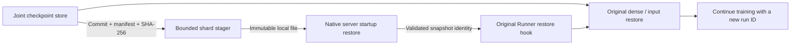

# Restore a joint training checkpoint

A restored training job uses fresh parameter-service processes and a new run ID.
Each server stages its committed shard, validates and loads it, then reports the
loaded file identity. The original Entropy restore hooks verify every server
before the existing framework restores dense parameters and resumes its reader.



## Stage and start each parameter shard

The checkpoint directory contains `external_parameters/parameter-service.json`,
its shard files and `committed.json`. The commit binds the manifest's SHA-256 to
the original checkpoint ID, source run and partition epoch. A complete parameter
export without that joint marker cannot be staged.

On the host assigned to shard 0:

```sh
export PYTHONPATH="$PWD/build/tensorflow/python:$PWD/adapters/entropy:$PYTHONPATH"
python -m entropy_stage \
  --checkpoint-root hdfs://your-checkpoint-store/job/checkpoint-2000 \
  --checkpoint-id checkpoint-2000 \
  --shard 0 --output-directory /var/tmp/parameter-restore \
  --filesystem tensorflow \
  --exec-server "$PWD/build/tensorflow/eps_server" \
  --service-config configs/shard-0.json --run resumed-training-run
```

Repeat on each shard host with its own shard index and service configuration.
The configuration's shard count and epoch must match the checkpoint. Set the
training adapter's run, ordered endpoints, epoch and table IDs to those servers.
`--filesystem tensorflow` uses the installed framework's `tf.io.gfile`, including
its configured remote-filesystem plugins. Local files use `--filesystem local`.

The stager copies at most 1 MiB per read, verifies file length, SHA-256 and the
source-run/partition header, fsyncs the local file, and publishes it immutably.
Identical local content can be reused on retry. It does not deserialize parameter
arrays in Python. The native loader checks the full snapshot body and embedded
checksum while constructing weights, Adam moments, counters and optimizer clocks.

`--exec-server` replaces the staging process with the server. The original
process handle and readiness/lifetime management therefore follow the server.
Without it, the command prints the staged file and its identity as JSON for an
existing service launcher.

## Verify the original restore boundary

Continue to call the existing `Runner.restore(model, path, checkpoint_id)`.
The installed wrapper validates the joint marker and compares the checkpoint to
each server's `RestoredFrom` response:

- Current run and source run.
- Shard index, count and partition epoch.
- Exact file byte length and the native loader's validated embedded checksum.
- Successful loading and a pristine pre-admission state.

Only a successful full snapshot load publishes provenance. The first admitted
lookup or a new table definition clears the pristine flag. Repeating the same
table definition during graph construction keeps it pristine. This lets the
original graph be constructed before restore while preventing a later dense-only
rewind from reusing parameters that have already advanced through training.

Selected tables' original `get_reshard` and `restore` calls verify the service
state and skip the native sparse loader. Unselected tables retain their original
methods. The original dense restore, asynchronous sparse-restore wait and final
framework barrier remain in the original control flow. Full training checkpoints
retain fixed partition topology; serving/delta migration is outside this path.

The parameter-service hooks do not replace the data reader. Configure that
reader to resume its checkpointed input state from the same joint checkpoint.

## Executed recovery check

The process regression trains the original-method graph, commits at step 3,
stops both parameter servers, and starts fresh servers through the staging CLI.
The original Runner/worker/table restore path reloads the dense variable through
an actual TensorFlow Saver. The fixture resumes the input cursor saved by the
checkpoint's feeder stand-in and continues three steps.

A native snapshot comparator checks selected tables against uninterrupted
six-step execution: weights, both Adam moments, row counters, optimizer sequence
and beta powers. Additional process phases reject an unrestored server and a
different loaded snapshot before dense restore; an attempted rewind after
training begins is also rejected.

```sh
ctest --test-dir build/tensorflow -V \
  -R '(restored_snapshot_provenance|committed_checkpoint_staging|entropy_original_restore_trajectory)'
```

These checks use real parameter-server processes, filesystem staging, native
snapshot loading and TensorFlow state. Preserved original methods execute with
explicit native-environment/feeder stand-ins and single-participant framework
barriers. Full native application, original reader and multi-peer framework
execution retain their own validation requirements.
