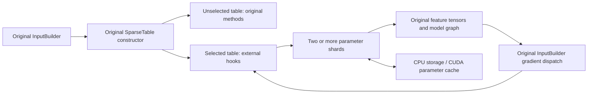

# Entropy table and checkpoint hooks

The job launcher installs external parameter tables before the existing Entropy
entry point builds its inputs and model. Selected table names use the distributed
parameter service. The original `SparseTable` class identity, variable
registration, `InputBuilder`, model, gradient scaling and dense optimizer remain
in the framework.



## Launch the existing job

Build the native Python client as described in the
[adapter guide](../adapters/entropy/README.md), start the parameter shards, and
copy [the job configuration](../configs/entropy-adapter.example.json). Its
`run`, partition epoch and ordered endpoint list must match those services.

```sh
export PYTHONPATH="$PWD/build/tensorflow/python:$PWD/adapters/entropy:$PYTHONPATH"
python -m entropy_launch \
  --parameter-config configs/entropy-adapter.example.json \
  --entry-module your_existing_training_entry -- --your-original-job-arguments
```

`--entry-script` also accepts the existing Python entry file. The launcher imports
`tensorswitch.train`, installs hooks, and forwards the remaining command-line
arguments. `--train-module` selects a different import name when the framework
package uses one. The original framework and its native dependencies must already
be installed in the training environment.

Explicit table IDs are shared by all learners. Names absent from `tables` retain
their native methods. One external backend per original learner/thread serves all
selected tables. Its request ID is `learner_rank * learner_id_stride + thread_id`;
choose a stride larger than the largest original thread ID in the job. IDs must
fit the service's 0–1023 learner namespace. The default stride of one covers a
single original thread per rank.

Optional `cache_agents` connect the existing Host or CUDA Agent processes.
`coalesce_gather` selects the existing gather policy. GPU placement remains the
parameter service's responsibility; select the plain V2 table boundary in the
original job configuration.

## Tensor and update contracts

| Original input | External representation | Output returned to the graph |
| --- | --- | --- |
| Rank-1 pooled IDs and row splits | Flat uint64 IDs, offsets, sum/mean pooling | `[B,D]` |
| Rank-2 sequence IDs and empty row splits | Flattened IDs and row offsets generated from sequence width | `[B,L,D]` |
| Signed int64 ID tensor | Preserve its uint64 bit pattern | `UINT64_MAX` is padding; zero remains a valid ID |
| Non-unique Pull with a bucket size above one | Mask non-padding IDs with `bucket_size - 1` | Preserve aliases in the original key space |

The hook creates and registers the same dummy variables as the original V2
method. `vars()` and `output()` return the current graph's feature tensors, so
the original `InputBuilder.sparse_vars` and `apply_sparse_grads` continue to
dispatch their gradients in feature order. Sequence gradients are flattened
before Push; the service performs mean unpooling once.

Each returned Push operation waits for that table's update acknowledgement. The
original framework groups those operations across tables. A per-table global
Join would incorrectly observe another table's still-live handle in the shared
backend, so the controller performs the global handle check at its save boundary.

The original `ignore_none_grads` option controls partial missing gradients. An
all-unused feature group releases its handle. Prediction mode releases the
read-only handle before returning independent feature data. Mode changes remain
owned by the original controller; callbacks read the captured learner's mode
without consulting framework thread-local state on TensorFlow executor threads.

Original table creation is cached by logical name per learner. New graph objects
therefore reuse successful remote creation for the same logical table, while
retaining distinct graph bindings. A changed definition under the same name is
rejected before a lookup can reinterpret its existing parameter state.

## Original Runner checkpoint boundary

The installed `_MultiDatasetRunner.checkpoint` wrapper coordinates all original
roles through `env.barrier(..., cluster="all")`:

1. Every learner finishes its own parameter handles; the worker chief freezes
   the shared parameter service.
2. Run the original directory preparation once, then export the frozen sparse
   state into `external_parameters/`. Suppress only the duplicate preparation
   inside the unchanged Runner body, since it would delete that export.
3. Execute the original Runner/module checkpoint code for dense, native sparse
   tables and input progress. Selected external tables reuse the shared export
   instead of calling the native sparse saver.
4. After all roles finish, publish `external_parameters/committed.json`, binding
   the parameter-manifest hash to the original checkpoint ID. Resume the service
   and release the training roles.

Failures leave parameter admission frozen. A completed parameter export alone
does not publish the external joint-commit marker. Direct calls to the module's
lower-level `checkpoint` function require the coordinated Runner context.

The [snapshot/export protocol](PERIODIC_CHECKPOINTS.md) describes bounded reads,
checksum validation and resume identities. The [restore stager and original
restore hooks](ENTROPY_RESTORE.md) prepare fresh parameter shards, verify their
loaded snapshot and reconnect the original dense/input continuation boundary.

## Source-level verification

The original-method contract executes the preserved `SparseTable`, optimizer,
decorators, registration, `InputBuilder` gradient methods, Runner checkpoint and
module checkpoint code. It uses real TensorFlow Session graphs, automatic
gradients, dense SGD, an actual TensorFlow Saver, and two external BRPC shards.
Native configuration, feeder and saver APIs use explicit stand-ins. The complete
original native application is a separate build/execution requirement.

Five paired update steps match a directly accessed reference table, covering
zero IDs, padding, mean/sequence layouts, bucket aliases and gradient dispatch.
The graph continues after a mid-run original-controller checkpoint. Additional
cases exercise prediction release, missing gradients, same-learner graph
recreation, different learner IDs, TLS-independent callbacks and a dense-save
failure that remains frozen without a joint marker. The same checks run with the
Host cache Agent attached.

```sh
ctest --test-dir build/tensorflow -V \
  -R '(entropy_table_hook_configuration|entropy_original_table_)'
```

Original-source tests return the explicit CTest skip code 77 when the private
source snapshot is absent. `EPS_ENTROPY_SOURCE_ROOT` can select that preserved
snapshot. Public configuration and launcher tests run without private sources.
Native original-application execution, multi-peer framework-barrier execution
and in-process CUDA tensor interop retain their own validation requirements.
