# Managed distributed training recovery

The manager runs replicated parameter shards, parameter owners, a task
coordinator and model workers through durable node role interfaces. It observes
actual process identities, stops the former generation after a failure, restores
parameters under new replica terms and continues the same model and input.
Worker journals move between independent node directories through the existing
sealed handoff protocol. Optional [gradient replicas](WORKER_GRADIENT_REPLICAS.md)
retain original records before Submit and supply recovery after worker-local
journal storage is lost.

```mermaid
flowchart LR
    A[Observe training roles] -->|role exits| B[Stop former generation]
    B --> C[Fetch original worker gradients]
    C --> D[Restart retained replicas and grant new terms]
    D --> E[Start replacement parameter shards and owners]
    E --> F[Plan common durable round]
    F --> G[Start paused coordinator]
    G --> H[Rehydrate owners and reconcile partial round]
    H --> I[Stage replacement worker journals]
    I --> J[Resume admission and workers]
    J --> K[Inspect state, loss history and cleanup]
```



## Named roles and durable launch

Each node role has a run-scoped name, immutable command/configuration intent,
wrapper identity, child identity, captured output and eventual exit result.
Roles in a replacement generation receive fresh names such as `primary-0-g1`.
Repeating `ensure` for an existing role observes its original process or terminal
result. It does not rerun a completed command. Changed intent rejects.

The launcher passes its locked file descriptor into the wrapper and child. The
child publishes its own PID, process birth identity and process group before
releasing that inherited launch lock and executing the business program. A
manager connection lost between spawn and handle publication therefore cannot
start a duplicate process. The next observation waits for publication and reads
the same role. Process birth identity distinguishes a reused PID from the
recorded process.

Stopping a role verifies the owned process group and waits for both wrapper and
child to exit. It also handles a child whose wrapper was killed. A bounded
SIGTERM wait precedes SIGKILL escalation. Transport timeouts retain role handles;
role replacement follows observed failure and a fresh generation.

`scripts/role_node.py` exposes `ensure`, `status`, `stop`, bounded output `read`
and hardware inspection over the persistent JSON node transport. This interface
runs over subprocess stdin locally or through SSH on a prepared node. Commands
are argument lists, and the durable intent records only explicit environment
overrides. Fleet credentials stay in the private fleet file.

## Parameter and worker recovery

Each primary's standby replica is placed on the opposite node. The replica
retains its existing storage when the manager restarts processes. A fresh
primary generation obtains a monotonic term; a matching already-issued grant
can be adopted after manager interruption. The new GPU/Host owner namespace is
derived from the stable training run, shard, term and primary identity.

The manager stops workers, primaries, owners and the old coordinator before
recovery. It fetches each stopped worker's journal, starts replacement roles,
then uses the existing `recover_training` protocol to determine the common
round. Owners load complete replicated weights, Adam moments and counters.
Original retained gradients roll any partially committed round forward once.
The coordinator stays paused until that state is reconciled.

After the journals are published on replacement worker nodes, the manager
resumes admission and starts those workers at the recovered read/input positions.
It checks final clocks, complete resident row counts, drained tickets and full
loss histories recovered from the completed worker journals.

## Endpoint aliases

A worker and the manager can reach the same shard through different addresses,
as with SSH loopback forwards. The private fleet provides separate node-visible
`shards`, `agents`, `replicas` and `coordinator` routes, plus node-local listen
addresses. The manager normalizes worker configs and replica/owner endpoints to
its own routes while reconciling. Before worker restart, it maps the new owner
identities back onto that worker's routes. Journal identity binds the shard
count, model and input, so address translation preserves original gradients.

The local verification uses real TCP forwarding sockets with different worker
and manager aliases. BRPC still talks to the production parameter, replica and
owner processes. Rebinding the service endpoints during recovery exercises
actual connection loss and reconnection through these aliases.

## Manager checkpoints

The manager records completed phases in an fsync-published `state.json`, bound
to the run, fault configuration and private fleet digest. A restart skips
completed phases and adopts existing role generations. Unacknowledged phase
operations retain their identities: role `ensure`, matching replica grants and
journal handoffs are repeatable. Admission resume checks whether the coordinator
is already unpaused before issuing another resume.

The verification interrupts the manager after replacement journals are staged,
then reenters the same job. Training continues with unchanged final state and
loss. Reentry after complete training reads the retained result and repeats only
cleanup. A transport/verification exception before terminal success leaves
explicit role handles and checkpoint state for observation and recovery.

## Running

Prepare two nodes with the current Python source and compatible native runtime.
The fleet node fields follow [distributed model execution](DISTRIBUTED_MODEL_TRAINING.md)
and add `replica_listen`, ordered `replicas` routes and `gpu`. Its `manager`
section supplies `bin_dir`, `module_dir` and manager-visible `shards`, `agents`,
`replicas`, `coordinator` routes.

An optional `workload` section selects `rows`, `table`, `hidden`, `rounds`,
`fault_round`, per-worker cyclic `batches` and `inspect_keys`. The built-in
acceptance workload uses a 64-row, eight-dimensional table, a two-layer MLP,
two workers and eight synchronous rounds. Large replicated workloads must also
fit the replica/snapshot resource limits; this correctness run is separate from
the recorded 60 GiB residency experiment.

```sh
PYTHONPATH=build/tensorflow/python:adapters/entropy \
  build/tensorflow-env/bin/python scripts/managed_training_recovery.py \
  --fleet private-fleet.json --run training-job-1 --out results/training-job-1
```

The CLI's `--fault after_pull`, `--fault partial_round` and `--fault after_update`
options inject acceptance faults. After injection, recovery uses the same role
liveness watcher as an observed worker/primary/owner/coordinator failure.
The default workflow watches actual role exits without fault injection.

## Execution record

Two parameter shards, two Host owners, two opposite-node replica placements, a
coordinator and two TensorFlow workers run through independent node subprocess
interfaces. Three injected failures cover a live read, a partially committed
round and a lost task completion. All 64 rows' full weights/Adam state and every
worker loss match uninterrupted training exactly. Final task clocks are `[8,8]`,
resident counts remain complete and all managed process groups are gone.

Protocol checks also cover lost successful start acknowledgement, completed
command deduplication, changed intent, observed readiness and orphan-wrapper
cleanup. The model check repeats manager entry after journal staging and after
completion. Distinct real TCP aliases cover endpoint normalization in both
normal and replacement workers.

```sh
ctest --test-dir build/tensorflow --output-on-failure \
  -R '^(managed_role_processes|managed_training_recovery|worker_journal_handoff|durable_worker_gradients)$'
```

[Validation record](validation/2026-11-04-managed-training-recovery.json) retains
the source/binary hashes and full model trajectories. Follow-up
[worker-gradient replica execution](WORKER_GRADIENT_REPLICAS.md) verifies real
cross-node CUDA recovery on two A6000 instances: both local journals are deleted,
all 64 parameter/Adam rows and losses match uninterrupted GPU training exactly,
and manager reentry after journal staging passes. Both instances and their
managed process groups are cleaned up. Complete physical-node loss additionally
requires surviving parameter authority and replacement placement/routing.
Original Entropy execution, log compaction, gradient metadata reuse and
common-quality/scaling measurements remain in overall project acceptance.
