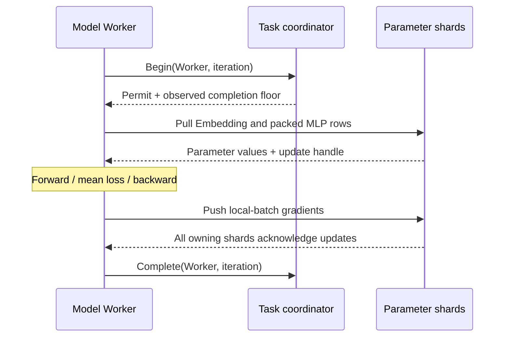

# Model training under three consistency policies

The TensorFlow Embedding + tanh MLP worker can apply one local-batch-mean
gradient update per Worker. The task coordinator controls how far a Worker may
advance relative to the slowest Worker. This path makes the three admission
policies comparable with the same model and optimizer-step definition.



## Update and admission rules

`update_mode: "per_worker"` uses training Pull handles and ordinary Push. Each
Worker computes the mean loss over its own batch; the parameter service combines
duplicate ID contributions and applies one LazyAdam update for that Worker.
Embedding vectors and the packed MLP weights/biases all live in the sharded
parameter table. The default `synchronous` mode retains the existing
sample-weighted group reduction and its recovery protocol.

| Admission policy | When iteration `t` may begin | Design choice |
| --- | --- | --- |
| `sequential` | Every Worker completed all iterations before `t` | Keeps Workers at the same iteration boundary; faster Workers wait for stragglers |
| `bounded_delay`, `max_delay: 2` | Completion floor is at least `t - 2` | Allows limited overlap while bounding the admitted iteration lead |
| `eventual` | No dependency on the slowest Worker's clock | Removes dependency waits; parameter reads can lag more optimizer updates |

The measured lead is `iteration - completion_floor` at admission. Workers in
the same iteration can execute concurrently, including under `sequential`.
Per-Worker updates can interleave differently across policies. Admission clocks
describe completed tasks; they do not give a cross-shard atomic read snapshot
or a bound on the exact age of every parameter value.

## Experiment

[`tensorflow_consistency_training.py`](../tests/tensorflow_consistency_training.py)
starts two parameter-server processes, a coordinator, and independent TensorFlow
Worker processes connected through actual BRPC sockets. All policies use the
same deterministic initialization, sparse ID inputs, mean-loss gradients and
LazyAdam configuration. One Worker receives a controlled 20 ms delay per task.

Before timing, every Worker reads parameters and warms its actual
forward/backward function without applying an update. The supervisor verifies
all readiness markers and inspects the initial parameter state, then releases
one start gate. Timing ends at the last Worker's acknowledged final update and
completion, before JSON reporting and process cleanup. A separate measurement
retains the full process-exit duration. Both clocks use the host's shared
monotonic clock.

After all Workers finish, the supervisor reads every touched parameter row and
evaluates the full fixed training set from the resulting Embedding and MLP
weights. It verifies completed task counts, finite weights/Adam moments, exactly
one dense-row update per Worker task, drained read tickets and the configured
admission-lead bound. Loss evaluation uses the same sum pooling, tanh activation
and binary cross-entropy as the TensorFlow model.

```sh
python tests/tensorflow_consistency_training.py \
  --build build/tensorflow \
  --iterations 2,4,8,16 --repeats 3 --target-loss 0.5 \
  --out build/tensorflow/tf-policy-endpoints.json
```

Each endpoint is a fresh training run. Policy order rotates between endpoints
and repetitions. The result records all trials, model inputs/configuration,
initial/final weights and optimizer state, Worker losses, admission waits,
source hashes and host settings. `complete` becomes true only after every
requested trial succeeds.

The common-quality statistic selects the first **tested endpoint** whose final
training loss meets the target. It does not interpolate an exact first-crossing
time between endpoints. These small CPU-host runs characterize admission and
convergence with an actual model; the separate
[multi-GPU capacity experiment](MULTIGPU_TRAINING_CAPACITY.md) measures distributed
GPU parameter capacity. Training loss on this controlled dataset is a system
comparison metric, not a model generalization score.

## Recorded comparison

The CPU-host run executes 36 accepted fresh runs: three policies, four endpoints
(`2, 4, 8, 16` iterations per Worker) and three repetitions. Every run starts
from identical full parameter/optimizer state and an initial loss of about
0.694. All three policies first meet the target training loss of `0.5` at the
tested four-iteration endpoint.

| Policy | Final loss at 4 iterations | Median training time | Time range, 3 runs | Summed Worker admission wait, median |
| --- | ---: | ---: | ---: | ---: |
| Sequential | 0.4500 | 125.8 ms | 122.3–129.7 ms | 93.0 ms |
| Bounded delay, 2 | 0.4472 | 124.3 ms | 119.2–131.7 ms | 28.8 ms |
| Eventual | 0.4463 | 129.5 ms | 129.1–132.3 ms | 2.1 ms |

Admission wait sums the two Workers' time blocked in Begin; it is not elapsed
wall time. At the 16-iteration endpoint, the maximum observed admitted leads are
`0`, `2` and `15`, respectively. The policies reduce dependency waiting as
configured. The target-time ranges overlap, so this experiment establishes no
clear end-to-end target-time speedup. The intentionally slow Worker still has
to finish its own tasks before the full run can drain.

[Accepted trials, settings, source hashes and raw-record checksum](validation/2026-11-04-model-consistency-policies.json)
retain every endpoint/repetition. Two interrupted preparation runs are explicitly
excluded: one overlapped regression checks, and one used a process-exit clock
before the training-only timing boundary was added.

Per-Worker mode currently rejects retained-gradient journal configuration. The
existing original-gradient reconciliation protocol operates on synchronous
group rounds, so its replay contract stays attached to that update mode.

The registered correctness check runs one eight-iteration trial for each policy:

```sh
ctest --test-dir build/tensorflow --output-on-failure \
  -R '^tensorflow_consistency_model_cpu$'
```


## GPU model execution

The RTX A6000 run repeats the same model, initialization, inputs, optimizer and
20 ms slow-Worker delay with forward/backward on GPU. Two independent TensorFlow
Workers share one physical card; two CPU parameter shards serve their rows with
cache disabled. Every accepted trial verifies GPU placement of parameter
inputs, loss and gradients. This measures model-training admission/convergence;
the multi-GPU capacity experiment uses separate GPU parameter-owner placement.

All 36 fresh runs pass: three policies, four iteration endpoints and three
repetitions, with identical complete initial parameter/optimizer state. Each
policy reaches target training loss `0.5` in all three repetitions:

| Policy | First passing endpoints, iterations/Worker | Median training time to first passing endpoint | Range, three repetitions |
| --- | --- | ---: | ---: |
| Sequential | 4/4/8 | 187.4 ms | 158.9–320.7 ms |
| Bounded delay, 2 | 4/4/4 | 163.8 ms | 163.3–165.9 ms |
| Eventual | 4/4/4 | 159.0 ms | 158.0–173.7 ms |

Timing excludes process startup and model warmup. Endpoints are tested in fresh
runs, so the table reports the first passing tested endpoint. At 16 iterations,
maximum admitted leads are `0`, `2` and `9`; the configured clock constraints
hold while eventual admission removes the slowest-Worker dependency. The
policies' target-time ranges overlap, establishing no repeatable target-time
speedup in this controlled workload.

```sh
python tests/tensorflow_consistency_training.py --build build-cuda \
  --device /GPU:0 --iterations 2,4,8,16 --repeats 3 \
  --target-loss 0.5 --out gpu-policy-endpoints.json
```

[Trial summaries, placement checks and source hashes](validation/2026-11-05-gpu-model-consistency-policies.json) ·
[Complete trial records with parameter/optimizer state](../benchmarks/results/2026-11-05-gpu-model-consistency.json.gz).
