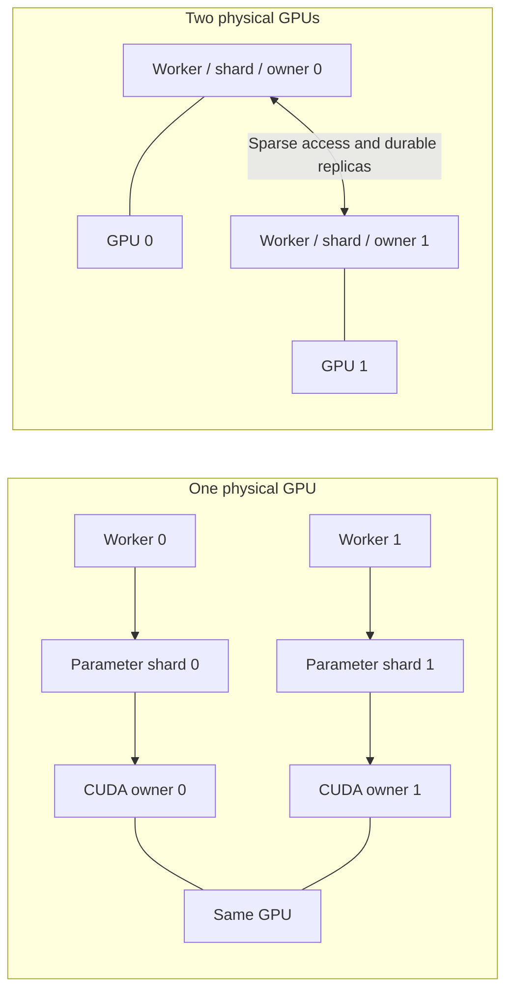

# Fixed-workload distributed model scaling

This benchmark keeps two logical Workers, two parameter shards, sparse LazyAdam,
the model, input batches and total optimizer rounds fixed while changing their
placement on one or two physical GPUs. The model is an Embedding table plus a
two-layer tanh MLP; all trainable rows live in the same sharded parameter table.



The one-GPU placement colocates both logical Workers and owners on one instance.
The two-GPU placement uses two instances, with parameter/gradient replicas on the
opposite host. Fleet files define explicit node-local and controller-visible
routes. Recorded GPU UUIDs establish the actual device count, and every placement
must use the same GPU model. When each instance has six vCPUs, two instances also
provide more host CPU resources: this measures whole-system placement scaling.

## Measurement boundaries

Each Worker first loads its model, performs a read-only forward/backward warmup,
and publishes readiness on its storage node. The manager observes both ready
Workers before releasing their start gates. This keeps process startup, model
compilation and first CUDA context creation outside the training measurement.
The first complete input cycle is excluded from the measured window to warm
the recurring key layouts and training path.

Placement comparisons enable deterministic TensorFlow operators and disable
TF32. Parameter initialization and input order are seeded independently of the
run name. The model mode belongs to the workload fingerprint; ordinary Worker
runs opt into determinism through `deterministic_model`. Every placement uses
that same mode and an explicitly recorded numerical tolerance. Additional
bitwise-comparison probes are retained separately from those numerical checks.

For measured round set `R`, the sample rate is:

```
samples_per_second = sum_worker(sum_round_in_R(local_samples))
                     / max_worker(sum_round_in_R(step_seconds))
```

Each elapsed duration comes from a monotonic clock on one Worker. The denominator
is the slowest Worker's measured window; no timestamp from one host is subtracted
from a timestamp on another. Raw records retain every round, its sample count,
warmup exclusion and both Worker window durations. The script alternates
placement order between repetitions and reports median/minimum/maximum rates.
Worker-step P99 is a descriptive quantile of those recorded steps.

Controller phase durations separately retain initialization, Worker startup,
warmup readiness, gate release, training observation and final verification.
The controller call duration includes untimed work and, after reentry, only the
current call. It is not used as a replacement for Worker-window throughput.

## Stage breakdown

| Stage | Included work |
| --- | --- |
| Admission | Task-progress permit and dependency waiting |
| Parameter pull | Native-client IPC, parameter/cache access, transport and read release |
| Model and gradient staging | Tensor conversion, GPU/CPU forward/backward, materialized loss/gradients and repeated-key accumulation |
| Journal I/O | Read/validation and durable publication of the original Worker gradient |
| Gradient replication | Original-gradient transfer and replica acknowledgement |
| Synchronous update | Weighted aggregation, optimizer application, updated-state export and durable replica acknowledgement |
| Task completion | Coordinator notification after the update acknowledgement |

Model-stage timing extends through host result materialization, which waits for
the GPU result. It is not an isolated CUDA-kernel measurement. Stage fractions
divide aggregate Worker stage time by aggregate Worker elapsed time. Concurrent
Worker durations are not added together and presented as cluster wall time.

The measured update path preserves durability. Turning off journal or replica
acknowledgements would change the training contract. Its measured fraction can
identify the affected path; isolating encoding, storage, GPU state export and
network costs requires additional measurements inside that path.

## Validation and retained evidence

Every trial checks complete resident row counts, task clocks and drained tickets.
It compares every training loss, final input cursor and selected rows' weights,
Adam moments and exact sparse update counts against the first trial. The selected
rows include all packed MLP rows and stratified sparse rows. The record explicitly
states whether this is a full-table inspection. Full-state small-model recovery
checks are documented in [generation continuation](DISTRIBUTED_GENERATION_RETIREMENT.md).

Completed original-gradient files are decoded and checksum-verified on their
owning hosts. Only round hashes, progress and losses return to the controller;
large gradient payloads do not need to cross SSH again for a performance report.
The recovery tools retain their full-payload journal transfer path.

An observation timeout retains the existing managed process handles. Reentering
the same series adopts its saved phases and releases/observes the same Workers.
A confirmed model failure is a rejected trial with explicit owned-process
cleanup. Successful completion resolves any earlier observation-pending record.

## Run

```sh
python scripts/benchmark_model_scaling.py \
  --placement one=/private/one-gpu-fleet.json \
  --placement two=/private/two-gpu-fleet.json \
  --out /controller/model-scaling --name model-scaling \
  --rows 65536 --dimension 128 --hidden 64 \
  --samples 128 --bag 16 --rounds 32 --warmup 4 --repetitions 3
```

Both fleets require two logical nodes, gradient mirroring, native service/bin
paths, Python/source paths and connected shard/agent/replica/coordinator routes.
Set `expected_physical_gpus` to 1 or 2. Private SSH credentials remain in those
fleet files. The output publishes a workload fingerprint, per-trial source
results and the verified physical device counts. A complete GPU comparison
requires both placements; `--allow-partial` collects a single placement without
publishing a two-versus-one speedup.

`--host` validates the protocol with CPU-owned native services. Its results have
`physical_gpu_scaling_verified: false`. The local integration also exercises
alternating trial order, warmup exclusion, stage timing closure, non-finite data
rejection, changed-workload rejection and live-handle reentry.
