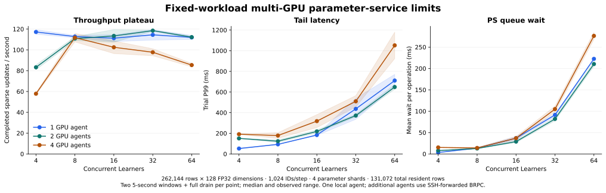

# Multi-GPU capacity and overload behavior

November 1, 2026 · C++20 / BRPC / CUDA · 1, 2 and 4 RTX A6000 agents

This study identifies the original scaling plateau and overload failures. The
[bounded-admission follow-up](AGENT_ADMISSION_RESULTS.md) adds an Agent-wide
queue and verifies completion at 128/192 Learners on a later mixed-GPU fleet;
the measurements below retain their original runtime and hardware scope.

The fixed-workload study sustains **120.19 / 133.44 / 120.40 acknowledged sparse
updates/s** on one, two and four GPU agents at their selected operating points.
Four agents provide approximately the same sustained rate as one agent in this
deployment. Increasing concurrency beyond the throughput plateau raises queue
wait and tail latency; four agents reach RPC admission rejection at 128 Learners.



## Sustained operating points

The sweep holds four parameter shards, 262,144 rows, 128 FP32 dimensions, 1,024
ID occurrences per update, pooling bags of 32 and 131,072 total resident rows
fixed. The short sweep measures 4/8/16/32/64 concurrent Learners with two
five-second submission windows per level. For each topology, the lowest
concurrency within 95% of its observed peak is selected for three 20-second
windows with full drain.

| GPU agents | Learners | Updates/s, median | Observed rate range | Trial P99, median | Queue wait/operation |
| --- | --- | --- | --- | --- | --- |
| 1 | 4 | 120.19 | 118.62–120.96 | 45.67 ms | 3.53 ms |
| 2 | 16 | 133.44 | 132.52–134.37 | 165.22 ms | 23.87 ms |
| 4 | 8 | 120.40 | 115.69–122.55 | 108.41 ms | 11.73 ms |

Each row uses its selected concurrency. The figure supplies the common-load
comparison across GPU counts. The two-agent operating point trades a higher
rate for longer request latency than the single-agent point.

At 64 Learners, median trial P99 reaches **710.81 / 648.28 / 1051.77 ms** on
one, two and four agents. At 112 Learners, all six short trials complete,
while P99 rises to **1.15 / 1.76 / 3.30 seconds**. The four-agent rate at that
level falls to **40.36 updates/s**. Admission success alone therefore does not
define a useful operating point.

## State after overload

The four-agent, 128-Learner probe hits the Agent's BRPC
`max_concurrency=128` limit. A separate four-agent probe with per-shard active
operations limited to one also reaches this boundary. The limit counts in-flight
RPCs at an Agent; a Learner update can create reads and updates from multiple
parameter shards.

Both failed probes preserve the following observations after the worker threads
finish:

| Observation | Default scheduling | Active limit 1 |
| --- | --- | --- |
| Fully acknowledged updates in the failed trial | 0 | 0 |
| Shards responding to statistics requests | 4/4 | 4/4 |
| Outstanding training tickets by shard | 0 / 126 / 0 / 0 | 0 / 126 / 0 / 0 |
| Fresh read-only parameter request | Failed | Failed |
| Parameter rows successfully inspected after failure | 0 | 0 |

Statistics remain available while parameter work is in a failed state. Different
shards have already applied different numbers of partial updates, so the failed
cohort cannot be counted as a completed optimizer trajectory. The run requires
controller-level recovery from a coordinated checkpoint. Agent-aware admission
and backpressure before excessive fan-out are the next scaling and recovery
priorities.

The one- and two-agent 128-Learner five-second probes complete in this fleet.
Their trial P99s are 1.32 and 2.86 seconds. Admission depends on overlapping
owner RPCs and scheduling, so a Learner count is an observed load boundary,
rather than a one-to-one translation of the Agent's RPC limit.

## Growing the table and batch with GPU count

A second fleet retains four parameter shards and increases the table, batch and
concurrency with GPU count. Every agent holds 131,072 live resident rows. Each
point has three ten-second windows followed by full drain.

| GPU agents | Table rows | IDs/update | Learners | Updates/s | ID occurrences/s | Trial P99 |
| --- | --- | --- | --- | --- | --- | --- |
| 1 | 262,144 | 1,024 | 8 | 129.01 | 132,109 | 82.22 ms |
| 2 | 524,288 | 2,048 | 16 | 46.55 | 95,334 | 1471.88 ms |
| 4 | 1,048,576 | 4,096 | 32 | 33.60 | 137,634 | 1930.80 ms |

The four-agent case processes approximately the same aggregate ID occurrence
rate as the single-agent case with substantially longer latency. Table size,
batch size and offered concurrency all change in this control; the fixed-size
curves above provide the common-workload comparison.

## Larger embeddings

The large-table control uses 1,048,576 rows, 512 FP32 dimensions, 8,192 ID
occurrences per update and pooling bags of 128. Weights and two Adam moments
represent **6 GiB of logical state**, with 524,288 live resident rows in total.
Each load level has two five-second windows.

| GPU agents | Learners | Updates/s, median | Trial P99, median |
| --- | --- | --- | --- |
| 1 | 8 | 42.93 | 219.10 ms |
| 1 | 32 | 41.79 | 819.95 ms |
| 4 | 8 | 25.16 | 505.30 ms |
| 4 | 32 | 24.34 | 1451.84 ms |

All eight completed trials pass their preflight and post-trial checks. This
establishes a tested working-set size. Allocation pools retain spare slots;
physical VRAM exhaustion is outside this measurement.

## Extended admission and recovery observations

The extended probe supports up to 512 concurrent Learners and stops each
topology at its first failed point. The second-fleet ten-second windows reach
the following failures:

| GPU agents | Failed Learner level | Learners reporting an error | Tickets after health probe | Fresh read | State inspected |
| --- | --- | --- | --- | --- | --- |
| 1 | 128 | 2 | 0 / 0 / 0 / 0 | Completed, finite | 16 finite sampled rows |
| 2 | 192 | 192 | 106 / 0 / 0 / 106 | Failed | 2 rows before read error |
| 4 | 192 | 192 | 140 / 0 / 0 / 140 | Failed | 2 rows before read error |

The two- and four-agent runs each complete both 128-Learner windows before
failing at 192. These results coexist with the first fleet's four-agent rejection
at 128: scheduling and which operation reaches the Agent affect the boundary.
The scanner stops before the configured 256/384/512 levels once it observes a
failure. Failed-point optimizer trajectories remain unverified even when the
health read and finite-state sample succeed.

A fresh 128-Learner confirmation uses up to three 20-second windows. The
single-agent probe fails with 254 outstanding tickets across two shards and a
failed health read. The two-agent probe completes one 20-second window at 77.74
updates/s and 3.09 s P99, then rejects two Learners in the next window; its final
health read succeeds and no tickets remain. The four-agent confirmation rejects
one Learner, then passes the health read and 16-row finite-state sample with no
remaining tickets. All rejected windows remain failed records.

## Scaling diagnostics

In the two fully sampled four-agent sustained trials, the PS processes consume
approximately **1.75 CPU cores** and the load generator approximately **0.78
cores**. Queue wait rises from 11.73 ms per operation at the selected
eight-Learner operating point to 903.69 ms at 112 Learners. These component
measurements and the flat throughput direct profiling toward owner-operation
waits, optimizer dependencies and shard-to-Agent fan-out.

A Host cache-backend control retains the BRPC topology and executes pooling and
updates on CPU. At eight Learners it records 146.09 updates/s with one Agent and
141.31 with four; at 32 Learners it records 134.67 and 147.02. Each point has two
five-second windows. These are Host-reference rates. The limited scaling across
both backends reinforces communication and coordination as profiling targets.

A framed upload followed by a one-byte acknowledgement measures the actual
loopback and SSH-forwarded paths after three warmups, with 20 repetitions per
payload size:

| Path | 8 KiB median | 64 KiB median | 1 MiB median | 1 MiB framed rate |
| --- | --- | --- | --- | --- |
| Loopback | 0.051 ms | 0.079 ms | 1.848 ms | 541.04 MiB/s |
| Forward 1 | 0.681 ms | 1.522 ms | 47.330 ms | 21.13 MiB/s |
| Forward 2 | 0.576 ms | 41.475 ms | 48.513 ms | 20.61 MiB/s |
| Forward 3 | 0.515 ms | 41.405 ms | 48.461 ms | 20.64 MiB/s |

The forwarded paths add substantial, payload-size-dependent latency. These
measurements characterize this deployment's transport, including its forwarding
and provider layer.

## Measurement contract

Every timed update includes distributed lookup, feature reconstruction,
synthetic feature-gradient preparation and acknowledged sparse LazyAdam updates.
95% of generated IDs come from the resident half of the table and 5% from the
whole table, yielding an expected 97.5% resident occurrence share. IDs may repeat
within an update; occurrence rates are distinct from unique-row update rates.
Model forward/backward and dense-gradient synchronization belong to the training
framework. Input generation is included in throughput; step latency starts after
ID preparation. Initialization, migration, numerical preflight, warmup and final
state inspection are outside the timed window. Throughput includes full drain.
Reported P99s are medians of trial P99s.

The coordinator has six affinity-visible CPUs with a 5.94-core cgroup quota on
an Intel Xeon E5-2699 v4. It hosts four PS processes, the load generator and one
Agent. Additional agents use SSH-forwarded BRPC on separate single-GPU
instances. Software is Ubuntu 22.04, GNU C++ 11.4, CUDA 13.0.88 and BRPC 1.18.0;
the provider preload remains installed. Four distinct CUDA device UUIDs and
identical deployed Agent hashes are verified within the fleet.

The main fleet uses source `955520e` and retains **59 completed capacity trials,
48,365 acknowledged updates, 1,888 sampled row-counter checks and two failed
load points**. Completed trials check numerical preflight, finite sampled
parameters, exact sampled update counters and zero outstanding tickets. Maximum
preflight feature error is **3.73e-8**. The native CPU/CUDA suite passes **26/26**,
and each worker separately passes its CUDA state/device-result check.

The second fleet uses source `b7b87cf`, which extends the probe to 512 Learners
and distinguishes unavailable state from finite inspected rows in failure
diagnostics. Parameter-service execution code is unchanged from the main fleet.
It uses the same CPU model, six-CPU affinity, 5.94-core quota and GPU type, with
its own binaries and hardware records. Its **30 completed trials / 19,060
updates** include eight Host-reference controls. Six failed points remain
separate. Its native CPU/CUDA suite also passes **26/26**, and its four workers
each pass the CUDA check.

Across the two fleets, **89 completed trials / 67,425 acknowledged updates /
2,848 sampled row-counter checks** pass with zero update errors in completed
records. Maximum preflight feature error is **3.91e-8**. Eight failed load points
retain their partial-work and health observations. The main-fleet driver stops
after its serialized-control rejection; the second fleet completes the remaining
workload and stress stages. All eight rented instances are deleted after
hash-verified retrieval; the account contains zero instances after cleanup.

Failed-point records remain separate from successful throughput and update
totals. In the original failure record, `finite=true` with zero checked rows and
an accompanying read error supplies no finiteness evidence; later diagnostics
emit `finite=null` for that case.

[Main-fleet manifest and source/binary hashes](benchmarks/2026-11-01-multigpu-boundaries/manifest.json)
· [Failed-point observations](benchmarks/2026-11-01-multigpu-boundaries/failed-points.json)
· [Validation and cleanup](validation/2026-11-01-multigpu-boundaries.json)

[Expanded-load manifest](benchmarks/2026-11-01-multigpu-boundaries-round2/manifest.json)
· [Expanded-load failures](benchmarks/2026-11-01-multigpu-boundaries-round2/failed-points.json)
· [Combined validation index](validation/2026-11-01-multigpu-study.json)

## Reproduce

```sh
python3 scripts/fleet_capacity_sweep.py --fleet /path/to/private-fleet.json \
  --out-name fixed --gpu-counts 1,2,4 --ps-shards 4 \
  --learners 4,8,16,32,64 --seconds 5 --repeats 2

python3 scripts/fleet_capacity_sweep.py --fleet /path/to/private-fleet.json \
  --out-name threshold --gpu-counts 1,2,4 --ps-shards 4 \
  --learners 80,96,112 --seconds 5 --repeats 2

python3 scripts/fleet_capacity_sweep.py --fleet /path/to/private-fleet.json \
  --out-name overload --gpu-counts 1,2,4 --ps-shards 4 \
  --learners 128 --seconds 5 --repeats 1

python3 scripts/fleet_capacity_sweep.py --fleet /path/to/private-fleet.json \
  --out-name extended --gpu-counts 1,2,4 --ps-shards 4 \
  --learners 128,192,256,384,512 --seconds 10 --repeats 2

python3 scripts/fleet_capacity_sweep.py --fleet /path/to/private-fleet.json \
  --out-name large --gpu-counts 1,4 --ps-shards 4 \
  --rows 1048576 --dimension 512 --keys 8192 --bag 128 \
  --learners 8,32 --seconds 5 --repeats 2
```

The capacity probe exits nonzero on a failed load point after emitting its
post-failure diagnostic record. Later topology sizes still run. Fleet connection
details and SSH keys stay outside the repository.

[Earlier operating envelope](CURRENT_MULTIGPU_LIMITS.md) · [Build and fleet setup](RUNNING.md)
