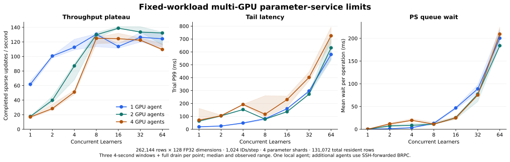

# Multi-GPU scaling and capacity limits

October 31, 2026 · C++20 / BRPC / CUDA · 1, 2 and 4 RTX A6000 agents

The default four-GPU operating point completes **116.47 acknowledged sparse update steps/s** with **102.41 ms median trial P99**, using four parameter shards and eight concurrent Learners. At 128 Learners, throughput falls to **85.74 steps/s** and P99 rises to **2.15 seconds**. Adding GPU agents yields limited throughput scaling in this deployment; higher concurrency mainly increases queueing.



The main matrix contains **140 capacity trials and 79,163 completed updates**, including four Host cache-backend control trials. All finish with zero training-update errors. A separate first-fleet scan retains **63 trials and 24,263 updates**. The two fleets therefore retain **203 capacity trials and 103,426 completed updates**. Fixed-trace cache-policy replay and the positive-cost correctness case are counted separately below.

## Sustained operating points

Each row has three 20-second submission windows followed by full drain. The selected concurrency is the lowest short-sweep level reaching 95% of that topology's observed peak. The optional coalesced path is selected independently by the same rule.

| GPU agents | Gather path | Learners | Steps/s, median | Trial rate range | Median trial P99 (ms) | Completed updates |
| --- | --- | --- | --- | --- | --- | --- |
| 1 | Per shard | 8 | 104.15 | 96.52–105.31 | 95.65 | 6,138 |
| 2 | Per shard | 16 | 109.71 | 104.78–114.07 | 190.93 | 6,626 |
| 4 | Per shard | 8 | 116.47 | 113.55–122.94 | 102.41 | 7,094 |
| 4 | Coalesced | 64 | 106.60 | 104.90–113.30 | 798.65 | 6,706 |

The default four-GPU path provides the best measured sustained balance of throughput and latency. The coalesced path reaches its selected point at 64 Learners, with longer waits and lower median throughput. These paths ran in separate blocks on the same second-fleet instances and binaries.

The four-GPU default at 128 Learners records **614.19 ms mean queue wait per operation**, compared with **12.39 ms** at eight Learners. Its trial rate range is 84.41–87.33 steps/s. All three high-concurrency trials pass parameter-counter and ticket-cleanup checks.

## Parameter shards and gather policy

The shard controls keep four GPU agents and the main workload fixed. Each point has a four-second submission window; the four-shard sweep has three repetitions and the two-/eight-shard controls have two. The table selects the highest median rate in each measured shard sweep.

| PS shards | Learners | Trials | Steps/s, median | Median trial P99 (ms) |
| --- | --- | --- | --- | --- |
| 2 | 16 | 2 | 72.36 | 346.47 |
| 4 | 8 | 3 | 124.89 | 116.20 |
| 8 | 8 | 2 | 50.21 | 282.68 |

Four shards are the best tested count on this coordinator. More shards reduce the number of rows handled by each shard, while increasing partial feature outputs, update contexts and messages. With the current placement, a shard can access every GPU agent, creating up to `PS shards × GPU agents` gather/update destinations per step.

Cross-shard coalescing reduces compatible gathers to one per destination. The default starts each shard's gathers while later shard replies may still be pending. Coalescing waits for the shard replies before issuing combined work. The matched short sweeps show this trade-off:

| Learners | Per-shard steps/s | Coalesced steps/s | Coalesced trial P99 (ms) |
| --- | --- | --- | --- |
| 8 | 124.89 | 55.98 | 331.20 |
| 16 | 124.41 | 81.49 | 419.95 |
| 32 | 122.38 | 38.78 | 1756.03 |
| 64 | 109.57 | 106.38 | 750.61 |

## Larger parameter table

This control uses **1,048,576 rows × 512 FP32 dimensions**, 8,192 ID occurrences per step, mean-pooling bags of 128 and 524,288 resident rows in total. Weights and two Adam moments occupy **6 GiB of logical state**; counters and service metadata are additional. Each GPU count tests 4, 8 and 16 Learners with two five-second windows per level. The table selects the highest observed median for each GPU count.

| GPU agents | Learners | Steps/s, median | Input ID occurrences/s | Median trial P99 (ms) |
| --- | --- | --- | --- | --- |
| 1 | 16 | 42.58 | 348,778 | 431.05 |
| 2 | 8 | 35.44 | 290,356 | 346.44 |
| 4 | 8 | 28.60 | 234,251 | 396.80 |

The larger workload also shows a cost to distributing resident rows over additional remote agents. The benchmark holds total live resident rows fixed; agent allocation pools include extra slots and do not measure a physical VRAM capacity limit.

## Concurrent automatic cache maintenance

Four GPU agents and four PS shards run the same 262,144-row, 128-dimensional workload with automatic admission enabled. Each level has two five-second windows. Frequency and reuse-cost modes use 16-request decision windows, at most 32,768 tracked rows per shard, 256 rows per migration batch, a 2 MiB migration budget per window, eight migration batches and a 32-slot per-agent reserve. The reuse-cost prior is zero saved time per access in this concurrency control.

| Admission mode | Learners | Steps/s, median | Median trial P99 (ms) |
| --- | --- | --- | --- |
| Frequency | 8 | 76.35 | 213.30 |
| Frequency | 16 | 57.14 | 515.11 |
| Frequency | 32 | 52.97 | 889.20 |
| Reuse cost | 8 | 80.27 | 166.39 |
| Reuse cost | 16 | 68.43 | 426.99 |
| Reuse cost | 32 | 68.46 | 587.47 |

The final policy counters cover setup, warmup and all six timed trials in each mode:

| Mode | Windows | Admitted rows | Evicted rows | Migration bytes | Pinned-row skips | Maintenance failures |
| --- | --- | --- | --- | --- | --- | --- |
| Frequency | 564 | 17 | 0 | 26,248 | 39,145 | 0 |
| Reuse cost | 640 | 0 | 0 | 0 | 46,240 | 0 |

The reuse-cost control performs no migrations and still shows a lower rate than manual placement. Policy bookkeeping is therefore an important profiling target. The current [maintenance path](../src/server/service.cpp) enumerates resident locations and tracked rows inside the shard's ordered executor. Incremental resident/candidate bookkeeping could reduce the work performed at each decision window.

## Cache-policy replay and numerical checks

The [first-fleet fixed traces](benchmarks/2026-10-31-four-agent-policy/manifest.json) compare CPU-only, static, frequency and reuse-cost modes under stable, shifted and scan-mixed access. Every main trace uses identical IDs and synthetic feature gradients, with 262,144 possible IDs, 512-dimensional vectors, 8,192 occurrences per step, 8,192 initially resident rows and 10,240 total configured cache slots. CPU/static calibration is repeated for each GPU count. All three topologies obtain a zero saved-access prior; the reuse-cost mode retains the initial resident set and admits no additional rows.

**35 completed runs, 81 phase records and 4,800 updates** pass independent CPU replay. Every touched row's weights, both Adam moments and integer update counter are checked after drain. Maximum absolute feature error is **5.22e-08**; maximum parameter/optimizer-state error is **0**. Every agent returns its complete slot capacity. Frequency mode executes actual admission and eviction on all tested topology sizes.

Four nonfatal cache-maintenance failure events occur in completed frequency traces; training-update errors remain zero and all final state checks pass. The counters record the number of maintenance failures, without a per-event error classification. One final four-GPU CPU-only repetition reaches the driver-wide 1,200-second timeout before producing verified output and is excluded from completed-run statistics. Its absence is recorded in the manifest; four-GPU CPU-only main-trace groups have one completed repetition, and the other main-trace groups have two.

A [separate four-agent positive-cost check](benchmarks/2026-10-31-four-agent-policy/forced-policy-validation.json) supplies a synthetic 10,000 µs saved-access prior to exercise cost-based admission and replacement. It completes **192 updates**, admits **3,267 rows**, evicts **2,377 rows** and matches the CPU parameter/optimizer state exactly. It records one nonfatal maintenance failure. This case is a correctness exercise and is excluded from calibrated performance comparisons.

The main capacity matrix checks 32 parameter update counters after every trial: **4,480 counter checks**, plus finite-state and live-ticket checks. Numerical preflight spans mean, sum and sequence outputs with duplicate IDs and empty bags; the largest absolute error is **3.91e-08**. The native suite passes **15/15** locally, and Ubuntu CPU/CUDA checks pass **17/17** on each fleet. Every GPU worker separately passes the CUDA state check.

## Communication and executor occupancy

The coordinator has six allocated vCPUs, six affinity-visible CPUs and a cgroup CPU quota of 5.94 cores. It hosts all PS processes, the load generator and one local GPU agent. Three additional single-A6000 instances provide the remote agents through SSH-forwarded BRPC. Each instance has 48 GiB of allocated RAM; four distinct CUDA UUIDs and identical agent binary hashes are verified.

In the two fully sampled default four-GPU sustained trials, aggregate PS CPU consumption has a median of **1.49 cores**, while PS executors are occupied approximately **97.6%** of the timed interval. Executor occupancy includes remote-operation waits. The source waits for agent completions inside ordered shard operations, so occupied executors can accumulate queues while using relatively little CPU. The measured pattern points to owner-operation waits and request fan-out as important scaling targets.

A CPU framed-transfer control sends a payload and waits for a one-byte acknowledgement through each tested path. It uses 20 measured repetitions after three warmups per payload size:

| Path | 8 KiB median (ms) | 64 KiB median (ms) | 1 MiB median (ms) | 1 MiB framed rate (MiB/s) |
| --- | --- | --- | --- | --- |
| Loopback | 0.070 | 0.097 | 2.651 | 377.18 |
| Forward 1 | 0.468 | 1.732 | 48.058 | 20.81 |
| Forward 2 | 0.442 | 41.859 | 46.892 | 21.33 |
| Forward 3 | 0.640 | 21.099 | 46.974 | 21.29 |

The forwarded paths show much higher transfer costs, including payload-size-dependent latency. These controls, the growing PS queue wait and the fan-out controls explain why increasing GPU count alone does not produce proportional end-to-end throughput in this deployment. The Host cache-backend control retains the transport topology and runs pooling/updates on CPU: at 16 Learners its two ten-second windows record **161.42 steps/s** with one agent and **171.16 steps/s** with four. These are explicit Host-reference rates.

## Workload, timing and provenance

Each measured step performs distributed lookup, feature reconstruction, synthetic gradient preparation and acknowledged sparse LazyAdam updates. The training framework owns model forward/backward and dense-gradient synchronization. IDs are occurrences and can repeat within a step.

The main workload has 262,144 rows, dimension 128, 1,024 occurrences/step and bags of 32; 131,072 rows are initially resident. 95% of generated IDs come from the resident half and 5% from the entire table, giving an expected 97.5% resident occurrence share. Homes use `key % shard_count`; initial GPU placement uses `(key / shard_count) % gpu_count`.

Every topology starts fresh PS and agent processes. Repetitions within a capacity probe continue the parameter/optimizer state and request sequences. Initialization, admission, numerical preflight, warmup and post-trial checks are outside timing. Throughput includes ID generation, client bookkeeping and full drain after the submission window. Step latency starts after ID preparation and ends after the sparse update acknowledgement. P99s are medians of trial-level P99s. Policy-trace trials restart the services/agents and replay prepared inputs independently.

Software is Ubuntu 22.04.5, GNU C++ 11.4.0, BRPC 1.18.0 and CUDA compiler 13.0.88, architecture 86, with `--fmad=false`; the NVIDIA driver is 610.43.02. The provider preload remains installed. BRPC's optional pthread contention-profiler hook is disabled by the [GPU build script](../scripts/gpu_validate.sh).

| Artifact | Contents |
| --- | --- |
| [Main capacity manifest](benchmarks/2026-10-31-four-agent-limits/manifest.json) | Source/binary hashes, 140 trials, workload and resource records |
| [Capacity summary](benchmarks/2026-10-31-four-agent-limits/summary.json) | All 55 measured load levels |
| [First-fleet scan](benchmarks/2026-10-31-four-agent-pilot/manifest.json) | 63 independently retained capacity trials |
| [Cache-policy manifest](benchmarks/2026-10-31-four-agent-policy/manifest.json) | 35 completed calibrated runs, one incomplete run and separate correctness check |
| [Validation artifact](validation/2026-10-31-four-agent-limits.json) | Suite counts, numerical errors, hashes and verified rental cleanup |

The main capacity binaries are built from `00b7ac9`; the first-fleet policy binaries are built from `1b708b4`. The same CPU model, allocation and GPU type are used by both fleets. Their records retain separate deployment provenance. All rental instances are deleted after artifact retrieval.

## Reproduce

```sh
python3 scripts/fleet_capacity_sweep.py --fleet /path/to/private-fleet.json \
  --out-name fixed --gpu-counts 1,2,4 --ps-shards 4 \
  --learners 1,2,4,8,16,32,64 --seconds 4 --repeats 3

python3 scripts/fleet_capacity_sweep.py --fleet /path/to/private-fleet.json \
  --out-name sustained-four --gpu-counts 4 --ps-shards 4 \
  --learners 8 --seconds 20 --repeats 3

python3 scripts/fleet_capacity_sweep.py --fleet /path/to/private-fleet.json \
  --out-name auto-frequency --gpu-counts 4 --ps-shards 4 \
  --learners 8,16,32 --seconds 5 --repeats 2 --cache-admission frequency

python3 scripts/fleet_cache_policy_sweep.py --fleet /path/to/private-fleet.json \
  --out results/policy --out-name fixed-policy --gpu-counts 1,2,4 \
  --phase-steps 64 --calibration-steps 32 --source-commit BUILD_SOURCE_COMMIT

python3 scripts/fleet_cache_policy_sweep.py --fleet /path/to/private-fleet.json \
  --out results/positive-cost --out-name positive-cost --gpu-counts 4 \
  --phase-steps 64 --positive-cost-check --source-commit BUILD_SOURCE_COMMIT

python3 scripts/render_multigpu_limits.py \
  --data docs/benchmarks/2026-10-31-four-agent-limits --out docs/assets
```

[Build instructions and private fleet format](RUNNING.md) · [Earlier 1–3 GPU deployments](BENCHMARKS.md)
