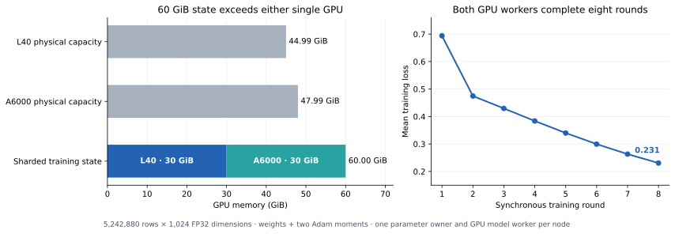
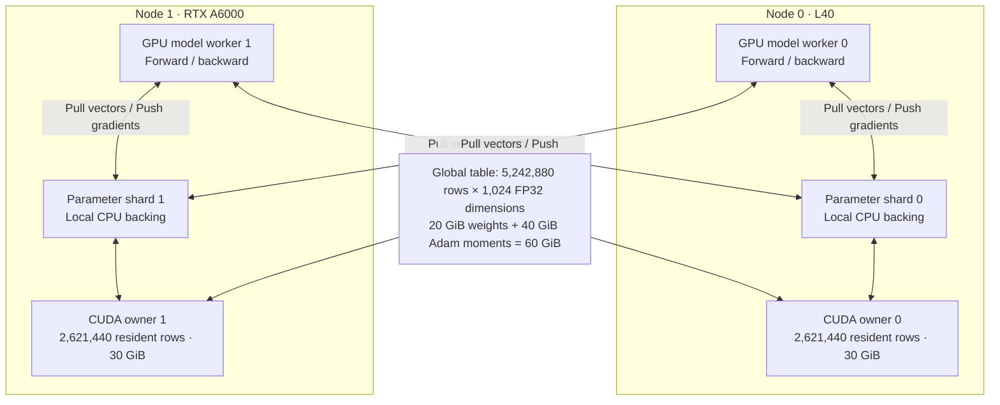

# Training beyond single-GPU memory

Two physical GPU nodes train a shared sparse model with **60 GiB of initialized,
GPU-resident parameters and Adam state**. Each owner holds 30 GiB. The larger
participating GPU exposes 47.99 GiB, so the combined state exceeds either
single device's physical capacity.



## Partitioning the training state

Each node runs a parameter shard, a CUDA parameter owner and a TensorFlow model
worker. Parameter rows are partitioned by Key. A row's weights and both Adam
moments stay together on its owner. Workers pull the vectors needed for their
examples, run GPU forward/backward and submit sparse gradients to the
corresponding shards. Each shard combines both workers' contributions and
applies one sample-weighted optimizer update per synchronous round.



CPU backing is also partitioned: one shard per node retains its local rows for
inspection and checkpointing. This avoids placing a second full 60 GiB copy on
one host. GPU-resident state counts only initialized weights and Adam moments;
metadata, framework allocations and transfer staging are reported separately.

## Executed workload

The model sums each example's Embedding vectors, then runs a two-layer MLP with an
eight-unit hidden layer. Both workers use 16 examples and 16 IDs per example,
for eight synchronous rounds. The controlled input is repeated across rounds.
All 5,242,880 table rows are initialized and loaded before training begins;
521 rows are touched during this sparse workload.

| Measurement | L40 node | RTX A6000 node |
| --- | ---: | ---: |
| Physical GPU memory exposed by driver | 44.99 GiB | 47.99 GiB |
| Initialized and resident rows | 2,621,440 | 2,621,440 |
| Resident weights + two Adam moments | 30.00 GiB | 30.00 GiB |
| Sampled peak device memory used | 31.33 GiB | 30.07 GiB |
| Sampled peak container memory used | 32.27 GiB | 32.27 GiB |
| Local shard preparation | 227.61 s | 197.67 s |
| Median worker step, eight measured rounds | 2.193 s | 2.193 s |

Device/container memory is sampled about once per second over preparation and
training. Device usage includes contexts and model workspace. Container samples
also include retained build/environment caches. Each CPU parameter backing
reports 30.02 GiB including its recorded row state overhead.

Both workers finish at clock 8, with 16 completed training tasks and eight
optimizer updates per shard. Mean training loss falls from **0.69395 to
0.23059**. Inspection checks full weights and both moments for 64 touched rows:
all values are finite and each row records exactly eight updates. Full shard
row/residency counts remain unchanged, and all Lookup tickets drain.

## Numerical reference before the capacity run

The same cross-node path first trains a 4,096-row × 32-dimensional model. A
matching deterministic Host run supplies the reference. Across 64 sampled
touched rows, complete weights and both Adam vectors differ by at most
**8.94e-7**; the maximum difference across all worker losses is **5.96e-8**.
The acceptance tolerance is `5e-5`.

The large capacity run checks all initialized/resident row counts and samples
64 touched rows for finite state and exact update counts. Its full 60 GiB state
is not replayed on a CPU reference. These checks keep numerical-reference
coverage separate from the larger residency measurement.

## Deployment and reproduction

The two nodes expose distinct physical GPU UUIDs. The current source is built
separately for compute capabilities 8.9 and 8.6; the environment and binary
hashes are retained in the validation records. Cross-node BRPC is relayed
through scoped SSH tunnels, and GPU RPC boundaries use host staging.
Step times describe this deployment and workload; this experiment establishes
capacity rather than a multi-GPU speedup or a maximum supported table size.

Prepare a private fleet file as described in
[distributed model execution](DISTRIBUTED_MODEL_TRAINING.md), then run:

```sh
python scripts/distributed_model_training.py \
  --fleet private-fleet.json \
  --rows 5242880 --dimension 1024 --hidden 8 \
  --samples 16 --bag 16 --iterations 8 --require-capacity \
  --run capacity-sixty-gib-two-gpu --out results/capacity
```

The controller checks distinct devices, actual free device/host memory,
initialized residency, GPU tensor placement, round progress, state samples and
owned-process cleanup. Both nodes' training processes are verified stopped;
both rented instances are deleted after records and runtime bundles are saved.

[Validation manifest](validation/2026-11-04-multi-gpu-training-capacity.json)
contains compressed large/small/reference reports, resource samples, losses,
source hashes and the cleanup receipt.
