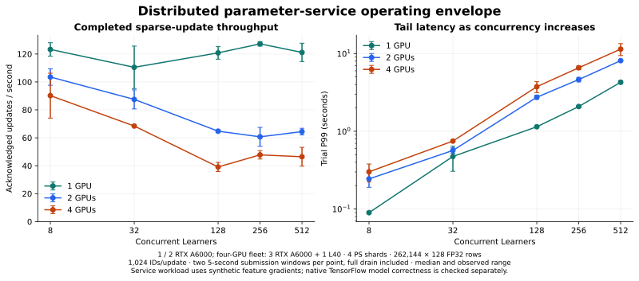

# Native integration and multi-GPU operating envelope

November 1, 2026 · C++20 / BRPC / CUDA / TensorFlow 2.20.0

The current service completes the small-workload tests through 1,022 concurrent
Learners on one, two and four physical GPU parameter owners. At low load, adding
remote owners reduces throughput in this deployment. Through the 512-Learner
sweep, increased queueing raises tail latency while multi-owner update rates fall.
The larger-input workload exposes an overload boundary: 512 Learners complete,
while 1,022 Learners produce a timed-out probe on one owner and RPC timeouts on
four owners, with temporarily unavailable shard statistics.



## Fixed total workload

The sweep holds four parameter shards, 262,144 rows × 128 FP32 dimensions,
1,024 ID occurrences per update, bags of 32 and 131,072 resident rows fixed.
Each point has two five-second submission windows, followed by full drain.
Values below are medians across the two completed windows.
95% of generated IDs are sampled from the resident half and 5% from the entire
table, yielding an expected 97.5% resident ID-occurrence share.

| GPU parameter owners | Learners | Acknowledged updates/s | Trial P99 | Shard queue wait/operation |
| --- | --- | --- | --- | --- |
| 1 | 8 | 123.28 | 89.78 ms | 12.72 ms |
| 2 | 8 | 103.53 | 244.02 ms | 16.05 ms |
| 4 | 8 | 90.19 | 301.02 ms | 21.47 ms |
| 1 | 512 | 121.15 | 4.27 s | 1.32 s |
| 2 | 512 | 64.44 | 8.11 s | 2.31 s |
| 4 | 512 | 46.45 | 11.41 s | 3.20 s |

All 30 fixed-sweep windows complete with zero reported update errors or admission
rejections. Each completed window checks 32 sampled row-update counters and
finite sampled weights, and drains lookup tickets and Agent RPC queues.

At 512 Learners, the four PS processes use approximately 0.61 CPU cores and the
load generator 0.24 cores in the four-owner topology. The coordinator has a
5.94-core cgroup quota. These timed samples do not indicate aggregate CPU
saturation. Queueing, ordered owner operations and the forwarded transport are
profiling targets; phase counters contain nested waits and cannot be summed as
exclusive CPU-time percentages.

## Sustained four-owner load

Three 20-second submission windows confirm the latency-throughput trade-off:

| Learners | Acknowledged updates/s, median | Trial P99, median |
| --- | --- | --- |
| 32 | 89.17 | 729.77 ms |
| 256 | 47.43 | 6.34 s |

Increasing concurrency beyond this low-load operating region adds substantial
waiting while the sustained acknowledged rate falls.

## Supported-stream upper scan

The service's request tracker accepts Learner IDs 0–1023. The upper-bound probe
reserves 1023 for initialization and 1022 for post-failure health checks, then
executes 768 and 1,022 independent training Learners. This avoids overlap between
control lifecycles and measured clients. All six short upper-scan windows
complete successfully.

Three additional 20-second windows confirm the 1,022-Learner points:

| GPU owners | Acknowledged updates/s, median | Trial P99, median | Completed updates |
| --- | --- | --- | --- |
| 1 | 184.86 | 6.56 s | 12,996 |
| 2 | 49.50 | 24.55 s | 5,789 |
| 4 | 41.70 | 25.12 s | 5,600 |

All nine sustained upper-scan windows complete with zero update errors. The
single-owner throughput rises above the earlier 512-Learner sweep at this much
higher concurrency, while end-to-end latency grows substantially. The accepted
load limit and an application-appropriate latency operating point are separate
decisions. The 1,024-ID protocol bound is an implementation constraint; physical
GPU memory exhaustion is outside this workload's measured envelope.

## Larger input and overload boundary

The larger workload uses 1,048,576 rows × 512 FP32 dimensions, 8,192 ID
occurrences per update and bags of 128. Weights and two Adam moments represent
6 GiB of logical state. Initial two-window tests at 8/32 Learners pass on one
and four owners. The subsequent one-window scan raises load to 128/512/1022.

| GPU owners | Learners | Result | Acknowledged updates/s | Trial P99 |
| --- | --- | --- | --- | --- |
| 1 | 128 | Completed | 39.20 | 3.29 s |
| 1 | 512 | Completed | 39.33 | 11.54 s |
| 1 | 1,022 | Whole probe exceeded 285-second harness deadline | — | — |
| 4 | 128 | Completed | 30.54 | 4.05 s |
| 4 | 512 | Completed | 25.56 | 18.13 s |
| 4 | 1,022 | 30-second RPC deadline reached | — | — |

The one-owner probe stops producing completed windows after 512 Learners. More
than 210 seconds after that window, all four shard HTTP statistics requests
time out at two seconds. The Agent responds with equal accepted/completed
counts and zero active/queued operations. The whole probe later exceeds its
285-second harness deadline; this is a bound on the complete probe, including
initialization and earlier windows, rather than a per-request latency.

The four-owner failed window records **31 acknowledged steps and 991 client
errors**, with `E1008` at the 30-second RPC deadline. Initial shard statistics
include three RPC timeouts and one responsive shard retaining 519 lookup
tickets. A separate live observation finds all four Agent queues drained while
all four shard HTTP statistics requests time out. Later health checks succeed:
all shard statistics return, lookup tickets reach zero, and a fresh read plus
16 sampled rows are finite. Those health observations do not verify the failed
cohort's complete cross-shard optimizer trajectory.

During the four-owner case, the coordinator's memory cgroup uses approximately
10.76 GiB of a 48 GiB limit, with zero OOM/OOM-kill events. Its local GPU sample
uses 3,128 MiB. The observed failure requires investigation of parameter-service
waiting, completion and overload control; its internal cause is not established
by the telemetry. Fast overload response and timely control-plane availability
remain a repair priority. The small-workload 1,022-Learner success does not carry
over to this larger-input case.

[Native failed-point record](benchmarks/2026-11-01-native-multigpu/failed-points.json)
· [Incomplete probe](benchmarks/2026-11-01-native-multigpu/incomplete-points.json)
· [One-owner live health](benchmarks/2026-11-01-native-multigpu/heavy-live-observation.json)
· [Four-owner live health](benchmarks/2026-11-01-native-multigpu/heavy-four-observation.json)
· [Memory observation](benchmarks/2026-11-01-native-multigpu/heavy-memory-observation.json)

## Native model trajectory

The native TensorFlow fixture executes model forward/backward on the local GPU
with one, two and four physical GPU parameter owners. Two independent actual PS
processes and two CPU-reference PS processes retain separate state. Each topology
runs five steps, seven sum/mean/sequence features, two prepared-input steps and a
mid-run dense/input plus sparse save/resume.

All eight touched rows' weights, both Adam moments and update counters match CPU
replay exactly. Maximum model/loss difference across the CUDA topologies is
7.45e-9. Every remote GPU has resident rows during training and finishes with all
accepted requests completed and zero active/queued requests. Graphs contain
native Eps operations without Python callbacks.

The model calculation remains on the local GPU. These checks exercise distributed
embedding parameter access and updates; dense-gradient collectives stay with the
training framework. Service pressure uses synthetic feature gradients so its
capacity figures measure the parameter-service path separately from model FLOPs.

## Deployment and measurement

A CPU-only framed-transfer control measures the same loopback and forwarded
paths, with three warmups and 20 repetitions per payload size. The receiver
acknowledges each complete upload with one byte; both TCP endpoints enable
`TCP_NODELAY`.

| Path | 8 KiB median | 64 KiB median | 1 MiB median | 1 MiB framed rate |
| --- | --- | --- | --- | --- |
| Loopback | 0.039 ms | 0.070 ms | 1.263 ms | 791.65 MiB/s |
| Forward 1 | 0.627 ms | 41.904 ms | 45.539 ms | 21.96 MiB/s |
| Forward 2 | 0.546 ms | 41.527 ms | 45.036 ms | 22.20 MiB/s |
| Forward 3 | 0.406 ms | 41.003 ms | 44.984 ms | 22.23 MiB/s |

These deployment-specific transfer delays are large compared with loopback.
Combined with rising request queues and low aggregate PS CPU use, they direct
profiling toward communication and ordered operation waits. Direct-network
measurements are needed to quantify the service's scaling on a different fabric.

The first two devices are RTX A6000 GPUs. The four-owner fleet uses three A6000
GPUs and one L40, on separate single-GPU instances with distinct device UUIDs.
All owners use identical Agent binaries. A six-vCPU coordinator hosts four PS
processes, the load generator and the local owner; remote BRPC uses verified SSH
forwards. GPU telemetry includes initialization and drain, while the derived PS
and load-generator CPU figures use each trial's timed interval.

Throughput includes ID generation, distributed lookup, reconstruction, synthetic
feature-gradient preparation, acknowledged sparse updates and full drain. Step
latency starts after ID preparation. Initialization, migration, numerical
preflight, warmup and post-window checks are outside timing. P99 entries are
medians of per-window P99s. The RPC deadline is 30 seconds. The complete matrix,
source/binary hashes and failure records accompany the final validation index.
A pressure-test Learner is a concurrent load-generator thread with its own client
and update identity. The coordinator runs these threads; GPU owner count is
verified separately from the offered Learner concurrency.

## Evidence and reproduction

The study retains **63 completed windows, 62,363 acknowledged sparse updates and
2,016 sampled row-counter checks**, plus one native failed point and one
incomplete probe. Completed windows report zero update errors and drained lookup
and Agent queues. Maximum feature preflight error is 3.91e-8. Agent admission
high-water marks reach 32 dispatched operations, 1,025 pending operations and
8,812,602 retained input bytes, within the configured 32/4096/256 MiB budgets.
High-water counters cover setup, preflight, warmup and all windows in a probe.

Runtime binaries use `5a69840`; the corrected upper-load probe uses `9fe0ac6`,
and the multi-owner native model fixture uses `1c8f060`. The probe changes preserve
the server and Agent binaries. A preliminary `96c2ff5` upper probe overlaps
initialization and health IDs with timed clients. Its record is explicitly
excluded from these operating-envelope counts. The Linux build executes 47
passing tests and skips three private original-source checks; the extended probe
passes the process-isolated capacity-failure diagnostic on Linux and macOS.

All four result archives are retrieved and SHA-256 verified before deleting the
four owned instances. Final account inventory is empty. Estimated base rental
cost for this four-instance deployment is **USD 1.06**, using observed lease
intervals rounded up to minutes and the published GPU rates. This is an estimate,
not an invoice. The earlier native-build attempt has a separate
[incident record](validation/2026-11-01-native-tensorflow/build-incidents.json).

[Validation index](validation/2026-11-01-native-multigpu.json) ·
[Source/binary hashes and raw matrix](benchmarks/2026-11-01-native-multigpu/manifest.json) ·
[Aggregated results](benchmarks/2026-11-01-native-multigpu/summary.json) ·
[Excluded probe incident](benchmarks/2026-11-01-native-multigpu/excluded-harness-incidents.json)

```sh
python3 scripts/fleet_capacity_sweep.py --fleet /path/to/private-fleet.json \
  --out-name fixed --gpu-counts 1,2,4 --ps-shards 4 \
  --learners 8,32,128,256,512 --seconds 5 --repeats 2

python3 scripts/fleet_capacity_sweep.py --fleet /path/to/private-fleet.json \
  --out-name upper-sustained --gpu-counts 1,2,4 --ps-shards 4 \
  --learners 1022 --seconds 20 --repeats 3

python3 scripts/fleet_capacity_sweep.py --fleet /path/to/private-fleet.json \
  --out-name heavy --gpu-counts 1,4 --ps-shards 4 \
  --rows 1048576 --dimension 512 --keys 8192 --bag 128 \
  --learners 128,512,1022 --seconds 5 --repeats 1

python3 scripts/render_native_multigpu.py \
  --data docs/benchmarks/2026-11-01-native-multigpu --out docs/assets
```
