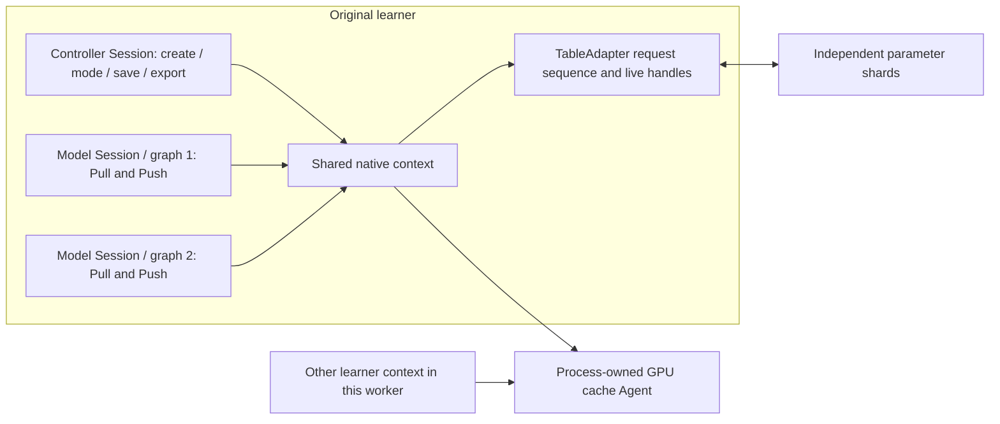

# Native table installation in the existing training graph

The existing launcher can select native TensorFlow CPU/CUDA operators for the
original SparseTable boundary. The model, InputBuilder gradient dispatcher and
Runner checkpoint control keep their original entry points.



## Configuration and launch

Build the Linux native runtime and TensorFlow operation library using
[the native build guide](NATIVE_TENSORFLOW.md#build). Select the
[native configuration](../configs/entropy-native.example.json), matching the
run, epoch and endpoint order of the parameter shards:

```sh
export EPS_TF_OP_LIBRARY="$PWD/build/native-tf/eps_tensorflow_ops.so"
export EPS_NATIVE_RUNTIME="$PWD/build/native-tf/libeps_runtime.so"
export PYTHONPATH="$PWD/build/native-tf/python:$PWD/adapters/entropy:$PYTHONPATH"
python -m entropy_launch --parameter-config configs/entropy-native.example.json \
  --entry-module your_existing_training_entry -- --your-original-job-arguments
```

`backend: "portable"` is the default. `backend: "native"` uses native Eps
operators in the original Session graph. Selected tables retain their plain V2
configuration, pooling and feature layout. CPU models can use configured remote
`cache_agents`. For model tensors on GPU, supply a local owner:

```json
"native": {
  "device": "/GPU:0",
  "cuda": {
    "agent": 0,
    "device": 0,
    "listen": "127.0.0.1:9300",
    "rows_per_table": 16384,
    "state_bytes": 536870912,
    "transfer_bytes": 16777216,
    "outstanding_output_bytes": 16777216
  }
}
```

The launcher starts the GPU owner through the C ABI before executing the
original entry point. This starts its listener without creating a TensorFlow
Session, so the entry point can still configure its TensorFlow devices. The
framework's existing all-peer initialization barrier then runs after every GPU
worker has started its owner. Programmatic installation follows the same order:
install before original peer initialization and model construction.

Each parameter shard registers the same Agent ID and its reachable endpoint.
Each worker process uses its own Agent ID/listener; multiple learner contexts in
that process share one owner. The original rank/thread mapping still determines
the learner request ID. Native library paths may also be supplied as
`native.op_library` and `native.runtime_library`.

## Shared context and lifetime

A CPU-only private controller Session creates and keeps each learner context
alive. It creates no TensorFlow GPU devices; the original model Session owns its
TensorFlow GPU allocation policy. Model
Sessions attach by a generated `context_key`, preserving request sequence and
live-handle history when the original framework recreates its graph. The
process-local registry holds weak references and rejects a key reused with a
different configuration or runtime library. Each TensorFlow resource retains a
shared reference while its operations execute.

A separate generated GPU owner key shares the CUDA backend and WorkerCacheAgent
across learner contexts. Their table adapters and request identities remain
independent. Closing one learner releases its owner reference; another learner
can continue using the Agent. Conflicting owner configuration is rejected.

`NativeSessionBackend` serializes controller commands through one argument
placeholder and caches the command operations. This keeps control calls on the
same native context without adding Python callbacks to the model graph. The
native runtime serializes each learner's adapter operations; this integration
makes no new overlap or throughput claim.

## Prediction and checkpoint control

The original training/prediction methods set a per-table native mode after the
learner has drained its live handles. Prediction returns independently owned
feature tensors and releases the lookup handle before publication. The returned
handle is `UINT64_MAX`, outside the adapter's training-handle namespace. A mode
change with outstanding training handles fails. Prepared queries choose the mode
when consumed; their preparation stores metadata only.

The unchanged coordinated Runner hook drains learners, freezes parameter shards,
exports sparse snapshots, executes dense/input saving, publishes the joint
commit and resumes admission. The native controller exposes snapshot chunks and
loaded-restore provenance through the existing C ABI command boundary. Snapshot
reads validate the running checksum in C++; the filesystem exporter verifies
lengths and publishes SHA-256 manifests. Raw chunks are bounded to 1 MiB and
hex-encoded on this control path. Training tensors continue to use native buffers.

The same original restore hooks verify pristine loaded shard identities before
dense/input continuation. A failed joint save leaves parameter admission frozen.

## Verification scope

Public native Session tests cover graph recreation, learner sequence continuity,
training/prediction transitions, conflicting context/owner identities, bounded
snapshot export and another learner surviving its peer's close. Optional
source-contract tests execute the preserved SparseTable/InputBuilder/Runner
methods with the native backend. Graph inspection requires native Eps operations
and rejects Python callback operations in the model graph.

Source-contract checks retain explicit stand-ins for the original native
configuration, feeder and barrier environment; the dense-save wrapper invokes a
real TensorFlow Saver. They verify the
selected method boundary. Rebuilding/running the complete original application,
its native data reader and its multi-peer native barriers remain separate
integration requirements.

## Executed checks

On Ubuntu 22.04 / TensorFlow 2.20.0 / CUDA 13.0 / RTX A6000, source `fc64812`
passes the full **56/56** suite with the recorded source-contract definition
slice. Source `c5a7f93` retains the same native binaries and passes five targeted
checks for the CPU-only controller and its native CPU/CUDA table/restore paths.

Three recreated model graphs retain the learner's four acknowledged updates per
shard. Another learner remains operational after its peer closes. Native CPU/GPU
original-method traces execute six training steps, compare five with zero feature
difference, switch prediction/training and continue after the mid-run Runner
checkpoint. The native restore trace resumes three additional steps and matches
all five selected rows' complete Adam state and dense weights exactly. Its input
cursor is the original-checkpoint feeder stand-in's state.

[Validation index and source/binary provenance](validation/2026-11-01-native-table-installation.json)
retain the initial startup regression and final pass records. The one GPU rental
is deleted after hash-verified evidence retrieval; estimated base cost USD 0.21.
