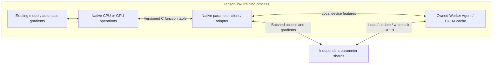

# Native TensorFlow CPU and CUDA operations

The native integration connects TensorFlow graphs to the distributed parameter
runtime through resource operations. Pull returns complete feature tensors;
TensorFlow runs the existing model and automatic differentiation; Push waits for
the sparse updates before Join completes its parameter lifecycle.



## Runtime boundary

`eps_tensorflow_ops.so` is built with the installed TensorFlow wheel's compile
and link flags. It contains resource and asynchronous operation kernels, without
linking the transport's C++ types into the TensorFlow operation library.
`libeps_runtime.so` exposes one entry point, `eps_runtime_api_v1`, returning a
versioned C function table. Arrays, scalar handles, status records and explicit
buffer-release callbacks cross that boundary; C++ objects and exceptions stay
inside their own module.

The Linux runtime links static BRPC/Protobuf dependencies and hides its internal
symbols, preventing their registries from becoming TensorFlow's transport ABI.
An operation library remains loaded while returned buffers can use its release
callbacks. Runtime resources own the adapter and local Worker; returned device
allocations can outlive resource close.

Native TensorFlow runtime loading currently targets Linux. A macOS operation
library rejects the dynamic transport combination before loading it; the portable
`eps_tensorflow.ParameterServer` remains the macOS integration path. The plain
C runtime can be exercised independently of TensorFlow on macOS.

## Tensor and execution lifecycle

The operations are `EpsRuntime`, `EpsPull`, `EpsPrepare`, `EpsPullPrepared`,
`EpsPush`, `EpsCommand` and `EpsIdCommand`. CPU and GPU Pull/Push kernels share
the same lifecycle. Native RPC waits run on a four-thread I/O pool with at most
128 queued operations, leaving TensorFlow executor threads available. The
runtime serializes control and adapter access within each resource.

CPU Pull copies native host results into TensorFlow-owned, aligned buffers. GPU
Pull wraps the owned CUDA result in a TensorFlow `TensorBuffer`, waits for its
producer event on the TensorFlow operation stream and transfers buffer ownership
to TensorFlow. Native final-output offsets use 256-byte alignment for framework
tensor alignment. The output-byte budget includes that alignment padding.
The wrapper prevents TensorFlow from treating the foreign allocation as uniquely
owned for in-place forwarding.

GPU Push receives actual device gradients and copies them to the existing RPC
update payload on the TensorFlow operation stream. It synchronizes those reads
before acknowledging submission to the native adapter; the service then waits
for the sparse optimizer acknowledgement. Feature inputs remain device resident
through the model. The current RPC gradient path uses host payloads.

Each successful Pull handle ends with Push or Release. A schema mismatch during
output publication releases its already-acquired lookup tickets. Prepared inputs
remain FIFO and can be cancelled. Join, save, resume and close retain the adapter
rules. Close requires zero live handles; abort abandons the adapter's known
handles and ends that runtime. A failed graph still requires the training
controller to decide whether to abandon or restart the run.

The native buffer owner survives model use and resource close. CUDA output uses
the existing `cudaMalloc` allocation/free lifecycle; this integration makes no
new stream-overlap or throughput claim. The framework keeps responsibility for
dense optimization, dense collectives and coordinated model/input checkpoints.

## Build

Use a Linux Python environment with TensorFlow, NumPy and pybind11, plus the
existing native dependencies. Position-independent static BRPC, Protobuf and
protoc archives are required for the isolated runtime. The Ubuntu validation
script builds Protobuf 3.12.4 with PIC enabled and uses its matching compiler
and headers:

```sh
cmake -S . -B build/native-tf -DCMAKE_BUILD_TYPE=Release \
  -DEPS_BUILD_RUNTIME=ON -DEPS_BUILD_PYTHON=ON -DEPS_BUILD_CUDA=ON \
  -DPython3_EXECUTABLE="$(command -v python)"
cmake --build build/native-tf -j 6
ctest --test-dir build/native-tf -R native_tensorflow --output-on-failure
```

The build creates the runtime and operation libraries separately. The TensorFlow
operation builder records the wheel version and exact flags beside its output.
`DPS_NATIVE_TF=ON bash scripts/gpu_validate.sh` provisions the matching validation
environment on the existing Ubuntu GPU workflow.

## Use the existing model

The training controller reserves reachable PS/Worker endpoints and starts the PS
processes with their local Worker endpoint configured. Initial PS table lists can
be empty; native resource creation starts the Worker before defining its tables.

```python
from eps_tensorflow_native import NativeParameterServer

parameters = NativeParameterServer(
    configuration,  # run, endpoints, tables; optional cuda/local Worker settings
    op_library="/path/to/eps_tensorflow_ops.so",
    runtime_library="/path/to/libeps_runtime.so",
    device="/GPU:0",
)

@tf.function
def train_step():
    handle, embeddings = parameters.pull(features)
    with tf.GradientTape() as tape:
        tape.watch(embeddings)
        loss = existing_model_loss(embeddings)
    gradients = tape.gradient(loss, embeddings)
    acknowledgement = parameters.push(handle, feature_ids, gradients)
    done = parameters.join([acknowledgement])
    with tf.control_dependencies([done]):
        return tf.identity(loss)
```

`prepare(features)` and `pull_prepared(token, dimensions)` use native operations.
`save(id)` freezes/drains sparse state; `resume(id)` continues after the existing
controller commits its full checkpoint. These commands return TensorFlow string
tensors containing JSON results. The resource and its operations share the selected TensorFlow device scope;
resource handles and control metadata use host memory. This preserves the
framework resource-manager lookup while Pull/Push operate on model tensors.

This supplies a native TensorFlow parameter boundary. Installing it in the
original application's worker/reader and its multi-peer job-control paths retains
the separate integration work in the main plan.

TensorFlow's [custom-operation guide](https://www.tensorflow.org/guide/create_op)
describes wheel ABI requirements. Its
[TensorBuffer interface](https://github.com/tensorflow/tensorflow/blob/v2.20.0/tensorflow/core/framework/tensor.h)
defines the reference ownership used by the device wrapper.

## Executed verification

Runtime `5a69840` executes 47 tests successfully on Ubuntu 22.04 with
TensorFlow 2.20.0, GNU C++ 11.4 and CUDA 13.0. Three original Entropy source checks skip because the
private reference tree is excluded from the uploaded source archive. Both native
CPU and native CUDA graph tests execute.

Each native graph runs five training steps, including two prepared-input steps,
with seven sum/mean/sequence features and two independent parameter shards. An
additional pair of reference shards replays the CPU trajectory. The checks cover
model loss and dense weights, all eight touched sparse rows, Adam moments and
update counters, a mid-run dense/input and sparse checkpoint, output lifetime,
and ticket cleanup after a rejected output schema. The CUDA graph's maximum
model difference is 7.45e-9; sparse optimizer states match the CPU replay exactly.
Graph inspection finds native Eps operations and no Python callback operations.

The same model trajectory also completes with one, two and four physical GPU
parameter owners. Model computation remains on the local TensorFlow GPU; remote
owners execute their resident embedding work through BRPC. All remote owners
retain parameter rows during the check, acknowledge their work and drain to zero
active/queued requests. Complete sparse optimizer state matches CPU replay for
every topology. These trajectories validate the native integration; service
capacity measurements use the separate pressure-test workload.

The local macOS native/C-ABI suite passes 30/30, including the explicit native
TensorFlow platform guard; the portable TensorFlow suite passes 42/42. The Linux
shared runtime exports only `eps_runtime_api_v1` and has no dynamic BRPC,
Protobuf or protoc dependency. [Raw native checks](validation/2026-11-01-native-tensorflow/native-checks.json)
and the associated test logs preserve these separate scopes.


The overload repair at `0e46929` executes 48 passing Ubuntu native/TensorFlow/CUDA
checks and skips the same three private-source checks. The local native/C-ABI
and portable TensorFlow suites pass 31/31 and 43/43. Additional two-/three-A6000
native graph trajectories match complete touched sparse optimizer state and
model outputs with zero difference. [Repair validation and measured bounds](OVERLOAD_SCHEDULING.md).


## Original table installation and Session contexts

The [native table backend](NATIVE_TABLE_INSTALLATION.md) connects the original
SparseTable/InputBuilder/Runner hooks to these operators. A generated process-local
context key shares one native learner across CPU-only controller and model
Sessions. Per-worker GPU ownership starts before the original entry point through
the C ABI, then is shared by learner contexts. `release_read_only` and table-mode
commands preserve prediction lifecycles; checkpoint chunks and loaded-state
metadata connect the original export/restore controller.

The source-contract integration passes the recorded full 56-test Linux suite;
five CPU-controller follow-ups use identical native binaries.
[Verification and scope](validation/2026-11-01-native-table-installation.json).
