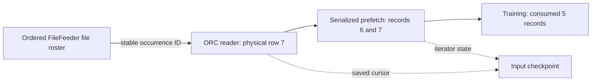

# Original ORC and FileFeeder Checkpoints

The native input overlay saves an ORC reader's physical row position together
with TensorFlow's iterator state. For FileFeeder input, it also records stable
file-assignment IDs. A restored reader reopens its current file directly, seeks
to the saved row and then resumes the original file-distribution RPC.

## Why the input cut has two positions

When training has consumed five records, the reader may already have read seven.
The two pending records belong to TensorFlow's serialized prefetch buffer. The
checkpoint therefore preserves both the buffer and the reader's position:

The assignment ID identifies an occurrence in the original ordered roster.
Two occurrences of the same filename have different IDs. During restore, the
planner excludes assignments represented by saved reader histories, because
their records are already consumed, buffered or owned by a restored reader.
Assignments fetched after the saved cut return to the queue.

## Implementation

- [`input_checkpoint.h`](../adapters/entropy/input_checkpoint.h) implements the
  bounded binary cursor/source formats, the source-allocation registry and the
  restore-cut planner. Allocation and metadata export share a mutex; the
  original filename vector remains in place.
- [`install_original_input_checkpoint.py`](../scripts/install_original_input_checkpoint.py)
  applies the overlay to a disposable original native source bundle. It retains
  the original bytes outside that bundle, checks source hashes and supports
  reentry after an interrupted update.
- The original `FetchFile` RPC carries an eight-byte occurrence ID in its BRPC
  response attachment. Its protobuf filename field remains the data path.
- The ORC reader counts physical rows and uses ORC's `seekToRow` on restore.
  TensorFlow serializes iterator and prefetch state through `SerializeIterator`
  and `SaveV2`; a fresh process restores them through `RestoreV2` and
  `DeserializeIterator`.
- [`eps_input_checkpoint_tool`](../src/input/checkpoint_main.cpp) combines reader
  captures with an ordered source roster and publishes an immutable queue
  restore plan. Native local functions export and restore the actual
  FileFeeder source metadata.

Parallel readers carry an input scope in their FileFeeder URI. The native
registry retains a reader's completed assignment history after TensorFlow
releases that reader. Capture includes histories completed before serialization
began, together with readers visited by iterator serialization. An unfinished
reader missing from serialization, or a reader created during capture, requires
a new serialization attempt while the training step stays paused. A new input
generation discards the preceding input shot's reader registry.

## Executed validation

The modified original CPU and GPU operation libraries compiled successfully
and passed the original TensorFlow C API loading probes. The CPU input probe
then saved checkpoints, exited and restored each checkpoint in a new process.
It ran against the original ORC kernel, two ORC files and a repeated occurrence
of the first filename, for 21 records in total.

| Input path | Save after records | Result |
| --- | --- | --- |
| Direct ORC with prefetch depth 2 | 0, 1, 5, 6, 7, 13, 20, 21 | Exact remaining record sequence at every position |
| Original FileFeeder RPC with prefetch depth 2 | 0, 1, 5, 6, 7, 13, 20, 21 | Exact remaining record sequence at every position |
| Six parallel FileFeeder readers, output buffer 2 per stream | 0, 1, 5, 6, 7, 13, 20, 21 | Consumed plus restored records match the complete input multiset at every position |
| Six parallel FileFeeder readers, output buffer 32 per stream | 5 | All six leaf readers already destroyed; remaining 16 records restored from upstream buffers |

The capture after five consumed records recorded a reader position of seven,
and the fresh process returned exactly the remaining 16 records. This exercises
the difference between consumed data and prefetched data. The FileFeeder cases
also execute actual source export, queue-plan construction and native source
restore.

The [machine-readable record](validation/2026-11-05-original-input-checkpoint.json)
contains the native library hashes, overlay manifest and individual cases.
The [parallel-reader lifecycle record](validation/2026-11-05-original-input-lifecycle.json)
contains the second native build and the six-stream cases. In the larger-buffer
case, TensorFlow visited zero leaf readers during serialization. The native
registry supplied all six completed histories, covering three assigned file
occurrences. Consumed plus restored records matched all 21 input records.
[`original_orc_checkpoint_sdk.py`](../tests/original_orc_checkpoint_sdk.py)
drives the original TensorFlow C API directly; a Python TensorFlow package is
not required for this reader test. Standalone source-allocation/cut tests also
passed AddressSanitizer, UndefinedBehaviorSanitizer and ThreadSanitizer checks.

## Full training integration

The next integration step binds the input checkpoint to sparse parameters,
dense state and the distributed training progress commit, including the Python
input-shot position. The native tests above execute direct and parallel input
recovery. Complete original multi-peer model training, joint save, fresh-process
restore and failure replay remain the full application integration checks.
