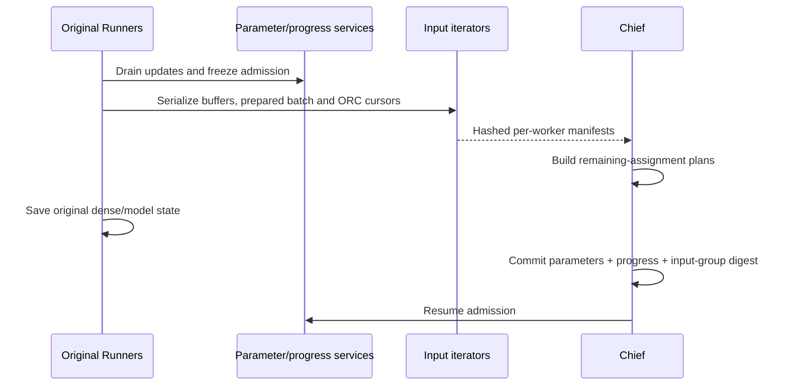

# Original input checkpoints

The input checkpoint joins the original FileFeeder/ORC iterator to the parameter,
dense optimizer and training-progress commit. A restored job resumes its saved
batch boundary, including records already read into pipeline buffers.

## Enable capture

Install the native source overlay into a disposable original source bundle and
compile its CPU/GPU targets. Native capability version 3 adds prepared-batch,
EOF and partition-notification state to the original iterator serialization.
The overlay preserves original source bytes and records input/output hashes.

Add this option to the native parameter-adapter configuration:

```json
{
  "input_checkpoint": {
    "planner": "/path/to/eps_input_checkpoint_tool",
    "max_retries": 20
  }
}
```

The native backend and training coordinator must also be configured. Add
`"restore": true` for a fresh process that will restore a committed input group.
This holds FileFeeder allocation before the original Runner initializes input.

## Save order



Each worker manifest identifies its input scope, source handle, input
specification, input shot and next-shot index. Its files contain the serialized
TensorFlow iterator and native stream capture. The chief binds all worker
manifests, ordered source plans and completed training clocks into one input
group. The joint commit stores that group's digest.

File assignment IDs distinguish repeated occurrences of the same filename.
The planner excludes assignments retained by restored readers and buffers;
speculative allocations outside the saved cut return to the remaining queue.
Completed reader histories survive leaf destruction until the next generation.

## Fresh-process restore order

1. Start model-process GPU owners before restored shards register their tables.
   `entropy_launch --startup-gate gate.json` publishes owner readiness and waits
   for a release record containing the same run, agent, endpoints and nonce.
2. Verify the joint commit, group digest, worker membership, input specification
   and payload hashes before the global verification barrier.
3. Initialize the saved input shot while source allocation remains held.
4. Restore ordered source assignment plans, then release source holds.
5. Restore original dense/model state, iterator buffers, ORC positions and
   Python input-shot position. Resume training progress after the final barrier.

Gate configuration uses fresh local paths:

```json
{
  "schema_version": 1,
  "ready": "/private/run/owner-ready.json",
  "release": "/private/run/parameters-ready.json",
  "timeout_seconds": 120
}
```

The orchestrator reads the ready record, starts the configured parameter shards,
waits for their readiness and publishes the identical record to the release
path. A release from an earlier owner generation is rejected.

## Executed checks

The original native TensorFlow C API verifies six-stream prepared-input recovery
at start, mid-stream and EOF, including held fresh initialization and a larger
prefetch buffer. The manifest tests reject missing workers, changed training
clocks, changed manifests and changed payloads; chunked staging covers a
1.5 MB payload. The startup-gate process test verifies generation identity.

The complete input-aware main/Executor save passes with two original training
peers at completed clocks `[16, 16]` (128 records, 32 batches on one physical
GPU). Fresh-process restore and failure-replay execution remain the next gate. Custom global shuffle and label-partition
buffers require their own serialization before this mode accepts those input
configurations.
