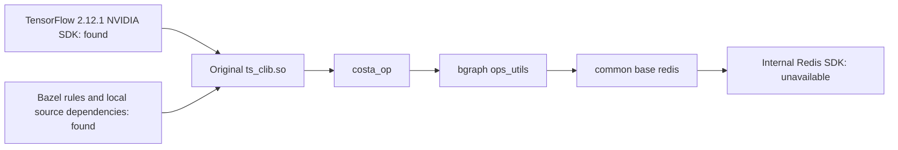

# Original framework native build preflight

The available code collection contains the framework's Bazel rules, TensorFlow
SDK and several internal source dependencies in separate repositories. A local
dependency-graph preflight now identifies the remaining private SDK needed to
rebuild the original `ts_clib.so` library.



## Recovered inputs

The separate Bazel workspace repository supplies `entrypoint.bzl`,
`protobuf_ng.bzl`, CUDA rule definitions, local system fixtures and cached
upstream rule archives. Local source repositories supply Entropy, common,
bgraph, the API definitions and b23.

The TensorFlow facade recorded in the available build configuration selects
`2.12.1+NVIDIA`. Its headers and compressed framework, TensorFlow C++ and
TensorFlow libraries are available locally. All three compressed libraries match
their recorded SHA-256 values. The build-tool preflight uses Bazel 7.7.0, with
legacy-compatible `rules_python` 0.31.0 and `rules_cc` 0.0.9.

Independent workspace overlays add workspace markers without editing the
original repositories. Compiler metadata records the actual macOS Clang setup
and an empty CUDA compiler map. The C++ graph loader uses a generated pip label
resolver; it does not install or validate a Python runtime.

## Remaining source dependency

The original target has this dependency path:

```text
//entropy:ts_clib.so
  //entropy:ts_clib
    //entropy:costa_op
      @bgraph//:ops_utils
        @common//base:redis
          @bilibili-redis
```

The internal repository is `platform/redis-sdk-cpp`. The common Redis layer
includes `bili_redis/bili_redis_client.h` and `redis_sdk/client.h`. Neither exact
interface header nor its SDK implementation was found in the available Code
collection. Another project contains public hiredis archives; the required
internal SDK interfaces remain absent.

With repository downloads disabled, the final `deps(//entropy:ts_clib.so)`
query emits 39,338 partial label records and exits with code 3. Its unresolved
repository is `bilibili-redis`. These partial labels locate the dependency;
they do not establish a successful build. No original native library has been
compiled or loaded by this preflight.

Completion requires either the matching Redis SDK source/headers/libraries, or
a compatible prebuilt framework runtime and its environment. Once that input is
available, native compilation and the complete reader/cluster execution checks
can proceed in a Linux/NVIDIA environment. This preflight rents no GPU.

[Machine-readable inventory and verified hashes](validation/2026-11-01-native-build-preflight.json)

