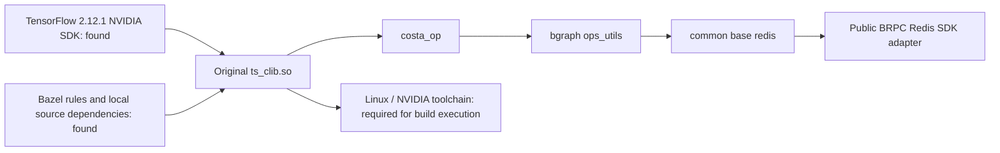

# Original framework native build preflight

The available code collection contains the framework's Bazel rules, TensorFlow
SDK and several internal source dependencies in separate repositories. A local
dependency graph now loads with a public Redis SDK adapter. Building the original
`ts_clib.so` next requires the matching Linux/NVIDIA toolchain and runtime.



## Recovered inputs

The separate Bazel workspace repository supplies `entrypoint.bzl`,
`protobuf_ng.bzl`, CUDA rule definitions, local system fixtures and cached
upstream rule archives. Local source repositories supply Entropy, common,
bgraph, the API definitions and b23.

The TensorFlow facade recorded in the available build configuration selects
`2.12.1+NVIDIA`. Its headers and compressed framework, TensorFlow C++ and
TensorFlow libraries are available locally. All three compressed libraries match
their recorded SHA-256 values. The build-tool preflight uses Bazel 7.7.0, with
legacy-compatible `rules_python` 0.31.0 and `rules_cc` 0.0.9.

Independent workspace overlays add workspace markers without editing the
original repositories. Compiler metadata records the actual macOS Clang setup
and an empty CUDA compiler map. The C++ graph loader uses a generated pip label
resolver; it does not install or validate a Python runtime.

## Redis dependency and its replacement

The original target has this dependency path:

```text
//entropy:ts_clib.so
  //entropy:ts_clib
    //entropy:costa_op
      @bgraph//:ops_utils
        @common//base:redis
          @bilibili-redis
```

The internal repository is `platform/redis-sdk-cpp`. The common Redis layer
includes `bili_redis/bili_redis_client.h` and `redis_sdk/client.h`. Neither exact
interface header nor its SDK implementation was found in the available Code
collection. Another project contains public hiredis archives; the required
internal SDK interfaces remain absent.

The November 1 preflight's partial query emitted 39,338 labels and stopped at
this missing repository. The [public Redis SDK adapter](PUBLIC_REDIS_SDK.md)
now supplies the observed interfaces with real BRPC Redis command execution.
The independent workspace registers its `bilibili-redis` target without modifying
original source or upstream BUILD files. Its per-Key batch response shape follows
the actual retained consumer, including ordered nil/error values and binary data.

The updated dependency query exits zero and resolves 39,343 labels. A subsequent
build analysis reaches `@@cuda//:missing` and fails with `Missing CUDA Environment`
on the macOS host with an empty CUDA compiler map. No original library has been
compiled or loaded by this analysis. The full original reader/cluster/training
execution remains required in the matching Linux/NVIDIA environment; generated
pip labels used for C++ graph loading do not establish that Python runtime.

[Redis adapter verification and build analysis](validation/2026-11-04-public-redis-sdk.json) ·
[Earlier build-input inventory](validation/2026-11-01-native-build-preflight.json)
