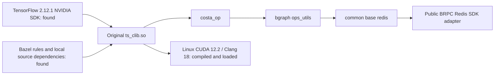

# Original framework native build and execution

The available code collection contains the framework's Bazel rules, TensorFlow
SDK and several internal source dependencies in separate repositories. A local
dependency graph loads with a public Redis SDK adapter. Both original native
targets now compile successfully on Linux with CUDA 12.2 and Clang 18. The CPU
and GPU libraries load into the recovered TensorFlow 2.12.1 SDK and register
314 and 315 operations, respectively. The original GPU row-segmentation kernel
passes ordinary and empty-row boundary checks. The matching Python runtime is
being built from recovered source for full reader, training and control execution.

[Native build, library loading and GPU execution record](validation/2026-11-04-original-native-build.json).

## Full application peer validation

[`validate_original_executor.py`](../scripts/validate_original_executor.py) runs
one or two unchanged original `main.py`/Executor processes against two external
sparse parameter shards. The original native cluster, dense parameter service,
DenseAdam, ORC FileFeeder, cross-peer barriers and Controller/Learner services
remain active. The project's [user model](../examples/entropy_executor_model.py)
uses Embedding lookup and GPU MLP forward/backward through that application.

```sh
python scripts/validate_original_executor.py \
  --native-root /path/to/matching-original-environment \
  --build /path/to/compiled-parameter-runtime \
  --op-library /path/to/matching-tensorflow-operations.so \
  --peers 2 --work /path/to/new-two-peer-run \
  --out /path/to/original-executor-result.json
```

The native root supplies `native/entropy`, the matching `original-python`
environment, generated protocols/feature modules and the prepared Hadoop client.
The launcher reexecutes the manager with that interpreter and library search
path. Private source and native artifacts remain outside this repository.

Each peer receives distinct native, Learner-service and parameter-owner routes.
Original InputGlobbing expands real ORC files; the original FileFeeder distributes
them. Validation records the actual per-peer task clocks, requires both peers
to train, and checks total input batches against acknowledged tasks and sparse
updates. It also verifies control pings, GPU graph placement, joint checkpoint
hashes, bound training progress and native dense optimizer exports. Managed role
handles and logs remain under the new work directory. An elapsed observation
window records live state and continues observing the same roles.

The two-peer harness has passed Python/environment preflight and is gated behind
the matching TensorFlow build, original readers, original training/restore and
one-peer application acceptance. Full native multi-peer execution and its joint
restore/failure replay remain pending actual runtime results.

[Deployed source hashes and preflight/gate record](validation/2026-11-05-original-executor-peers-preflight.json).



## Recovered inputs

The separate Bazel workspace repository supplies `entrypoint.bzl`,
`protobuf_ng.bzl`, CUDA rule definitions, local system fixtures and cached
upstream rule archives. Local source repositories supply Entropy, common,
bgraph, the API definitions and b23.

The TensorFlow facade recorded in the available build configuration selects
`2.12.1+NVIDIA`. Its headers and compressed framework, TensorFlow C++ and
TensorFlow libraries are available locally. All three compressed libraries match
their recorded SHA-256 values. The build-tool preflight uses Bazel 7.7.0, with
legacy-compatible `rules_python` 0.31.0 and `rules_cc` 0.0.9.

Independent workspace overlays add workspace markers without editing the
original repositories. Compiler metadata records the actual macOS Clang setup
and an empty CUDA compiler map. The C++ graph loader uses a generated pip label
resolver; it does not install or validate a Python runtime.

## Redis dependency and its replacement

The original target has this dependency path:

```text
//entropy:ts_clib.so
  //entropy:ts_clib
    //entropy:costa_op
      @bgraph//:ops_utils
        @common//base:redis
          @bilibili-redis
```

The internal repository is `platform/redis-sdk-cpp`. The common Redis layer
includes `bili_redis/bili_redis_client.h` and `redis_sdk/client.h`. Neither exact
interface header nor its SDK implementation was found in the available Code
collection. Another project contains public hiredis archives; the required
internal SDK interfaces remain absent.

The November 1 preflight's partial query emitted 39,338 labels and stopped at
this missing repository. The [public Redis SDK adapter](PUBLIC_REDIS_SDK.md)
now supplies the observed interfaces with real BRPC Redis command execution.
The independent workspace registers its `bilibili-redis` target without modifying
original source or upstream BUILD files. Its per-Key batch response shape follows
the actual retained consumer, including ordered nil/error values and binary data.

The updated dependency query exits zero and resolves 39,343 labels. A subsequent
build analysis reaches `@@cuda//:missing` and fails with `Missing CUDA Environment`
on the macOS host with an empty CUDA compiler map. That analysis did not compile
or load an original library. The full original reader/cluster/training
execution remains required in the matching Linux/NVIDIA environment; generated
pip labels used for C++ graph loading do not establish that Python runtime.

## Relocatable native inputs

`scripts/original_native_bundle.py` materializes the native target's source and
build-file closures into an independent workspace. It rewrites repository
locations relative to the generated WORKSPACE, copies file symlinks as bytes,
retains workspace-loaded rule repositories and includes the original framework
tree for its Python training and control entry points. The resulting private
tree belongs outside version control.

Generate successful Bazel query outputs for `deps(//entropy:ts_clib.so)` and
`buildfiles(deps(//entropy:ts_clib.so))`, then run:

```sh
python scripts/original_native_bundle.py \
  --workspace /path/to/independent-original-workspace \
  --deps /path/to/native-dependency-labels.log \
  --buildfiles /path/to/native-buildfile-labels.log \
  --output /tmp/original-native-portable
```

After moving the generated directory, run the dependency query again with Bazel
7.7.0 and `--enable_bzlmod=false`. Query `kind("source file",
deps(//entropy:ts_clib.so))` separately and audit its inputs:

```sh
python scripts/original_native_bundle.py \
  --workspace /tmp/original-native-portable --audit \
  --sourcefiles /path/to/relocated-source-file-labels.log
```

The actual relocation retains **39,343 dependency labels**, with zero missing or
added labels. The bundle contains **40,300 materialized files** across **218 local
repository declarations**. Its file hashes pass the audit, and no file symlinks
or absolute local-repository paths remain. Source-file inspection identifies
15 InfiniBand host inputs, including two shared libraries, to provision on Linux.
Generated build outputs are kept separate from these missing system inputs.

The recovered SDK's own CUDA configuration specifies **CUDA 12.2 and cuDNN 8**.
The original Python lockfile selects a **CPython 3.10 TensorFlow 2.12.1 NVIDIA
wheel**. Linux compilation must use actual compiler, CUDA and system-library
fixtures, followed by library loading and original training/control execution.
The portable source audit establishes build-input coverage. The Linux build and
C API execution below now verify the original binaries; full Python application
execution requires the matching runtime rebuild.

[Relocation and source-input audit](validation/2026-11-04-original-native-bundle.json).

## Matching Python runtime rebuild inputs

The recovered collection also contains the NVIDIA TensorFlow 2.12.1 source
archive and the corresponding builder inputs. The archive is extracted into a
private working directory, and all **13 framework patches** apply successfully.
All **nine dependency patches** also apply to **12 materialized dependency
overrides**. The OpenSSL override uses the already recovered local SDK instead
of the initializer's remote fetch. The Snappy and zlib directory layouts are
reproduced with local file moves after reviewing their small initializer scripts.

The builder records Clang 18, LLD 18 and CPython 3.10. Dependency archives and
patch inputs are retained privately for the Linux rebuild; the original builder
initializer is not executed. The matching Python wheel still needs compilation
and loading before it can supply the original framework's runtime.

[Source and dependency preparation](validation/2026-11-04-original-tensorflow-source.json).

## Linux toolchain and SDK execution

The Linux build host uses Ubuntu 22.04, eight CPU cores, an RTX A6000 and CUDA
12.2.140. Clang 18 compiles both host C++ and CUDA dependencies. The original
local-call registry uses in-class explicit template specializations accepted by
Clang, and GPU dependencies supply Clang/LLVM-specific options. RDMA development libraries,
libunwind, libaio, `libgoogle-perftools-dev`, Clang's `libomp-18-dev` headers and cuDNN 8 are installed from
their package repositories. Framework CPU paths use AVX2/F16C/FMA instructions
for FP16 conversion and parameter gathering/pooling. These features are present
on the build host and enabled for the framework sources.

Configure a transported private workspace with:

```sh
python scripts/configure_original_native_linux.py \
  --workspace /path/to/original-native-portable \
  --cuda /usr/local/cuda-12.2 --gcc /usr/bin/gcc --clang /usr/bin/clang-18
```

The tool records actual compiler include paths, generates CUDA rules against the
installed toolkit, enumerates real RDMA headers/libraries and initializes the
Bazel version feature repository. The independent source copies also carry
bounded build fixes: explicit TensorFlow helper qualification for GCC C++17.
The build also preserves the original template's `__identity_ai` compiler
definition, `AI_BUILD_WITH_BAZEL=1`, for target and host compilation. This selects
the declared Redis include layout and Peta's glog implementation consistently.
The original mounted repositories remain unchanged.

The full GPU dependency selection requires `--define=enable_gpu=1` in addition to
the CUDA toolchain flags:

```sh
bazel --output_user_root=/path/to/private-bazel-cache build \
  --enable_bzlmod=false --define=enable_gpu=1 --jobs=6 \
  --//.resources/adapters:rdkafka.active_variant=2 \
  --copt=-DAI_BUILD_WITH_BAZEL=1 --host_copt=-DAI_BUILD_WITH_BAZEL=1 \
  --cxxopt=-fsized-deallocation --host_cxxopt=-fsized-deallocation \
  --per_file_copt='.*entropy/tensorswitch/.*@-mavx2,-mf16c,-mfma' \
  --extra_toolchains=//.resources/toolchains/cc:cc-toolchain-k8-clang,//.resources/toolchains/cuda:cc-toolchain-k8-clang,//.resources/toolchains/cuda:cuda-clang-cuda-toolchain \
  --//.resources/toolchains/cc:compiler=clang \
  --//.resources/toolchains/cuda:compiler=clang \
  --//.resources/toolchains/cuda:version=. \
  --//.resources/toolchains/cuda:capabilities=sm_86 \
  //entropy:ts_clib.so //entropy:ts_clib_gpu.so
```

The Kafka dependency selects the recovered librdkafka 2.4.0 variant. The original
offset-discovery code uses `DescribeTopics` and `ListConsumerGroupOffsets`, which
are absent from the repository facade's default 1.9.2 headers.

`scripts/probe_original_tensorflow.py` loads the recovered framework, NCCL and
TensorFlow C++ shared libraries through their C API. It validates the SDK's
serialized operation list and runs GPU MatMul with runtime-fed inputs and soft
placement disabled. TensorFlow reports version **2.12.1**, exposes a GPU and
returns the expected matrix result. With `--ops`, the same probe additionally
loads an original custom-operation library and requires a nonempty registered
operation list. Both original libraries now pass that check in separate processes.

With `--row-segments`, the probe additionally runs the original
`GpuRowLengthSegment` kernel on the GPU, checking both ordinary and empty-row
segment boundaries. It requires the provided library to register that operation;
an unrelated operation library is rejected. Both original-kernel cases pass on
the RTX A6000 with soft placement disabled.

The parameter service has also been rebuilt against the same CUDA 12.2 toolkit.
Its C ABI, independent owner identity and real CUDA state/device-result checks
pass (3/3). The private build artifacts retain the static BRPC/Protobuf
dependencies and runtime binaries for subsequent original-framework execution.

The SDK execution probe establishes native TensorFlow GPU operation in this
environment. Full framework training is validated separately after both original
libraries and their matching Python runtime are ready.

[Linux environment and SDK execution](validation/2026-11-04-original-linux-sdk.json).

## Original Python communication protocols

Generate the framework's actual protocol definitions with a separate Python
3.10 environment containing `grpcio-tools==1.60.0` and `protobuf==4.25.2`:

```sh
python scripts/prepare_original_python_protocols.py \
  --workspace /path/to/original-native-portable \
  --output /path/to/private-python-generated
```

This compiles the original cluster, parameter-table, learner and controller
protocols and the API embedding schema. It verifies serialization and imports of
the generated learner/controller gRPC stubs, and records source and output
hashes. Add the generated directory and `entropy/tensorswitch/python` to
`PYTHONPATH` for the full framework. Generation leaves original source files
unchanged; full framework import and distributed training are subsequent checks.

[Linux protocol-generation verification](validation/2026-11-04-original-python-protocols.json).

For the complete executor's feature-processing imports, add
`--feature-protocols`. This also compiles the 197 original Trinity/Tensor
protocols and creates `snapshot_fdset`, using the original descriptor-generation
command's source set. All generated feature protocol modules import successfully.
The private feature-processing source collection contains 132 Python files;
their transported hashes match the original files. Put their parent directory on
`PYTHONPATH` and set `TRINITY_GALAXY_SNAPSHOT_PROTO_FDSET` to the generated
`snapshot_fdset`. PyFE's existing raw-operation selector reuses
`tensorswitch.ops.oplib` when the framework is loaded.

[Complete feature-input preparation](validation/2026-11-04-original-feature-inputs.json).

## Executor filesystem and monitoring environment

The original file feeder calls `hadoop fs` for input metadata, and the training
checkpoint path uses it to copy dense NumPy exports. Prepare the real Apache
Hadoop 3.3.6 client classes with an installed Java runtime:

```sh
python scripts/prepare_original_hadoop_client.py --directory /path/to/hadoop-client
export PATH="/path/to/hadoop-client/bin:$PATH"
```

The package contains the pinned Hadoop client API/runtime and logging JARs from
Maven Central. The launcher invokes the original `FsShell` and `VersionInfo`
classes, with `core-site.xml` selecting the local filesystem. It verifies Maven
checksums and records SHA-256 hashes. Linux execution passes real file listing,
binary reads, copies, existence checks and removal. This supplies Hadoop's
[local filesystem shell](https://hadoop.apache.org/docs/r3.3.6/hadoop-project-dist/hadoop-common/FileSystemShell.html)
for the original reader and export path.

The original monitor classes use fixed deployment addresses. The adapter's
optional `--metrics-gateway` argument configures new monitor instances for an
anonymous Prometheus gateway while preserving their metric collection and
actual HTTP pushes:

```sh
python -m entropy_launch --parameter-config /path/to/parameter-job.json \
  --metrics-gateway http://127.0.0.1:9091 \
  --entry-script /path/to/original/main.py -- <original job arguments>
```

The override restores class constructors on exit and leaves original source
files unchanged. A local HTTP receiver verifies all three monitor types send
real metric payloads without authentication. The original job's existing
`blackhole_url` option independently configures model-state reporting.

The prepared Executor job uses the original `main.py`, graph builder, file
feeder, Learner/Controller startup, SparseTable/InputBuilder, DenseAdam and
dataset-end checkpoint. It waits for the matching Python runtime and original
reader/training-restore checks before execution. The original Executor training
result is recorded after this job completes.

[Filesystem and monitor checks](validation/2026-11-04-original-executor-environment.json).

The application uses a separate Python 3.10 virtual environment, leaving the
active TensorFlow source-build environment unchanged. The installed dependency
set is recorded in `adapters/entropy/requirements-tensorflow212.txt`; it retains
NumPy 1.24.3, protobuf 4.25.2, Keras 2.12.0 and the original framework's
TensorFlow IO 0.32.0. Its package dependency check passes. Install the matching
locally rebuilt TensorFlow wheel in this environment when compilation completes.

[Application dependency preparation](validation/2026-11-04-original-python-environment.json).

## Parameter-service operation compatibility

The parameter-service TensorFlow module now uses the SDK's `tensorflow::Status`
type and selects the available StreamExecutor header and CUDA stream accessor.
This supports both the original 2.12.1 SDK and the existing 2.20 runtime without
changing parameter access, gradient submission or stream ownership.

On Linux, the module compiles and links against the recovered 2.12.1 SDK. Its
seven EPS operations register through `TF_LoadLibrary`, and the same process
executes the GPU MatMul check successfully. The 2.20 macOS module also compiles,
loads and retains its unsupported-runtime guard. Distributed parameter execution
with the rebuilt original Python runtime is a subsequent validation step.

[Parameter-service operation compatibility](validation/2026-11-04-tensorflow-sdk-compatibility.json).

[Redis adapter verification and build analysis](validation/2026-11-04-public-redis-sdk.json) ·
[Earlier build-input inventory](validation/2026-11-01-native-build-preflight.json)


## Matching Python runtime and original Runner continuation

The rebuilt NVIDIA TensorFlow 2.12.1 wheel installs in the dedicated Python 3.10
application environment. Its SHA-256 is
`2065e1c07e0218d086112dc28dd9f500a47b3adaacabce9a74a4618303357356`.
The original CPU and GPU reader probes both exit successfully after reading
16 ORC records, decoding four batches, reaching EOF and pinging the original
Learner and Controller services. The ORC element shape is `[1]`, matching the
actual native element and Python wrapper. The ctypes handle uses `RTLD_LOCAL`
to avoid duplicate static-registry destruction on process exit.

The original modules and Runner execute GPU forward/backward operations against
two external parameter shards and the original native dense optimizer. An
eight-batch uninterrupted run and a four-batch checkpoint followed by four
batches in a fresh process produce the same loss trajectory at absolute
tolerance `1e-6`. Both sparse partitions' complete weights and optimizer state
have maximum absolute error zero. This run restores at a whole-file epoch
boundary; the input-aware full-application gate additionally checks serialized
prefetch buffers and input-shot state.

A restored shard immediately registers its table with the model-process GPU
owner. The optional `entropy_launch --startup-gate` handshake therefore starts
the owner first, waits for the restored parameter shards and releases model
construction only after their readiness signals. Its nonce binds release to
that owner generation. See [joint input checkpoints](ORIGINAL_INPUT_CHECKPOINT.md)
for the input and training-progress publication order.

[Reader execution](validation/2026-11-05-original-framework-reader.json) ·
[Original Runner continuation](validation/2026-11-05-original-runner-continuation.json) ·
[Prepared-batch recovery](validation/2026-11-05-original-prepared-input-checkpoint.json).

Full original main/Executor execution now passes with one and two training
peers on one physical RTX A6000. The two-peer run completes 128 ORC records and
32 GPU-model batches, with completed training clocks `[16, 16]`. Both peers'
exported graphs retain GPU MatMul nodes; native DenseAdam state contains all
21 model values and their first/second moments. The input-enabled run binds
both serialized iterators and source plans to the joint checkpoint at those
same completed clocks. All owned roles exit and clean up.

Global op determinism is disabled in this fixture while model constants and
table seeds remain fixed. TensorFlow's `make_deterministic` pass sets prefetch
capacity to zero for this stateful custom pipeline; GDB observed a runtime
prefetch limit of zero. The original multi-scene Runner peeks the partition
notification before `Session.run`, so disabling autonomous prefetch causes a
second-batch wait. Increasing the configured prefetch size or disabling the
ordinary optimization/autotuning options does not override that mandatory pass.
The validation retains the original asynchronous input path.

[Single-peer execution](validation/2026-11-05-original-executor.json) ·
[Two-peer execution](validation/2026-11-05-original-executor-two-peers.json) ·
[Two-peer input-aware save](validation/2026-11-05-original-executor-input-two-peers.json).

Fresh-process full-application joint restore and failure replay remain active
integration gates. Their acceptance includes input coverage and complete
model/optimizer/progress comparisons.
