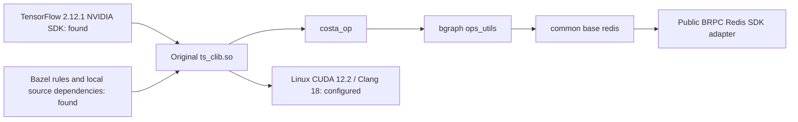

# Original framework native build preflight

The available code collection contains the framework's Bazel rules, TensorFlow
SDK and several internal source dependencies in separate repositories. A local
dependency graph loads with a public Redis SDK adapter. Both original native
targets are now undergoing C++/CUDA compilation on a Linux GPU host. The recovered
TensorFlow 2.12.1 SDK has passed C API metadata and real GPU execution checks;
the matching Python runtime is also being built from its recovered source.
Original shared-library loading and full reader/training/control execution remain
open until their own checks pass.



## Recovered inputs

The separate Bazel workspace repository supplies `entrypoint.bzl`,
`protobuf_ng.bzl`, CUDA rule definitions, local system fixtures and cached
upstream rule archives. Local source repositories supply Entropy, common,
bgraph, the API definitions and b23.

The TensorFlow facade recorded in the available build configuration selects
`2.12.1+NVIDIA`. Its headers and compressed framework, TensorFlow C++ and
TensorFlow libraries are available locally. All three compressed libraries match
their recorded SHA-256 values. The build-tool preflight uses Bazel 7.7.0, with
legacy-compatible `rules_python` 0.31.0 and `rules_cc` 0.0.9.

Independent workspace overlays add workspace markers without editing the
original repositories. Compiler metadata records the actual macOS Clang setup
and an empty CUDA compiler map. The C++ graph loader uses a generated pip label
resolver; it does not install or validate a Python runtime.

## Redis dependency and its replacement

The original target has this dependency path:

```text
//entropy:ts_clib.so
  //entropy:ts_clib
    //entropy:costa_op
      @bgraph//:ops_utils
        @common//base:redis
          @bilibili-redis
```

The internal repository is `platform/redis-sdk-cpp`. The common Redis layer
includes `bili_redis/bili_redis_client.h` and `redis_sdk/client.h`. Neither exact
interface header nor its SDK implementation was found in the available Code
collection. Another project contains public hiredis archives; the required
internal SDK interfaces remain absent.

The November 1 preflight's partial query emitted 39,338 labels and stopped at
this missing repository. The [public Redis SDK adapter](PUBLIC_REDIS_SDK.md)
now supplies the observed interfaces with real BRPC Redis command execution.
The independent workspace registers its `bilibili-redis` target without modifying
original source or upstream BUILD files. Its per-Key batch response shape follows
the actual retained consumer, including ordered nil/error values and binary data.

The updated dependency query exits zero and resolves 39,343 labels. A subsequent
build analysis reaches `@@cuda//:missing` and fails with `Missing CUDA Environment`
on the macOS host with an empty CUDA compiler map. No original library has been
compiled or loaded by this analysis. The full original reader/cluster/training
execution remains required in the matching Linux/NVIDIA environment; generated
pip labels used for C++ graph loading do not establish that Python runtime.

## Relocatable native inputs

`scripts/original_native_bundle.py` materializes the native target's source and
build-file closures into an independent workspace. It rewrites repository
locations relative to the generated WORKSPACE, copies file symlinks as bytes,
retains workspace-loaded rule repositories and includes the original framework
tree for its Python training and control entry points. The resulting private
tree belongs outside version control.

Generate successful Bazel query outputs for `deps(//entropy:ts_clib.so)` and
`buildfiles(deps(//entropy:ts_clib.so))`, then run:

```sh
python scripts/original_native_bundle.py \
  --workspace /path/to/independent-original-workspace \
  --deps /path/to/native-dependency-labels.log \
  --buildfiles /path/to/native-buildfile-labels.log \
  --output /tmp/original-native-portable
```

After moving the generated directory, run the dependency query again with Bazel
7.7.0 and `--enable_bzlmod=false`. Query `kind("source file",
deps(//entropy:ts_clib.so))` separately and audit its inputs:

```sh
python scripts/original_native_bundle.py \
  --workspace /tmp/original-native-portable --audit \
  --sourcefiles /path/to/relocated-source-file-labels.log
```

The actual relocation retains **39,343 dependency labels**, with zero missing or
added labels. The bundle contains **40,300 materialized files** across **218 local
repository declarations**. Its file hashes pass the audit, and no file symlinks
or absolute local-repository paths remain. Source-file inspection identifies
15 InfiniBand host inputs, including two shared libraries, to provision on Linux.
Generated build outputs are kept separate from these missing system inputs.

The recovered SDK's own CUDA configuration specifies **CUDA 12.2 and cuDNN 8**.
The original Python lockfile selects a **CPython 3.10 TensorFlow 2.12.1 NVIDIA
wheel**. Linux compilation must use actual compiler, CUDA and system-library
fixtures, followed by library loading and original training/control execution.
The portable source audit establishes build-input coverage; native compilation
and runtime execution are still open.

[Relocation and source-input audit](validation/2026-11-04-original-native-bundle.json).

## Matching Python runtime rebuild inputs

The recovered collection also contains the NVIDIA TensorFlow 2.12.1 source
archive and the corresponding builder inputs. The archive is extracted into a
private working directory, and all **13 framework patches** apply successfully.
All **nine dependency patches** also apply to **12 materialized dependency
overrides**. The OpenSSL override uses the already recovered local SDK instead
of the initializer's remote fetch. The Snappy and zlib directory layouts are
reproduced with local file moves after reviewing their small initializer scripts.

The builder records Clang 18, LLD 18 and CPython 3.10. Dependency archives and
patch inputs are retained privately for the Linux rebuild; the original builder
initializer is not executed. The matching Python wheel still needs compilation
and loading before it can supply the original framework's runtime.

[Source and dependency preparation](validation/2026-11-04-original-tensorflow-source.json).

## Linux toolchain and SDK execution

The Linux build host uses Ubuntu 22.04, eight CPU cores, an RTX A6000 and CUDA
12.2.140. Clang 18 compiles both host C++ and CUDA dependencies. The original
local-call registry uses in-class explicit template specializations accepted by
Clang, and GPU dependencies supply Clang/LLVM-specific options. RDMA development libraries,
libunwind, libaio and cuDNN 8 are installed from their package repositories.

Configure a transported private workspace with:

```sh
python scripts/configure_original_native_linux.py \
  --workspace /path/to/original-native-portable \
  --cuda /usr/local/cuda-12.2 --gcc /usr/bin/gcc --clang /usr/bin/clang-18
```

The tool records actual compiler include paths, generates CUDA rules against the
installed toolkit, enumerates real RDMA headers/libraries and initializes the
Bazel version feature repository. The independent source copies also carry
bounded build fixes: explicit TensorFlow helper qualification for GCC C++17.
The build also preserves the original template's `__identity_ai` compiler
definition, `AI_BUILD_WITH_BAZEL=1`, for target and host compilation. This selects
the declared Redis include layout and Peta's glog implementation consistently.
The original mounted repositories remain unchanged.

The full GPU dependency selection requires `--define=enable_gpu=1` in addition to
the CUDA toolchain flags:

```sh
bazel --output_user_root=/path/to/private-bazel-cache build \
  --enable_bzlmod=false --define=enable_gpu=1 --jobs=6 \
  --copt=-DAI_BUILD_WITH_BAZEL=1 --host_copt=-DAI_BUILD_WITH_BAZEL=1 \
  --cxxopt=-fsized-deallocation --host_cxxopt=-fsized-deallocation \
  --extra_toolchains=//.resources/toolchains/cc:cc-toolchain-k8-clang,//.resources/toolchains/cuda:cc-toolchain-k8-clang,//.resources/toolchains/cuda:cuda-clang-cuda-toolchain \
  --//.resources/toolchains/cc:compiler=clang \
  --//.resources/toolchains/cuda:compiler=clang \
  --//.resources/toolchains/cuda:version=. \
  --//.resources/toolchains/cuda:capabilities=sm_86 \
  //entropy:ts_clib.so //entropy:ts_clib_gpu.so
```

`scripts/probe_original_tensorflow.py` loads the recovered framework, NCCL and
TensorFlow C++ shared libraries through their C API. It validates the SDK's
serialized operation list and runs GPU MatMul with runtime-fed inputs and soft
placement disabled. TensorFlow reports version **2.12.1**, exposes a GPU and
returns the expected matrix result. With `--ops`, the same probe additionally
loads an original custom-operation library and requires a nonempty registered
operation list. That custom-library check will run after the build completes.

The SDK execution probe establishes native TensorFlow GPU operation in this
environment. Full framework training is validated separately after both original
libraries and their matching Python runtime are ready.

[Linux environment and SDK execution](validation/2026-11-04-original-linux-sdk.json).

## Original Python communication protocols

Generate the framework's actual protocol definitions with a separate Python
3.10 environment containing `grpcio-tools==1.60.0` and `protobuf==4.25.2`:

```sh
python scripts/prepare_original_python_protocols.py \
  --workspace /path/to/original-native-portable \
  --output /path/to/private-python-generated
```

This compiles the original cluster, parameter-table, learner and controller
protocols and the API embedding schema. It verifies serialization and imports of
the generated learner/controller gRPC stubs, and records source and output
hashes. Add the generated directory and `entropy/tensorswitch/python` to
`PYTHONPATH` for the full framework. Generation leaves original source files
unchanged; full framework import and distributed training are subsequent checks.

[Linux protocol-generation verification](validation/2026-11-04-original-python-protocols.json).

## Parameter-service operation compatibility

The parameter-service TensorFlow module now uses the SDK's `tensorflow::Status`
type and selects the available StreamExecutor header and CUDA stream accessor.
This supports both the original 2.12.1 SDK and the existing 2.20 runtime without
changing parameter access, gradient submission or stream ownership.

On Linux, the module compiles and links against the recovered 2.12.1 SDK. Its
seven EPS operations register through `TF_LoadLibrary`, and the same process
executes the GPU MatMul check successfully. The 2.20 macOS module also compiles,
loads and retains its unsupported-runtime guard. Distributed parameter execution
with the rebuilt original Python runtime is a subsequent validation step.

[Parameter-service operation compatibility](validation/2026-11-04-tensorflow-sdk-compatibility.json).

[Redis adapter verification and build analysis](validation/2026-11-04-public-redis-sdk.json) ·
[Earlier build-input inventory](validation/2026-11-01-native-build-preflight.json)
