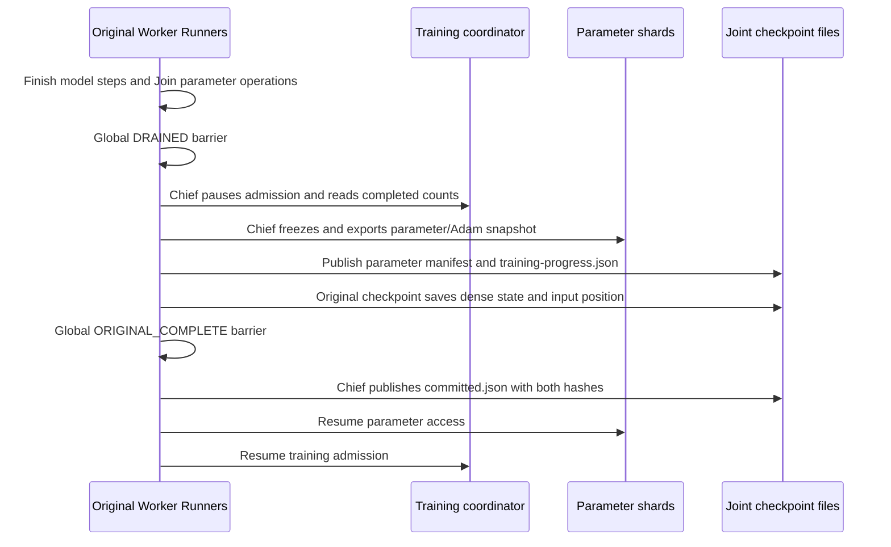

# Original-framework checkpoints with training progress

The original Runner checkpoint now saves the training coordinator's completed
Worker counts alongside the external parameter snapshot. A restored coordinator
starts paused. Original table and Runner restore hooks check its policy, clocks
and each local learner's starting iteration before the original dense restore
runs. Training reopens after every peer completes framework restoration.

## Save boundary



`external_parameters/training-progress.json` contains the source run, epoch,
consistency policy, maximum delay and ordered per-Worker completed counts.
`committed.json` binds its exact bytes and the parameter manifest with SHA-256.
The original framework owns its dense and input checkpoint files; the joint
marker is published only after its checkpoint methods complete on every peer.

A failed original dense save leaves parameter access and coordinator admission
paused, with no joint commit marker. A present but unbound, missing or corrupted
progress file rejects restore. Checkpoints without configured training progress
retain their existing format.

## Prepare fresh processes

Stage parameter shards through the existing `entropy_stage` command. Prepare the
coordinator and learner options from the same committed checkpoint:

```python
from checkpoint_restore import training_restore_plan

plan = training_restore_plan(
    "/checkpoints/step-100",
    run="replacement-run",
    coordinator_listen="0.0.0.0:9100",
    coordinator_endpoint="coordinator:9100",
    checkpoint_id="step-100",
)

# Start eps_training_coordinator with plan["coordinator"].
# For each original global learner_rank:
worker_job["run"] = "replacement-run"
worker_job["partition_epoch"] = plan["coordinator"]["epoch"]
worker_job["training"] = plan["workers"][learner_rank]
```

The coordinator's `restore` configuration preserves membership order, policy and
completed counts. Its C++ startup restores those clocks and pauses admission.
Each learner's `start_iteration` must equal its saved completed count. Restore
requires a fresh run with the same parameter partition topology and Worker
membership semantics.

## Restore boundary

The existing parameter provenance checks first verify every pristine restored
shard against the committed snapshot. Each native learner then checks:

- the progress file is bound to the same source run and epoch;
- coordinator policy, delay and the entire completed-count vector match;
- coordinator admission is paused, with no active or waiting task;
- its native context has the correct next iteration and no armed step.

Only after these checks does the original Runner restore dense and framework
state. A global model-restore barrier precedes the chief's admission resume;
another global barrier precedes any resumed model step. Parameter request IDs
continue to use the existing learner namespace, while progress membership uses
the original global learner rank.

The completed count tracks successful model steps. The original reader remains
responsible for restoring the corresponding input position. The joint save
boundary closes both before publishing the commit.

## Model continuation checks

`original_native_training_checkpoint_cpu` and its CUDA model variant run two
original-method Workers against two real parameter shards and a real training
coordinator. All trainable feature and model vectors live in the parameter
service. The model has four input batches per cycle and saves after three steps
per Worker. Fresh processes restore at the fourth batch and continue to six
steps per Worker.

The checks compare every learned parameter, Adam moment, row update count,
optimizer sequence and beta power with an uninterrupted model, plus every
continued loss. They also reject a wrong learner starting clock before original
dense restore and inject an original dense-save failure to check that progress
admission stays paused and no commit is published. A local dense sentinel checks
the original Saver restore path; trainable model vectors are shared externally.

The fixture executes preserved original Runner, SparseTable and barrier methods
with explicit framework environment stand-ins. Complete original main/Executor,
reader and native multi-peer services have their separate execution gates.
The CUDA model variant runs on one physical GPU with Host parameter shards.

```sh
ctest --test-dir build/native-runtime --output-on-failure \
  -R '^(original_native_training_checkpoint_cpu|original_native_training_checkpoint_cuda)$'
```

Both Host and A6000 GPU model executions finish at `[6, 6]` after restoring
`[3, 3]`, with zero maximum parameter/Adam-state and continuation-loss differences
from uninterrupted execution. [Source hashes, phase records and executed checks](validation/2026-11-05-original-training-checkpoint.json).
