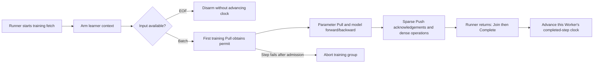

# Training-task progress at the original Runner boundary

An opt-in native table configuration connects original Entropy training steps to
the parameter service's training-progress coordinator. The original framework
continues to execute its model, dense optimizer and input pipeline. The native
parameter context obtains permission before reading trainable external parameters
and reports completion after the original Runner returns successfully and every
parameter operation is acknowledged.



## Configuration

Add `training` to the existing native table job configuration:

```json
{
  "schema_version": 1,
  "run": "training-run",
  "endpoints": ["parameter-0:9000", "parameter-1:9000"],
  "backend": "native",
  "native": {
    "device": "/CPU:0",
    "op_library": "/runtime/eps_tensorflow_ops.so",
    "runtime_library": "/runtime/libeps_runtime.so"
  },
  "training": {
    "coordinator": "training-coordinator:9100",
    "start_iteration": 0
  },
  "tables": {"entities": {"id": 1, "seed": 42}}
}
```

The coordinator must use the same run and partition epoch. Each original global
`learner_rank` identifies one training Worker. Parameter request identities retain
their existing `learner_rank * learner_id_stride + thread_id` namespace, so an
ID stride does not create gaps in coordinator membership. Direct native-context
users can provide `training.worker`; otherwise it defaults to their parameter
learner ID.

The installation wraps original single-scene and multi-scene Runner training
fetches containing `run_op`. Prediction and administrative fetches keep their
existing execution path. The native context rejects unarmed training Pulls when
progress is configured. Multiple external table Pulls in one step share its
permit; prepared Pulls obtain admission when their parameter read starts.

## Admission, completion and failure

Arming alone consumes no coordinator task. Admission occurs inside the native
Pull after TensorFlow has produced the input tensors. Dataset EOF before that
point leaves the completed clock unchanged. Prediction reads do not obtain a
training permit.

The Runner completion hook calls Join before Complete. A live parameter handle
therefore prevents completion, and the original model Session must also have
finished its fetched dense operations. An exception after a potentially admitted
Begin aborts the coordinator group, including when the Begin reply is lost. This
step boundary does not automatically retry model gradients or undo partial
parameter updates; replicated-gradient recovery uses its separate protocol.

Sequential and bounded-delay admission use a fixed Worker group and require
aligned training-step counts. Eventual admission can run uneven finite input
partitions. [Original-framework joint checkpoints](ORIGINAL_TRAINING_CHECKPOINTS.md)
bind completed clocks to the parameter snapshot and original save boundary,
validate a paused restored coordinator and reopen training after all peers finish
framework restoration.

## Executed checks

The C ABI process test uses two independent parameter shards and a real
coordinator. It checks direct and prepared Pull admission, independent parameter
and training Worker IDs, rejection of overlapping scopes and premature
completion, EOF-style cancellation, prediction exclusion and group abort after
an admitted model failure.

The original-method fixture executes preserved `SparseTable` and
`_MultiDatasetRunner.run` bodies with native TensorFlow operations. Two Worker
processes each train three batches and then consume dataset EOF. CPU and GPU
model variants verify `[3, 3]` completed clocks, six acknowledged updates per
shard, two updates per parameter row, finite model losses and no live tickets.
The GPU model variant uses one physical A6000 and Host parameter shards.

This fixture supplies explicit framework environment stand-ins. Complete
original main/Executor, reader, multi-peer services and checkpoint/restore
execution remain separate acceptance gates.

```sh
ctest --test-dir build/native-runtime --output-on-failure \
  -R '^(native_runtime_training_progress|original_runner_native_training_progress_cpu|original_runner_native_training_progress_cuda)$'
```

Original-method checks require `EPS_ENTROPY_SOURCE_ROOT` pointing to the preserved
Entropy directory and are skipped when those private sources are absent. They
run on Linux with the static transport runtime and a matching TensorFlow native
operation module.

[Source hashes, complete six-row model state, progress and executed checks](validation/2026-11-04-original-runner-training-progress.json).
