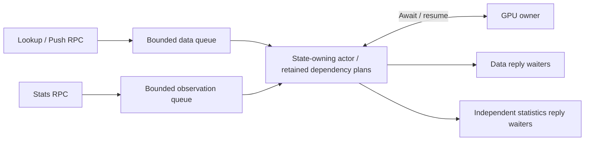
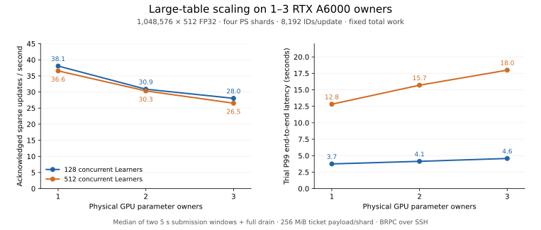

# Bounded scheduling and observable overload

The parameter shard retains row, optimizer and Agent dependencies while a CUDA
operation is pending. Statistics now have a bounded path through both the actor
and RPC reply layers, so operators can inspect that waiting work.

## Dependency-plan pressure

Earlier scheduling discarded every queued dependency plan when the next plan did
not fit the shared budget. Large queues repeatedly collected and sorted the
same blocked prefix after wakeups. The scheduler now retains older plans and
reclaims only younger optional plans when an older plan needs space. If active
and older reservations still occupy the budget, a required-size hint avoids
rebuilding that candidate until space or the dependency epoch changes.

Row/optimizer/Agent conflict order and full mutation barriers remain in place.
This chooses bounded metadata and older-request progress over admitting more
independent data work when dependency memory is exhausted. Each oversized plan
still rejects before execution. Growing plans after ownership changes can reclaim
younger cache reservations, preventing an oldest request from being trapped
behind optional cached metadata.

In the controlled local probe, five blocked-prefix jobs and ten wake notifications
produce **55 dependency builds on the prior actor and 5 on the repaired actor**.
Both drain to zero reserved dependency bytes. This measures scheduling work in a
small controlled case, rather than GPU throughput.

## Read-only observation

The actor accepts at most 16 queued synchronous observations by default. It
executes them on the same state-owning thread between events, interleaving them
with runnable data work. Observations consume no asynchronous data slot and
cannot change parameter or ticket state. They can inspect an in-flight mutation
or checkpoint; a statistics snapshot is an actor-state observation, not a
checkpoint commit acknowledgement.

RPC statistics use two independent native completion waiters with at most 32
outstanding replies. A ready statistics future can therefore return while the
four data completion waiters are blocked. Excess observations reject explicitly;
mutation/save ordering and accepted-work shutdown rules remain intact.

The real BRPC regression holds one owner update and occupies all four data reply
waiters with four Push RPCs. Statistics return in approximately **0.2 ms** on the
local test machine while the mutation remains held. After release, all four
updates complete and full weights, Adam moments and counters equal CPU replay.

`active_operations` counts data operations and excludes the query itself.
`queued_observations`, `completed_observations`, `rejected_observations` and
`dependency_budget_waits` expose the independent path and metadata pressure.
The completed-observation counter excludes its current snapshot.

## Verification scopes

Runtime source `0e46929` passes 31 native/RPC checks, 43 portable TensorFlow
checks, 18 core ASan/UBSan checks and two resumable-operation TSan checks on
macOS. A ramped Host-reference workload of 65,536 rows, 16 dimensions and 8,192
IDs completes 128/512/1022 concurrent clients, engages dependency-budget waiting
and preserves sampled update counts. Its lifecycle-marked HTTP observations are
recorded separately from CUDA measurements; that monitor checks HTTP transport
status only.

A separate cold 1,022-client burst reaches macOS socket `ENOBUFS` during data
submission. Statistics and a later read remain responsive, but partial lookup
tickets remain and the failed cohort's optimizer trajectory is unverified. This
transport failure is retained as a separate incident; it is not a successful
training window. The load generator shares per-shard BRPC channels across its
logical Learner threads.

The Linux TensorFlow/CUDA build executes 48 passing checks and skips three
private original-source checks. On an A6000, the default 256 MiB per-shard ticket
budget admits two completed 512-Learner large-input windows and explicitly
rejects part of the 1,022-Learner window with `live ticket payload budget
exhausted`. All 676 running-phase statistics queries succeed; their P99 is
199 ms and maximum is 399 ms. After drain, all four shards have zero live
tickets. This establishes observable capacity rejection; the failed cohort is
not included in verified throughput or full optimizer-trajectory claims.

The same-instance cold 1,022-Learner/default-budget control uses the same GPU
owner and pressure-probe binaries for both server revisions. The prior server
`5a69840` produces no completed window before the 215-second whole-probe deadline;
284 of 540 running-phase statistics queries fail. Server `0e46929` returns an
explicit ticket-payload capacity rejection, drains all four shards to zero live
tickets and completes all 440 running-phase statistics queries. The earlier
ramped candidate and this cold control retain separate observations.

## Sustained load and transport controls

Four additional three-owner windows use a 20-second submission interval and full
drain. Both repetitions at each concurrency complete without update errors:

| Learners | Acknowledged updates/s, median | Trial P99, median | Completed updates |
| --- | --- | --- | --- |
| 128 | 30.30 | 4.72 s | 1,452 |
| 512 | 29.32 | 17.06 s | 2,048 |

A CPU-only framed-transfer control runs after the training probes, using the same
SSH forwards. Twenty repetitions per payload produce these medians:

| Path | 64 KiB transfer + acknowledgement | 1 MiB upload rate |
| --- | --- | --- |
| Coordinator loopback | 0.085 ms | 1,253.98 MiB/s |
| Remote owner 1 | 41.12 ms | 21.73 MiB/s |
| Remote owner 2 | 1.54 ms | 20.84 MiB/s |

Both remote 64 KiB paths have approximately 43 ms maxima. The measured expansion
curve includes these transport characteristics. Direct BRPC networking requires
its own operating-envelope measurement. The coordinator's final cgroup counters report zero OOM and OOM-kill events.

## Large-table multi-owner measurements

Runtime `0e46929` uses three distinct RTX A6000 GPUs on separate cloud instances.
Four parameter shards and the load generator run on the coordinator, with a
5.94-core cgroup quota and 48 GiB host-memory limit. BRPC reaches remote owners
through verified SSH forwards. The fixed table has 1,048,576 rows × 512 FP32
dimensions: 6 GiB of logical weights and two Adam moments, with half the rows
resident. Each update supplies 8,192 ID occurrences in bags of 128.

| GPU owners | Learners | Acknowledged updates/s | Trial P99 |
| --- | --- | --- | --- |
| 1 | 128 | 38.06 | 3.75 s |
| 2 | 128 | 30.87 | 4.14 s |
| 3 | 128 | 28.03 | 4.57 s |
| 1 | 512 | 36.56 | 12.82 s |
| 2 | 512 | 30.33 | 15.70 s |
| 3 | 512 | 26.52 | 17.99 s |

These are medians of two five-second submission windows followed by full drain,
with the default 256 MiB/shard ticket payload budget. Every completed window
checks 32 sampled row-update counters, finite sampled state and empty Agent
queues. Adding remote owners reduces throughput and raises tail latency in this
deployment; reducing fan-out, transfer and coordination work is the next scaling
priority.

At 1,022 Learners, the three-owner default-budget window explicitly rejects
requests with `live ticket payload budget exhausted`. All four parameter shards
then return zero live tickets and all three Agent queues drain. Its 592
running-phase statistics requests all succeed. Raising the per-shard budget to
512 MiB admits the same three-owner concurrency: 1,022 updates complete at
23.61 updates/s with trial P99 35.47 seconds, and all 664 running-phase statistics
requests succeed. This is an admission-capacity/host-memory trade-off. The ticket
payload budget, dependency-plan cache budget and GPU memory are separate bounds.

The protocol has 1,024 Learner identity slots. This probe reserves two for setup
and post-failure health checks, leaving 1,022 measured training clients. That is
the tested client ceiling; the million-row table is the tested scale rather than
an established physical GPU-memory limit.

The native TensorFlow graph separately verifies two and three physical parameter
owners. Model forward/backward, prepared inputs and mid-run dense/sparse
save/resume complete; all eight touched parameter rows, Adam moments and counters
match independent CPU replay exactly. Synthetic-gradient capacity trials retain
their separate sampled-counter and finite-state verification scope.

[Runtime and measurement commands](RUNNING.md#large-input-overload-and-ticket-byte-controls)

[Design and bounds](RESUMABLE_OPERATIONS.md) ·
[Implementation and verification plan](plans/2026-11-01-overload-scheduling.md)

## Evidence and resource cleanup

The repair study retains **21 completed windows, 12,227 acknowledged sparse
updates and 672 sampled row-counter checks**, three explicit ticket-budget
failure points and the prior server's incomplete cold probe. Partial updates in
failed cohorts are excluded from successful throughput; their complete optimizer
trajectories are unverified. The repaired runtime completes **6,292 running-phase
statistics queries with zero failures**, across setup, preflight, warmup, measured
submission and drain. Boundary queries are classified separately.

Source/binary hashes, workload configurations, raw records, observations,
resource summaries and independent model checks are retained in the
[measurement manifest](benchmarks/2026-11-01-overload-repair/manifest.json) and
[validation index](validation/2026-11-01-overload-repair.json).
[Local correctness and sanitizer evidence](validation/2026-11-01-overload-scheduling/local-validation.json)
retains its distinct platform and observation scopes.

All three rented instances are deleted and verified absent after hash-checked
retrieval. The base-rate duration estimate rounds up to **USD 0.40**; it is an
estimate rather than an invoice.
