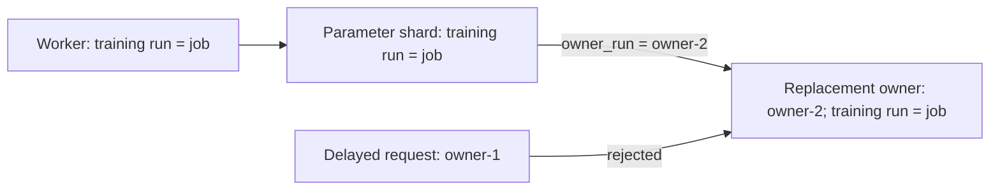

# Parameter-owner incarnations

A training run can continue from its replicated parameters while a replacement
parameter owner uses a fresh identity. The stable training identity binds the
model's optimizer updates, worker journals and replicas. The owner identity
binds Agent reads and ordered control commands to one owner incarnation.



Start a replacement owner with both identities:

```sh
eps_cache_agent --run owner-2 --training-run job --agent 0 \
  --listen 127.0.0.1:9200 --backend cuda
```

Parameter-shard, model-worker, native-runtime and preparation configurations
select that owner's namespace through the same Agent entry:

```json
{
  "agents": [
    {"id": 0, "endpoint": "127.0.0.1:9200", "owner_run": "owner-2"}
  ]
}
```

The parameter server retains its existing `run_id`; workers and native runtimes
retain their existing `run`. The original Entropy adapter accepts the same
`owner_run` field in `cache_agents`. Portable Python callers may use
`backend.cache_endpoints([(0, endpoint, "owner-2")])`. Existing two-field endpoint
tuples and omitted `owner_run` fields continue using the training run. Omitting
`--training-run` on the Agent also preserves the original shared identity.

Every control operation and parameter read validates the owner identity before
accessing the backend. Ordinary and compact optimizer updates additionally
validate the stable training identity and home shard in their original update
context. The runtime preserves that original context; it does not relabel a
gradient to make it match a different model. A rejected old-owner command does
not consume the replacement owner's command sequence or update its parameters.

## Execution evidence

The RPC lifecycle check stops an owner and starts its replacement at the same
listener address. Row IDs, slots and generation numbers are reused. Old reads,
loads and both update paths reject. The new owner accepts gradients from the
original training run and rejects contexts from a different training run; its
row update counter remains unchanged after rejected requests.

The TensorFlow model check uses two Host owners with distinct owner identities,
two workers and eight synchronous rounds. Full touched parameter/moment state
and the first aggregated gradient are compared against the single-worker global
batch. The C ABI check uses a separately identified Host owner, moves rows into
it, reads through the native resolver, updates, saves and checks buffer lifetime.
These checks establish identity/routing semantics with Host storage. CUDA owner
execution of this new identity option remains part of GPU recovery validation.

The manager must stop former owners before replacement and distribute the fresh
owner identities to every caller. Run namespaces provide replay isolation;
network authentication and revoking another live endpoint are deployment
responsibilities. [Replica-backed owner recovery](REPLICA_OWNER_RECOVERY.md)
loads weights and Adam moments into fresh owners, reconciles partial rounds and
resumes the model. Its complete process path passes with Host owners; CUDA
execution remains in the GPU validation plan.

[Validation record](validation/2026-11-04-owner-incarnations.json) retains the
source hashes, model state, RPC results and suite logs for this implementation.
