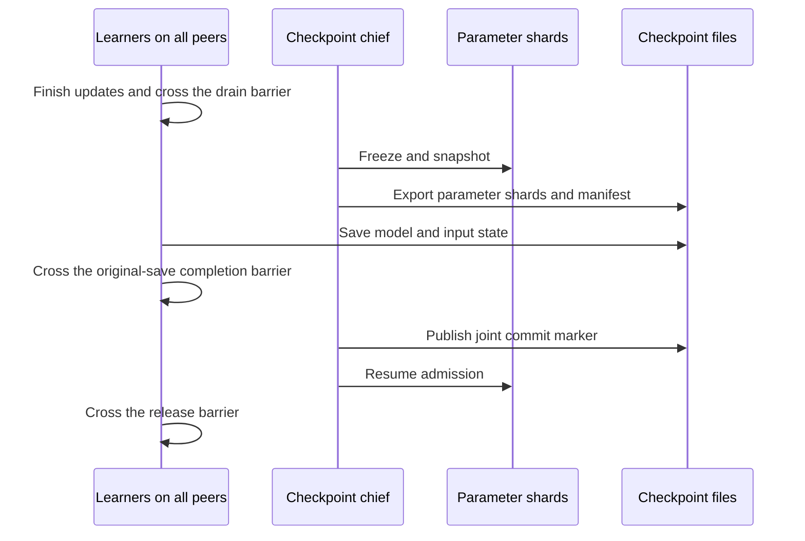

# Peer-coordinated checkpoints

The checkpoint chief can coordinate a parameter-service save even when its own
model creates no selected external parameter table. A lazy administrative client
freezes and exports the shared service, then resumes admission after all training
peers finish their model/input saves. Learner clients continue to own parameter
access, gradient updates and request sequencing.



## Administrative client

The installation reuses an existing learner backend when available. Otherwise,
it creates one administrative backend independently of the learner registry.
This client performs save/export/resume and loaded-restore verification. It
creates no tables and submits no parameter lookups or gradient updates. Save
operates on the shard-wide drain protocol and consumes no learner data-request
sequence numbers.

For the native backend, its controller Session runs on CPU and omits CUDA-owner
and remote-cache configuration. Closing the installation releases administrative
and learner clients before releasing its process-owned GPU Agent.

## Process and thread verification

`entropy_peer_checkpoint_control` starts two independent BRPC parameter-shard
processes and two framework peer processes, with two learner threads per peer.
The chief peer has an unselected original table and no external learner backend;
both learners on the other peer use the selected external table. Every learner
uses a real TensorFlow Session.

The fixture executes preserved `Barrier`, `MultiThreadingLearner` and
`env.barrier` Python definitions, together with the original table, InputBuilder
and Runner checkpoint methods. Their native cluster call uses a bounded network
rendezvous supplied by the test. The original native feeder/configuration/save
APIs retain the explicit source-contract stand-ins; the dense-save wrapper uses
an actual TensorFlow Saver. Legacy sparse executor threads use a test fallback
to the local chief's learner context.

The successful case completes two checkpoints and 24 global barrier rounds.
Before releasing the first original-save completion barrier, the supervisor
checks that the parameter manifest exists, the joint marker is absent, all
lookup tickets have drained, and a new lookup receives `shard is draining`.
After release, both joint manifests and all exported shard hashes verify. The
second training step/checkpoint succeeds, each shard records four acknowledged
updates, and a fresh lookup succeeds after admission resumes.

A separate injected dense-save failure leaves both the native completion marker
and joint marker absent. The parameter manifest remains available, tickets are
drained and new lookups remain rejected. The test supervisor terminates its owned
peer process groups: the preserved local Python barrier has no cancellation API.

The restore follow-up stops the original shards and stages both files from the
second joint checkpoint, then starts fresh shard and peer processes under a new
run. The chief's administrative client verifies loaded provenance without
creating a learner table. Four learner threads cross the original Python
restore barriers; the actual TensorFlow Saver replaces a deliberately different
dense initializer (`-0.5`) with the saved value (`0.5`). Each external learner
then completes one additional update.

The final two parameter rows match six uninterrupted direct-client updates
exactly: weights, first/second Adam moments, row-update counters, optimizer
sequence and beta powers all compare with zero difference. Fresh-run RPC
statistics count the two resumed updates per shard; saved optimizer/row state
includes the four updates before restart. Restore completes eight global
barrier rounds. No native data reader or original C++ cluster library is loaded.

```sh
ctest --test-dir build/tensorflow --output-on-failure \
  -R 'entropy_peer_checkpoint_control|entropy_table_hook_configuration'
```

These checks establish the adapter's process/thread checkpoint protocol using
the portable parameter client. Native GPU table execution has its separate
[recorded checks](NATIVE_TABLE_INSTALLATION.md). Loading the complete original
application, reader and C++ cluster runtime requires its `ts_clib.so` or
`ts_clib_gpu.so` build artifact; those native artifacts are absent from the
available source copies.

The preserved top-level BUILD also loads absent `.resources` entrypoint and
protobuf rules. Building the original runtime requires the complete rule and
dependency bundle, or a compatible prebuilt runtime/environment.
[Dependency inventory](validation/2026-11-01-original-native-dependencies.json).

[Validation record and hashes](validation/2026-11-01-peer-checkpoint-control.json)
retain the successful/failure cases and the prior-adapter regression.
[Restore continuation evidence](validation/2026-11-01-peer-restore.json) records
the restarted process topology and full optimizer-state comparison.
