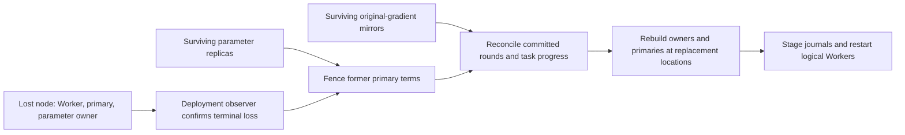

# Physical placement and terminal-node recovery

Training Workers and parameter shards keep their logical identities when their
processes move to another machine. A deployment supplies generation-specific
physical placement and replacement endpoint routes. Parameter and original-
gradient replicas remain on surviving hosts, so recovery can rebuild owners and
continue without opening the lost Worker's local journal.



## Deployment configuration

The existing managed training controller has two logical Workers/shards. Its
`nodes` entries describe each logical Worker's initial routes. Physical
deployments additionally provide:

| Field | Purpose |
| --- | --- |
| `physical_nodes` | Node transports, stable `node_id`, storage roots and optional provider UUID |
| `role_placement["0"]` | Initial physical host index for each named role |
| `role_placement["1"]` | Replacement physical host index for each named role |
| `replacement_nodes` | Replacement per-Worker routes and role listeners |
| `replacement_manager` | Manager-visible replacement routes |

For example, initial Worker/primary/owner roles can use physical indices `[0, 1]`
while replicas, gradient mirrors and the coordinator use an independent survivor
at index `2`. The replacement generation can place Worker/primary/owner roles at
`[1, 1]` with distinct listeners. Replica and mirror storage stays on its original
surviving physical host for this transition.

Source, Python, binary and native-module installation paths are uniform across
the physical roster. Storage roots can differ. This keeps immutable role commands
portable while each machine owns its own role state and journals. The declared
routes must resolve to the corresponding host/listener; placement does not
implicitly rewrite network endpoints.

## Confirm loss before skipping a node

`PhysicalRoles.record_loss()` accepts a terminal deployment-observer receipt.
A provider deletion receipt must name the run, stable node identity and the
deployment's previously owned UUID, with fresh inventory evidence that the UUID
is absent. The observer owns the provider operation and verification; the role
client does not delete cloud resources.

A transport timeout leaves the node unresolved. It cannot authorize skipping
its lifecycle checks. Terminal receipts are fsync-published under the manager
state directory and reloaded on manager reentry. The client refuses loss of a
node still required to host a surviving replica/mirror, coordinator or declared
replacement role.

After confirmation, old-role status and stop return the terminal-node evidence
without contacting that machine. Reads and new actions against its lost roles
are rejected. New-generation roles use their declared physical hosts, even when
their logical Worker index formerly belonged to the lost machine.

## Recovery sequence

1. Stop old roles on surviving nodes; retain the terminal receipt for roles on
   the lost node.
2. Activate replacement Worker and manager routes, including on manager reentry.
3. Fetch each original-gradient journal from its actual mirror host.
4. Restart surviving parameter replicas, grant new primary terms and create the
   replacement owners and primaries.
5. Reconcile partially committed rounds, rehydrate complete owner state and
   recover coordinator progress through the existing retained-gradient protocol.
6. Seed fresh Worker and mirror stores, reopen admission and resume logical
   Workers at their recovered input positions.

Replica fencing and owner incarnation checks retain their existing guarantees.
Replacement placement must have enough memory for the recovered state. Placement
can co-locate logical roles when the working set fits; it does not add GPU
capacity automatically.

### Interrupted recovery before admission

The manager records each recovery phase before advancing. If a replacement
role has exited before admission resumes, it stops the remaining roles in that
attempt, records the retired phases and creates a fresh generation on the
replacement hosts. Parameter replicas keep their storage and advance their
fencing terms; immutable source gradient journals keep the same handoff identity
when copied into the new generation. This also covers a manager failure after
journal staging. A live or unresolved role is observed in place.

This restart path ends when admission resumes: replacement Workers can then
produce new gradients, so further recovery must retain that generation's
journals. The manager does not reuse the original pre-admission journals after
that boundary.

Native-client IPC children use the parent's interpreter, an absolute Worker
script path and the discovered native-module directory. A manager whose Python
cannot discover its configured native module fails before starting roles.

## Executed provider-node loss

The physical trial starts two TensorFlow model Workers and CUDA parameter owners
on distinct **NVIDIA L40 and RTX A6000** instances. The deployment observer deletes
the owned L40 while shard frontiers are **`[4, 3]`**, then confirms its UUID is absent
from provider inventory. Both parameter replicas and original-gradient mirrors
remain on the A6000.

Recovery fences the old primaries, rehydrates the replacement CUDA owners and
replays original round-three gradients to bring the lagging shard to round four.
Both logical Workers then continue on the A6000 and finish **eight rounds each**.
All **64 rows**, row update counts, Adam first/second moments and both complete
loss histories match uninterrupted two-GPU training with **zero absolute error**.

The trial also exercises a failed pre-admission recovery attempt: the first
replacement cohort is stopped after a manager interpreter/module-path failure;
reentry creates generation two at term three and completes the same job. All
33 registered role groups have terminal cleanup receipts, and provider inventory
confirms deletion of the failure instance. The existing A6000 remains allocated
for the separate original-framework integration work.

This 64-row working set fits on the survivor. The separate 60 GiB capacity trial
measures a model that exceeds one GPU's memory; the node-loss trial measures
recovery and replacement routing.

[Hardware, source hashes, replay frontiers, full-state comparison and cleanup
evidence](validation/2026-11-05-provider-node-loss-recovery.json).

## Executed local node-scope checks

`managed_physical_node_scope_recovery` uses three local process/storage scopes
and distinct real TCP aliases. At each fault it stops every training role on
scope zero, removes that scope's storage, records an explicit local-test receipt
and moves its replacement roles to the surviving scope. Such receipts require
`allow_test_loss=true` and are rejected for remote production nodes.

The fixture covers loss after parameter Pull, a partially committed round and
updates committed before task completion. In the last case it also interrupts
the manager after journal staging and reenters from durable state. No lost
storage directory is recreated during recovery or completed-job reentry.

An additional case stops the first replacement cohort after journal staging,
then verifies generation-two reentry from the same immutable source journals.
All 64 parameter rows, row update counts, Adam moments and every loss match
uninterrupted eight-round training exactly. Role cleanup receipts confirm the
old terminal scope and all remaining managed roles are gone.

[Source hashes, fault cases, replacement placement and cleanup records](validation/2026-11-05-physical-node-scope-recovery.json).

```sh
ctest --test-dir build/tensorflow --output-on-failure \
  -R '^managed_physical_node_scope_recovery$'
```
