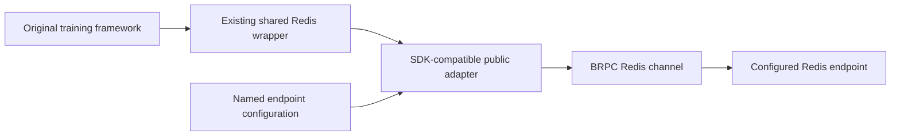

# Public Redis SDK adapter

The adapter supplies the Redis client interfaces used by the original training
framework's shared Redis wrapper. It uses Apache BRPC to execute commands on real
Redis services. The existing wrapper keeps its command filtering, write
protection, retry quota and circuit-breaker logic.



## Build and configuration

The CMake target is `eps_redis_compat`. It builds as C++17 and depends on BRPC,
Protobuf and nlohmann JSON, independently of the parameter-server core. Its
public include directory supplies `redis_sdk/client.h` and
`bili_redis/bili_redis_client.h`. The adapter's Bazel `bilibili-redis` target uses
`@brpc//:brpc` and `@json//:json` from the original isolated workspace.

Set `EPS_REDIS_CONFIG` to a JSON configuration file:

```json
{
  "clusters": {
    "training-cache": {
      "endpoint": "127.0.0.1:6379",
      "database": 0,
      "password_env": "TRAINING_REDIS_PASSWORD"
    }
  }
}
```

`database` defaults to zero. Omit `password_env` when authentication is not
configured. The environment variable's value supplies the password; credentials
are not part of the committed configuration. The named endpoint can represent
an independently deployed Redis service. The adapter uses explicit endpoints
and surfaces redirection errors; it does not discover a Redis Cluster topology.

The manager requires nonempty app, zone and environment identities. Repeating
initialization with the same identity is idempotent. Invalid configuration,
missing named passwords and unknown clusters fail initialization/admission.
`add_cluster` enables an existing configured name before `new_client` opens it.
The overload taking a Prometheus registry delegates to the same operational
initialization; it does not register the private SDK's metrics.

For the original framework, register the adapter in the **independent** Bazel
workspace while leaving upstream code and BUILD files unchanged:

```python
local_repository(
    name = "bilibili-redis",
    path = "/absolute/path/to/project/adapters/entropy/redis-sdk",
)
```

## Command and batch execution

`exec` accepts the original `brpc::RedisRequest` and returns BRPC responses.
Binary command arguments retain their lengths. String, integer, array, nil and
error replies keep their types. With `_merge_batch_as_array=true`, an EXEC
pipeline containing multiple commands returns one array of ordered replies;
a single-command response retains its original shape.

`mget` pipelines GET commands and returns **one response per input record**, in
input order. Repeated Keys remain repeated positions, missing values remain nil
and empty strings remain empty strings. A wrong-type error belongs to its own
position rather than changing another result. This matches the retained
wrapper's per-record batch consumer; it is not a single Redis MGET array.

`mset` pipelines SET commands with per-record `EX` when `_ttl_s` is positive.
Zero means no expiration. All record lengths and TTLs are validated before any
command is sent. The batch is ordered, with per-record replies; it is not a
transaction, and a network failure can leave a partially executed batch.

Batch admission allows at most 4,096 records and bounds encoded request data to
8 MiB. A shared client supports concurrent calls with independent controllers
and response objects. Callback arguments, when supplied, run once synchronously
before return; the retained wrapper supplies null callbacks.

## Failures and retries

Server command errors remain Redis error replies. Transport failures also
produce explicit error replies, so the original wrapper cannot mistake an
unavailable service for a missing Key. Methods additionally return `Status`.
Errors do not expose configured passwords.

The channel disables automatic retries. A dropped response to INCR leaves its
execution ambiguous; retransmitting it can increment twice. The original outer
wrapper retains its configured retry policy, so callers must account for that
policy when choosing non-idempotent commands. The adapter itself provides no
transaction or exactly-once guarantee for arbitrary Redis writes.

## Executed verification

```sh
cmake -S . -B build/native -DEPS_REDIS_SERVER=/path/to/redis-server
cmake --build build/native --target eps_redis_compat_tests -j 4
ctest --test-dir build/native --output-on-failure -R '^public_redis_sdk$'
```

The test starts separate loopback Redis processes, including a password-protected
service, and cleans them up through their retained process handles. It checks
binary data, nil/empty values, duplicate-Key order, TTL expiration, mixed batch
errors, raw/merged pipeline replies, authentication, database isolation,
malformed configuration, admission bounds, concurrent shared-client calls,
command timeout and a terminated Redis service.

A TCP fault proxy forwards an INCR to real Redis, discards its response and
closes the connection. The adapter reports failure; the server counter is one,
and the proxy observes one INCR packet. This is a lost-reply/no-automatic-replay
check, not a general exactly-once storage protocol.

The original `deps(//entropy:ts_clib.so)` query now completes successfully with
39,343 dependency labels. The subsequent build analysis reaches the original
CUDA environment requirement on this macOS host. Compiling/loading the original
library and executing its complete training/control path still require the
matching Linux/NVIDIA environment. The adapter's process checks and dependency
query are separate from that full integration acceptance.

[Validation manifest](validation/2026-11-04-public-redis-sdk.json) ·
[Original native build](ORIGINAL_NATIVE_BUILD.md)

Implementation references: [Apache BRPC Redis client](https://github.com/apache/brpc/blob/master/docs/en/redis_client.md),
[Redis SET and expiration](https://redis.io/docs/latest/commands/set/),
[Redis pipelining](https://redis.io/docs/latest/develop/using-commands/pipelining/).
