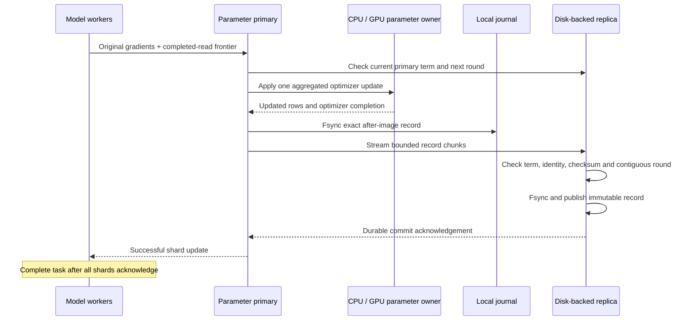

# Replicated training updates and primary recovery

A synchronous shard round is acknowledged after its exact updated state is
persisted on the primary and an independent replica. Each record contains the
touched rows' weights, both Adam moments, all table optimizer clocks and
completed request-stream frontiers. Recovery installs those after-images; it
does not execute Adam again for an already committed round.



## Why persist after-images

Saving only gradients requires replaying optimizer arithmetic after a failure.
After-images preserve the actual CPU/GPU update result, including floating-point
rounding and row update counters. Each touched row sends three FP32 vectors;
untouched table rows are not copied on every update. Table-wide optimizer clocks
still advance for empty contributions.

An immutable baseline preserves the initial full table state. Declared dense-ID
ranges in `replica_table_rows` are initialized before baseline creation, so a
capacity-sized table's untouched rows survive recovery too. A baseline loaded
from an existing checkpoint retains its saved values. The primary shares an
immutable snapshot inode with its local journal when the filesystem permits;
cross-filesystem storage falls back to streaming a local copy. The remote
replica receives an independent baseline copy.

The standby streams files and does not keep the full parameter table in memory.
Its bounded actor accepts chunks of at most 1 MiB with an 8 MiB queued/active
payload budget. Complete update records default to at most 64 MiB. The log's
payload disk budget defaults to 64 GiB. Immutable record files are published only
after complete checksummed data is fsynced; partial uploads do not advance the
committed frontier. A full log rejects new writes instead of acknowledging an
unprotected update. Baseline storage, primary snapshots, journals and any
co-located replica payloads must be included in node disk sizing.

Synchronous persistence adds disk and network latency to each update. It favors
preserving acknowledged training progress when a primary fails. An unavailable
or failed replica cannot produce a successful update acknowledgement. The
current implementation uses one standby authority per shard; it does not elect
a replica quorum after loss of that authority's disk.

## Identity and promotion

Model run and partition epoch stay stable across primary replacement. A
separate monotonic term identifies the active primary role. The replica stores
that term and the primary identity durably. Manager promotion compares the
expected term, increments it and publishes the new owner. A repeated identical
promotion request is idempotent; competing owners cannot both acquire the same
expected term.

Every baseline/write/read operation checks its run, shard, shard count,
partition epoch, model binding and granted primary term. The model binding
includes exact table definitions, worker count, reduction mode and declared
initial row counts. A baseline round must also match at startup. Previous terms
cannot publish new updates after promotion. A commit that precedes promotion
remains valid even if its acknowledgement arrives late.

Promotion is a privileged manager operation over the trusted control channel.
The executables default to loopback listeners; the existing fleet deployment
uses authenticated SSH forwarding. Endpoint selection and process supervision
remain explicit manager responsibilities.

Each log directory holds an exclusive operating-system file lock for its process
lifetime. A second replica process pointing at that directory fails startup,
preserving one serialization authority for its durable term and record frontier.
The lock is released when the process exits, including after SIGKILL. Use local
storage with working advisory locks and fsync semantics for these directories.

## Request progress through a retained-gradient retry

Training rounds and transport request sequences are separate clocks. A worker
releases its parameter reads before submitting gradients. The adapter can then
certify the next completed read sequence, which travels with the original
gradient packet. The primary verifies that certification overlaps no live read
ticket and persists the resulting request frontier with the update.

For example, a worker has completed read 3 and computed round-3 gradients, but
the primary fails before that round reaches the replica. The replacement knows
only the read frontier from round 2. Retrying the retained gradients with
`completed_reads=4` closes the missing read-3 lifecycle before the next update.
Read 4 can then continue without leaving a gap in the bounded deduplication
window. The request-progress check also verifies continuation from sequence
50,000, beyond the default 4,096-entry transport window.

A worker retains all original per-shard gradients until every shard acknowledges.
The worker helper submits to all shards before waiting, keeps successful shards
complete, and retries unavailable shards with the same identity and gradient
payload. It also handles a disconnected older response occupying a pending slot.
No retry waiting runs on a transport-completion thread. `gradient_retry_ms` opts
the model worker into a retry window of at most 20 seconds; the isolated native
client remains within its 30-second parent IPC completion bound.

Completed replica rounds are acknowledged on resubmission without reapplying
an update. Pre-baseline rounds are retired. Read tickets are recreated by later
normal reads; completed transport frontiers prevent old ticket identities from
becoming new operations. The provided workers emit completion certificates;
other clients need the equivalent read-lifecycle contract for retained-gradient
recovery.

## Running a replicated shard

Use the same `run_id`, `partition`, `tables`, `replica_table_rows` and
`synchronous_training.workers/reduction` in the primary, replica and manager
configurations. `replica_base_round` defaults to zero; checkpoint continuation
sets it to the saved optimizer/group round.

Start a standby with its storage directory and listener:

```sh
build/eps_replica --config replica.json
```

A replica config extends the shared model fields with:

```json
{
  "listen": "127.0.0.1:20100",
  "replica_directory": "/srv/training/standby/shard-0",
  "replica_table_rows": {"1": 64},
  "replica_record_bytes": 67108864,
  "replica_disk_bytes": 68719476736
}
```

The manager config supplies the shared model fields, `replica_endpoint`,
`expected_term` and a unique `primary` identity. Grant the role before launching
its primary:

```sh
build/eps_replica_control --config manager.json --action fence
build/eps_replica_control --config manager.json --action head
```

The primary's `synchronous_training` object adds:

```json
{
  "workers": 2,
  "reduction": "sample_mean",
  "replica": {
    "endpoint": "127.0.0.1:20100",
    "primary": "primary-instance-a",
    "term": 1,
    "local_directory": "/srv/training/primary/shard-0",
    "recover": false
  }
}
```

Start `eps_server` normally. It creates/verifies the baseline before serving.
For replacement, confirm termination or redirect workers away from the former
role, advance the standby term, and start a fresh primary with the new
`primary`, `term` and `recover: true`. The process restores the baseline and
contiguous committed images, validates optimizer clocks and request frontiers,
checks the lease again, and opens training. The tested manager binds the new
process to the same service endpoint so existing worker channels reconnect.

`eps_replica_control --action record` reads a committed record selected by the
config's `round` and prints row count, optimizer clocks and request frontiers.
Process-lifetime update counters reset at replacement; replica/group frontiers
retain the logical training round.

## Executed failure cases

```sh
ctest --test-dir build --output-on-failure -R '^durable_replica_log$'
ctest --test-dir build --output-on-failure -R '^tensorflow_replicated_primary_recovery$'
```

The model check runs two TensorFlow workers, two parameter shards and independent
replica processes. It compares all 64 rows of an 8-dimensional table over eight
rounds with uninterrupted, non-replicated training. Batches cycle through three
different input layouts. A controlled publication gate verifies that the local
optimizer update and journal record exist while the replica record is still
unpublished and neither worker has completed that task.

| Fault at round 3 | Recovery |
| --- | --- |
| Primary killed; replica then publishes, losing its acknowledgement | New primary starts at round 4 and acknowledges original round-3 retries |
| Primary and standby processes killed before replica publication | Standby reopens at round 3; a new primary applies the retained round-3 gradients once |
| Active replacement's term advanced again | Old role rejects new round-8 submissions; model state and completed worker clocks remain unchanged |

Both training continuations match every parameter, Adam moment, row counter,
input position and loss value exactly (maximum absolute state/loss differences:
0). Worker retry counters and Lookup-layout fallbacks confirm that the original
processes continue through endpoint replacement. The final durable records
retain both read frontiers and optimizer clocks at 8. All owned processes are
checked terminated at cleanup. The core log also checks concurrent term CAS,
chunk retries, partial publication, corruption and size/disk limits under
ASan/UBSan and TSan.

This execution covers CPU ownership and failures after gradients are retained.
[Durable worker recovery](WORKER_RECOVERY.md) extends it to worker/coordinator
process loss, abandoned completed-Pull tickets and partially committed rounds.
Partial Pull/Release RPC failures, automatic endpoint discovery and
fencing/reinitializing live GPU owners require further execution.
The beyond-single-GPU capacity experiment
and complete original Entropy integration remain in the overarching project
scope. Runtime power-loss behavior relies on the implemented fsync/publication
protocol; the executed fault injections kill processes while preserving disk.

[Validation manifest and retained execution records](validation/2026-11-04-replicated-training.json)
include the complete model report, source/binary hashes and test logs.
