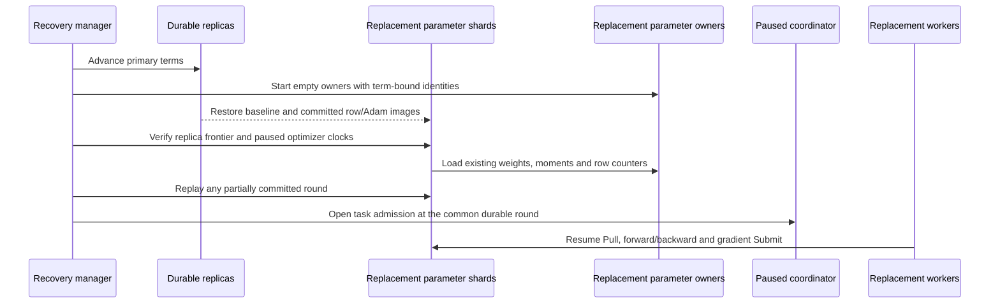

# Replica-backed parameter-owner recovery

The recovery manager restores replicated parameters into fresh parameter owners
and resumes the interrupted training run. It preserves each vector's weights,
both Adam moments and row update count, reconciles a partially committed round
with the original worker gradients, and restores worker input/task progress.



## Replace and reconcile

The manager stops former workers and their native-client children, primaries,
coordinator and parameter owners before replacing roles. Worker journals and
replica storage remain accessible. Each cached parameter shard uses one owner,
manual admission, one bound table and its original `replica_table_rows` cardinality.

After advancing a replica term, derive the owner's new namespace from its actual
grant:

```sh
PYTHONPATH=adapters/entropy python -c \
  'from training_recovery import owner_run; print(owner_run("job", 1, 0, 2, "replacement-0"))'
```

The identity hashes training run, partition epoch, home shard, primary term and
primary identity. Start `eps_cache_agent` with that identity as `--run`, and
the stable training run as `--training-run`. Its `--backend` selects `cuda` or
the Host backend used for local protocol checks. Put the same identity in the
primary's `agents[].owner_run`; set its replica configuration to `recover: true`
and `start_paused: true` under the newly granted term.

Use the [worker recovery job configuration](WORKER_RECOVERY.md) to plan the common
round, start the emitted paused coordinator, then reconcile:

```sh
python scripts/recover_training.py --config recovery-job.json --build build-cuda \
  --action plan --out recovery-plan.json
# Start the replacement coordinator with recovery-plan.json's coordinator config.
python scripts/recover_training.py --config recovery-job.json --build build-cuda \
  --action reconcile --out recovery-ready.json
```

Reconciliation locks the worker journals, validates the input/model identity and
all replica grants, then pauses gradient collectors. For each cached shard it
checks same-run replica restore provenance, the live replica term/frontier,
table/cardinality, paused optimizer clocks and the live owner namespace. It
migrates only existing rows. Missing rows fail without being initialized.
Complete resident row counts and unchanged replica/optimizer frontiers are
checked before any retained gradients are submitted.

The ready result includes `owner_rehydration` records and new `parameter_owners`.
Every emitted worker configuration selects those new owners. Collectors are
resumed for original-gradient reconciliation, while task admission remains
paused. After `ready: true`, resume the coordinator and launch the returned
workers at their recovered input positions.

## Continuing interrupted recovery

Replica after-images mark an ordinary restored snapshot non-pristine. The new
replica preparation mode verifies its live grant and optimizer frontier instead;
ordinary snapshot rehydration retains its existing pristine-snapshot requirement.

If preparation stops after only some owners load, repeat against the same
replacement processes. Existing rows on the selected owner are retained and
the missing placements are loaded. Repeating successful reconciliation neither
reinitializes parameters nor applies another optimizer step. If gradient replay
fails with a partially collected or failed round, replace the primaries from
their durable replicas again before reconciliation; retained worker gradients
provide the original update contents.

Old owners must be terminated. A new namespace rejects delayed old requests at
the replacement endpoint; it does not revoke another owner that is still running
at a separate endpoint. Automatic remote role supervision and storage-loss
recovery remain separate implementation work.

## Verification

The two-owner Host test runs actual TensorFlow model training and kills all old
roles at three points: a live read ticket, a partially committed round, and a
parameter update whose task completion was lost. It replaces owner processes at
the same endpoints and restores all 64 rows. Full weights/moments/counters and
every worker loss match uninterrupted training exactly. An intermediate check
loads one owner, checks that no optimizer state changed, then lets reconciliation
continue that partially loaded topology. Invalid owner identities, live replica
terms and table cardinalities reject before training resumes.

```sh
python tests/tensorflow_worker_recovery.py --build build/tensorflow --owners host
python tests/tensorflow_worker_recovery.py --build build-cuda --owners cuda --devices 0
```

CUDA mode additionally checks GPU model tensor placement and records physical
GPU identities. Its execution awaits available rental inventory; the Host
verification establishes the process/protocol path. Beyond-single-GPU capacity
and complete original Entropy execution remain in overall project acceptance.

[Validation record](validation/2026-11-04-replica-owner-recovery.json) includes the
full model trajectories, role/owner preparation records, source/binary hashes
and regression logs.
