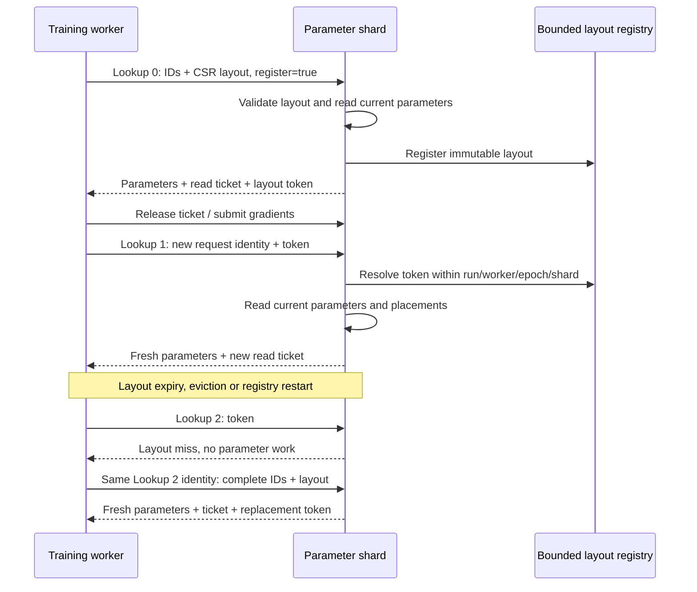

# Reusable sparse lookup metadata

Repeated parameter reads can reuse an ID list without reusing parameter values.
The first successful Lookup registers the complete feature layout with its
parameter shard. Later Lookups send a small opaque token and their normal
request identity. The shard resolves the layout and performs a fresh parameter
read through the existing actor, ownership and ticket paths.



## Layout identity and lifetime

The exact cache identity includes feature order, table and feature IDs, pooling
mode, ID occurrences, offsets and original valid lengths. Repeated IDs and bag
boundaries remain intact. Tokens are scoped by run, learner, parameter shard
and partition epoch. Each connection has its own client registry; server tokens
also contain a process-specific namespace. A token from another existing scope
rejects rather than reading a different worker's layout.

The cache holds metadata only. It does not retain parameter values, optimizer
state, row locations, read tickets, model results or gradients. Row migration
therefore continues to resolve the current parameter owner on every Lookup.

Both sides enforce entry count, charged metadata bytes and idle TTL with LRU
eviction. The conservative byte charge includes immutable vectors, exact-key
copies, token/scope strings and container overhead; it is not a process RSS
measurement. An in-flight shared layout remains valid through eviction. Server
registration happens only after the parameter request succeeds. Registration
rejection leaves the read result and its ticket usable.

A cache miss is an explicit successful metadata response with no read ticket or
parameter work. The asynchronous client invalidates the local token and sends
the complete layout once using the original request identity. It preserves the
existing request deduplication and total call deadline. Other errors, including
scope mismatches and transport failures, retain their normal error behavior.
A lost network connection must reconnect before the metadata fallback can run.

Clients still compute an exact content key and prepare the complete layout for
possible fallback. This choice reduces repeated cross-node metadata transfer
while retaining a simple comparison and retry path; it does not eliminate local
input preparation or all serialization. TTL and LRU bound memory when inputs
change frequently. Reusing one layout across many reads amortizes registration;
one-off layouts add registration work without a recurring byte saving.

## Configuration

C++ parameter clients opt in before training:

```cpp
BrpcParameterService shard(endpoint);
shard.SetLookupLayoutCache(true);
auto reply = shard.Lookup(request);  // Same read/release/update lifecycle.
const auto transport = shard.LookupTransport();
```

The constructor's optional `LookupLayoutCacheOptions` sets client entry count,
byte limit and TTL. Existing clients default to full requests. An old server
that returns no token continues receiving full requests.

The server uses a 4,096-entry, 64 MiB charged-metadata budget and 60-second idle
TTL by default. Its JSON configuration can change those limits:

```json
{"lookup_layout_cache": {"entries": 4096, "bytes": 67108864, "idle_ttl_ms": 60000}}
```

Set `entries` or `bytes` to zero to decline server registrations. The isolated
Python client exposes `lookup_layout_cache(enabled)` and
`lookup_transport_stats()`. The TensorFlow model worker enables it by default;
`reuse_lookup_layouts: false` selects the full-request ablation.

This path reuses Worker-to-parameter-shard Lookup layouts. Sparse gradient IDs,
remote Agent layouts, parameter responses and local Python IPC are separate
communication paths.

## Verification and measurements

```sh
ctest --test-dir build --output-on-failure -R '^reusable_lookup_layout_(cache|rpc)$'
ctest --test-dir build --output-on-failure -R '^tensorflow_reusable_lookup_layouts$'
```

The CPU training ablation uses two workers and two Host-backed parameter owners,
a 512-row, 8-dimensional table, 16 local samples per worker, 64 ID occurrences
per sample and eight training rounds. The runs compare all 503 touched rows'
weights, both Adam moments, update counts, loss and training progress. Cached
and uncached state/loss differences are zero. Each run also retains the existing
single-worker/global-batch numerical reference and its original tolerance.

Across the 32 Worker-to-shard Lookups, caching sends four full requests and
28 token requests. Lookup request payload bytes decrease by approximately
86%. The counters sum the actual serialized request protobuf and attachment
sizes for application-level sends. They exclude RPC framing, responses,
BRPC-internal retransmissions, gradients and Agent traffic. They establish a
metadata byte reduction for this repeated-input workload, rather than a
complete-network or training-speed result.

`request_bytes` counts all application sends, including a metadata miss and
its full fallback. `avoided_request_bytes` compares each successfully decoded
token request with its hypothetical full registration form; the paired-run
byte reduction above is calculated directly from `request_bytes`.

Core checks cover exact layout identity, scope boundaries, LRU/TTL/byte limits,
held views and concurrent access. RPC checks verify fresh weights after an
update, one fallback after a volatile registry restart, independent read tickets,
server expiry/eviction, incompatible scopes and peers without token support.
The registry core is checked under ASan/UBSan and TSan. The [canonical validation
record](validation/2026-11-04-reusable-lookup-layouts.json) includes reports,
source hashes and executed/rejected points.
