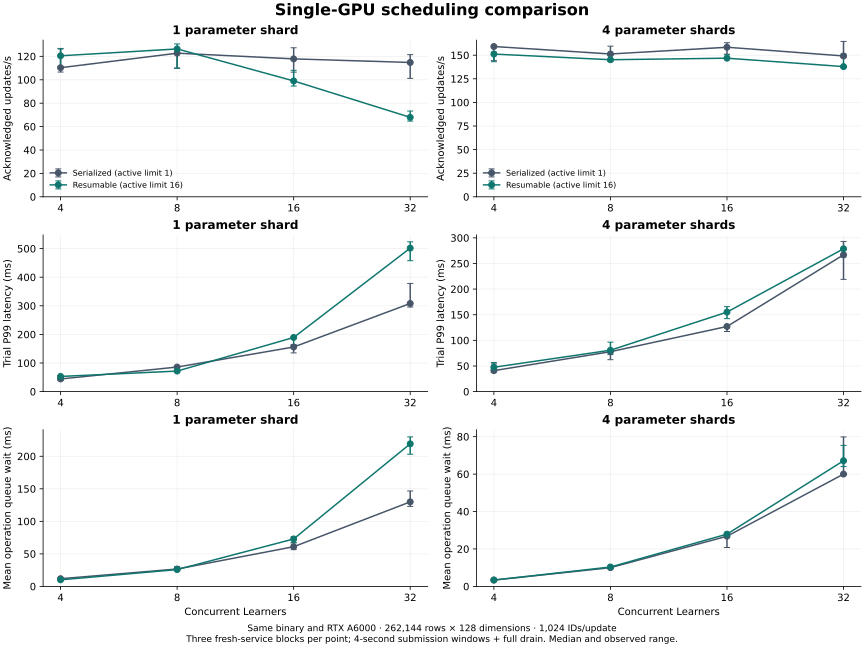

# Resumable shard scheduling: measurements

October 31, 2026 · Runtime source `0661e52` · one RTX A6000 · same-binary controls

Caching queued dependency plans reduces repeated scheduling work. At one parameter
shard and 32 Learners, the cache-on/off control raises median acknowledged update
throughput from **67.69 to 94.50 updates/s**
and reduces dependency-preparation wall time per completed update from
**10.28 to 0.82 ms**.
Resumable execution also permits independent work during owner waits, with
workload-dependent throughput and tail-latency results below.

The latest deployment retains **70 completed capacity trials and 25,990 updates**:
64 main-matrix trials / 23,407 updates, plus six cache-ablation trials / 2,583
updates. All report zero training-update errors and complete their sampled
counter, finite-state and live-ticket checks. Fixed-trace replay is counted
separately. These are parameter-service steps; dense-model computation is outside
the timed capacity workload.



## Manual-placement scheduling control

Both configurations enable dependency caching and use the same binaries.
`max_active_operations=1` is the serialized scheduling control; `16` enables
independent operations during external waits. Each point has three fresh-service
blocks with four-second submission windows followed by full drain. The active-limit
order alternates across blocks, as does the parameter-shard-count order.
Entries are medians; the figure and raw summaries retain observed ranges.

| PS shards | Learners | Serialized updates/s | Resumable updates/s | Throughput change | Serialized trial P99 (ms) | Resumable trial P99 (ms) |
| --- | --- | --- | --- | --- | --- | --- |
| 1 | 4 | 88.12 | 95.46 | +8.3% | 51.20 | 49.50 |
| 1 | 8 | 95.83 | 102.86 | +7.3% | 102.85 | 88.25 |
| 1 | 16 | 89.32 | 98.78 | +10.6% | 189.51 | 187.61 |
| 1 | 32 | 87.21 | 91.84 | +5.3% | 386.92 | 370.75 |
| 4 | 4 | 107.15 | 101.77 | -5.0% | 47.26 | 47.45 |
| 4 | 8 | 92.43 | 101.62 | +9.9% | 100.53 | 99.65 |
| 4 | 16 | 106.05 | 109.95 | +3.7% | 173.29 | 175.60 |
| 4 | 32 | 106.68 | 103.89 | -2.6% | 338.64 | 354.36 |

With one shard, resumable execution improves median throughput by 5.3–10.6% in
these four measured loads. With four shards, eight Learners improves by 9.9%,
while four and 32 Learners are slower. Same-table optimizer clocks and conflicting
rows remain ordered; freeing the actor does not make those updates independent.
The capacity study does not establish a universal concurrency setting.

## Isolate dependency-plan caching

This control holds one shard, 32 Learners and active limit 16 fixed. Cache-off
and cache-on run in alternating order across three fresh-service blocks per mode,
with five-second submission windows and full drain. Row, optimizer and agent
semantics remain identical. Both modes use the same resource-comparison order.

| Metric, median trial value | Cache off | Cache on |
| --- | ---: | ---: |
| Acknowledged updates/s | 67.69 | 94.50 |
| Trial P99 (ms) | 708.21 | 396.30 |
| Dependency preparation per completed update (ms) | 10.281 | 0.817 |
| Dependency-plan builds per completed update | 32.24 | 2.00 |
| Plan-cache hits per completed update | 0.00 | 30.75 |

The preparation counter measures key collection and normalization on the actor;
it excludes device waiting and conflict comparison. Cache-on reduces this
per-update wall-time measure by 92.1%,
raises throughput by 39.6% and lowers trial P99 by
44.0% at this operating point. Retained queued/active plans share a 64 MiB
budget per shard. Ownership/policy changes invalidate queued plans; incomplete
Push plans remain uncached. The [implementation guide](RESUMABLE_OPERATIONS.md)
describes memory pressure, lifecycle ordering and barrier upgrades.

## Automatic-placement controls

Four parameter shards run frequency and reuse-cost admission. Each point has
two three-second windows. Both active-limit configurations retain the same
16-completion decision window, bounded history, migration budget, slot reserve
and zero saved-access prior used by the script.

| Mode | Learners | Serialized updates/s | Resumable updates/s | Serialized trial P99 (ms) | Resumable trial P99 (ms) |
| --- | --- | --- | --- | --- | --- |
| frequency | 8 | 84.84 | 76.82 | 160.76 | 175.32 |
| frequency | 16 | 81.85 | 87.90 | 229.99 | 205.52 |
| reuse_cost | 8 | 71.84 | 67.20 | 173.03 | 327.35 |
| reuse_cost | 16 | 81.44 | 59.92 | 239.97 | 798.12 |

Automatic-policy completions share an ordered maintenance resource; a decision
window drains other active operations before upgrading to a full barrier.
Concurrent reads can therefore add live-ticket/observation work before a window.
These controls retain both throughput and tail-latency regressions. The measured
reuse-cost case at 16 Learners falls by 26.4% and its median trial P99 grows by
3.33×. A serialized scheduling configuration remains useful for such workloads.
All four automatic controls report zero maintenance failures. Frequency mode
admits 7 rows in the serialized control and 10 in the resumable control; reuse-cost
mode performs no migrations under the zero prior. Whole-probe policy counters,
including setup/warmup, are retained beside the raw records. The zero admission-savings prior is a workload control, not a tuned
positive-benefit policy claim.

## Workload, execution and numerical validation

The main workload has 262,144 possible rows, 128 FP32 dimensions, 1,024 ID
occurrences per step, mean-pooling bags of 32 and 131,072 initially resident rows.
95% of generated IDs come from the initial resident half and 5% from the entire
table. Every configuration starts fresh processes. Load levels within a probe
continue its optimizer state; setup, initial admission, preflight and warmup are
outside timing. Throughput includes full drain. Step latency begins after ID
preparation and ends after the sparse-update acknowledgement. P99 values are
medians of trial-level P99s.

The host is **Intel(R) Xeon(R) CPU E5-2699 v4 @ 2.20GHz**, with six affinity-visible
CPUs, a cgroup CPU quota of 5.94 cores (`594000 / 100000`)
and 48 GiB of allocated memory.
The GPU is RTX A6000 48 GB, compute capability 8.6, driver 610.43.02. Software is
Ubuntu 22.04, GNU C++ 11.4.0, BRPC 1.18.0 and CUDA compiler 13.0.88, architecture
86, with `--fmad=false`. One coordinator hosts PS processes, client and agent;
BRPC uses loopback. This isolates scheduling and is separate from the earlier
SSH-forwarded four-GPU scaling deployment.

Current local native/RPC/TensorFlow checks pass **26/26**, ASan/UBSan **13/13** and
focused TSan **5/5**. Ubuntu CPU/CUDA checks pass **22/22**, the complete
CPU/CUDA/TensorFlow suite **29/29**, and forced-CUDA process/graph checks **5/5**.
The CUDA delay-injection case covers independent read progress, original Adam
order, row/agent exclusion through migration, queued-plan invalidation, save,
retry and failure fencing.

A separate small fixed trace completes six runs / 14 phase records / 112 updates.
Every touched row's weights, Adam moments and update counter match CPU replay
exactly; maximum state error is zero and feature error is 9.31e-10. One nonfatal
cache-maintenance failure is retained; training-update errors remain zero.
The load trials check 2,240 sampled row-update counters, finite state and ticket
cleanup. All artifacts were fetched and hash-verified before rental deletion.

## Earlier implementation and provenance

The initial resumable revision `c52f516` rebuilt dependency plans on repeated
queue scans. Its separate E5-2683 v4 deployment completed 64 trials / 30,696 updates,
with zero training-update errors. At one shard / 32 Learners, the resumable rate
was 67.89 versus 114.78 updates/s for its serialized control. That negative result
motivated bounded plan caching and early optimizer/agent conflict checks.


The two deployments use different CPU models and retain separate source/binary
hashes. Their absolute rates are not a paired cache-speedup comparison. The
same-binary cache-on/off experiment above isolates caching on the latest host.
The initial GCC 11 braced-aggregate coroutine failure was fixed before the initial
capacity trials; its corrected source and the latest source both pass the native
CUDA lifecycle checks.

- [Latest manifest and raw records](benchmarks/2026-10-31-cached-scheduling/manifest.json)
- [Latest aggregate summary](benchmarks/2026-10-31-cached-scheduling/summary.json)
- [Cache-ablation manifest](benchmarks/2026-10-31-cached-scheduling/cache-ablation-manifest.json)
- [Source-hashed validation and cleanup](validation/2026-10-31-cached-shards.json)
- [Initial matrix and negative results](benchmarks/2026-10-31-resumable-scheduling/manifest.json)

## Reproduce

```sh
python3 scripts/capacity_sweep.py --build build/cuda --out results/serial \
  --ps-shards 4 --max-active-operations 1 --dependency-cache on \
  --learners 4,8,16,32 --seconds 4 --repeats 3
python3 scripts/capacity_sweep.py --build build/cuda --out results/resumable \
  --ps-shards 4 --max-active-operations 16 --dependency-cache on \
  --learners 4,8,16,32 --seconds 4 --repeats 3
python3 scripts/capacity_sweep.py --build build/cuda --out results/cache-off \
  --ps-shards 1 --max-active-operations 16 --dependency-cache off \
  --learners 32 --seconds 5 --repeats 3
```

For the published block design, invoke one repeat per fresh-service block and
alternate mode order. [Build and deployment instructions](RUNNING.md).
