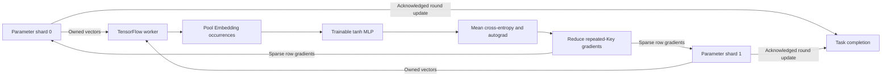

# Sharded Embedding and MLP training

The executable worker trains an Embedding table and a two-layer tanh MLP through
the parameter service. Workers own disjoint examples, compute local mean binary
cross-entropy gradients and submit them to their parameter owners. The shard's
sample-weighted reduction produces one Adam update for the global batch.



## One shared model

All trainable state lives in the parameter service, including the MLP matrix and
biases. The small MLP parameters are packed into ordinary fixed-width rows at
the start of the same table; Embedding IDs occupy the remaining rows. This
reuses the existing ownership, transport, GPU storage and optimizer path, and
avoids a separate dense-parameter server for this model. Unused tail elements
have zero gradients. Each iteration reconstructs TensorFlow tensors from the
current pulled rows; workers do not maintain private optimizer copies.

Two sequence features carry Embedding occurrences and packed MLP rows. A
TensorFlow `GradientTape` differentiates the actual loss with respect to both.
Repeated Embedding IDs are summed into unique row gradients before transport.
The example uses host staging between remote RPC results and TensorFlow device
tensors. Model forward/backward execute on the requested device; host staging
and local row reduction remain part of this execution path.

GPU mode checks the actual device of model inputs, loss and both gradient
tensors. Soft placement is disabled and TF32 is disabled for the FP32 correctness
reference. TensorFlow's device allocator current/peak usage is recorded
separately from parameter-owner allocations.

The native BRPC client runs in the existing isolated IPC process. Its new
`configure_training`, `begin_training`, `submit_synchronous`, `complete_training`
and `abort_training` calls keep training and parameter completion on the same
run/epoch/worker identities. Synchronous submission sends all shard contributions
before waiting, including empty ones, and drains every acknowledgement future
before reporting an error. Model errors abort the group and close the native
client process.

## Full-table preparation

`eps_training_prepare` initializes each configured row through the parameter
service, releases its read ticket and migrates it to the assigned owner. It
checks every migration reply and the final shard row/resident counts. The
report includes initialized rows, resident logical state bytes, CPU state bytes,
remaining owner slots and preparation time. This distinguishes actual loaded
rows from unused preallocated device capacity.

Each shard can be prepared locally using `only_shard`; the topology still lists
all shards so Key ownership is unchanged. Preparation reserves learner 1022,
so runs using this utility support worker IDs 0 through 1021. It is a fresh-run
initialization utility; coordinated checkpoint restart follows the job's restore
protocol.

## Reference and executed checks

`tests/tensorflow_synchronous_training.py` trains a single-worker/global-batch
reference and a multi-worker/sharded case from the same seeded parameter rows.
It compares the first aggregated gradient and final weights/Adam moments,
checks exact row update counts, complete task progress, drained tickets and
decreased weighted loss. CPU mode uses Host owners through the real migration
and owner-update RPC path. CUDA mode uses CUDA owners and GPU model workers.

The default test checks every touched row. Larger batches sample final touched
rows within the inspection transport budget and report that scope explicitly;
their first-gradient comparison still covers all touched rows. Optional
`--samples-per-worker` and `--bag-size` draw ID bags across the full table range.

```sh
ctest --test-dir build/tensorflow -V -R '^tensorflow_synchronous_model_cpu$'

# On a CUDA/TensorFlow build with a visible NVIDIA GPU:
ctest --test-dir build-cuda -V -R '^tensorflow_synchronous_model_cuda$'

python tests/tensorflow_synchronous_training.py --build build-cuda --devices 0 \
  --rows 16384 --dimension 64 --hidden 8 --iterations 8 \
  --samples-per-worker 8 --bag-size 8 --out results/model-reference.json
```

These model/reference checks establish the training path. The separate
[multi-GPU capacity acceptance](plans/2026-11-04-multi-gpu-training-capacity.md)
requires actually resident global state above one GPU's physical memory and
distributed host-memory placement. Full original Entropy execution and durable
round/replica recovery remain in the overarching project scope.

## Execution record — November 4, 2026

The small CPU and A6000 cases each train eight global rounds with two workers;
the model inputs, loss and both parameter gradients report GPU placement in the
CUDA case. A 16,384-row, 64-dimensional table is then fully initialized and
loaded on the CUDA owner before training on scattered ID bags. All 137 touched
rows' weights and Adam moments are compared with the single-worker reference.

| Case | Maximum parameter/moment error | First global-gradient error | Initial / final weighted loss |
| --- | --- | --- | --- |
| 64 rows × 8 dimensions, GPU | 2.98e-8 | 1.49e-8 | 0.693386 / 0.603282 |
| 16,384 rows × 64 dimensions, CPU | 9.09e-7 | 7.45e-9 | 0.695597 / 0.275646 |
| 16,384 rows × 64 dimensions, GPU | 4.14e-6 | 2.24e-8 | 0.695597 / 0.275646 |

The local 51-check framework suite passes. On the GPU host, 53 checks pass and
four original-source checks skip because private references are not deployed.
The GPU lease is deleted and verified absent after result and runtime-cache
download. [Canonical reports, hashes and logs](validation/2026-11-04-tensorflow-sharded-training.json).
