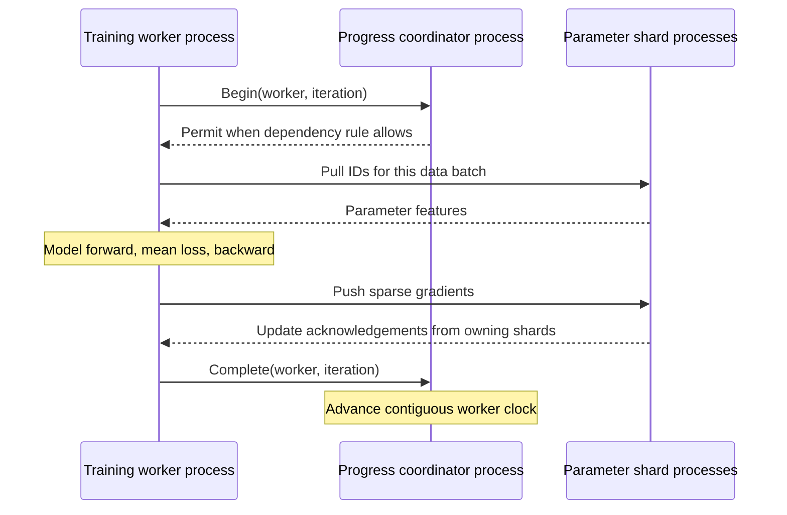

# Distributed training execution

Workers train one shared model: each worker reads its data partition, pulls the
sparse parameters it needs, computes model gradients and pushes updates to the
owning parameter shards. Training-task progress decides when the next iteration
may start. Parameter ownership, update completion and recovery must agree with
that progress.

## Training responsibilities

| Component | Responsibility |
| --- | --- |
| Training worker | Own data/input position, forward/backward, gradient scaling and task completion |
| Parameter shard | Own parameter rows and optimizer state; apply the configured aggregation/update algorithm |
| Training progress controller | Admit tasks according to inter-worker dependencies and retain completed worker clocks |
| Server manager | Track membership, partition ownership and fenced failover |
| Replicas/checkpoint storage | Preserve committed parameter state and update progress for recovery |

The design reference is Duke CPS 512 Lecture 16, *Distributed Machine Learning:
The Parameter Server*, supplied as `16-parameter-server.pdf`. Slides 11-14 cover
roles and sparse communication; 15-22 cover training dependencies and logical
progress; 24-26 cover replication and recovery; 20 and 27-30 motivate comparison
at a common training-quality target.

## Implemented task-progress core

[`TrainingProgressController`](../include/eps/training_progress.hpp) supports a
fixed group of up to 1,024 worker identities. Worker `w` with completed count
`c[w]` has finished iterations `[0,c[w])`. The global completion floor is the
minimum of these counts.

| Policy | Admission for iteration `t` |
| --- | --- |
| Sequential | All iterations before `t` are globally complete |
| Eventual | No finite inter-worker delay bound |
| Bounded delay `tau` | All iterations `j < t - tau` are globally complete |

For slide 18's `tau=1`, iterations 0 and 1 need no completed earlier iteration;
iteration 2 waits for iteration 0, and iteration 3 waits for 0 and 1. Completed
counts use a different offset from iteration indices: a paused/drained group
can have counts differing by at most `tau+1`. Restore validates this invariant.

Admission returns a shared future. Duplicate requests for one in-flight task
share that result, with at most one active/waiting request per worker. Completing
an unadmitted iteration rejects; duplicate completion leaves clocks unchanged.
Run/epoch checks reject old-job identities. Permit metadata records the exact
completion floor observed when admitted.

The executor advances the clock after its parameter update acknowledgements.
The core controls task dependencies; gradient aggregation, optimizer-step
semantics and dense collectives are configured in the training path. In
particular, admitting several workers in one round does not itself average their
gradients into a single optimizer update. A task clock also does not identify an
atomic cross-shard parameter snapshot.

Pause rejects new work, releases waiting callers and lets admitted tasks drain.
A progress checkpoint can be exported only after this drain. Restore requires a
fresh run and matching group/policy, and keeps admission paused until the job
controller finishes matching parameter/input restoration. Abort is terminal and
wakes waiting callers; the training executor still owns cleanup of parameter
handles and any device work already submitted.

## RPC coordinator and worker execution

`eps_training_coordinator` runs the progress controller as a separate BRPC
service. Workers use `BrpcTrainingProgress` to obtain a permit and report the
completed task. Run/epoch checks also cover administrative calls, so an old job
cannot pause, resume or abort a new one.



Waiting Begin calls use one completion loop and a bounded pending-RPC list.
Complete and Stats do not use that waiting list or the parameter-service
completion pool. At capacity, the controller rejects admissions that would
need a new wait slot without registering a task. Immediately eligible work
still runs: the slow worker must be able to finish the task that unblocks the
waiting workers. Completion/abort/pause signals wake the loop; a 10 ms fallback
poll also retires disconnected requests. Retrying Begin uses the same task
identity and existing permit rather than allocating another task.

Shutdown fails waiting admissions before the BRPC server joins outstanding
calls. Pause releases dependency waiters and allows already-admitted tasks to
drain. `eps_training_control` provides stats, inspect, pause, checkpoint, resume
and abort operations. A restored coordinator starts paused with its saved
completed counts. Its progress-only checkpoint does not by itself restore
parameter files or input cursors.

`eps_training_worker` is an executable sparse-logistic training path, configured
with a worker identity, its local examples, parameter endpoints and coordinator.
The worker pools ID-selected scalar parameters, computes a binary logistic loss
and submits gradients. The loss reduction is the local batch mean; each worker
Push advances LazyAdam once on each owning shard. The three admission policies
use this same update algorithm. Sequential task admission does not combine
the workers' gradients into one averaged optimizer step.

The worker waits for all Push acknowledgements before Complete. On a training
error it aborts the job so dependency waiters wake. A failure after some shards
apply an update can leave a partial task; coordinated rollback/replay requires
the replication, range-progress and ownership-fencing work listed below.

## Executed verification

The C++ checks cover the exact bounded-delay boundary, sequential/zero-delay
equivalence, unlimited eventual progress, duplicate completion, malformed task
identities, pause/drain, fresh-run restore, invalid clock snapshots and abort.
Eight concurrent threads each complete 80 iterations under every policy,
including an intentionally slower worker.

A controlled sparse-logistic-loss check connects four worker threads to two
in-process parameter-service actors. Every worker computes actual gradients
from pulled features and waits for its LazyAdam Push acknowledgement before
completing the training task. Each policy completes 160 worker updates, reduces
the controlled loss, verifies all five touched rows' update counts/finite
optimizer state and drains lookup tickets. This is a correctness workload with
equal per-worker task counts. It is not a common-quality benchmark or a
multi-process/GPU training result.

```sh
cmake --build build/native --target eps_training_progress_tests -j 4
ctest --test-dir build/native -V -R '^training_progress_consistency$'
```

The same target runs under the existing ASan/UBSan and TSan core builds.
[Verified records, source hashes and logs](validation/2026-11-04-training-progress.json).

The RPC check saturates 16 waiting-call slots with duplicate admissions while
64 additional calls receive capacity errors. Stats, the slow worker's Begin
and completion still proceed. It also checks stale control identities,
duplicate completion, pause/checkpoint/resume, terminal abort, a timed-out Begin
followed by retry and shutdown with a waiting caller.

The process test launches four worker processes, two parameter-server processes
and a coordinator. Each policy completes 160 acknowledged worker updates with
the same local-mean-gradient/per-worker-LazyAdam algorithm and a controlled slow
worker. It checks actual row-update counts, finite weights/moments, zero live
tickets, policy bounds and reduced loss. The final progress checkpoint is loaded
by a fresh coordinator, verified paused and explicitly resumed. This restore
check covers coordinator clocks; parameter/input restoration is separate.

```sh
cmake --build build/native --target eps_server eps_training_coordinator \
  eps_training_worker eps_training_control eps_training_rpc_tests -j 4
ctest --test-dir build/native -V \
  -R '^(training_progress_rpc|distributed_training_processes)$'
```

[RPC/process evidence](validation/2026-11-04-training-rpc.json).

## Work remaining for complete training acceptance

1. Integrate RPC task progress with the original training executor and its joint
   parameter/input checkpoint; add durable replay and worker replacement.
2. Define and implement synchronous gradient aggregation/normalization and
   optimizer-step boundaries, alongside asynchronous update policies. Reuse
   repeated key-list metadata with bounded, epoch-checked handles.
3. Persist per-range logical update progress; replicate before acknowledgement
   and fence shard/worker replacement. Exercise lost replies and process failure.
4. Replace the private Redis SDK through the retained interfaces and execute
   the complete original Entropy training/control path.
5. Compare time to the same quality target under controlled stragglers,
   communication load and failures. Retain waiting time, bytes, staleness,
   convergence and recovery measurements.

Comparisons across dependency policies must retain the same update algorithm,
gradient normalization and optimizer-step unit. A round-averaged update and
per-worker updates have separate aggregation semantics and reference checks.

[Implementation design](plans/2026-11-04-distributed-training-design.md)
