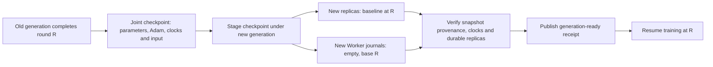

# Replica and Worker-journal generation rollover

A committed joint training checkpoint becomes the starting baseline of a fresh
training generation. Parameter replicas retain the full saved model and
subsequent after-images; Worker journals begin at the same saved round. The
controller checks the replacement generation with task admission paused, then
the existing `resume-job` operation opens training.



## Why use a checkpoint boundary

An update after-image depends on the preceding full replica baseline. Retained
original gradients can be needed to reconcile a round that reached only some
shards. Advancing all baselines at a quiescent, committed joint checkpoint gives
the replacement generation one shared starting point. Weights, Adam moments and
clocks are saved together; input cursors identify the next batch. No partially
committed round crosses this boundary.

Rollover pauses training and starts fresh service/Worker processes. That
checkpoint-and-restart cost buys a simple generation commit and a shorter
recovery replay window. Metadata tokens and request streams start in the new
run namespace; optimizer and input progress continue from the saved round.

## Prepare replacement roles

[`rotate_training_checkpoint.py`](../scripts/rotate_training_checkpoint.py)
accepts a private job description. The existing role manager owns placement and
process lifecycle.

The planner currently consumes the journaled Embedding/MLP Worker's single-table
joint-checkpoint format. The original Entropy controller retains its own
checkpoint integration path.

| Job field | Meaning |
| --- | --- |
| `manifest` | Committed joint checkpoint manifest |
| `run` | Fresh replacement training-run identity |
| `end_round` | Final round; replacement iterations equal `end_round - checkpoint_round` |
| `workers` | Ordered original Worker configs, including table/model/input and journal identity |
| `shards` | Ordered original primary configs, preserving capacity and update settings |
| `coordinator_endpoint`, optional `coordinator_listen` | Client route and node-local listener |
| `routes[i]` | New primary/replica endpoints, optional distinct listeners and parameter-owner descriptors |
| optional `worker_routes[i]` | Replacement gradient-mirror endpoint/generation/writer and optional distinct listener |

Each shard route supplies `primary_endpoint` and `replica_endpoint`.
`primary_listen` and `replica_listen` default to those routes. Cached shards
require explicit replacement `agents`; their deployment stays with the role
manager. An agent shared by several shards must have the same descriptor
everywhere. Mirrored source Workers require replacement `journal_mirror`
routes, preserving original-gradient durability; `journal_mirror_listen` can
specify a distinct node-local listener.

```sh
python scripts/rotate_training_checkpoint.py --build build/tensorflow \
  --action prepare --config private/rollover-job.json \
  --destination private/generation-2
```

Prepare validates the checkpoint through the C++ controller and checks source
membership, model, optimizer/reduction settings and exact input identity. It
stages checkpoint files under the new directory, using immutable hard links on
the same filesystem or bounded streaming copies across filesystems, and
revalidates every staged file. The planner does not load full parameter arrays.

The directory contains `plan.json`, role configs and empty Worker journals.
Replica configs set `replica_base_round` to the checkpoint round; Workers set
the same `journal_base_round` and restore their actual input cursor. Primary
terms start at one in the fresh run namespace. Starting the replica, granting
its configured primary term and starting the primary loads the snapshot and
publishes its durable baseline.

Prepare is idempotent for the same intent. An existing staged plan can be
reopened even after the original checkpoint pathname disappears. The replacement
checkpoint has its own directory entries.

## Verify before admission

After the role manager starts the replacement replicas, primaries, coordinator,
parameter owners and any gradient mirrors, run:

```sh
python scripts/rotate_training_checkpoint.py --build build/tensorflow \
  --action verify --config private/generation-2/plan.json
```

Verification holds each new Worker journal's exclusive lock and requires an
empty journal at the saved base round. Live replica heads must contain the
correct durable baseline, primary grant and round. Gradient mirrors validate
the new writer/model identity and report the same empty frontier.

The C++ `verify-job` action validates the paused coordinator, gradient groups and
each shard's pristine snapshot provenance against the joint manifest. Admission
stays paused. The planner fsyncs and immutably publishes `ready.json`, binding
these checks to the exact plan hash. The manager can then call
`eps_training_control --action resume-job` with the staged manifest and new
endpoints, and start model Workers.

Repeated verification before training returns the same receipt. An active
journal, changed plan, incompatible baseline or already-advanced journal rejects
readiness. A running generation cannot acquire a new fresh-baseline receipt.

## Model verification

`tensorflow_replicated_checkpoint_rollover` executes two BRPC primaries, two
disk-backed replicas, two parameter owners, two gradient mirrors, two TensorFlow
Workers and a coordinator. It compares uninterrupted eight-round Embedding/MLP
training with four rounds, a joint save and four resumed rounds. Inputs cycle
through three batches, so the checkpoint is not an input-cycle boundary.

The fixture stages the new generation and removes the original checkpoint route
before starting it. Readiness checks real replica/mirror services, rejects a
held Worker journal and remains paused until resume. Every one of 32 rows'
weights, Adam moments and update counts matches uninterrupted training;
continued losses and final input cursors match too. New logs contain only
rounds `4, 5, 6, 7`, with base round `4`. The original corruption/input/clock
rejection cases remain, and readiness rejects after the new journals advance.
An injected failure before plan publication leaves an unpublished generation;
retry validates the staged state and finishes the same immutable plan.
Injected cross-device link errors exercise the bounded, fsynced streaming-copy
path for both shard snapshots before the source checkpoint route is removed.

[Source hashes, receipts, model state comparison and negative cases](validation/2026-11-04-training-checkpoint-rollover.json).

```sh
ctest --test-dir build/tensorflow --output-on-failure \
  -R '^(tensorflow_joint_training_checkpoint|tensorflow_replicated_checkpoint_rollover)$'
```

Current implementation prepares and validates replacement generations. Old
payload retirement, repeated rollover followed by a failure, and cross-node
cleanup remain in the
[implementation plan](plans/2026-11-04-replicated-checkpoint-rollover.md).
