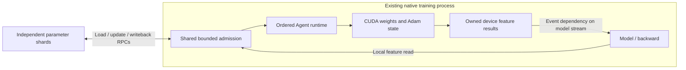

# In-process training-worker Agent

`WorkerCacheAgent` embeds the parameter cache in a native training process. The
parameter shards keep using the existing Agent RPC protocol; model code can read
owned device contributions directly, without a feature-result copy to host.



## Ownership and creation

Link `eps_brpc` and `eps_cuda` into the native worker, using one compatible
BRPC/Protobuf/CUDA toolchain. Create the owner before the training controller
registers its Agent endpoint with parameter shards:

```cpp
#include "eps/worker_cache_agent.hpp"
#include "eps/cuda_cache_backend.hpp"

eps::CudaCacheOptions cache;
cache.agent = 0;
cache.device = 0;
cache.state_bytes = 1ULL << 30;
cache.rows_per_table = 65536;

eps::WorkerCacheOptions options;
options.run = "training-run";
options.listen = "0.0.0.0:9200";
eps::WorkerCacheAgent worker(options,
    std::make_shared<eps::CudaCacheBackend>(cache));
// Publish the worker's reachable host:port in each PS agent configuration.
// A loopback default listener is appropriate for local PS processes only.
```

The standalone `eps_cache_agent` executable uses the same owner. Native embedding
adds no child process. The caller supplies the backend, so CPU protocol tests can
use `HostCacheBackend`; requesting device tensors from it returns an explicit
invalid-argument error.

## Native device reads

Use the `AgentWork` locations/maps from the live parameter lookup and their
matching `FeatureInput` layouts. `GatherDevice` returns a future containing
`DeviceTensorBlock` objects. Each block carries a feature ID, shape and shared
device allocation:

```cpp
auto result = worker.GatherDevice(work, layouts).get();
if (auto error = std::get_if<eps::Error>(&result)) {
    // Abort this lookup according to the training controller's policy.
    throw std::runtime_error(error->message);
}
auto blocks = std::get<std::vector<eps::DeviceTensorBlock>>(std::move(result));
for (const auto& block : blocks) {
    block.tensor->WaitOnStream(model_stream);
    const auto* features = static_cast<const float*>(block.tensor->data());
    // Launch the existing model's consumer on model_stream with features.
}
// Retain blocks until their model-side operations finish.
```

Device reads share the ordered runtime with updates, migration and eviction.
Generation validation remains in the CUDA backend. A returned contribution owns
an output allocation distinct from resident rows and reusable staging buffers.
Its content survives subsequent updates, slot reuse and Agent destruction.
Outstanding outputs consume the backend's configured output-byte budget until
their last owner releases them. `WaitOnStream` inserts the producer event into
the supplied stream; the existing gather implementation also finishes its
staging use before fulfilling its future. This interface makes no new overlap
or asynchronous-throughput claim.

These blocks are owner contributions. The distributed client/framework still
combines contributions across shards and applies global mean denominators.
The portable TensorFlow bridge continues to use host callbacks; this change
does not install a native TensorFlow GPU operation or replace its tensor ABI.

## Shared admission and shutdown

RPCs and direct native gathers use one Agent admission queue. The count limits
therefore apply to both sources together. Native requests charge retained vector
capacities and fixed object storage; RPCs charge their serialized envelope and
attachment. These counters bound charged input, rather than total process RSS.
An admission permit lives until the backend result has been placed in the native
future or encoded into the RPC reply. Device output has a separate lifetime and
budget. `Stats()` exposes the same queue counters without an RPC.

After the training framework closes input and completes its normal backward,
update and checkpoint barriers, call `Stop()` or destroy the owner. Stop:

1. Prevents new direct calls and closes the RPC listener.
2. Waits for accepted RPCs and local reads to complete.
3. Drains admission, then releases the ordered runtime and backend references.

Stop is idempotent. Subsequent direct calls return an unavailable error, and the
last admission statistics remain readable. External shared references can keep
the backend alive. Independently owned device results may outlive the worker.
Stop does not write back unsaved resident parameters or replace the training
controller's coordinated save. The controller must retain lookup tickets until
backward/update completes, or discard backward and complete device reads before
explicitly releasing a lookup.

## Verification

```sh
ctest --test-dir build/native -R in_process_worker_lifecycle --output-on-failure
ctest --test-dir build/cuda -R native_worker_cuda_stream --output-on-failure
```

The CPU protocol test combines real BRPC control with local reads, verifies shared
count and retained-input budgets, stops during a held read, checks backend release
and rebinds the same endpoint. The CUDA test consumes native features with a model
kernel on a nondefault stream, compares full selected optimizer rows with a Host
reference, checks output-budget reclamation and stale generations, and consumes
retained outputs again after worker/backend destruction. This is a native CUDA
consumer check; original model/application execution retains its own validation.
